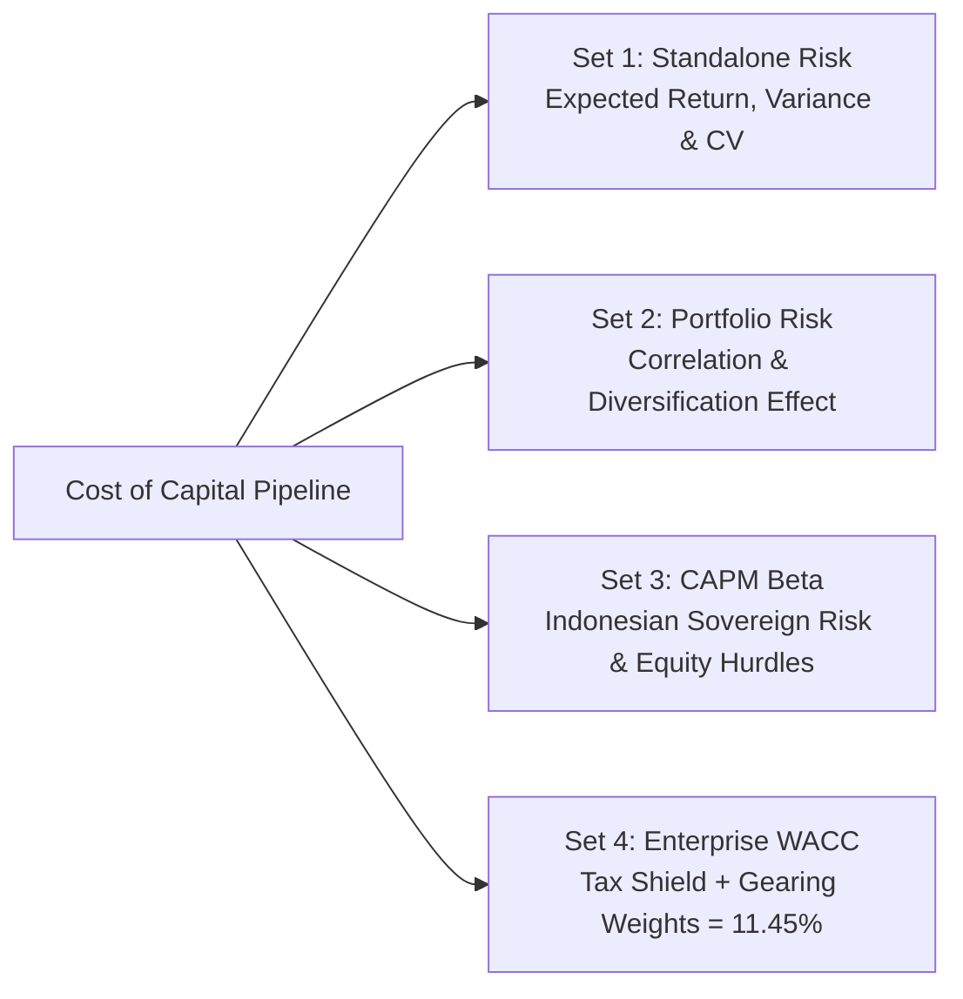
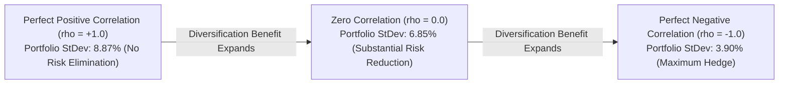
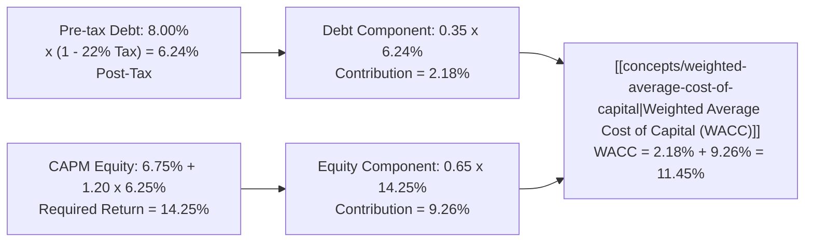

> [!NOTE] Cohort Attribution & Academic Scope
>
> - **Course:** MK2 Financial Management and Strategy — Week 08
> - **Analytical Contribution:** Synthesized from the core quantitative models of **`F9 (Class F / Syndicate 9)`**.
> - **Source Problem Sets:** P3MD MM5007 Week 8 Valuation & Cost of Capital Exercises.

## 1. Executive Summary & Problem Setup

The cost of capital establishes the minimum rate of return a corporate investment must yield to justify committing capital. The cohort worked through four integrated problem sets:

1. **Problem Set 1: Discrete Probability Risk & Return**: Sizing expected return ($\hat{r}$), variance ($\sigma^2$), standard deviation ($\sigma$), and coefficient of variation ($\text{CV}$).
2. **Problem Set 2: Portfolio Diversification & Correlation**: Modeling the reduction of portfolio variance across asset correlation regimes ($\rho = +1.0, 0.0, -1.0$).
3. **Problem Set 3: Asset Beta & CAPM Hurdle Rates**: Deriving equity return for cyclical commodity mining vs defensive consumer staples in Indonesia.
4. **Problem Set 4: Institutional WACC Assembly**: Building the enterprise hurdle rate for capital budgeting decisions.

---

## 2. Problem Set 1: Standalone Risk & Probability Distribution

Management is evaluating two alternative industrial projects under three macroeconomic states of the world:

| Economic State ($i$)      | Probability ($P_i$) | Project Alpha Return ($r_{\alpha}$) | Project Beta Return ($r_{\beta}$) |
| :------------------------ | :-----------------: | :---------------------------------: | :-------------------------------: |
| **Boom / High Growth**    |       $0.25$        |              $+28.0\%$              |             $+18.0\%$             |
| **Normal Growth**         |       $0.50$        |              $+12.0\%$              |             $+12.0\%$             |
| **Recession / Downcycle** |       $0.25$        |              $-8.0\%$               |             $+4.0\%$              |

### Step 1: Expected Rate of Return ($\hat{r}$)

$$\mathbf{\hat{r}_{\alpha} = (0.25 \times 0.28) + (0.50 \times 0.12) + (0.25 \times -0.08) = 0.07 + 0.06 - 0.02 = \mathbf{11.00\%}}$$

$$\mathbf{\hat{r}_{\beta} = (0.25 \times 0.18) + (0.50 \times 0.12) + (0.25 \times 0.04) = 0.045 + 0.06 + 0.01 = \mathbf{11.50\%}}$$

### Step 2: Variance ($\sigma^2$) and Standard Deviation ($\sigma$)

$$
\begin{aligned}
\mathbf{\sigma_{\alpha}^2} &= 0.25(0.28 - 0.11)^2 + 0.50(0.12 - 0.11)^2 + 0.25(-0.08 - 0.11)^2 \\
&= 0.25(0.0289) + 0.50(0.0001) + 0.25(0.0361) = 0.007225 + 0.00005 + 0.009025 = \mathbf{0.0163} \\
\mathbf{\sigma_{\alpha}} &= \sqrt{0.0163} = \mathbf{12.77\%}
\end{aligned}
$$

$$
\begin{aligned}
\mathbf{\sigma_{\beta}^2} &= 0.25(0.18 - 0.115)^2 + 0.50(0.12 - 0.115)^2 + 0.25(0.04 - 0.115)^2 \\
&= 0.25(0.004225) + 0.50(0.000025) + 0.25(0.005625) = 0.001056 + 0.000013 + 0.001406 = \mathbf{0.002475} \\
\mathbf{\sigma_{\beta}} &= \sqrt{0.002475} = \mathbf{4.97\%}
\end{aligned}
$$

### Step 3: Coefficient of Variation (CV)

$$\mathbf{\text{CV}_{\alpha}} = \frac{12.77\%}{11.00\%} = \mathbf{1.161} \qquad \mathbf{\text{CV}_{\beta}} = \frac{4.97\%}{11.50\%} = \mathbf{0.432}$$

**Diagnostic Conclusion**: While Project Alpha offers an expected return of $11.00\%$, its volatility ($\sigma = 12.77\%$) is nearly triple that of Project Beta ($\sigma = 4.97\%$). Project Beta offers higher expected return ($11.50\%$) with dramatically lower risk per unit of return ($\text{CV} = 0.432$ vs $1.161$), representing a far superior standalone investment.

---

## 3. Problem Set 2: Portfolio Risk & Diversification Mechanics

Combining two assets into a $50/50$ portfolio ($w_1 = 0.5, w_2 = 0.5$) demonstrates the mathematical power of diversification:

$$\mathbf{\sigma_p = \sqrt{w_1^2 \sigma_1^2 + w_2^2 \sigma_2^2 + 2 w_1 w_2 \rho_{1,2} \sigma_1 \sigma_2}}$$

- When correlation is **perfectly positive ($\rho = +1.0$)**: $\sigma_p = (0.5 \times 12.77\%) + (0.5 \times 4.97\%) = \mathbf{8.87\%}$ (weighted average, zero risk reduction).
- When correlation is **uncorrelated ($\rho = 0.0$)**: $\sigma_p = \sqrt{(0.25 \times 0.0163) + (0.25 \times 0.002475)} = \sqrt{0.004694} = \mathbf{6.85\%}$ (risk drops by 22.8%).
- When correlation is **perfectly negative ($\rho = -1.0$)**: $\sigma_p = |(0.5 \times 12.77\%) - (0.5 \times 4.97\%)| = \mathbf{3.90\%}$ (risk drops below the volatility of either individual asset).

---

## 4. Problem Set 3: Indonesian Capital Market Beta & Equity Returns (CAPM)

### Macroeconomic Parameters (Indonesian Capital Market)

- **Risk-Free Rate ($r_{\text{RF}}$)**: **$6.75\%$** (Yield on 10-year Republic of Indonesia Benchmark Government Bonds / SUN FR series).
- **Expected Return on Broad Market ($r_M$)**: **$13.00\%$** (Historical annualized IDX Composite / IHSG index return).
- **Market Risk Premium ($\text{MRP} = r_M - r_{\text{RF}}$)**: **$6.25\%$** ($13.00\% - 6.75\%$).

### Sectoral Asset Beta Comparison

$$\mathbf{r_s = r_{\text{RF}} + \beta_i \times (r_M - r_{\text{RF}})}$$

| Enterprise Sector                       | Asset Beta ($\beta_i$) | Required Equity Return ($r_s$) Calculation                                 | Strategic Hurdle Profile                                                      |
| :-------------------------------------- | :--------------------: | :------------------------------------------------------------------------- | :---------------------------------------------------------------------------- |
| **Defensive Consumer Goods** (Indofood) |   **$\beta = 0.75$**   | $r_s = 6.75\% + 0.75 \times (6.25\%) = 6.75\% + 4.69\% = \mathbf{11.44\%}$ | Low operational volatility; staple demand resilience dampens market shocks.   |
| **Cyclical Natural Resources** (PTBA)   |   **$\beta = 1.35$**   | $r_s = 6.75\% + 1.35 \times (6.25\%) = 6.75\% + 8.44\% = \mathbf{15.19\%}$ | High operating and commodity leverage; sensitive to global industrial cycles. |

---

## 5. Problem Set 4: Comprehensive Institutional WACC Assembly

An Indonesian enterprise is establishing its corporate hurdle rate for capital budgeting:

### Capital Structure & Cost Parameters

- **Target Debt-to-Equity Capital Structure**: $35\%$ Debt ($w_d = 0.35$), $65\%$ Common Equity ($w_e = 0.65$).
- **Pre-Tax Cost of Debt ($r_d$)**: **$8.00\%$ per annum** (based on yields of recent AA-rated corporate bond issues).
- **Indonesian Corporate Income Tax Rate ($T$)**: **$22.00\%$**.
- **Post-Tax Cost of Debt**:
  $$\mathbf{r_d \times (1 - T)} = 8.00\% \times (1 - 0.22) = 8.00\% \times 0.78 = \mathbf{6.24\%}$$
- **Enterprise Beta ($\beta_e$)**: **$1.20$**.
- **Cost of Common Equity ($r_s$)**:
  $$\mathbf{r_s} = 6.75\% + 1.20 \times (6.25\%) = 6.75\% + 7.50\% = \mathbf{14.25\%}$$

### Final WACC Calculation

$$\mathbf{\text{WACC} = \left[w_d \times r_d \times (1 - T)\right] + \left[w_e \times r_s\right]}$$

$$\mathbf{\text{WACC} = [0.35 \times 6.24\%] + [0.65 \times 14.25\%] = 2.184\% + 9.2625\% = \mathbf{11.45\%}}$$

### Capital Budgeting Decision Framework

Management establishes **$11.45\%$** as the corporate benchmark hurdle rate:

- **Accept**: Any project with an expected internal rate of return ($\text{IRR}$) exceeding **$11.45\%$** (or positive Net Present Value discounted at $11.45\%$).
- **Reject**: Any project with an $\text{IRR}$ below **$11.45\%$**, as deploying capital into such projects destroys economic value.

---

## 🔗 Related Notes

- Master Hub: [[courses/mk2-financial-management-strategy/week-08/index|Week 08: Risk, Return & Cost of Capital]]
- Concept Note: [[concepts/weighted-average-cost-of-capital|Weighted Average Cost of Capital (WACC)]]
- Concept Note: [[concepts/capital-asset-pricing-model|Capital Asset Pricing Model (CAPM)]]
- Mid-Term Synthesis: [[courses/mk2-financial-management-strategy/mid/index|Mid-Term Examination Comprehensive Dossier]]
