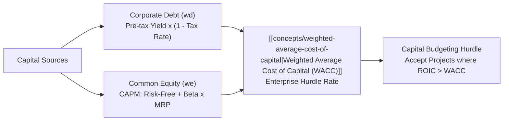
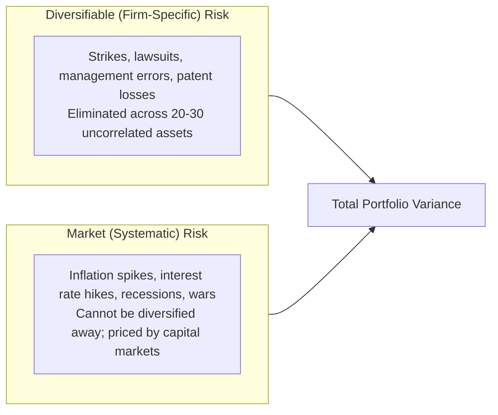
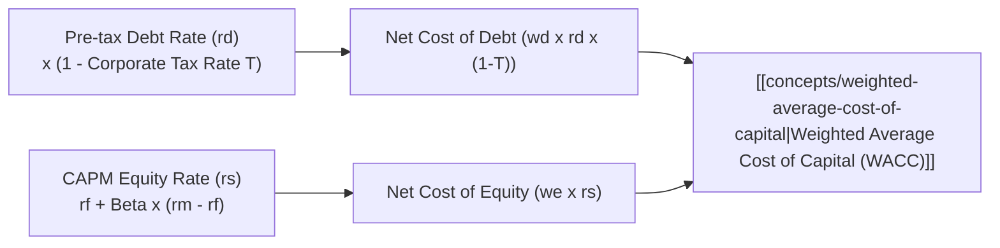

> [!NOTE] Curricular & Faculty Metadata
>
> - **Course:** MK2 Financial Management and Strategy — Week 08
> - **Teaching Team:** Dr. Arif Zamani (Lead Lecturer), Dr. Subiakto Soekarno, Dr. Aswin Rahadi, Yunieta Anny Nainggolan Ph.D., Oktofa Yudha Sudrajat Ph.D.
> - **Primary Curricular Spine:** `P3MD Week 8 - RR & CoC.pdf` (Dr. Arif Zamani)
> - **Direct Satellites & Problem Sets:**
>   - [[courses/mk2-financial-management-strategy/week-08/assignment-risk-return-wacc|Case Analysis: Estimating Sovereign Risk, Beta & Corporate WACC]]

## 1. Executive Overview: The Universal Hurdle Rate

No corporate investment decision—whether constructing a new cement kiln, launching an electric vehicle battery plant, or building railway infrastructure—can be evaluated in isolation from the **Cost of Capital**.

Capital is not free. Providers of capital (commercial lenders, bondholders, and equity shareholders) demand an expected return that compensates them for two distinct economic factors:

1. **The [[concepts/time-value-of-money|Time Value of Money]]**: The risk-free return available on sovereign government obligations ($r_{\text{RF}}$).
2. **The Risk Premium**: Compensation for volatility, operational business risk, financial leverage, and macroeconomic sovereign risk.

The **[[concepts/weighted-average-cost-of-capital|Weighted Average Cost of Capital (WACC)]]** represents the composite hurdle rate an enterprise must clear to create economic value ($\text{EVA} > 0$). Deploying capital in projects earning returns below WACC destroys shareholder wealth, regardless of top-line revenue growth.

---

## 2. Theoretical Architecture: Risk and Return Foundations

### Standalone Risk vs Portfolio Risk

- **Expected Return ($\hat{r}$)**: The probability-weighted average of all possible return states:
  $$\hat{r} = \sum_{i=1}^n P_i \times r_i$$
- **Variance ($\sigma^2$) and Standard Deviation ($\sigma$)**: Measure the total statistical dispersion of returns around the expected mean:
  $$\sigma = \sqrt{\sum_{i=1}^n P_i \times (r_i - \hat{r})^2}$$
- **Coefficient of Variation (CV)**: Measures risk per unit of expected return ($\text{CV} = \sigma / \hat{r}$), enabling risk comparison across assets with different scales.

### Portfolio Diversification and the Two Types of Risk

$$\mathbf{\text{Total Standalone Risk} = \text{Diversifiable (Firm-Specific) Risk} + \text{Market (Systematic) Risk}}$$

1. **Diversifiable (Unsystematic / Idiosyncratic) Risk**: Caused by random events specific to an individual firm. As an investor expands portfolio holdings across uncorrelated industries ($\rho < 1.0$), diversifiable risk approaches zero without sacrificing expected return.
2. **Systematic (Market / Non-Diversifiable) Risk**: Caused by macroeconomic forces that influence all market participants simultaneously. Capital markets **do not compensate investors for taking diversifiable risk**; expected returns are governed solely by systematic risk.

---

## 3. The [[concepts/capital-asset-pricing-model|Capital Asset Pricing Model (CAPM)]] and Beta ($\beta$)

The **[[concepts/capital-asset-pricing-model|Capital Asset Pricing Model (CAPM)]]** formalizes how systematic risk dictates the required rate of return on common equity:

$$\mathbf{r_s = r_{\text{RF}} + \beta_i \times \big(r_M - r_{\text{RF}}\big)}$$

Where:

- $r_s$: Required rate of return on equity.
- $r_{\text{RF}}$: Risk-Free Rate (typically the 10-year Indonesian Government Bond / Surat Utang Negara yield).
- $\beta_i$ (Beta): Metric of systematic risk measuring the volatility and co-movement of the stock relative to the overall market portfolio:
  $$\beta_i = \frac{\text{Cov}(r_i, r_M)}{\sigma_M^2} = \frac{\rho_{i,M} \times \sigma_i}{\sigma_M}$$
- $r_M - r_{\text{RF}}$: **Market Risk Premium (MRP)** demanded by investors for holding the broad equity market rather than risk-free sovereign debt.

### Interpreting Beta Benchmark Regimes

- **$\beta = 1.0$ (Market Average)**: Stock moves in lockstep with the broad market index (e.g., IHSG).
- **$\beta > 1.0$ (Aggressive / High Beta)**: Stock is more volatile than the market (e.g., tech infrastructure, cyclical mining like PTBA during commodity booms).
- **$\beta < 1.0$ (Defensive / Low Beta)**: Stock is less volatile than the market (e.g., regulated utilities, consumer staple food producers like Indofood).

---

## 4. The [[concepts/weighted-average-cost-of-capital|Weighted Average Cost of Capital (WACC)]]

The cost of capital is calculated as the weighted average cost of each component source of long-term funding:

$$\mathbf{\text{WACC} = \underbrace{w_d \times r_d \times (1 - T)}_{\text{Cost of Debt (Post-Tax)}} + \underbrace{w_p \times r_p}_{\text{Cost of Preferred Stock}} + \underbrace{w_e \times r_s}_{\text{Cost of Common Equity}}}$$

Where:

- $w_d, w_p, w_e$: Target capital structure weights ($w_d + w_p + w_e = 1.0$), calculated using **market values** rather than historical book values.
- $r_d$: Pre-tax cost of debt (the current yield-to-maturity on newly issued corporate bonds or bank borrowings).
- $T$: Corporate tax rate (interest payments provide an **interest tax shield**, reducing the effective cost of debt to $r_d \times (1 - T)$).
- $r_p$: Cost of preferred stock ($D_p / P_p$).
- $r_s$: Cost of common equity (derived via CAPM, DDM, or Bond Yield plus Risk Premium).

---

## 5. Managerial Applications & Capital Budgeting Pitfalls

1. **The Single-WACC Fallacy**: Applying a single corporate-wide WACC to all internal corporate investment proposals is a dangerous error. High-risk exploratory divisions (e.g., deep-sea mining or speculative software ventures) must use a **risk-adjusted hurdle rate ($\text{WACC} + \text{Risk Premium}$)**. Using a single corporate WACC systematically rejects safe, value-accretive baseline projects and over-allocates capital to reckless gambles.
2. **Book Value vs Market Value Weights**: Relying on balance-sheet book values of debt and equity distorts WACC because market equity values for established firms generally exceed book equity multiples.
3. **The Sovereign Risk Premium in Emerging Markets**: For multinational Indonesian enterprises raising offshore dollar capital, the sovereign credit default spread (Indonesian CDS) must be incorporated into both debt yields and the risk-free benchmark.

---

## 📚 Direct Satellite Notes

- [[courses/mk2-financial-management-strategy/week-08/assignment-risk-return-wacc|Case Analysis: Estimating Sovereign Risk, Beta & Corporate WACC]]: Step-by-step empirical computation of portfolio variance, asset Beta derivation, and institutional WACC modeling for Indonesian enterprises.

---

## 🔗 Knowledge Graph & Curriculum Bridges

- **Featured Concepts in Knowledge Matrix**:
  - [[concepts/weighted-average-cost-of-capital|Weighted Average Cost of Capital (WACC)]]
  - [[concepts/capital-asset-pricing-model|Capital Asset Pricing Model (CAPM)]]
- **Previous Curricular Module**: [[courses/mk2-financial-management-strategy/week-07/index|Week 07: Applications of TVM (Asset Valuation)]]
- **Mid-Term Synthesis**: [[courses/mk2-financial-management-strategy/mid/index|Mid-Term Examination Comprehensive Dossier]]
- Return to **[[courses/mk2-financial-management-strategy/index|MK 2 Course Overview]]**
