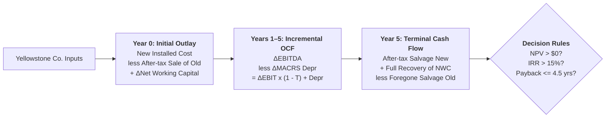

> [!IMPORTANT] Cohort Pre-Class Study Brief (_"Ini Peta, Bukan Jawaban"_)
> **Audience:** P3MD Batch I Soedirman Cohort  
> **Academic Mode:** Pre-Class Analytical Framework & Spreadsheet Architecture Guide  
> **Source Case:** Yellowstone Co. High-Speed Widget Grinder Replacement Decision  
> **Purpose:** This brief equips participants to build and audit the financial model in `Pre-Assignment_FMS - Capital Budgeting Cash Flows_template (1).xlsx` by mapping MACRS depreciation recovery, working capital dynamics, and capital budgeting decision rules—**without publishing completed answer keys**.

---

## 🎯 Case Narrative & Decision Context

**Yellowstone Co.** is evaluating whether to replace an existing widget grinder purchased three years ago with a modern high-speed grinder.

The decision is governed by corporate capital budgeting rules:

- **Cost of Capital (WACC)**: $15.0\%$.
- **Payback Period Hurdle**: Management requires capital to be paid back within **$4.5\text{ years}$**.
- **Tax Rate ($T$)**: $40.0\%$.

---

## 📊 Summary of Given Case Parameters

| Parameter Category                | Existing Grinder (Old Asset)              | Proposed High-Speed Grinder (New Asset)             |
| :-------------------------------- | :---------------------------------------- | :-------------------------------------------------- |
| **Historical Purchase Price**     | $\$80{,}000$ (Purchased 3 years ago)      | $\$125{,}000$ purchase price                        |
| **Installation Expenses**         | $\$0$ (Historical)                        | $\$5{,}000$ (Capitalized into depreciable basis)    |
| **Total Installed Basis**         | $\$80{,}000$                              | **$\$130{,}000$**                                   |
| **Depreciation Method**           | MACRS 5-Year Recovery Period              | MACRS 5-Year Recovery Period                        |
| **Current Sale Price ($t=0$)**    | $\$90{,}000$ (Zero cleanup/removal costs) | Not applicable                                      |
| **Usable Operating Life**         | $5\text{ more years}$                     | $5\text{ years}$                                    |
| **Terminal Market Value ($t=5$)** | $\$10{,}000$ (Market value in Year 5)     | $\$35{,}000$ (Net after removal/cleanup before tax) |

### Net Working Capital Requirements ($\Delta\text{NWC}$)

To support increased production volume:

- Increase in Accounts Receivable ($\Delta\text{AR}$): $+\$50{,}000$
- Increase in Inventories ($\Delta\text{Inv}$): $+\$35{,}000$
- Increase in Accounts Payable ($\Delta\text{AP}$): $+\$47{,}000$
  $$
  \Delta\text{NWC} = \Delta\text{AR} + \Delta\text{Inv} - \Delta\text{AP} = \$50{,}000 + \$35{,}000 - \$47{,}000 = \mathbf{+\$38{,}000}
  $$
  _(Note: Requires a cash outflow of $\$38{,}000$ at $t=0$, and is fully liquidated/recovered as a cash inflow of $+\$38{,}000$ at $t=5$)_.

### EBITDA Projections (Years 1–5)

| Operating Year ($t$) | EBITDA New Grinder | EBITDA Existing Grinder | Incremental EBITDA ($\Delta\text{EBITDA}$) |
| :------------------: | :----------------: | :---------------------: | :----------------------------------------: |
|      **Year 1**      |    $\$50{,}000$    |      $\$27{,}000$       |             **$+\$23{,}000$**              |
|      **Year 2**      |    $\$50{,}000$    |      $\$25{,}000$       |             **$+\$25{,}000$**              |
|      **Year 3**      |    $\$50{,}000$    |      $\$23{,}000$       |             **$+\$27{,}000$**              |
|      **Year 4**      |    $\$50{,}000$    |      $\$20{,}000$       |             **$+\$30{,}000$**              |
|      **Year 5**      |    $\$50{,}000$    |      $\$17{,}000$       |             **$+\$33{,}000$**              |

---

## 🛠️ Step-by-Step Modeling Guide

### Step 1: Calculating Initial Investment ($CF_0$)

1. **Installed Cost of New Asset**:
   $$\text{Basis}_{\text{new}} = \$125{,}000 + \$5{,}000 = \$130{,}000$$
2. **Book Value of Old Grinder at $t=0$**:
   Under 5-year MACRS, depreciation rates are: Year 1 ($20\%$), Year 2 ($32\%$), Year 3 ($19\%$), Year 4 ($12\%$), Year 5 ($12\%$), Year 6 ($5\%$).
   - Accumulated depreciation over the prior 3 years equals \( \text{AccDepr} = (20\% + 32\% + 19\%) \times \$80{,}000 = 71\% \times \$80{,}000 = \$56{,}800 \).
   - Subtracting accumulated depreciation from historical cost yields the remaining unamortized tax carrying basis:
     $$\text{BV}_0 = \$80{,}000 - \$56{,}800 = \mathbf{\$23{,}200}$$
3. **Tax on Sale of Old Grinder**:
   - Current market price: $\$90{,}000$.
   - Gain on sale: $\$90{,}000 - \$23{,}200 = \$66{,}800$.
   - Tax liability ($40\%$): $0.40 \times \$66{,}800 = \mathbf{\$26{,}720}$.
   - Deducting the tax payment from the gross liquidation price yields the net after-tax liquid proceeds: \( \text{After-Tax Proceeds} = \$90{,}000 - \$26{,}720 = \mathbf{\$63{,}280} \).
4. **Net Initial Outlay Formula**:
   Synthesizing the purchase expenditure, old asset liquidation recovery, and working capital commitment:
   $$CF_0 = -(\text{Installed Cost}_{\text{new}}) + \text{After-Tax Proceeds}_{\text{old}} - \Delta\text{NWC}$$

---

### Step 2: Determining Incremental Operating Cash Flows ($OCF_t$)

For each year $t \in [1, 5]$:

1. Compute **Incremental EBITDA**: $\Delta\text{EBITDA}_t = \text{EBITDA}_{\text{new}, t} - \text{EBITDA}_{\text{old}, t}$.
2. Compute **Incremental Depreciation ($\Delta\text{Depr}_t$)**:
   - New Grinder uses Year 1–5 rates applied to $\$130{,}000$.
   - Old Grinder uses remaining Year 4 ($12\%$), Year 5 ($12\%$), and Year 6 ($5\%$) rates applied to $\$80{,}000$. (In Years 4 and 5, Old Grinder depreciation is $\$0$).
3. Compute **Incremental EBIT**: $\Delta\text{EBIT}_t = \Delta\text{EBITDA}_t - \Delta\text{Depr}_t$.
4. Compute **Taxes**: $\text{Taxes}_t = 40\% \times \Delta\text{EBIT}_t$.
5. Compute **NOPAT**: $\text{NOPAT}_t = \Delta\text{EBIT}_t - \text{Taxes}_t$.
6. Add back Incremental Depreciation:
   $$OCF_t = \text{NOPAT}_t + \Delta\text{Depr}_t$$

---

### Step 3: Determining Terminal Cash Flow ($TCF_5$)

At the end of Year 5, three terminal cash adjustments occur:

1. **After-Tax Proceeds from Sale of New Grinder**:
   - Market value: $\$35{,}000$.
   - Book Value of New Grinder at end of Year 5: remaining Year 6 MACRS rate ($5\% \times \$130{,}000 = \$6{,}500$).
   - Taxable gain: $\$35{,}000 - \$6{,}500 = \$28{,}500$.
   - Tax ($40\%$): $\$11{,}400$.
   - After-tax proceeds: $\$35{,}000 - \$11{,}400 = \mathbf{\$23{,}600}$.
2. **Full Recovery of Net Working Capital**:
   $$+\Delta\text{NWC} = \mathbf{+\$38{,}000}$$
3. **Foregone After-Tax Salvage of Old Grinder (Opportunity Cost)**:
   - If old grinder was kept, it would be sold for $\$10{,}000$ at $t=5$.
   - Book Value of old grinder at $t=5$ is $\$0$ (fully depreciated).
   - Tax ($40\%$): $\$4{,}000$.
   - Foregone proceeds (cash reduction): $-(\$10{,}000 - \$4{,}000) = \mathbf{-\$6{,}000}$.
4. **Total Terminal Cash Flow**:
   $$TCF_5 = \text{After-Tax Salvage}_{\text{new}} + \Delta\text{NWC} - \text{After-Tax Salvage}_{\text{old}}$$

---

### Step 4: Capital Budgeting Hurdle Evaluation

Synthesize the final cash timeline $[CF_0, OCF_1, OCF_2, OCF_3, OCF_4, OCF_5 + TCF_5]$ to evaluate:

- **Net Present Value (NPV)**: Discount at $r = 15\%$. Accept if $\text{NPV} > \$0$.
- **Internal Rate of Return (IRR)**: Rate where $\text{NPV} = 0$. Accept if $\text{IRR} > 15\%$.
- **Payback Period**: Track cumulative unrecovered cash flow. Accept if $\text{Payback} \le 4.5\text{ years}$.

---

## 🔗 Related Knowledge Bridges

- Master Curricular Hub: [[courses/mk2-financial-management-strategy/week-09/index|MK2 Week 09: Capital Budgeting Techniques and Cash Flows]]
- Foundational Theory: [[concepts/capital-budgeting-cash-flows|Capital Budgeting Cash Flows Architecture]]
- Hurdle Rate Theory: [[concepts/weighted-average-cost-of-capital|Weighted Average Cost of Capital (WACC)]]
- Prior Module: [[courses/mk2-financial-management-strategy/week-08/index|Week 08: Risk, Return & Cost of Capital Architecture]]
