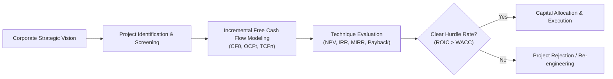
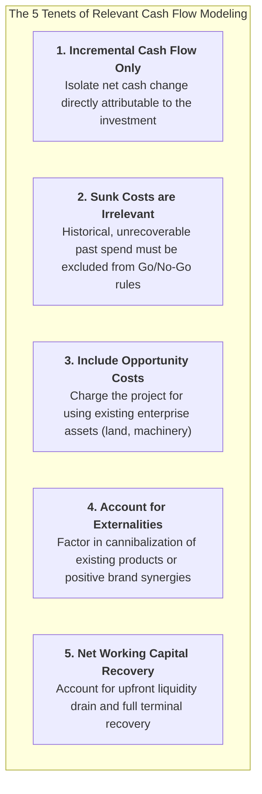
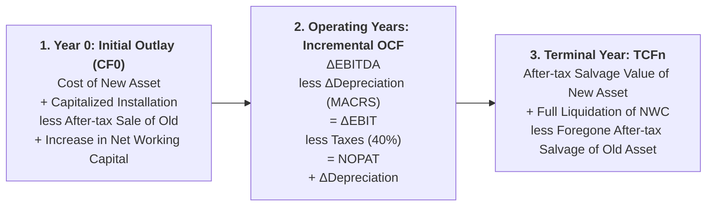

> [!NOTE] Curricular & Faculty Metadata
>
> - **Course:** MK2 Financial Management and Strategy — Week 09
> - **Teaching Team:** Dr. Arif Zamani (Lead Lecturer), Dr. Subiakto Soekarno, Dr. Aswin Rahadi, Yunieta Anny Nainggolan Ph.D., Oktofa Yudha Sudrajat Ph.D.
> - **Primary Curricular Spine:** `archive/courses/mk2/week-09/P3MD - Capital Budgeting Techniques and Cash Flows_for students.pdf` (Dr. Arif Zamani)
> - **Direct Satellites & Problem Sets:**
>   - [[courses/mk2-financial-management-strategy/week-09/assignment-capital-budgeting-cash-flows|Cohort Pre-Class Brief: Capital Budgeting Cash Flows & Equipment Replacement Modeling]]

---

## 1. Executive Overview: The Capital Allocation Engine

Capital budgeting represents the most critical strategic activity undertaken by corporate financial officers and enterprise leadership. While day-to-day working capital management safeguards immediate liquidity, **capital budgeting commits multi-million-dollar capital outlays across multi-year or multi-decade horizons**.

Because major capital expenditures (capex)—such as developing a deep-water port, commissioning a high-speed rail corridor, or acquiring automated manufacturing lines—are largely irreversible, deploying capital in sub-optimal projects permanently impairs return on invested capital ($\text{ROIC}$) and destroys shareholder value.

---

## 2. Capital Budgeting Evaluation Techniques

The lecture establishes a rigorous hierarchy of capital budgeting evaluation metrics, contrasting non-discounted legacy rules with mathematically robust discounted cash flow (DCF) techniques:

| Evaluation Metric                 | Theoretical Definition                                                                                             | Acceptance Criterion                           | Key Analytical Strength                                                                         | Critical Flaw / Vulnerability                                                                     |
| :-------------------------------- | :----------------------------------------------------------------------------------------------------------------- | :--------------------------------------------- | :---------------------------------------------------------------------------------------------- | :------------------------------------------------------------------------------------------------ | ----------------------------------------------------------------- |
| **Payback Period**                | Time required for undiscounted cumulative cash inflows to equal initial outlay.                                    | $\text{Payback} \le \text{Target Years}$       | Simple; measures liquidity risk and cash recovery velocity.                                     | Ignores [[concepts/time-value-of-money                                                            | Time Value of Money]]; ignores cash flows occurring after cutoff. |
| **Discounted Payback**            | Time required for cumulative present value of cash inflows to recover initial outlay.                              | $\text{Disc. Payback} \le \text{Target Years}$ | Incorporates TVM and cost of capital.                                                           | Still ignores all cash flows received after the arbitrary cutoff point.                           |
| **Net Present Value (NPV)**       | The dollar measure of wealth created: $\text{NPV} = \sum_{t=0}^n \frac{CF_t}{(1+r)^t}$.                            | $\text{NPV} > \$0$                             | **The Gold Standard**. Directly measures shareholder wealth creation; additive across projects. | Requires precise estimate of enterprise [[concepts/weighted-average-cost-of-capital               | WACC]]; hard to convey to non-financial executives.               |
| **Internal Rate of Return (IRR)** | The discount rate that equates the present value of inflows with initial cost ($\text{NPV} = 0$).                  | $\text{IRR} > \text{WACC}$                     | Intuitively expresses return as an annualized percentage rate.                                  | Assumes cash flows reinvested at IRR; multiple IRRs for non-normal cash flows; ranking conflicts. |
| **Modified IRR (MIRR)**           | Rate equating PV of outflows with Terminal Value of inflows reinvested at WACC.                                    | $\text{MIRR} > \text{WACC}$                    | Eliminates multiple IRR problem; realistic reinvestment rate assumption at WACC.                | Inferior to NPV when choosing between mutually exclusive projects of different scale.             |
| **Profitability Index (PI)**      | Ratio of PV of future cash inflows to initial outlay: $\text{PI} = \frac{\text{PV of Inflows}}{\vert CF_0 \vert}$. | $\text{PI} > 1.0$                              | Exceptional tool for capital rationing under fixed investment budget constraints.               | Can conflict with NPV ranking when comparing projects with vastly different capital scale.        |

---

## 3. Incremental Cash Flow Modeling Principles

The fundamental rule of capital budgeting states: **Only incremental, after-tax cash flows matter**.

$$
\Delta CF_t = CF_t (\text{Enterprise with Project}) - CF_t (\text{Enterprise without Project})
$$

---

## 4. The 3-Stage Equipment Replacement Timeline

As detailed in the [[concepts/capital-budgeting-cash-flows|Capital Budgeting Cash Flows Architecture]], evaluating replacement projects requires tracking cash across three distinct phases:

### MACRS Depreciation Tax Shield Mechanics

Because tax depreciation reduces taxable corporate income without consuming liquid cash, it creates a substantial **Depreciation Tax Shield**:

$$
\text{Tax Shield}_t = \Delta\text{Depreciation}_t \times T
$$

Under U.S. and international modified accelerated cost recovery schedules (MACRS), depreciation percentages front-load tax shields into earlier operating years, raising project NPV relative to straight-line amortization.

---

## 5. Strategic Implications for BUMN & Indonesian Infrastructure

For Indonesian State-Owned Enterprises and Danantara portfolio entities, mastering capital budgeting disciplines resolves two widespread governance hazards:

1. **The Sunk-Cost Fallacy in Distressed Capex**: Public sector mega-projects that encounter delays frequently justify throwing additional billions into bad projects under the rationale: _"We have already spent Rp 20 Trillion; we cannot stop now."_ Rigorous incremental capital budgeting demands that past spend be treated as sunk—evaluating only forward-looking cash flows against remaining incremental investment.
2. **Proper Capital Rationing Across Subsidiaries**: When holding entities allocate limited capex pools among competing subsidiaries, using the Profitability Index ($\text{PI}$) alongside NPV ensures that capital is deployed to maximize aggregate economic value per Rupiah of constrained capital invested.

---

## 🔗 Week 09 Direct Curricular Bridges

- Cohort Pre-Class Guide: [[courses/mk2-financial-management-strategy/week-09/assignment-capital-budgeting-cash-flows|Capital Budgeting Cash Flows & Equipment Replacement Modeling]]
- Foundational Concept: [[concepts/capital-budgeting-cash-flows|Capital Budgeting Cash Flows Architecture]]
- Hurdle Rate Foundation: [[concepts/weighted-average-cost-of-capital|Weighted Average Cost of Capital (WACC)]]
- Fundamental Mathematics: [[concepts/time-value-of-money|Time Value of Money (TVM)]]
- Prior Module: [[courses/mk2-financial-management-strategy/week-08/index|Week 08: Risk, Return & Cost of Capital Architecture]]
- Return to [[courses/mk2-financial-management-strategy/index|MK2 Course Overview Hub]]
