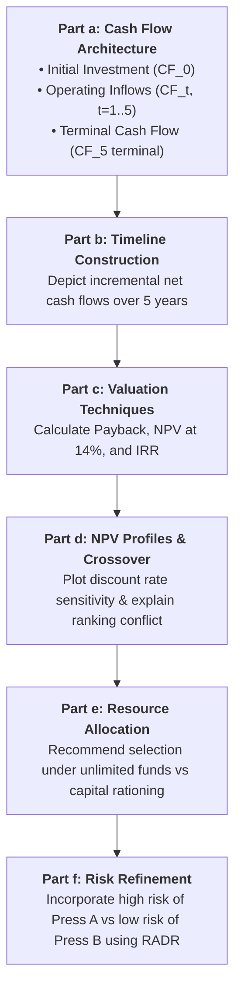

> [!IMPORTANT] Cohort Pre-Class Case Brief (_"Ini Peta, Bukan Jawaban"_)
> **Audience:** P3MD Batch I Soedirman Cohort  
> **Academic Mode:** Pre-Class Quantitative Model & Framework Map  
> **Purpose:** This dossier provides the comprehensive financial exhibits, MACRS tax schedules, incremental cash flow architecture, and evaluation roadmaps for the **Lasting Impressions Company** capital budgeting case—**without prescribing final calculated numbers or group recommendations**.

---

## 1. Case Background & Decision Dilemma

**Lasting Impressions (LI) Company** is a medium-sized commercial printing enterprise serving advertising agency clients across New York and Chicago. Its competitive sweet spot requires high-quality commercial runs exceeding 50,000 units.

However, LI is severely handicapped by its aging, inefficient printing equipment, resulting in delayed run times, quality degradation, and elevated operating labor costs. The General Manager proposes replacing the existing printing asset with one of two alternative six-color commercial presses:

- **Press A:** A highly automated, premium-efficiency machine requiring significant initial capital and incremental net working capital investment, delivering aggressive annual revenue growth.
- **Press B:** A standard-automation alternative requiring lower capital investment and zero incremental working capital, producing stable, predictable cash flows.

The executive team must evaluate these mutually exclusive alternatives under both **unlimited funds** and **capital rationing** environments, while explicitly incorporating differences in operating risk.

---

## 2. Master Case Exhibits & Quantitative Data

### Exhibit 1: Machine Characteristics & Capital Outlays

| Parameter                                     | Old Press                      | Press A (High Automation)                                        | Press B (Standard)                                               |
| :-------------------------------------------- | :----------------------------- | :--------------------------------------------------------------- | :--------------------------------------------------------------- |
| **Original Purchase Timing**                  | Purchased 3 years ago          | New Acquisition                                                  | New Acquisition                                                  |
| **Original Installed Cost**                   | $\$400,000$                    | $\$830,000$ purchase $+ \$40,000$ install $= \mathbf{\$870,000}$ | $\$640,000$ purchase $+ \$20,000$ install $= \mathbf{\$660,000}$ |
| **Depreciation Method**                       | MACRS 5-Year (3 years elapsed) | MACRS 5-Year (Years 1–5)                                         | MACRS 5-Year (Years 1–5)                                         |
| **Remaining Useful Life**                     | 5 years                        | 5 years                                                          | 5 years                                                          |
| **Current Liquidation Value (Today)**         | $\$420,000$ (Pre-tax)          | N/A                                                              | N/A                                                              |
| **Terminal Salvage Value (End Year 5)**       | $\$150,000$ (Pre-tax)          | $\$400,000$ (Pre-tax)                                            | $\$330,000$ (Pre-tax)                                            |
| **Net Working Capital Change ($\Delta NWC$)** | Baseline                       | $+ \$90,400$ (See breakdown below)                               | $\$0$ (No change in NWC)                                         |
| **Corporate Tax Rate ($T$)**                  | $40\%$                         | $40\%$                                                           | $40\%$                                                           |
| **Base Cost of Capital ($r$)**                | $14\%$                         | $14\%$ (Base)                                                    | $14\%$ (Base)                                                    |

### Exhibit 2: Working Capital Impacts for Press A

| Current Account Item                          | Projected Balance Change | Cash Flow Impact                                      |
| :-------------------------------------------- | :----------------------: | :---------------------------------------------------- |
| **Cash**                                      |       $+ \$25,400$       | Cash outflow (increased liquidity buffer)             |
| **Accounts Receivable**                       |      $+ \$120,000$       | Cash outflow (capital tied up in customer credit)     |
| **Inventories**                               |       $- \$20,000$       | Cash inflow (leaner inventory management)             |
| **Accounts Payable**                          |       $+ \$35,000$       | Cash inflow (spontaneous supplier financing)          |
| **Net Working Capital Change ($\Delta NWC$)** |  $\mathbf{+ \$90,400}$   | **Net cash outflow at $t = 0$; recovered at $t = 5$** |

$$\Delta NWC = (\Delta \text{Cash} + \Delta AR + \Delta \text{Inv}) - \Delta AP = (\$25,400 + \$120,000 - \$20,000) - \$35,000 = +\$90,400$$

### Exhibit 3: Operating EBDIT Projections

Earnings before depreciation, interest, and taxes (EBDIT) across the 5-year planning horizon:

| Operating Year | Old Press Baseline | Press A (Projected EBDIT) | Press B (Projected EBDIT) |
| :------------: | :----------------: | :-----------------------: | :-----------------------: |
|   **Year 1**   |    $\$120,000$     |        $\$250,000$        |        $\$210,000$        |
|   **Year 2**   |    $\$120,000$     |        $\$270,000$        |        $\$210,000$        |
|   **Year 3**   |    $\$120,000$     |        $\$300,000$        |        $\$210,000$        |
|   **Year 4**   |    $\$120,000$     |        $\$330,000$        |        $\$210,000$        |
|   **Year 5**   |    $\$120,000$     |        $\$370,000$        |        $\$210,000$        |

---

## 3. Methodological & Tax Accounting Foundations

### MACRS 5-Year Depreciation Schedule

Under U.S. MACRS tax guidelines, a 5-year asset is depreciated across 6 calendar years due to the half-year convention:

| Recovery Year | MACRS Rate |    Old Press Depr. ($Cost = \$400k$)    |     Press A Depr. ($Cost = \$870k$)     |     Press B Depr. ($Cost = \$660k$)     |
| :-----------: | :--------: | :-------------------------------------: | :-------------------------------------: | :-------------------------------------: |
|  **Year 1**   |   $20\%$   |     _(Taken in Year -2: \$80,000)_      |               $\$174,000$               |               $\$132,000$               |
|  **Year 2**   |   $32\%$   |     _(Taken in Year -1: \$128,000)_     |               $\$278,400$               |               $\$211,200$               |
|  **Year 3**   |   $19\%$   |      _(Taken in Year 0: \$76,000)_      |               $\$165,300$               |               $\$125,400$               |
|  **Year 4**   |   $12\%$   |       **\$48,000 (Case Year 1)**        |               $\$104,400$               |               $\$79,200$                |
|  **Year 5**   |   $12\%$   |       **\$48,000 (Case Year 2)**        |               $\$104,400$               |               $\$79,200$                |
|  **Year 6**   |   $5\%$    |       **\$20,000 (Case Year 3)**        | $\$43,500$ _(Accrues in Y5 or carried)_ | $\$33,000$ _(Accrues in Y5 or carried)_ |
|   **Total**   |  $100\%$   | Book Value today $= \mathbf{\$116,000}$ |           Total: $\$870,000$            |           Total: $\$660,000$            |

> [!NOTE] Current Book Value & Tax on Sale of Old Press
>
> - Installed cost of Old Press: $\$400,000$.
> - Accumulated depreciation after 3 years: $\$80k + \$128k + \$76k = \$284,000$.
> - **Current Book Value ($BV_0$):** $\$400,000 - \$284,000 = \mathbf{\$116,000}$.
> - If sold today for $\$420,000$: Total pre-tax gain $= \$420,000 - \$116,000 = \mathbf{\$304,000}$.
> - Depreciation recapture: $\$284,000$ taxed at $40\%$ ordinary income.
> - Capital gain: $\$420,000 - \$400,000 = \$20,000$ taxed at $40\%$.
> - Total Tax Due on Sale $= \$304,000 \times 40\% = \mathbf{\$121,600}$.
> - **Net After-Tax Liquidation Inflow:** $\$420,000 - \$121,600 = \mathbf{\$298,400}$.

---

## 4. Question-by-Question Analytical Roadmap

### Roadmap for Part a: Developing Relevant Cash Flows

1. **Initial Investment ($CF_0$):**
   - Installed cost of new press (purchase price $+$ installation).
   - _Less:_ Net after-tax proceeds from sale of Old Press ($\$298,400$).
   - _Plus:_ Initial change in Net Working Capital ($\Delta NWC$).
2. **Operating Cash Inflows ($t = 1$ to $5$):**
   - For each year, calculate incremental operating cash flow:

     $$\Delta OCF_t = (\Delta EBDIT_t - \Delta Depr_t) \times (1 - T) + \Delta Depr_t$$

     _Alternatively:_ $\Delta OCF_t = \Delta EBDIT_t \times (1 - T) + (\Delta Depr_t \times T)$.

   - Carefully align remaining Old Press MACRS deductions against new press deductions.

3. **Terminal Cash Flow ($t = 5$):**
   - After-tax salvage value of new press at Year 5.
   - _Less:_ Foregone after-tax salvage value of Old Press at Year 5 ($\$150,000$ pre-tax, with book value $\$0$, netting $\$150k \times (1 - 0.40) = \$90,000$).
   - _Plus:_ Complete recovery of initial Net Working Capital ($\Delta NWC$ reverses at project termination).

### Roadmap for Part c & d: Evaluating Ranking Conflicts

- **Conflicting Rankings:** When does NPV conflict with IRR?
  - Scale differences (Press A requires higher initial outlay than Press B).
  - Cash flow timing (Press A's cash flows grow aggressively; Press B's cash flows are flat).
- **The Crossover Rate:** Find the exact discount rate where $NPV_A = NPV_B$. Below the crossover rate, the larger/back-loaded project (Press A) dominates; above it, the faster-payback project (Press B) dominates.

### Roadmap for Part e & f: Incorporating Capital Rationing & Risk Refinements

- **Unlimited Funds:** Follow the core theoretical rule: **Maximize total Net Present Value**.
- **Capital Rationing:** When capital is strictly budgeted, evaluate whether combination packaging (highest aggregate NPV per dollar invested) or Profitability Index ($PI = \frac{PV_{\text{inflows}}}{CF_0}$) alters the selection.
- **Risk Differential:** Press A carries high operating volatility (automated machine dependent on aggressive volume gains), while Press B carries low risk. Applying a **Risk-Adjusted Discount Rate (RADR)**:
  - If Press A's discount rate is increased to $16\%$ or $18\%$ while Press B remains at $12\%$ or $14\%$, plot whether Press A's NPV advantage evaporates.

---

## 🔗 Related Portals

- Core Lecture Hub: [[courses/mk2-financial-management-strategy/week-10/index|Week 10: Risk and Refinements in Capital Budgeting]]
- Foundational Concept: [[concepts/risk-adjusted-discount-rate|Risk-Adjusted Discount Rate (RADR)]]
- Course Table of Contents: [[courses/mk2-financial-management-strategy/index|MK2 Course Index]]
