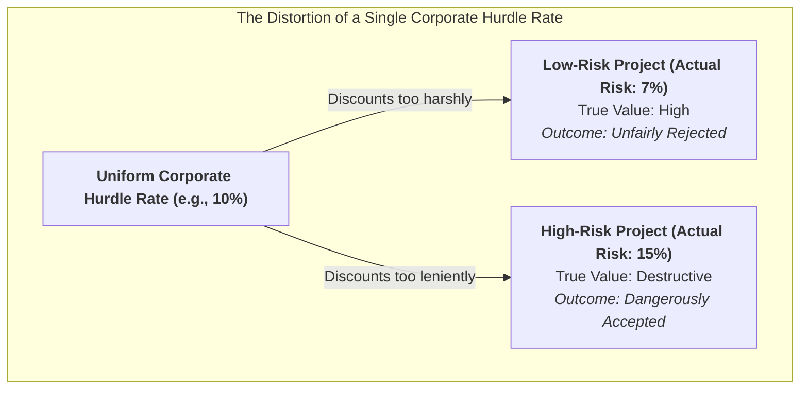
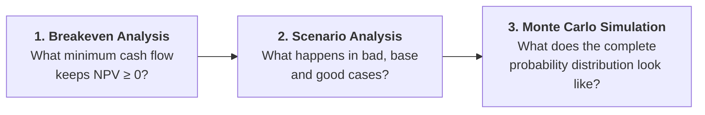
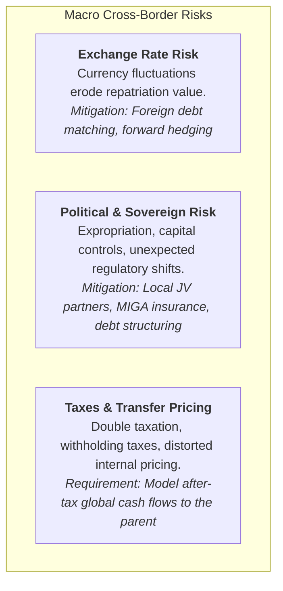
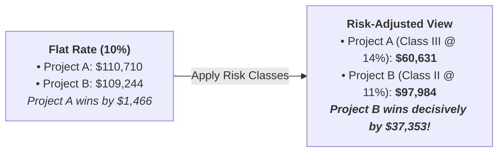
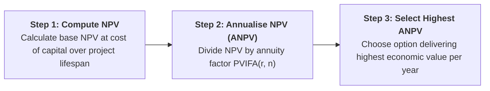
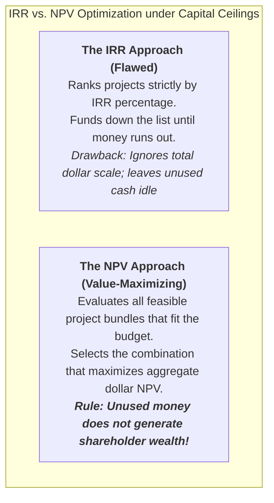

> [!NOTE] Curricular & Faculty Metadata
>
> - **Course:** MK2 Financial Management & Strategy — Week 10
> - **Teaching Team:** Prof. Dr. Ir. Sudarso Kaderi Wiryono, DEA, Dr. Subiakto Soekarno, MBA, Mandra Lazuardi Kitri, Ph.D., Kurnia Fajar Afgani, Ph.D.
> - **Primary Curricular Spine:** `archive/courses/mk2/week-10/P3MD - Risk and Refinements in Capital Budgeting (1).pdf`
> - **Integrative Case Dossier:** [[courses/mk2-financial-management-strategy/week-10/case-lasting-impressions-capital-budgeting|Case Dossier: Lasting Impressions Company — Replacing an Old Press]]
> - **Foundational Lattice Concept:** [[concepts/risk-adjusted-discount-rate|Risk-Adjusted Discount Rate (RADR)]]

---

## 1. The Opening Dilemma: Why Flat Hurdle Rates Destroy Value

In foundational corporate finance, capital budgeting is introduced under a simplifying assumption: **every project shares the same risk as the firm's existing business**, allowing managers to discount all future cash flows at a single, company-wide Weighted Average Cost of Capital (WACC):

$$\text{Static Assumption: } r_{\text{project}} = \text{WACC}_{\text{firm}} \quad \forall \text{ projects}$$

In enterprise reality, this assumption is demonstrably false and financially toxic. Capital projects vary dramatically in uncertainty:

- A routine replacement of existing factory machinery is low-risk.
- Entering an unfamiliar overseas market or developing an unproven deep-tech digital platform carries extreme volatility.

When an executive team evaluates all investments at a single corporate hurdle rate (e.g., $10\%$):

1. **Risky projects are artificially subsidized:** Highly volatile projects appear value-accretive because their steep risk premium is ignored, causing the firm to over-invest in fragile gambles.
2. **Safe projects are unfairly penalized:** Low-volatility cost-reduction initiatives are rejected because the high corporate hurdle rate suppresses their Net Present Value.

---

## 2. Behavioral Approaches to Getting a "Feel" for Risk

Before committing capital to formal stochastic models, executives utilize three behavioral diagnostic tools to map the downside boundaries of an investment:

### 1. Breakeven Cash Inflow Analysis

Calculates the minimum constant annual cash inflow ($CF_{\text{breakeven}}$) an investment must generate over its $n$-year lifespan to prevent value destruction ($NPV = 0$):

$$CF_{\text{breakeven}} = \frac{CF_0}{\left[ \frac{1 - (1 + r)^{-n}}{r} \right]} = \frac{CF_0}{PVIFA_{r,n}}$$

Where $PVIFA_{r,n}$ is the present value interest factor of an annuity. Once $CF_{\text{breakeven}}$ is computed, managers evaluate the subjective probability of clearing that threshold: $P(CF_t > CF_{\text{breakeven}})$.

### 2. Scenario Analysis (Pessimistic, Most Likely, Optimistic)

Evaluates project performance across three discrete macroeconomic states:

- **Pessimistic (Downturn):** High raw material inflation, weak customer adoption, supply chain bottlenecks.
- **Most Likely (Base Case):** Management's standard budget assumptions.
- **Optimistic (Expansion):** Rapid volume growth, favorable pricing power, efficiency gains.

The resulting **NPV Range** ($\text{Range} = NPV_{\text{optimistic}} - NPV_{\text{pessimistic}}$) visualizes volatility. A risk-averse CFO will prefer a project with a modest base NPV and narrow range over a project with identical base NPV but an enormous downside loss potential.

### 3. Monte Carlo Simulation

Assigns continuous probability distributions (normal, triangular, or lognormal) to every uncertain variable (sales volume, operating margin, salvage value, inflation). A computer model recalculates the project's NPV thousands of times, generating a complete distribution curve. The area under the curve where $NPV < 0$ quantifies the exact **Probability of Value Destruction**.

---

## 3. What Changes When Capital Crosses Borders?

When a capital project operates internationally, cash flows are exposed to two unique risk dimensions that do not exist in domestic operations:

> [!WARNING] The "Strategic" Investment Fallacy
> Executives frequently defend unprofitable cross-border expansions by labeling them "strategic" (e.g., establishing a regional beachhead, blocking a rival). SBM ITB financial governance mandates: _Strategic intent is never a justification to bypass quantitative valuation. If a strategic benefit exists, model its real option value explicitly in the cash flow._

---

## 4. Risk-Adjusted Discount Rates (RADR)

The standard corporate method for reflecting differential project risk is the **Risk-Adjusted Discount Rate (RADR)**:

$$NPV = \sum_{t=1}^{n} \frac{CF_t}{(1 + RADR)^t} - CF_0$$

### RADR via the Capital Asset Pricing Model (CAPM)

Under capital market theory, the required rate of return for project $j$ reflects its systematic, non-diversifiable covariance with the macro economy:

$$r_{\text{project}} = R_F + \beta_{\text{project}} \times (r_m - R_F)$$

- **Above the Security Market Line (SML):** If Project $IRR > RADR$, the investment generates positive abnormal returns ($NPV > 0$) $\rightarrow$ **Accept**.
- **Below the SML:** If Project $IRR < RADR$, the project fails to compensate investors for its systematic volatility ($NPV < 0$) $\rightarrow$ **Reject**.

### Practical Implementation: Risk Classes & The Bennett Ranking Flip

In daily practice, measuring pure project betas ($\beta_{\text{project}}$) is difficult because individual physical assets are not publicly traded. Corporations therefore establish **Risk Class Categories**:

|  Risk Class   | Description        | Typical Project Types                                        |  Illustrative RADR  |
| :-----------: | :----------------- | :----------------------------------------------------------- | :-----------------: |
|  **Class I**  | Below-Average Risk | Routine maintenance, cost reduction, equipment replacement   |       **8%**        |
| **Class II**  | Average Risk       | Expansion or renewal of core business operations             | **10% (Base WACC)** |
| **Class III** | Above-Average Risk | New product lines in existing markets, domestic acquisitions |       **14%**       |
| **Class IV**  | Highest Risk       | Unfamiliar overseas markets, breakthrough digital R&D        |       **20%**       |

#### The Bennett Company Demonstration: How Risk Flips the Decision

The running lecture case of Bennett Company illustrates why RADR is decisive:

At a single corporate rate of $10\%$, Project A barely won. But Project A was an aggressive, volatile expansion (Class III), while Project B was a safe renewal (Class II). Once discounted at their appropriate risk-adjusted rates, **the ranking completely flipped**—protecting the firm from misallocating capital into an excessively risky asset.

---

## 5. Capital Budgeting Refinements

### Refinement 1: Evaluating Mutually Exclusive Projects with Unequal Lives

When comparing mutually exclusive alternatives that provide identical long-term operational service but last for different durations (e.g., Project X lasts 3 years; Project Y lasts 6 years), standard NPV is distorted because it ignores the replacement cycle:

$$\text{Annualised Net Present Value: } ANPV = \frac{NPV_j}{\left[ \frac{1 - (1 + r)^{-n_j}}{r} \right]} = \frac{NPV_j}{PVIFA_{r,n_j}}$$

### Refinement 2: Real Options (Strategic Flexibility Has Real Economic Value)

Traditional DCF treats capital investments as passive, unalterable commitments. In reality, managers actively manage operations post-launch. **Real Options (Strategic Options)** explicitly value this managerial flexibility:

$$NPV_{\text{strategic}} = NPV_{\text{traditional}} + \text{Value of Real Options}$$

| Real Option Archetype  | Managerial Action                                                                           | Real-World Enterprise Example                                                                                  |
| :--------------------- | :------------------------------------------------------------------------------------------ | :------------------------------------------------------------------------------------------------------------- |
| **Abandonment Option** | Liquidate or shut down project early if market demand collapses.                            | Sale of offshore drilling rig to recover scrap capital when oil prices fall below $\$40$/bbl.                  |
| **Flexibility Option** | Switch inputs, outputs, or processes dynamically.                                           | Dual-fuel power generation plant capable of burning either natural gas or coal depending on commodity spreads. |
| **Growth Option**      | Follow up with expansion, scale-up, or distribution spin-offs if initial test succeeds.     | Small modular pharmaceutical pilot facility opening access to global patent commercialization.                 |
| **Timing Option**      | Defer initial capital outlay until regulatory, technological, or market uncertainty clears. | Holding land concessions for solar farms until national grid interconnect tariffs are gazetted.                |

### Refinement 3: Capital Budgeting Under Capital Rationing (Fixed Budget)

In a frictionless financial market, an enterprise accepts every independent proposal with $NPV > 0$. Under **Capital Rationing**, the firm faces an inflexible capital ceiling (e.g., total budget $= \$250,000$).

---

## 6. Curricular Synthesis: Which Tool for Which Problem?

| Decision Environment                                                            | Appropriate Financial Tool                   | Governing Decision Rule                                                                                  |
| :------------------------------------------------------------------------------ | :------------------------------------------- | :------------------------------------------------------------------------------------------------------- |
| Need an intuitive understanding of downside cash flow exposure                  | **Breakeven, Scenario Analysis, Simulation** | Evaluate the probability and magnitude of value destruction ($P(NPV < 0)$).                              |
| Capital proposals differ substantially in business and operating risk           | **Risk-Adjusted Discount Rates (RADR)**      | Accept if $NPV$ evaluated at the project's own $RADR$ is positive ($NPV(RADR) > 0$).                     |
| Choosing between mutually exclusive assets with unequal operating lifespans     | **Annualised Net Present Value (ANPV)**      | Select the asset that delivers the highest annualized cash flow equivalent ($ANPV$).                     |
| Proposals contain significant managerial flexibility to expand, switch, or exit | **Strategic NPV (Real Options)**             | Value options explicitly: $NPV_{\text{strategic}} = NPV_{\text{traditional}} + \text{Value of Options}$. |
| Senior management imposes an absolute budget cap on total capital outlays       | **NPV Capital Rationing Optimization**       | Select the feasible portfolio combination that maximizes total aggregate dollar $NPV$.                   |

---

## 7. Indonesian Context: Danantara & Large-Scale Capital Allocation

In the Indonesian corporate landscape, capital budgeting refinements are central to the strategic mandate of **Danantara (Daya Anagata Nusantara)** and state infrastructure champions:

- **Toll Road & Energy Concessions:** Evaluating 30-year concessions requires unequal-life adjustments and real options (timing options on Phase II construction).
- **Sovereign Capital Rationing:** With multi-billion-dollar national investment priorities across energy transition, mineral downstreaming, and high-speed rail, Danantara must reject simplistic IRR rankings and optimize total sovereign NPV across constrained budgetary allocations.

---

## 🔗 Curricular Satellites & Further Study

- **Integrative Case Study:** [[courses/mk2-financial-management-strategy/week-10/case-lasting-impressions-capital-budgeting|Lasting Impressions Company: Replacing an Old Press]]
- **Foundational Concept Page:** [[concepts/risk-adjusted-discount-rate|Risk-Adjusted Discount Rate (RADR)]]
- **Course Syllabus Hub:** [[courses/mk2-financial-management-strategy/index|MK2 Course Table of Contents]]
