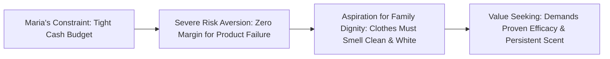

> [!NOTE] Case Metadata & Course Context
>
> - **Source Case:** Guimaraes, P. P., & Chandon, P. (2014). _Unilever in Brazil (1997–2007): Marketing Strategies for Low-Income Consumers_. INSEAD Case INS615 (22 pages).
> - **Primary Dilemma:** Whether and how Unilever Brazil should target 48 million low-income Northeast consumers without cannibalizing its flagship premium brand _Omo_ or diluting corporate profitability.
> - **Related Notes:** [[courses/mk3-marketing-management/week-01/index|Week 01 Master Lecture: Creating Customer Value]] · [[courses/mk3-marketing-management/week-01/case-unilever-indonesia-2026|Case Study: Unilever Indonesia (2026)]] · [[courses/mk3-marketing-management/week-01/assignment-pre-assignment-unilever|Week 01 Assignment Analysis: Unilever Cases]]

---

## 🚨 The Executive Dilemma

In late 1996, Vinicius Prianti, Marketing Director for Detergents at Unilever Brazil, faced a boardroom crossroads in São Paulo.

Unilever dominated the Brazilian laundry detergent category with an overwhelming **81% market value share** in the industrialized Southeast. Its brand portfolio—anchored by the flagship **Omo**—was among the most profitable FMCG operations in Latin America. However, in the impoverished Northeast (home to 48 million people, nearly 30% of Brazil's population), Unilever's conventional playbook had stalled:

1. **The Washing Divide:** While 75% of Southeastern households owned washing machines, only 22% of Northeastern homes did. Laundry in the Northeast was performed manually by hand in outdoor cement tanks (_tanques_), public washbasins, or rivers.
2. **The Bar Soap Fortress:** In the Northeast, laundry powder (_sabão em pó_) accounted for only a fraction of total fabric washing volume. Consumers predominantly used cheap, unbranded laundry bar soap (_sabão em barra_). When factoring in bar soap, Unilever's true volume share of Northeast fabric washing fell to below 25%, and value share hovered around **48%**.
3. **The Cannibalization Specter:** Fernanda Fasting, Senior Brand Manager for Omo, fiercely opposed launching a low-priced detergent. She argued that a budget brand would cannibalize Omo's lucrative sales, trigger a margin-destroying price war with regional competitors, and cheapen Unilever's brand prestige. Conversely, Business Development Manager Everyman da Silva insisted that ignoring low-income consumers was strategic negligence: competitors like Procter & Gamble or domestic rivals would capture the bottom of the pyramid and eventually attack Omo from below.

---

## 👤 Consumer Anatomy: Maria Conceição & The "Value Seeker"

To understand why Unilever's existing portfolio failed, the case introduces **Maria Conceição**, a 42-year-old mother of four living in a Recife _favela_ earning minimum wage (R$ 112 per month):



### The Northeast Value Perception Paradox

Conventional wisdom among FMCG executives assumed low-income consumers were **price shoppers** who simply bought the cheapest product on the shelf. The INSEAD field research revealed the exact opposite:

> [!IMPORTANT] The Value Seeker vs. Price Shopper Distinction
> A price shopper prioritizes absolute shelf price. A low-income consumer like Maria is an extreme **value seeker**. Because her financial margin for error is zero, buying an ineffective cheap detergent wastes scarce household capital and ruins irreplaceable family clothing. Immaculate white shirts and fresh fragrance protect family social standing, dignity, and self-esteem (_orgulho_) in the community.

### Exhibit 5 Analysis: Northeast Detergent Attribute Ranking

When Northeastern consumers ranked detergent attributes in Exhibit 5, price was **not** the primary purchase driver:

| Rank  | Attribute                       | Importance (%) | Behavioral & Sensory Mechanism in Manual Wash                                   |
| :---: | :------------------------------ | :------------: | :------------------------------------------------------------------------------ |
| **1** | **Cleanliness / Stain Removal** |    **24%**     | Primary functional requirement; stains must lift without destructive scrubbing. |
| **2** | **Fragrance / Cheiro**          |    **20%**     | Sensory proof of cleanliness; long-lasting perfume signals care to neighbors.   |
| **3** | **Whitening / Alvura**          |    **18%**     | Visual proof of hygiene; dingy clothes carry social stigma of poverty.          |
| **4** | **Softness / Maciez**           |    **15%**     | Protects delicate fibers during aggressive manual wringing and sun-drying.      |
| **5** | **Low Shelf Price**             |    **13%**     | Table-stakes constraint, but secondary to performance and risk elimination.     |
| **6** | **Foam / Espuma**               |    **10%**     | Psychological cue of active surfactant action during manual agitation.          |

---

## 🏢 Portfolio Architecture: The Three Legacy Brands Before Ala

Prior to 1997, Unilever operated three laundry detergent brands in Brazil:

```
+--------------------------------------------------------------------------+
|                     UNILEVER BRAZIL BRAND PORTFOLIO                      |
+--------------------------------------------------------------------------+
  [OMO]       --> Premium Tier (Price Index: 100) | "Superior Stain Removal"
  [MINERVA]   --> Mid-Tier Softness (Price Index: ~85) | "Softness & Fabric Care"
  [CAMPEIRO]  --> Economy Budget (Price Index: ~70) | "Abrasive / Low Quality"
```

1. **Omo (Premium / "Aspirational"):** The undisputed market benchmark. Positioned on high performance, advanced biological enzymes, and immaculate whiteness. Priced at a premium that low-income consumers could only afford for special occasions.
2. **Minerva (Mid-Tier / "Softness"):** Positioned around conditioning and softness. Failed to gain traction in the Northeast because manual washers viewed fabric softness as secondary to heavy-duty stain removal.
3. **Campeiro (Economy / "Abrasive"):** Formulated as a stripped-down budget powder. It relied on cheap fillers and lacked adequate perfume and surfactants. Low-income women rejected it because it felt rough on their hands, produced insufficient lather in hard water, and left white residue on dark fabrics.

---

## 📊 Quantitative Exhibits & Northeast Market Economics

### 1. Market Penetration and Volume Dynamics (1996)

- **Total Northeast Population:** ~48 million (53% in Socioeconomic Classes D and E).
- **Laundry Powder Penetration:** 97% of households had used powder at least once, but per-capita consumption was only **2.2 kg/year** in the Northeast vs. **5.4 kg/year** in the Southeast.
- **Fabric Washing Volume Split:**
  - Laundry Bar Soap: **72%** of total washing volume.
  - Powder Detergent: **28%** of total washing volume.

### 2. Retail Channel Fragmentation (The 75,000 _Invisíveis_)

Low-income Northeastern consumers did not shop at modern supermarket chains (Carrefour, Pão de Açúcar). They purchased groceries daily at roughly **75,000 small, traditional mom-and-pop neighborhood grocers (_mercearias_ or _invisíveis_)**:

| Channel Parameter          | Traditional Wholesaler Route      | Specialized Van Distribution (Pilot)    |
| :------------------------- | :-------------------------------- | :-------------------------------------- |
| **Wholesaler Markup**      | 15% – 20%                         | Bypassed via direct delivery            |
| **Distribution Cost / kg** | **US\$ 0.10 / kg**                | **US\$ 0.05 / kg** (Targeted density)   |
| **Retailer Credit**        | Cash on delivery or high interest | 7–14 days trade credit                  |
| **Shelf Execution**        | Brand hidden behind counter       | Prominent POS displays & hanging strips |

---

## ⚖️ Strategic Alternatives Matrix

| Dimension                | Option 1: Cut Omo Price / Extend Omo Down                      | Option 2: Reposition Campeiro                                               | Option 3: Launch New Regional Brand (_Ala_)                     |
| :----------------------- | :------------------------------------------------------------- | :-------------------------------------------------------------------------- | :-------------------------------------------------------------- |
| **Brand Equity Impact**  | Severe risk of Omo brand dilution; existing buyers trade down. | Difficult to erase Campeiro's negative perception as "harsh & ineffective". | Clean slate; allows bespoke positioning for hand-washing needs. |
| **Cannibalization Risk** | **Extreme** (100% direct internal margin destruction).         | Low, but unlikely to generate volume trial.                                 | **Moderate** (controllable via regional-only distribution).     |
| **Formulation Match**    | Optimized for washing machines; foams too much for rivers.     | Inferior formulation; lacks fragrance and skin gentleness.                  | Custom-built: gentle on hands, rapid dissolve, heavy perfume.   |
| **Contribution Margin**  | Slashes corporate gross margin across all regions.             | Negligible margin improvement.                                              | Scalable unit economics if distribution density is achieved.    |

---

## 🎯 Executive Outcome: The Birth of _Ala_

Unilever chose **Option 3** and launched **Ala** in 1998 exclusively in the Northeast:

1. **Value Proposition:** Tailored specifically for hand washing—effective stain removal, gentleness on hands, and intense fragrance (_cheiro_) that lingered on sun-dried clothes.
2. **Pricing & Pack Architecture:** Ala launched at approximately **82% of Omo's price index** (indexed at 100), positioned safely above low-tier commodity powders (~60–70) while remaining accessible via 500g and small sachet units.
3. **Cannibalization Control:** Because Ala was distributed only through dedicated Northeast distributor routes and small grocers, Omo sales remained resilient in urban centers, while Ala captured massive volume from local bar soaps and budget regional detergents.

---

## 🔗 Knowledge Graph & Curriculum Bridges

- Return to **[[courses/mk3-marketing-management/week-01/index|Week 01 Masterclass Lecture Hub]]**
- Sister Case Analysis: **[[courses/mk3-marketing-management/week-01/case-unilever-indonesia-2026|Unilever Indonesia (2026): Winning the Mass Market]]**
- Assignment Deep-Dive: **[[courses/mk3-marketing-management/week-01/assignment-pre-assignment-unilever|Week 01 Assignment Q&A Solution]]**
- Core Concept: **[[concepts/customer-perceived-value|Customer Perceived Value]]**
