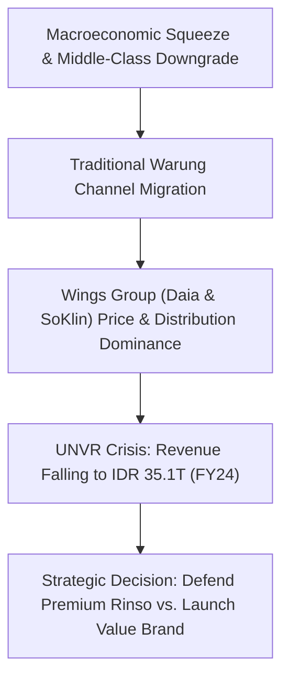

> [!NOTE] Case Metadata & Course Context
>
> - **Source Case:** SBM ITB MM5001 Marketing Management. (2026). _Unilever Indonesia (2026): Winning the Mass Market in the Archipelago_. Case Ref: SBM-ITB-MM5001-2026-01 (14 pages).
> - **Primary Dilemma:** How PT Unilever Indonesia Tbk (UNVR) can arrest domestic revenue decline (-8.7% YoY in FY24), combat the relentless rise of domestic rival Wings Group (_Daia_ and _SoKlin_), and capture the 137.5 million-strong "aspiring middle class" across Tier 2/3 Indonesian islands.
> - **Related Notes:** [[courses/mk3-marketing-management/week-01/index|Week 01 Master Lecture: Creating Customer Value]] · [[courses/mk3-marketing-management/week-01/case-unilever-brazil-low-income|Case Study: Unilever Brazil (1997–2007)]] · [[courses/mk3-marketing-management/week-01/assignment-pre-assignment-unilever|Week 01 Assignment Analysis: Unilever Cases]]

---

## 🚨 The Executive Dilemma

In early 2026, PT Unilever Indonesia Tbk (UNVR) navigated the most severe strategic crucible in its 93-year history in Indonesia.

Following peak performance in the early 2020s, UNVR's domestic business suffered sustained volume and value contraction:

- **FY 2024 Financial Performance:** Net sales dropped to **IDR 35.1 trillion** (down 8.7% YoY, driven by -3.6% price contraction and -5.2% volume decline). Net profit halved to **IDR 3.4 trillion** (Exhibit 2).
- **Macroeconomic Headwinds:** Inflation, middle-class purchasing power erosion (sluggish formal job creation, rising BPJS and food costs), geopolitical boycotts, and a 23% surge in imported plastic resin costs squeezed FMCG operating margins.
- **The Competitive Pincer:** Domestic FMCG powerhouse **Wings Group** capitalized on consumer down-trading. Through its flagship budget detergent **Daia** (retailing 20–25% below Rinso) and mid-tier **SoKlin** (7% below Rinso), Wings captured unprecedented market share across traditional trade (_warung_) channels in Java and Outer Islands.



---

## 👥 Market Demographics: The "Aspiring Middle Class"

The centerpiece of Indonesia's consumer landscape is not the affluent urban elite, but the massive **Aspiring Middle Class** (_Menuju Kelas Menengah_):

```
+--------------------------------------------------------------------------+
|                  INDONESIAN SOCIOECONOMIC STRATIFICATION                 |
+--------------------------------------------------------------------------+
  [Upper Class]           -->  ~1.2M people (0.4%) | > Rp 9.9M / capita / mo
  [Middle Class]          --> ~47.9M people (17.1%) | Rp 2.04M - Rp 9.9M / mo
  [ASPIRING MIDDLE CLASS] --> 137.5M people (49.2%) | Rp 874k - Rp 2.04M / mo
  [Vulnerable / Poor]     --> ~93.4M people (33.3%) | < Rp 874k / capita / mo
```

- **Segment Size:** Approximately **137.5 million people** (49.2% of Indonesia's ~280 million population).
- **Economic Definition:** Monthly per-capita expenditure band of **Rp 874,398 to Rp 2,040,262** (BPS / World Bank classification).
- **Consumer Behavior:** Highly aspirational yet liquidity-constrained. They desire the trust, fragrance, and status of multinational brands like Rinso, but manage daily finances on tight cash flows. As a result, they purchase laundry products in **single-use sachet formats (Rp 1,500 – Rp 2,000)** or small pouches rather than bulk 800g/1kg boxes.

---

## ⚔️ Competitive Landscape: UNVR vs. Wings Group vs. P&G

| Dimension              | PT Unilever Indonesia Tbk (UNVR)                             | Wings Group (PT Sayap Mas Utama)                                                  | P&G Indonesia                                                 |
| :--------------------- | :----------------------------------------------------------- | :-------------------------------------------------------------------------------- | :------------------------------------------------------------ |
| **Flagship Brands**    | **Rinso** (Premium, 100), **Surf** (Mid-tier, 75–80)         | **SoKlin** (Mid-tier, ~75), **Daia** (Mass, 60–65), **Boom** (Ultra-value, 45–55) | **Ariel** (Premium, 100–110), **Downy** (Softener)            |
| **Channel Strength**   | Dominant in Modern Trade (Indomaret, Alfamart, Hypermarkets) | **Unrivaled Warung Network** across 3–4 million kiosks nationwide                 | Modern trade urban supermarkets; weak rural traditional trade |
| **Sourcing Advantage** | Exposed to imported resin & global API costs                 | Domestic vertical integration; lower supply chain volatility                      | Global formulation standards; import dependence               |
| **Brand Perception**   | High trust, technological superiority, premium stain removal | _"Lokal Asli Indonesia"_, high perceived value, unbeatable affordability          | Global innovation, high performance, niche volume             |

---

## 📊 Quantitative Exhibits: Unit Economics & Channel Margins

### Exhibit 4: Unit Economics Across Brand Tiers and Pack Formats

_Source: SBM ITB Case Exhibit 4 (Illustrative estimates for pedagogical analysis)._

| SKU Format              | Brand      | Retail Shelf Price (IDR) | Est. Factory Cost (IDR) | Distributor Margin (IDR) | Warung / Retail Margin (IDR) | Est. Price per Wash Occasion |
| :---------------------- | :--------- | :----------------------: | :---------------------: | :----------------------: | :--------------------------: | :--------------------------: |
| **Powder 800g**         | **Rinso**  |        Rp 24,000         |        Rp 9,000         |         Rp 3,500         |           Rp 3,000           |         **~Rp 800**          |
| **Powder 800g**         | **Daia**   |        Rp 16,000         |        Rp 5,500         |         Rp 2,500         |           Rp 2,500           |         **~Rp 550**          |
| **Liquid 900ml Refill** | **Rinso**  |        Rp 28,000         |        Rp 11,000        |         Rp 4,000         |           Rp 3,500           |         **~Rp 700**          |
| **Liquid 900ml Refill** | **SoKlin** |        Rp 26,000         |        Rp 9,500         |         Rp 3,500         |           Rp 3,000           |         **~Rp 650**          |
| **Powder Sachet 80g**   | **Rinso**  |         Rp 2,000         |         Rp 700          |          Rp 350          |            Rp 350            |   **~Rp 1,000** (Premium)    |
| **Powder Sachet 80g**   | **Daia**   |         Rp 1,500         |         Rp 450          |          Rp 300          |            Rp 300            |         **~Rp 750**          |

> [!NOTE] The Sachet Premium Paradox
> On a per-gram basis, sachets carry a higher cost-per-wash (~Rp 1,000 vs. Rp 800 for Rinso) due to multilayer plastic packaging and handling costs. However, cash-constrained consumers gladly pay this premium because the **absolute transaction size (Rp 2,000)** fits their daily cash envelope, eliminating the prohibitive upfront capital outlay of an 800g bag (Rp 24,000).

### Exhibit 5: Channel Structure & Margin Architecture (2026)

| Retail Channel                          | Warung / Retail Markup | Distributor Markup  | Detergent Volume Share |      SKU Depth      |  Digital / POS Readiness   |
| :-------------------------------------- | :--------------------: | :-----------------: | :--------------------: | :-----------------: | :------------------------: |
| **Traditional Warung / Kiosk**          |     **20% – 30%**      |    **15% – 20%**    |     **40% – 50%**      |  Low (15–25 SKUs)   |    Nascent / Mitra Apps    |
| **Minimarkets (Indomaret / Alfamart)**  |       15% – 20%        |      10% – 15%      |     **30% – 35%**      | Medium (50–80 SKUs) | Full Digital POS / Barcode |
| **Modern Hypermarkets**                 |       15% – 20%        |      8% – 12%       |       10% – 15%        |  High (100+ SKUs)   |       Integrated EDI       |
| **Social / E-Commerce (TikTok/Shopee)** |   Platform fee 5–10%   | Direct / Wholesaler |       10% – 15%        |      Infinite       | Algorithmic live commerce  |

---

## 🧠 Bain's Elements of Value: Indonesian Mass-Market Mapping

Applying the 30-element pyramid from Almquist, Senior, & Bloch (HBR 2016) to Indonesian mass-market laundry consumers reveals critical operational insights:

```
                  /\
                 /  \
                / ST \          <-- Social Impact: Self-Transcendence (Sachet Waste / EPR)
               /------\
              /  LIFE  \        <-- Life-Changing: Provides Hope, Affiliation & Belonging
             /----------\
            /  EMOTIONAL \      <-- Emotional: Reduces Anxiety, Badge Value, Wellness
           /--------------\
          /   FUNCTIONAL   \    <-- Functional: Quality, Reduces Cost, Sensory Appeal (Wangi)
         /------------------\
```

### 1. Functional Elements

- **Quality (Cleaning Efficacy):** Non-negotiable baseline. In manual and twin-tub washing, mud and food stains must dissolve without destroying fabric.
- **Reduces Cost (Cost per Wash):** The purchasing decision is evaluated by _rupiah per wash load_, not rupiah per kilogram.
- **Sensory Appeal (_Wangi_):** Persistent fragrance is **not an optional cosmetic bonus**—it serves as the definitive sensory evidence that the wash succeeded, signaling hygiene and family pride to neighbors.

### 2. Emotional Elements

- **Reduces Anxiety:** Eliminates the fear that white school uniforms (_seragam sekolah_) will turn yellow or dull, attracting community disapproval.
- **Badge Value:** Holding or hanging a branded Rinso sachet in front of the house displays household upward mobility and discernment.

### 3. Life-Changing Elements & Debate

- **Provides Hope vs. Status Signaling:** While the case author hypothesizes that buying Rinso delivers "Provides Hope" through upward mobility, critical analysis indicates this is primarily **Badge Value** (respectability) rather than true fundamental life transformation.
- **Affiliation / Belonging:** Aligns with communal _gotong royong_ values.

### 4. Social Impact Elements

- **Self-Transcendence (Environmental Consciousness):** While looming EPR regulations and Bali's sachet ban pressure manufacturers, lower-income consumers currently view eco-friendly packaging as secondary to unit affordability and functional cleanliness.

---

## ⚖️ Strategic Options for Unilever Indonesia

1. **Option A: Premium Fortress (Protect Rinso):** Retain Rinso's premium pricing (Index 100), harvest margins, double down on liquid concentrates in minimarkets, and concede Tier 2/3 mass-market volume to Wings.
2. **Option B: Price Repositioning (Compress Rinso Price):** Reduce Rinso powder price by 15–20% to compete directly with Daia, risking severe brand equity erosion and catastrophic corporate profit collapse.
3. **Option C: Re-activate Fighter Brand / Dual-Brand Strategy:** Re-architect **Surf** or launch a dedicated mass-market fighter brand tailored for traditional trade with custom low-cost formulations, strong fragrance, and aggressive warung distribution margins.

---

## 🔗 Knowledge Graph & Curriculum Bridges

- Return to **[[courses/mk3-marketing-management/week-01/index|Week 01 Masterclass Lecture Hub]]**
- Sister Case Analysis: **[[courses/mk3-marketing-management/week-01/case-unilever-brazil-low-income|Unilever Brazil (1997–2007): Low-Income Strategy]]**
- Assignment Deep-Dive: **[[courses/mk3-marketing-management/week-01/assignment-pre-assignment-unilever|Week 01 Assignment Q&A Solution]]**
- Core Concept: **[[concepts/customer-perceived-value|Customer Perceived Value]]**
- Entity Profile: **[[entities/unilever|Unilever (Global & Indonesia)]]**
