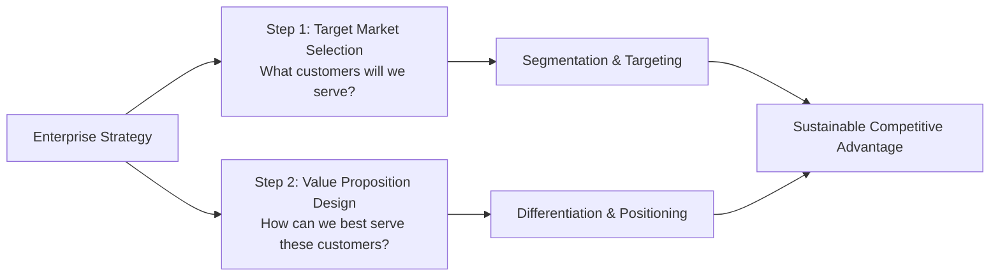
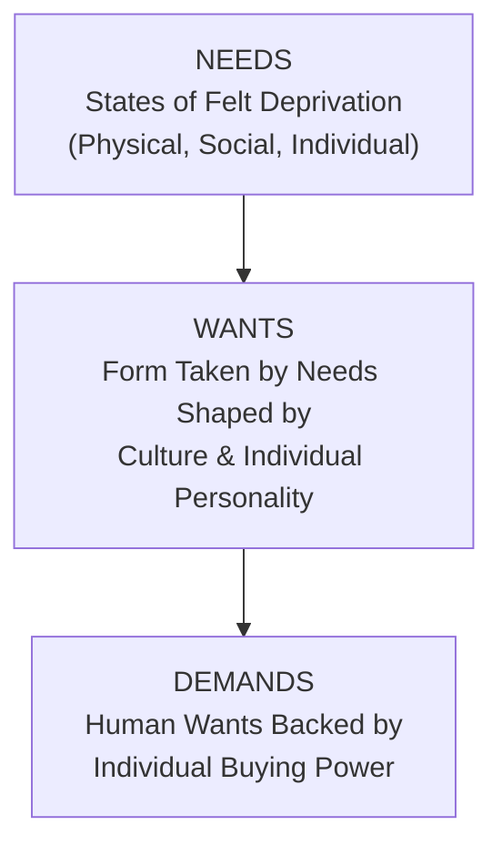
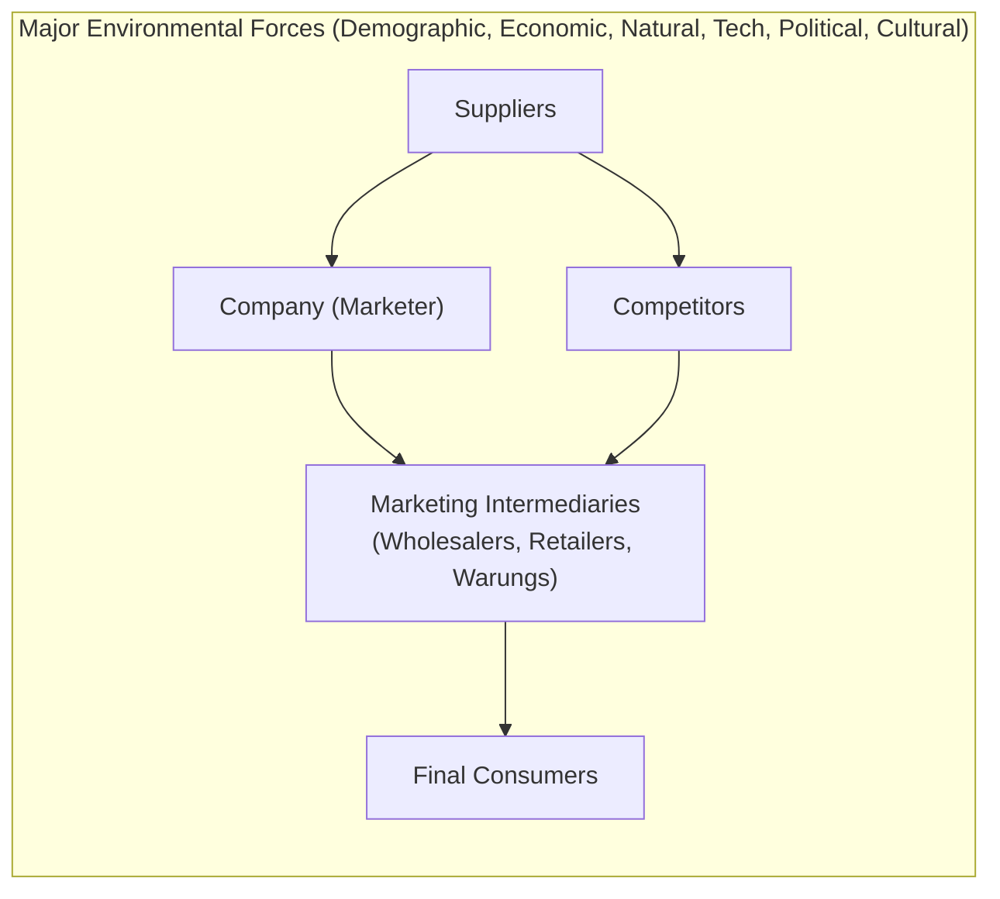
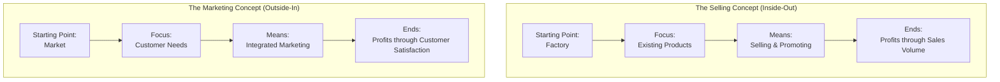
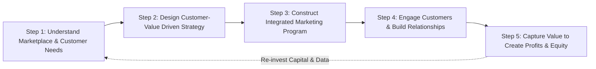
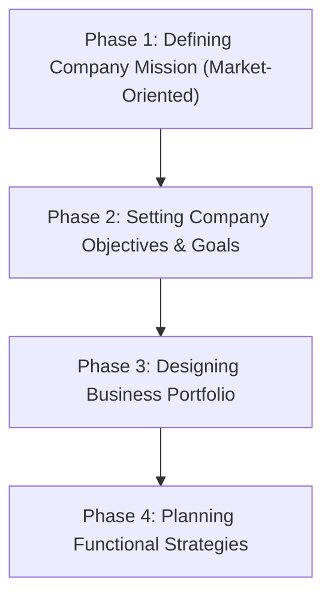
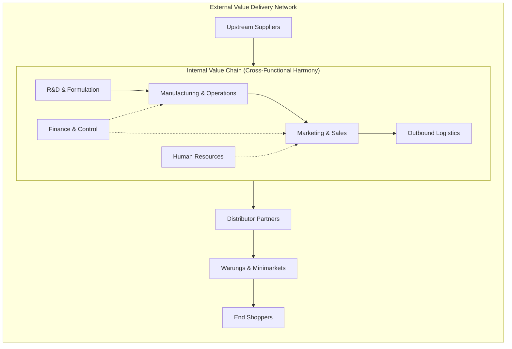
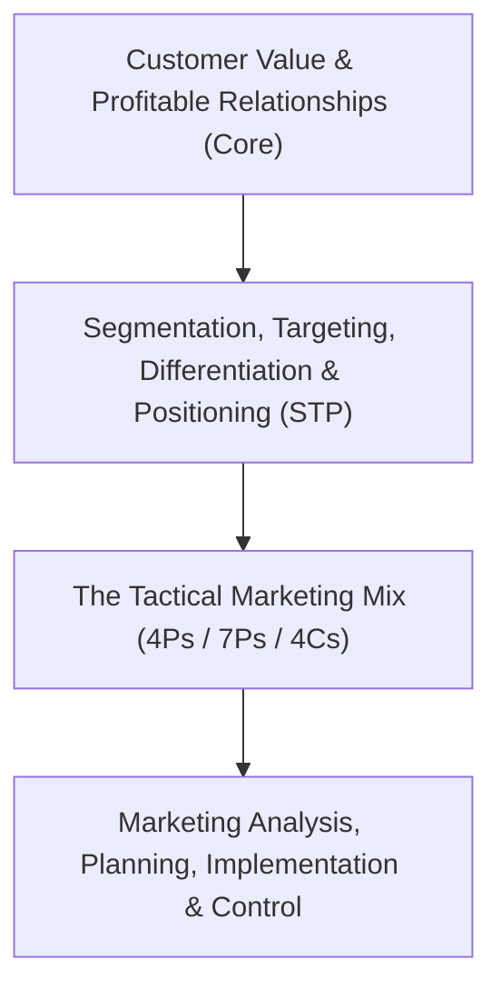
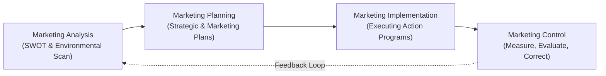
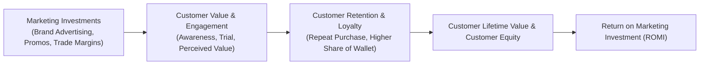

> [!NOTE] Curricular & Faculty Metadata
>
> - **Course:** MM5001 Marketing Management — Week 01
> - **Teaching Team:** Ilma Aulia Zaim, Ph.D. & Ira Fachira, Ph.D. (School of Business and Management, Institut Teknologi Bandung)
> - **Primary Curricular Spine:** SBM ITB Master Slide Deck `[P3MD] Week 1-MK3.pdf` (35 slides)
> - **Textbook Foundation:** Kotler & Armstrong, _Principles of Marketing_ (Ch. 1: "Creating Customer Value and Engagement" & Ch. 2: "Company and Marketing Strategy")
> - **Direct Satellites & Problem Sets:**
>   - Dedicated Assignment Analysis: [[courses/mk3-marketing-management/week-01/assignment-pre-assignment-unilever|Week 01 Assignment Q&A: Unilever Cases]]
>   - Case Study Dossier 1: [[courses/mk3-marketing-management/week-01/case-unilever-brazil-low-income|Unilever in Brazil (1997–2007): Low-Income Consumer Strategy]]
>   - Case Study Dossier 2: [[courses/mk3-marketing-management/week-01/case-unilever-indonesia-2026|Unilever Indonesia (2026): Winning the Mass Market in the Archipelago]]

---

## 1. Executive Overview & Foundations of Marketing Management

Marketing is frequently misunderstood in corporate practice as commercial promotion, aggressive advertising, or high-pressure selling. When enterprise leadership adopts this narrow transactional orientation, the firm falls victim to **Marketing Myopia** (Levitt, 1960)—an inward-looking preoccupation with existing products and internal operational efficiency rather than an outward obsession with customer problems and evolving marketplace needs.

```
+--------------------------------------------------------------------------+
|                     CORE DEFINITIONS OF MARKETING                        |
+--------------------------------------------------------------------------+
| 1. The Value Exchange Process:                                           |
|    Marketing is the process by which companies create value for          |
|    customers and build strong customer relationships in order to         |
|    capture value from customers in return.                               |
|                                                                          |
| 2. The Managerial Art & Science:                                         |
|    Marketing management is the art and science of choosing target        |
|    markets and getting, keeping, and growing customers through           |
|    creating, delivering, and communicating superior customer value.      |
+--------------------------------------------------------------------------+
```

### The Two Foundational Executive Questions

Every strategic marketing initiative, from multinational product launches to public-sector enterprise transformations, resolves into two executive decisions:



1. **Target Market Selection (_Whom do we serve?_):** The firm cannot be all things to all people. It must systematically segment the market into discrete customer cohorts and select target segments where its capabilities deliver distinct superiority.
2. **Value Proposition Design (_How do we serve them?_):** The set of tangible benefits, functional utilities, and psychological promises the company commits to deliver to satisfy target customer needs and differentiate itself from competitive alternatives.

---

## 2. Understanding the Marketplace & Customer Needs

Strategic marketing failure begins when organizations misunderstand the psychological hierarchy of human motivation:



### 1. The Needs-Wants-Demands Triad

- **Needs (States of Felt Deprivation):** Basic biological, social, and psychological requirements inherent in human nature:
  - _Physical Needs:_ Food, clothing, shelter, warmth, physical safety, and hygiene.
  - _Social Needs:_ Belonging, peer affection, community alignment, and social esteem.
  - _Individual Needs:_ Knowledge, curiosity, autonomy, and self-expression.
    > [!IMPORTANT] Core Principle
    > **Marketers do not create customer needs.** Needs pre-exist commercial marketing within human biology and society.
- **Wants (Culturally Shaped Manifestations):** The specific forms that human needs take as they are filtered through cultural institutions, religious beliefs, peer groups, and personal identity. (e.g., an individual _needs_ hygiene, but _wants_ a floral-scented premium bar soap or an organic liquid body wash).
- **Demands (Wants Backed by Buying Power):** Wants that are converted into commercial marketplace demand through disposable income, accessible unit sizing, appropriate price architecture, and available distribution channels. When purchasing power is constrained, wants remain unrealized unless marketers design accessible formats (such as single-use sachets).

### 2. The Modern Marketing System

Marketing operates within an interconnected system of actors and environmental forces:



Each party in the system adds value for the next tier. A failure at any node—such as stockouts at traditional retail kiosks or raw material spikes from resin suppliers—collapses the value delivered to the final consumer.

---

## 3. Marketing Management Orientations

Over the past century, enterprise commercial philosophy has evolved across five distinct orientations:

```
+--------------------------------------------------------------------------+
|                  FIVE MARKETING MANAGEMENT ORIENTATIONS                  |
+--------------------------------------------------------------------------+
  [Production]   --> Focus: Efficiency, Scale, Low Cost, Wide Availability
  [Product]      --> Focus: Engineering, Features, Technological Quality
  [Selling]      --> Focus: Hard Selling, Advertising Push, Inventory Clearance
  [Marketing]    --> Focus: Target Customer Needs, Integrated Effort, Profits via Value
  [Societal]     --> Focus: Long-Term Consumer & Environmental Well-Being (ESG)
```

| Orientation                    | Core Premise                                                                                                                             | Starting Point            | Primary Means                                                                     | Strategic End Goal                                                 | Boardroom Blindspot / Failure Mode                                                                                            |
| :----------------------------- | :--------------------------------------------------------------------------------------------------------------------------------------- | :------------------------ | :-------------------------------------------------------------------------------- | :----------------------------------------------------------------- | :---------------------------------------------------------------------------------------------------------------------------- |
| **Production Concept**         | Consumers favor products that are widely available and highly affordable.                                                                | Factory & Supply Chain    | Mass production, economies of scale, supply chain distribution.                   | Profits through scale and volume.                                  | **Myopic efficiency:** Overlooks product aesthetics, quality deterioration, and shifts in consumer taste.                     |
| **Product Concept**            | Consumers favor products offering the highest quality, performance, and innovative features.                                             | Laboratory & R&D Dept     | Continuous product improvement, technical engineering.                            | Profits through premium product superiority.                       | **The "Better Mousetrap" Fallacy:** Assumes buyers want an engineered product rather than a convenient solution to a problem. |
| **Selling Concept**            | Consumers will not buy enough of the firm's products unless undertaken with large-scale selling and promotion.                           | Factory Inventory         | Aggressive salesmanship, heavy discounting, television/push advertising.          | Profits through short-term sales volume.                           | **Transaction focus:** High customer dissatisfaction, zero repeat purchases, toxic brand equity.                              |
| **Marketing Concept**          | Achieving organizational goals depends on knowing the needs and wants of target markets and delivering satisfactions better than rivals. | Target Marketplace        | Integrated marketing across Operations, Finance, HR, and R&D.                     | Profits through customer satisfaction and long-term relationships. | Can neglect broader societal side-effects (e.g., single-use plastic waste).                                                   |
| **Societal Marketing Concept** | Marketing strategy must deliver value in a way that maintains or improves both the consumer's and society's long-term well-being.        | Society & Human Ecosystem | Sustainable formulations, circular packaging, fair-trade sourcing, social impact. | Profits through societal value and stakeholder trust.              | Short-term margin pressure; balancing investor return with ESG capital expenditures.                                          |

### Selling vs. Marketing Concept Comparison



> [!NOTE] The Customer Insight Dilemma
> As noted in lecture discussion, _"In many cases, customers don't know what they want or even what is possible."_ This requires marketers to practice **customer-driving marketing** (anticipating latent, unarticulated needs through ethnographic immersion) rather than merely **customer-driven marketing** (asking superficial survey questions).

---

## 4. Managing Customer Relationships & Capturing Customer Value

Customer relationship management (CRM) is the overall process of building and maintaining profitable customer relationships by delivering superior customer value and satisfaction.

### 1. Customer-Perceived Value (CPV)

Customers rarely evaluate market offerings objectively. They evaluate **Customer-Perceived Value (CPV)**:

$$\mathbf{CPV = Total\ Customer\ Perceived\ Benefits - Total\ Customer\ Costs}$$

$$\mathbf{CPV = (B_{\text{functional}} + B_{\text{economic}} + B_{\text{emotional}} + B_{\text{social}}) - (C_{\text{monetary}} + C_{\text{time}} + C_{\text{energy}} + C_{\text{psychological\ risk}})}$$

- To a cash-constrained consumer, **psychological risk** (the fear that a laundry detergent will ruin clothes or fail to remove stains) is a massive cost. Minimizing risk through trusted brand equity and sensory cues (_wangi_) dramatically increases net perceived value.

### 2. Customer Satisfaction & Expectation Management

Customer satisfaction depends on the product's perceived performance relative to the buyer's prior expectations:

$$\mathbf{Satisfaction = Perceived\ Performance - Prior\ Expectations}$$

- **If Performance < Expectations:** The customer is dissatisfied, driving negative word-of-mouth and brand switching.
- **If Performance = Expectations:** The customer is satisfied, but remains vulnerable to competitor promotional discounts.
- **If Performance > Expectations:** The customer is delighted, creating emotional attachment, high switching barriers, and active brand advocacy.

```
+--------------------------------------------------------------------------+
|                  THE EXECUTIVE EXPECTATION BALANCE                         |
+--------------------------------------------------------------------------+
| Setting Expectations Too High:                                           |
| -> Marketing hype over-promises performance; buyers are disappointed.    |
|                                                                          |
| Setting Expectations Too Low:                                            |
| -> Fails to attract prospective buyers or justify premium pricing.       |
|                                                                          |
| The Optimum Stance:                                                      |
| -> Set expectations that accurately reflect reality, then consistently    |
|    over-deliver on execution.                                            |
+--------------------------------------------------------------------------+
```

### 3. Customer Engagement & Digital Media Dynamics

Modern marketing has shifted from broadcast monologue to **Customer-Engagement Marketing**—fostering direct, continuous customer involvement in shaping brand conversations, experiences, and community.

- **The Omnichannel Reality:** Marketers combine traditional mass media with targeted mobile, social, and conversational commerce (WhatsApp, TikTok Shop, Shopee).
- **The Pitfall of Superficial Social Media Engagement:** Engaging consumers through digital storytelling carries high reputation risk if corporate integrity is absent. As analyzed in SBM ITB class discussions, Indonesian financial consulting firm **Jouska** leveraged viral social media content to build massive millennial brand engagement, but suffered catastrophic collapse when operational governance, regulatory compliance, and fiduciary responsibility were breached.

### 4. Customer Relationship Groups (The Loyalty Matrix)

Firms must classify customers by potential profitability and projected loyalty:

```
+--------------------------------------------------------------------------+
|                   CUSTOMER RELATIONSHIP GROUPS (KOTLER)                  |
+--------------------------------------------------------------------------+
| HIGH PROFITABILITY  |   BUTTERFLIES           |      TRUE FRIENDS        |
|                     |   Good fit of offerings |  Good fit of offerings   |
|                     |   High profit potential |  Highest profit potential|
|                     |   Short-term loyalty    |  Long-term loyalty       |
| --------------------+-------------------------+--------------------------|
| LOW PROFITABILITY   |   STRANGERS             |      BARNACLES           |
|                     |   Little fit of offering|  Limited fit of offerings|
|                     |   Lowest profit potential| Low profit potential    |
|                     |   Short-term loyalty    |  Long-term loyalty       |
| --------------------+-------------------------+--------------------------|
|                     |   SHORT-TERM LOYALTY    |  LONG-TERM LOYALTY       |
+--------------------------------------------------------------------------+
```

- **Butterflies:** Highly profitable but uncommitted. Action: Milk their transactions when active, avoid investing in long-term relationship infrastructure.
- **True Friends:** Highly profitable and loyal. Action: Continuous relationship investment, delight them, make them brand champions.
- **Strangers:** No fit, low profit. Action: Do not invest anything; make money on every single transaction.
- **Barnacles:** Highly loyal but generate negligible profits (e.g., small bank depositors who constantly use physical teller windows). Action: Attempt to cross-sell profitable services; if unprofitable, "fire" them by raising account fees.

---

## 5. The Comprehensive 5-Step Marketing Process

Slide 15 and Kotler Chapter 1 synthesize marketing into a sequential, 5-phase loop that creates value for customers in order to capture value from customers in return:



1. **Step 1: Understand the marketplace and customer needs/wants.** Conduct market research, analyze consumer insights, and monitor the macro-environment.
2. **Step 2: Design a customer-value driven marketing strategy.** Decide _whom to serve_ (market segmentation and targeting) and _how to serve them_ (differentiation and positioning). Select the guiding marketing management orientation.
3. **Step 3: Construct an integrated marketing program that delivers superior value.** Translate strategy into tactics via the **Marketing Mix (4Ps/7Ps)**: Product design, value-based Pricing, omnichannel Place distribution, and promotional Communication.
4. **Step 4: Engage customers, build profitable relationships, and create customer delight.** Implement CRM, foster interactive digital communities, and manage customer touchpoints.
5. **Step 5: Capture value from customers to create profits and customer equity.** Harvest the economic return: customer lifetime value (CLV), sustainable market share, brand equity, and Return on Marketing Investment (ROMI).

---

## 6. Company-Wide Strategic Planning & Marketing's Role

Strategic planning is the managerial process of developing and maintaining a strategic fit between the organization's goals and capabilities and its changing marketing opportunities.



### 1. Defining the Market-Oriented Company Mission

A company mission statement is an enduring statement of purpose—what the organization wants to accomplish in the larger environment. It must be **market-oriented** (defined in terms of satisfying basic customer needs) rather than **product-oriented** (defined in terms of goods or technologies):

| Corporation          | Product-Oriented Mission (Myopic)                       | Market-Oriented Mission (Customer-Centric)                                                      |
| :------------------- | :------------------------------------------------------ | :---------------------------------------------------------------------------------------------- |
| **Nike**             | "We sell sports shoes and athletic apparel."            | _"To bring inspiration and innovation to every athlete in the world."_                          |
| **Google**           | "We operate an internet search engine."                 | _"To organize the world's information and make it universally accessible and useful."_          |
| **PT KAI (Persero)** | "We run diesel locomotives and passenger train cars."   | _"To deliver seamless, safe, and integrated multimodal transport experiences."_                 |
| **Unilever**         | "We manufacture soaps, detergents, and packaged foods." | _"To make sustainable living commonplace by meeting everyday needs for hygiene and nutrition."_ |

### 2. Setting Company Objectives and Goals

The corporate mission must be translated into specific supporting objectives at every management tier:

```
+--------------------------------------------------------------------------+
|                  HIERARCHY OF STRATEGIC OBJECTIVES                       |
+--------------------------------------------------------------------------+
| BUSINESS OBJECTIVES (Corporate Level):                                   |
| - Build profitable customer relationships across all divisions           |
| - Invest in sustainable R&D (biodegradable surfactants, recycled plastic)|
| - Achieve 15% Return on Capital Employed (ROCE)                          |
|                                                                          |
| MARKETING OBJECTIVES (Functional Level):                                 |
| - Increase market volume share in Tier 2/3 cities by 450 bps             |
| - Expand traditional trade warung distribution to 2.5 million kiosks     |
| - Launch regional budget powder format at 80% price index of flagship   |
+--------------------------------------------------------------------------+
```

---

## 7. Business Portfolio Analysis Frameworks

Management must evaluate the firm's collection of businesses and products (Strategic Business Units or SBUs) to allocate scarce capital effectively.

### 1. The Boston Consulting Group (BCG) Growth-Share Matrix

The BCG matrix evaluates SBUs along two quantitative axes: **Market Growth Rate** (vertical axis, proxy for market attractiveness) and **Relative Market Share** (horizontal axis, proxy for company competitive strength):

```
+--------------------------------------------------------------------------+
|                      THE BCG GROWTH-SHARE MATRIX                         |
+--------------------------------------------------------------------------+
| HIGH MARKET GROWTH  |   STARS                 |   QUESTION MARKS         |
|                     |   High Share, High Growth|  Low Share, High Growth  |
|                     |   Requires heavy capital |  Requires heavy cash to  |
|                     |   to fund rapid growth;  |  turn into star; risk    |
|                     |   becomes cash cow.      |  becoming a cash trap.   |
| --------------------+-------------------------+--------------------------|
| LOW MARKET GROWTH   |   CASH COWS             |   DOGS                   |
|                     |   High Share, Low Growth |  Low Share, Low Growth   |
|                     |   Generates surplus cash;|  Generates enough cash   |
|                     |   funds stars & ? marks; |  to maintain itself; no  |
|                     |   low reinvestment need. |  growth promise; divest. |
| --------------------+-------------------------+--------------------------|
|                     |   HIGH RELATIVE SHARE   |   LOW RELATIVE SHARE     |
+--------------------------------------------------------------------------+
```

- **Four Portfolio Strategies:**
  1. _Build:_ Invest cash to increase market share (ideal for promising Question Marks).
  2. _Hold:_ Invest just enough to maintain current share (ideal for Cash Cows).
  3. _Harvest:_ Milk short-term cash flow regardless of long-term effect (weak Cash Cows, Question Marks).
  4. _Divest:_ Sell or liquidate the unit to deploy capital elsewhere (Dogs, failing Question Marks).

### 2. The Ansoff Product/Market Expansion Grid

Firms identify future growth opportunities through four corporate pathways:

```
+--------------------------------------------------------------------------+
|                     ANSOFF PRODUCT/MARKET EXPANSION GRID                 |
+--------------------------------------------------------------------------+
|                     | EXISTING PRODUCTS       | NEW PRODUCTS             |
| --------------------+-------------------------+--------------------------|
| EXISTING MARKETS    | 1. MARKET PENETRATION   | 3. PRODUCT DEVELOPMENT   |
|                     | Increase sales to       | Offer modified or new    |
|                     | existing customer base  | products to existing     |
|                     | without changing product| customer segments.       |
| --------------------+-------------------------+--------------------------|
| NEW MARKETS         | 2. MARKET DEVELOPMENT   | 4. DIVERSIFICATION       |
|                     | Identify & develop new  | Start or acquire         |
|                     | market segments for     | businesses outside       |
|                     | current company products| current products/markets.|
+--------------------------------------------------------------------------+
```

- **Market Penetration in Action:** Unilever marketing Rinso through promotional multipacks and increased wash-frequency campaigns to existing Indonesian urban middle-class consumers.
- **Market Development in Action:** Unilever taking existing detergent formulations into previously unserved Northeast Brazilian favelas or rural Outer Indonesia islands.
- **Product Development in Action:** Unilever formulating _Rinso Matic_ liquid detergent optimized specifically for front-loading automatic washing machines.
- **Diversification in Action:** Unilever acquiring gourmet condiment brands (_Bango_ sweet soy sauce) or plant-based consumer wellness businesses.

---

## 8. Partnering for Value: Internal Value Chain vs. External Value Delivery Network

No marketing department can create and deliver customer value alone. Enterprise success depends on cross-functional and inter-organizational alignment:



### 1. The Internal Value Chain (Porter)

Each corporate department is a link in the firm's internal value-creating activities:

- **Marketing vs. Operations Friction:** Marketing desires wide SKU variety, rapid custom packaging, and sudden promotional surges to capture volatile customer demand. Operations prioritizes long, predictable production runs, low machine changeover downtime, and minimal SKU complexity.
- **Marketing vs. Finance Friction:** Marketing treats brand advertising and distributor margin allowances as strategic capital investments. Finance views them as period expenses that compress operating margins and demand verifiable, short-term ROI hurdles.
- **Marketing vs. HR:** Marketing relies on frontline service personnel (e.g., station gate staff at PT KAI, beauty advisors in retail stores) to execute brand promises; HR must recruit and train for emotional empathy and diagnostic skill.

### 2. The Value Delivery Network

The network comprised of the company, suppliers, independent logistics providers, distributors, and retail partners who partner with each other to improve the performance of the entire commercial system:

- In FMCG emerging markets, **the wholesaler and retailer are not mere conduits—they are full strategic partners**. If small mom-and-pop kiosks (_warungs_) do not receive credit terms, healthy margins, and high-frequency van replenishment, the best-formulated detergent will never reach the consumer.

---

## 9. Marketing Strategy & Tactical Execution: STP, 4Ps, 7Ps, and 4Cs

At the operational core of marketing management sits the customer value strategy (STP), executed through the marketing mix:



### 1. Strategic STP

- **Segmentation:** Dividing a total market into distinct groups of buyers with different needs, characteristics, or behaviors.
- **Targeting:** Evaluating each market segment's attractiveness and selecting one or more segments to enter.
- **Differentiation:** Differentiating the firm's market offering to create superior customer value.
- **Positioning:** Arranging for a product to occupy a clear, distinctive, and desirable place relative to competing products in the minds of target consumers.

### 2. The 4Ps and 7Ps Marketing Mix

The tactical toolkit used to produce the desired response in the target market:

```
+--------------------------------------------------------------------------+
|                     THE 4Ps & EXTENDED 7Ps MARKETING MIX                 |
+--------------------------------------------------------------------------+
| PRODUCT: Variety, quality, design, features, brand name, packaging.      |
| PRICE: List price, discounts, allowances, payment period, credit terms.  |
| PLACE: Channels, coverage, assortments, locations, inventory, logistics. |
| PROMOTION: Advertising, personal selling, sales promotion, PR, digital.  |
| ------------------------------------------------------------------------ |
| EXTENDED FOR SERVICES (7Ps):                                             |
| PEOPLE: Frontline service staff, training, culture, customer interaction.|
| PROCESS: Service blueprint, flow of activities, wait times, automation.  |
| PHYSICAL EVIDENCE: Store atmosphere, packaging tangibles, receipts, UI. |
+--------------------------------------------------------------------------+
```

### 3. Re-Framing 4Ps to 4Cs: The Customer-Centric Mirror

| 4Ps (Seller Perspective) | 4Cs (Customer Perspective) | Managerial Transformation                                                                                                                          |
| :----------------------- | :------------------------- | :------------------------------------------------------------------------------------------------------------------------------------------------- |
| **Product**              | **Customer Solution**      | Shift from pushing product features to delivering a validated, holistic solution to a real customer pain point.                                    |
| **Price**                | **Customer Cost**          | Move beyond shelf price to consider total cost of acquisition, usage, maintenance, per-wash cost, and disposal.                                    |
| **Place**                | **Convenience**            | Move beyond channel logistics to ensure purchasing is frictionless, located within walking distance, and available in flexible payment increments. |
| **Promotion**            | **Communication**          | Shift from one-way corporate broadcasting to continuous, interactive two-way dialog and credible social proof.                                     |

---

## 10. Managing the Marketing Effort: SWOT, Planning & Control

Managing the marketing effort requires four integrated management functions:



### 1. Marketing Analysis (SWOT Matrix)

The firm evaluates its internal capabilities against external market forces:

- **Internal Strengths:** Technological patents, brand equity, deep warung distribution network, low-cost domestic manufacturing.
- **Internal Weaknesses:** Vulnerability to imported raw material costs, lack of presence in rural traditional trade, high corporate overhead.
- **External Opportunities:** 137.5 million aspiring middle-class consumers, growing demand for biodegradable formulations, rapid adoption of QRIS and digital ordering apps.
- **External Threats:** Geopolitical boycotts, looming EPR plastic packaging regulations, aggressive price discounting by agile domestic rivals (Wings Group).

### 2. The Eight Components of a Formal Marketing Plan

1. **Executive Summary:** Brief overview of the main goals, market dilemma, and recommendations.
2. **Current Marketing Situation:** Market description, target segment review, product performance review, competitor landscape, and channel review.
3. **Threats and Opportunities Analysis (SWOT):** Assessment of external market shifts and internal operational readiness.
4. **Objectives and Issues:** Specific quantitative targets (sales volume, market share, gross margin) and qualitative hurdles (brand perception).
5. **Marketing Strategy:** The overarching logic: target market selection, value proposition, STP choices, and 4Ps positioning.
6. **Action Programs:** Detailed operational schedules (_What will be done? When will it be done? Who is responsible? How much will it cost?_).
7. **Budgets:** Projected profit-and-loss statement showing expected revenue, COGS, marketing expenditures, and contribution margin.
8. **Controls:** Milestones, monthly KPI dashboards, monitoring mechanisms, and contingency plans for corrective action.

### 3. Implementation and Marketing Control

- **The Execution Gap:** _"It is often easier to think up good marketing strategies than to carry them out."_ Implementation requires cross-level organizational alignment, incentive structures, and operational discipline.
- **Operating Control:** Ongoing checks of ongoing performance against the annual plan (monitoring monthly sales, distributor stockouts, promotional lift).
- **Strategic Control:** Periodic, comprehensive audits of whether the company's basic marketing strategy remains suited to its changing market opportunities (evaluating whether the entire brand portfolio needs restructuring).

---

## 11. Measuring Return on Marketing Investment (ROMI)

In modern corporate governance, Chief Marketing Officers face intense scrutiny from Chief Financial Officers to justify marketing expenditures with verifiable financial returns:

$$\mathbf{ROMI = \frac{\Delta Net\ Contribution\ Attributable\ to\ Marketing - Marketing\ Investment}{Marketing\ Investment}}$$



Beyond short-term sales spikes, marketing builds **Customer Equity**—the total combined customer lifetime values of all the company's current and prospective customers. Maximizing customer equity produces sustainable enterprise shareholder value.

---

## 12. Real-World Case Synthesis: Mass-Market Bottom-of-the-Pyramid Dynamics

The foundational marketing models analyzed in this lecture were tested through two extensive real-world case crucibles across emerging markets:

```
+--------------------------------------------------------------------------+
|                  COMPARATIVE MASS-MARKET CASE MATRIX                     |
+--------------------------------------------------------------------------+
| STRATEGIC CRITERIA    | UNILEVER BRAZIL (1997–2007) | UNILEVER INDONESIA (2026)  |
| ----------------------+-----------------------------+----------------------------|
| Core Case Subject     | Guimaraes & Chandon (INSEAD)| SBM ITB Case Series        |
| Demographic Focus     | 48M Northeast Brazil Pop.   | 137.5M Aspiring Middle Cl. |
| Economic Baseline     | Minimum Wage (R$ 112/mo)    | Rp 874k - Rp 2.04M exp/mo  |
| Washing Ritual        | Manual washing in rivers/tubs| Manual + twin-tub machine |
| Legacy Flagship       | Omo (Premium 100 Index)     | Rinso (Premium 100 Index)  |
| Competitor Threat     | Unbranded local bar soaps   | Wings Group (Daia & SoKlin)|
| Core Challenge        | Cannibalization of Omo      | Revenue contraction (-8.7%)|
| Channel Architecture  | 75,000 *Invisíveis* Grocers | 3–4M Traditional Warungs   |
| Winning Formulation   | Gentle on hands, high scent | Strong *wangi*, quick-foam |
+--------------------------------------------------------------------------+
```

### Strategic Lessons from the Case Dossiers

1. **The Fallacy of the "Price Shopper" (Brazil):** In [[courses/mk3-marketing-management/week-01/case-unilever-brazil-low-income|Unilever Brazil]], low-income consumers like Maria Conceição ranked price **5th out of 6 detergent attributes (only 13%)**, prioritizing stain removal (24%) and fragrance (20%). Low-income consumers are extreme **value seekers** who cannot afford product failure.
2. **The Sachet Paradox (Indonesia):** In [[courses/mk3-marketing-management/week-01/case-unilever-indonesia-2026|Unilever Indonesia]], cash-constrained households pay a higher per-gram unit price for single-use sachets (~Rp 1,000/wash for Rinso sachet vs. Rp 800/wash for 800g box) because the **absolute transaction outlay (Rp 2,000)** matches their daily cash-flow envelope.
3. **The Power of Channel Dominance:** In both Latin America and Southeast Asia, multinational superiority in modern hypermarkets is insufficient. Market leadership is decided in the **traditional trade** (the 75,000 invisíveis in Northeast Brazil and the 3+ million warungs in Indonesia). Domestic challenger **Wings Group** achieved market dominance with _Daia_ by offering higher retailer margins (20–30%), direct store van delivery, and formulations engineered for high fragrance (_wangi_).

---

## 13. Required Readings, Cases & Problem Sets

| Document / Asset                      |    Type    | Source Institution | Curricular Focus & Core Contribution                                                                                             | Study Satellite                                                                                        |
| :------------------------------------ | :--------: | :----------------: | :------------------------------------------------------------------------------------------------------------------------------- | :----------------------------------------------------------------------------------------------------- |
| **Unilever in Brazil (1997–2007)**    | Case Study |       INSEAD       | Marketing to low-income consumers, Maria Conceição, Omo cannibalization risks, and specialized distributor economics.            | [[courses/mk3-marketing-management/week-01/case-unilever-brazil-low-income\|Open INSEAD Case Dossier]] |
| **Unilever Indonesia (2026)**         | Case Study |      SBM ITB       | Archipelago mass-market defense, UNVR financial reset, Wings Group (_Daia_), and Bain Elements of Value application.             | [[courses/mk3-marketing-management/week-01/case-unilever-indonesia-2026\|Open SBM ITB Case Dossier]]   |
| **Week 01 Assignment Q&A Analysis**   | Assignment |   SBM ITB MM5001   | Complete 10-question pre-assignment diagnostic, F9 (Class F / Syndicate 9) & Maintainer reference models, and cold-call debrief. | [[courses/mk3-marketing-management/week-01/assignment-pre-assignment-unilever\|Open Assignment Brief]] |
| **Principles of Marketing (Ch. 1–2)** |  Textbook  | Kotler & Armstrong | Foundational theory on customer value, marketing management orientations, BCG growth-share matrix, and the marketing mix.        | _Raw Textbook Reference_                                                                               |

---

## 14. Primary Source Media & Digital Archives

| Material Title                           |                Media Type                | Direct Repository Reference                                             |
| :--------------------------------------- | :--------------------------------------: | :---------------------------------------------------------------------- |
| **Foundations: Creating Customer Value** |       Lecture Slide Deck (`.pdf`)        | `raw/courses/mk3/week-01/[P3MD] Week 1-MK3.pdf`                         |
| **Week 1 Pre-Assignment Prompt**         |        Assignment Prompt (`.pdf`)        | `raw/courses/mk3/week-01/[P3MD] Week 1-MK3 -Pre Assignment.pdf`         |
| **F9 (Class F / Syndicate 9) Analysis**  | Reference Deliverable (`.pdf` / `.docx`) | `raw/courses/mk3/week-01/Final_Group 9 - Pre-Assignment Week 1_MK3.pdf` |
| **Portal Maintainer Research Synthesis** |         Research Notes (`.pdf`)          | `raw/courses/mk3/week-01/Havergal_Week1-MK3_Pre-Assignment.pdf`         |
| **Catatan Kuliah MM5001 Week 1**         |          Class Notes (`.docx`)           | `raw/courses/mk3/week-01/Catatan Week 1 Marketing Management.docx`      |

---

## 15. Knowledge Graph & Curriculum Bridges

- **Core Frameworks & Metrics in Knowledge Base:**
  - [[concepts/customer-perceived-value|Customer Perceived Value (CPV)]]
  - [[concepts/elements-of-value|Bain's Elements of Value]]
- **Enterprise & Theorist Profiles:**
  - [[entities/ilma-aulia-zaim|Ilma Aulia Zaim, Ph.D. (Lead Lecturer)]]
  - [[entities/unilever|Unilever (Global & Indonesia)]]
  - [[entities/wings-group|Wings Group (PT Sayap Mas Utama)]]
  - [[entities/philip-kotler|Philip Kotler (Father of Modern Marketing)]]
- **Next Curricular Module:**
  - Return to **[[courses/mk3-marketing-management/index|MK3 Course Overview]]**
  - Week 02: [[courses/mk3-marketing-management/index|Analyzing the Marketing Environment]] _(Scheduled)_
