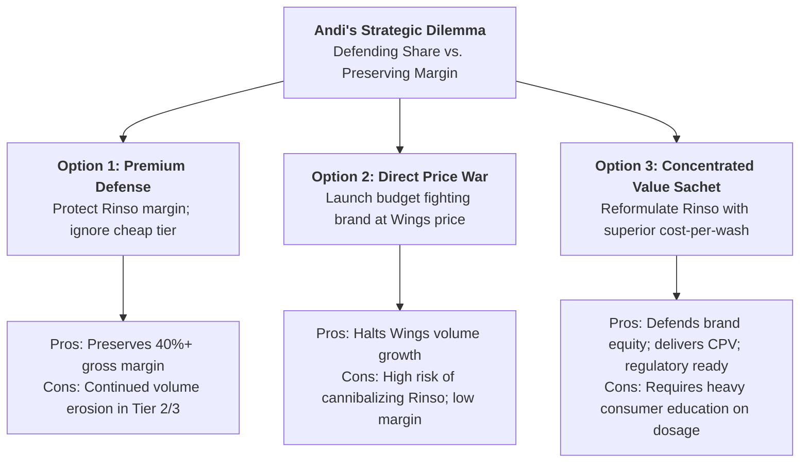

> [!NOTE] Assignment Context & Attribution
>
> - **Course:** MM5001 Marketing Management — Week 02
> - **Source Prompt:** `archive/courses/mk3/week-02/[P3MD] Week 2-MK3 -Pre Assignment.pdf`
> - **Reference Attribution:** Analytical synthesis contributed by **F9 (Class F / Syndicate 9)**
> - **Parent Lecture:** [[courses/mk3-marketing-management/week-02/index|Week 02 Master Lecture Hub: Analyzing the Marketing Environment]]
> - **Core Frameworks:** [[concepts/five-c-analysis|5C Environmental Analysis Framework]], [[concepts/customer-perceived-value|Customer Perceived Value (CPV)]]

---

## 🎯 Executive Synopsis & Problem Dilemma

The executive dilemma centers on **Andi**, Category Lead for Fabric Cleaning at [[entities/unilever|PT Unilever Indonesia Tbk]]. Facing market share erosion in mass-market laundry detergents from aggressive domestic rival [[entities/wings-group|Wings Group]] (Daia, SoKlin), Andi must formulate a defensible strategic plan.

Wings commands a 20–25% price advantage in powder detergents and leverages deep rural traditional trade (_warung_) distribution. Meanwhile, macroeconomic shifts—including the expansion of the "Aspiring Middle Class," rising consumer adoption of washing machines, the rollout of digital payments (QRIS), and impending government regulations targeting single-use plastic sachets by 2030—challenge Unilever’s historical premium positioning.

---

## 📊 The 20-Fact Evidentiary 5C Inventory Table

Every case observation is classified under the [[concepts/five-c-analysis|5C Framework]] and verified using explicit evidentiary tags:

- **`[V]` Verified**: Audited, central bank, or official statistical data.
- **`[E]` Case-Writer Estimate**: Academic case modeling without external audit.
- **`[I]` Illustrative**: Pedagogical construct or testing hypothesis.
- **`[U]` Unclear / Unverified**: Unverified third-party estimate or proposed policy.

| Vector            |  Code   | Case Fact / Evidence Statement                                                                   |  Tag  | Empirical Source                           | Strategic Relevance to Decision-Maker                                                                |
| :---------------- | :-----: | :----------------------------------------------------------------------------------------------- | :---: | :----------------------------------------- | :--------------------------------------------------------------------------------------------------- |
| **Company**       | `[Co1]` | UNVR home-care market share fell from ~38–39% to ~34–35% during 2022–2023.                       | `[U]` | Third-party fabric-care research           | Highlights urgency of counter-offensive; indicates competitive vulnerability.                        |
| **Company**       | `[Co2]` | Rinso brand maintains market leadership in premium powder and liquid detergent tiers.            | `[V]` | Case narrative & historical brand tracking | Core brand equity asset; must be shielded from price dilution and down-market brand erosion.         |
| **Company**       | `[Co3]` | Multi-tier manufacturing plants in Cikarang operate at high automated efficiency.                | `[V]` | Corporate operational profile              | Provides operational scale, but fixed overhead limits rapid low-cost micro-batch reformulation.      |
| **Company**       | `[Co4]` | Corporate commitment to Unilever Sustainable Living Plan (USLP) packaging targets.               | `[V]` | Corporate sustainability report            | Constrains reliance on cheap multi-layer plastic packaging; creates compliance friction.             |
| **Customers**     | `[Cu1]` | Aspiring middle-class population stands at ~137.5 million people (49.2% of national population). | `[E]` | BPS / World Bank categorization            | Defines the massive addressable target segment seeking quality at strict price caps.                 |
| **Customers**     | `[Cu2]` | Aspiring-class monthly expenditure per person ranges from Rp 874,398 to Rp 2,040,262.            | `[V]` | BPS official expenditure bands             | Establishes the absolute purchasing power ceiling; necessitates sachet cash-outlay pricing.          |
| **Customers**     | `[Cu3]` | Consumers evaluate detergent value by "cost per wash occasion" rather than price per kg.         | `[I]` | Case analytical framework                  | Core pricing hypothesis: high active ingredients can justify higher unit price if dosage is lower.   |
| **Customers**     | `[Cu4]` | Stain-removal efficacy and long-lasting fragrance (_wangi_) are baseline hygiene factors.        | `[I]` | Case consumer value modeling               | Non-negotiable functional requirements; budget reformulations that sacrifice fragrance will fail.    |
| **Customers**     | `[Cu5]` | Twin-tub semi-automatic washing machine adoption is rising in Tier 2 and Tier 3 cities.          | `[U]` | Retail appliance channel reports           | Triggers consumer migration from hand-wash powders to liquid machine detergent formulations.         |
| **Competitors**   | `[Cp1]` | Daia powder is 20–25% cheaper than Rinso; SoKlin liquid is ~7% cheaper than Rinso liquid.        | `[V]` | Retail shelf price audits (2025)           | Quantifies the price gap Andi must overcome through perceived efficacy or package sizing.            |
| **Competitors**   | `[Cp2]` | Wings Group commands an entrenched, exclusive distribution network across rural warungs.         | `[U]` | Industry distribution profile              | Major barrier to entry; rival sales reps service warungs with high frequency and credit flexibility. |
| **Competitors**   | `[Cp3]` | Wings’ domestic chemical sourcing reduces exposure to imported resin and currency volatility.    | `[U]` | Trade source commentary                    | Structural cost advantage enabling Wings to sustain aggressive price wars during FX swings.          |
| **Competitors**   | `[Cp4]` | Local value players market aggressive promotional bundles (e.g., "Buy 1 Get 1" sachet strings).  | `[V]` | Retail POS observations                    | Drives retail trial and pantry-loading among budget-conscious household shoppers.                    |
| **Collaborators** | `[Cl1]` | Traditional trade (_warung_) accounts for 40–50% of total national detergent sales volume.       | `[U]` | Industry market estimates                  | Confirms that winning the mass market requires dominating fragmented traditional channels.           |
| **Collaborators** | `[Cl2]` | An estimated 3 to 4 million warungs operate across Indonesia.                                    | `[U]` | Ministry of Cooperatives & SMEs (2023)     | Illustrates channel fragmentation; requires multi-tiered wholesale and distributor networks.         |
| **Collaborators** | `[Cl3]` | Modeled distribution markups: Warung (20–30%), Distributor (15–20%) over factory price.          | `[I]` | Case economic exhibit                      | Demonstrates trade margin requirements; any new SKU must protect retailer gross margins.             |
| **Collaborators** | `[Cl4]` | Bank Indonesia QRIS digital payment system reached >30 million merchant touchpoints.             | `[V]` | Bank Indonesia official data (Q3 2024)     | Digital payment infrastructure enables direct-to-warung trade promotions and loyalty programs.       |
| **Collaborators** | `[Cl5]` | Distributor working capital credit terms dictate whether warungs maintain full SKU variety.      | `[U]` | Field trade interviews                     | Liquidity-constrained warung owners stock fast-turning SKUs that offer 14-day credit terms.          |
| **Context**       | `[Ct1]` | Population of ~280 million is distributed across ~17,000 archipelago islands.                    | `[V]` | BPS National Census                        | Maritime logistics costs create significant price markups outside Java-Bali.                         |
| **Context**       | `[Ct2]` | Ministry of Environment regulation targets complete phase-out of single-use sachets by 2030.     | `[V]` | Ministry regulatory roadmap                | Threatens long-term viability of single-use sachets; demands development of circular formats.        |

---

## ⚖️ Strategic Alternatives Matrix

---

## 🎯 Executive Recommendation & Implementation Roadmap

**Syndicate 9 Recommendation: Hybrid Value Innovation Strategy (Option 3 with Targeted Trade Interventions)**

1. **Retain and Protect Rinso Equity**: Reject across-the-board price discounting. Instead, reformulate with high-efficiency concentrated surfactants, marketing **Cost Per Wash Occasion (Rp 500/wash)** rather than pack price.
2. **Channel Margin Realignment**: Incentivize warung owners by offering 22% retail margins (surpassing Wings' 20%) paired with QRIS-linked distributor rebates to secure front-of-counter hanging strip placement.
3. **Regulatory Future-Proofing (2026–2030)**: Pilot refillable dispenser stations in high-density urban residential pockets to anticipate the 2030 single-use sachet ban, building a competitive moat before rivals react.

---

## 🎙️ Classroom Cold-Call & Boardroom Defense

### Cold-Call 1: _"Why shouldn't Unilever simply launch a cheap fighting brand to crush Daia?"_

> **Defense**: A fighting brand requires separate advertising capex, dedicated distribution slotting, and risks severe **cannibalization** of Rinso. Furthermore, Wings Group possesses lower corporate overhead and localized chemical sourcing. Engaging in a pure cost-price war plays into the competitor's structural strength. Unilever wins by redefining value around cleaning speed and fragrance longevity.

### Cold-Call 2: _"Why is the single-use sachet phase-out a strategic opportunity rather than a regulatory crisis?"_

> **Defense**: If sachets are banned by 2030, all players face disruption. However, Unilever possesses the global R&D capacity and capital to pioneer concentrated powders, dissolvable pods, and bulk dispensing. Moving early allows Unilever to shape the regulatory standards with the Ministry of Environment, leaving regional competitors stranded with non-compliant packaging lines.

---

## 🔗 Knowledge Graph & Bridges

- Master Lecture Hub: [[courses/mk3-marketing-management/week-02/index|MK3 Week 02: Analyzing the Marketing Environment]]
- Associated Concept: [[concepts/five-c-analysis|5C Environmental Analysis Framework]]
- Corporate Profiles: [[entities/unilever|Unilever Indonesia]], [[entities/wings-group|Wings Group]]
