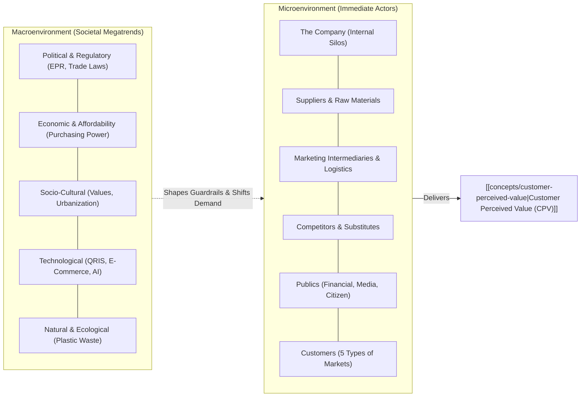
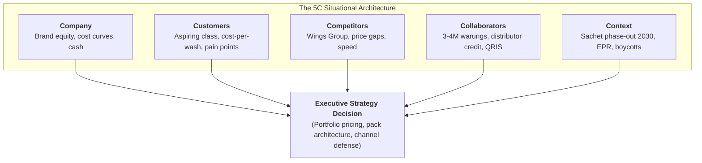

> [!NOTE] Curricular & Faculty Metadata
>
> - **Course:** MM5001 Marketing Management — Week 02
> - **Teaching Team:** [[entities/ilma-aulia-zaim|Ilma Aulia Zaim, Ph.D.]] & [[entities/ira-fachira|Ira Fachira, Ph.D.]] (School of Business and Management, Institut Teknologi Bandung)
> - **Primary Curricular Spine:** SBM ITB Master Slide Deck `[P3MD] Week 2-MK3.pdf` (38 slides)
> - **Textbook Foundation:** Kotler & Armstrong, _Principles of Marketing_ (Ch. 3: "Analyzing the Marketing Environment")
> - **Direct Satellites & Problem Sets:**
>   - Dedicated Assignment Analysis: [[courses/mk3-marketing-management/week-02/assignment-pre-assignment-5c-environment|Week 02 Assignment Debrief: 5C Environmental Analysis & Strategic Options]]

---

## 1. Executive Overview & The Environmental Scanning Imperative

No commercial enterprise operates in a vacuum. Even organizations with superior products and dominant market share collapse when leadership fails to anticipate structural shifts in the **Marketing Environment**—the actors and forces outside marketing that affect management's ability to build and maintain successful customer relationships.

Modern marketing strategy categorizes these forces into two interconnected spheres:

Enterprise failure rarely originates from engineering defects; it stems from **Environmental Blindness**—misdiagnosing collaborator channel power, underestimating low-tier competitor agility, or ignoring shifting customer affordability thresholds.

---

## 2. Theoretical Architecture: Micro vs. Macro Environment

### 1. The Microenvironment: The Value-Delivery Network

The microenvironment consists of actors close to the company that directly impact its ability to serve customers:

1. **The Company**: Internal departments (R&D, Purchasing, Operations, HR, Finance). Marketing leadership must break functional silos to align the internal value chain with customer promises.
2. **Suppliers**: Provide resources required to produce goods. Supplier delays, material price volatility (e.g., petrochemical resin spikes), and labor strikes directly destabilize pricing power.
3. **Marketing Intermediaries**: Resellers, physical distribution firms (3PLs), marketing service agencies, and financial intermediaries. In emerging markets like Indonesia, traditional trade (_warung/toko kelontong_) and distributor credit terms govern market access.
4. **Competitors**: Strategic positioning requires achieving competitive advantage by offering greater [[concepts/customer-perceived-value|Customer Perceived Value]] than rivals. Firms must monitor direct rivals (e.g., [[entities/unilever|Unilever]] vs. [[entities/wings-group|Wings Group]]) and indirect substitute categories.
5. **Publics**: Any group that has an actual or potential interest in or impact on an organization’s ability to achieve its objectives (Financial, Media, Government, Citizen-Action, Local, General, and Internal publics).
6. **Customers**: The focal point of the network. Divided into five customer markets: consumer markets, business markets, reseller markets, government markets, and international markets.

### 2. The Macroenvironment: PESTLE Forces

The macroenvironment consists of broader societal forces that influence the entire microenvironment:

| Macro Force            | Core Analytical Dimensions                                                                       | Indonesian Market Crucible (2026)                                                                                                                       |
| :--------------------- | :----------------------------------------------------------------------------------------------- | :------------------------------------------------------------------------------------------------------------------------------------------------------ |
| **Demographic**        | Population growth, age structure, family structures, geographic shifts, educational attainment.  | **Demographic Dividend**: ~280 million population across 17,000 islands; rapid urbanization; expanding "Aspiring Middle Class" (~137.5 million people). |
| **Economic**           | Income distribution, purchasing power, inflationary pressure, expenditure patterns.              | BPS/World Bank threshold: Aspiring class spends Rp 874,398–2,040,262/month/person. High price sensitivity dictates single-use unit packaging.           |
| **Natural / Physical** | Shortage of raw materials, energy costs, environmental pollution, sustainability mandates.       | Government target to phase out single-use plastic sachets by 2030; impending Extended Producer Responsibility (EPR) regulations.                        |
| **Technological**      | Digital connectivity, automation, digital payments, packaging innovations.                       | **Fintech Explosion**: Bank Indonesia QRIS adoption exceeding 30 million merchant touchpoints, integrating traditional warungs into digital ecosystems. |
| **Political / Legal**  | Government regulations, state-owned enterprise monopolies, consumer protection, fair trade laws. | Halal certification compliance mandates (BPJPH); local content requirements (TKDN); antitrust monitoring (KPPU).                                        |
| **Socio-Cultural**     | Core beliefs, secondary values, religious norms, consumer boycott movements.                     | Social media amplification of geopolitical sentiment (e.g., boycott pressures impacting multinational brands).                                          |

---

## 3. Managerial Crucible: The 5C Framework & Evidentiary Tagging

To synthesize micro and macro environmental forces into executive action, strategists deploy the [[concepts/five-c-analysis|5C Environmental Analysis Framework]] (**Company, Customers, Competitors, Collaborators, Context**).

### The Evidentiary Quality Floor

To eliminate superficial guesswork in board-level strategy, data points are audited through explicit **Evidentiary Tagging**:

- **`[V]` Verified**: Audited corporate filings, official central bank statistics (BI), or statistical bureau data (BPS).
- **`[E]` Case-Writer Estimate**: Academic case modeling or industry analyst approximations.
- **`[I]` Illustrative Hypothesis**: Pedagogical constructs or unvalidated pricing assumptions to be tested.
- **`[U]` Unclear / Unverified**: Anecdotal market rumors, disputed trade counts, or prospective policy targets.

---

## 4. Cross-Functional Implementation & Strategic Trade-offs

When navigating aggressive rival price wars in mass consumer markets:

1. **Marketing vs. Finance**: Marketing advocates defending market share by launching a lower-priced "fighting brand" or matching competitor price cuts. Finance warns that aggressive discounting dilutes gross margins and cannibalizes premium SKUs.
2. **Operations vs. Sustainability**: Operations seeks long production runs of standardized multi-layer plastic sachets to minimize packaging costs. Sustainability and Legal warn of imminent EPR penalties and brand reputation damage from plastic leakage in maritime ecosystems.

---

## 📚 Required Readings & In-Depth Satellites

| Document Title                                    | Author / Institution     | Core Focus / Methodological Contribution                                                 | Study Note                                                                                                     |
| :------------------------------------------------ | :----------------------- | :--------------------------------------------------------------------------------------- | :------------------------------------------------------------------------------------------------------------- |
| **5C Environmental Analysis & Strategic Options** | F9 Syndicate 9 & SBM ITB | 20-point verified evidentiary audit and strategic options for Indonesian FMCG leadership | [[courses/mk3-marketing-management/week-02/assignment-pre-assignment-5c-environment\|Open Assignment Debrief]] |

---

## 📂 Primary Source Media & Digital Archives

| Material Title                            |        Media Type         | Archival Path                                                                        |
| :---------------------------------------- | :-----------------------: | :----------------------------------------------------------------------------------- |
| **[P3MD] Week 2-MK3 Presentation**        |   Presentation (`.pdf`)   | `archive/courses/mk3/week-02/[P3MD] Week 2-MK3.pdf`                                  |
| **Week 2 Pre-Assignment Brief**           | Assignment Guide (`.pdf`) | `archive/courses/mk3/week-02/[P3MD] Week 2-MK3 -Pre Assignment.pdf`                  |
| **Syndicate 9 Pre-Assignment Submission** |  Word Document (`.docx`)  | `archive/courses/mk3/week-02/FINAL BOSS Week 2-Pre Assignment MK 3 _ Marketing.docx` |

---

## 🔗 Knowledge Graph & Curriculum Bridges

- **Featured Frameworks in Knowledge Matrix**:
  - [[concepts/five-c-analysis|5C Environmental Analysis Framework]]
  - [[concepts/customer-perceived-value|Customer Perceived Value (CPV)]]
  - [[concepts/elements-of-value|Bain's Elements of Value]]
- **Enterprise Profiles**:
  - [[entities/unilever|Unilever PLC / PT Unilever Indonesia Tbk]]
  - [[entities/wings-group|Wings Group (PT Sayap Mas Utama)]]
- **Next Curricular Module**: [[courses/mk3-marketing-management/week-03/index|Week 03: Managing Marketing Information & Customer Insights (Part 1)]]
- Return to **[[courses/mk3-marketing-management/index|MK3 Course Overview]]**
