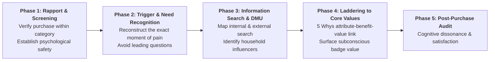

> [!NOTE] Assignment Context & Attribution
>
> - **Course:** MM5001 Marketing Management — Week 03
> - **Source Prompt:** `archive/courses/mk3/week-03/CDS_PreClass_Assignment_ConsumerBehaviorInterview.pdf`
> - **Reference Attribution:** Analytical synthesis contributed by **F9 (Class F / Syndicate 9)** & **the Portal Maintainer**
> - **Parent Lecture:** [[courses/mk3-marketing-management/week-03/index|Week 03 Master Lecture Hub: Consumer Behavior & Customer Decision Stripe]]
> - **Target Case:** [[courses/mk3-marketing-management/week-03/case-customer-decision-stripe-interview|Customer Decision Stripe Case Dossier]]

---

## 🎯 Executive Synopsis & Assignment Objectives

The purpose of this field research exercise is to test textbook consumer behavior models against live marketplace reality through one-on-one, in-depth qualitative interviews.

Each student was assigned one of six case profiles (CDS A through F) from `Pembagian CDS - Kelas F.xlsx` and instructed to interview two external respondents (one male, one female) who recently purchased a product in that category. The exercise forces researchers to uncover:

1. The real **Decision-Making Unit (DMU)** in household purchasing.
2. The core motivations (Utilitarian vs. Hedonic vs. Social).
3. The discrepancy between what consumers _say_ drove their purchase vs. what _actually_ triggered the transaction.

---

## 🛠️ The Qualitative Interview Protocol & Diagnostic Toolkit

### Core Probing Questions

- **Need Recognition**: _"Take me back to the exact day or situation when you realized you needed to buy this. Where were you? What had just happened?"_
- **DMU Audit**: _"Who else was present or consulted before you paid? Did anyone advise against it? Whose opinion mattered most?"_
- **Trade-Off Analysis**: _"What was the second-choice brand you almost bought? What single factor made you reject it at the final moment?"_
- **Laddering (The 5 Whys)**:
  - _Interviewer_: _"Why did having 512GB storage matter to you?"_
  - _Respondent_: _"So I don't have to delete photos."_
  - _Interviewer_: _"Why is having to delete photos a problem?"_
  - _Respondent_: _"Because my past work portfolio is stored there."_
  - _Interviewer_: _"And why does keeping that work portfolio accessible matter?"_
  - _Respondent_: _"Because I need to feel confident that I'm always prepared for freelance opportunities."_ _(Value: Professional Security & Autonomy)_.

---

## 📊 Cross-Syndicate Comparative Findings (Class F / Syndicate 9)

Synthesizing interviews across CDS A (Low-Involvement FMCG), CDS B (High-Functionality Durables), and CDS C (Identity-Expressive Fashion):

| Interview Dimension                                    | Male Respondent (CDS B: Laptop)                                                                                                | Female Respondent (CDS C: Perfume / Bag)                                                                                    | Male Respondent (CDS A: Snack / Cigarette)                                                      |
| :----------------------------------------------------- | :----------------------------------------------------------------------------------------------------------------------------- | :-------------------------------------------------------------------------------------------------------------------------- | :---------------------------------------------------------------------------------------------- |
| **Product Acquired**                                   | Lenovo ThinkPad / Asus ROG                                                                                                     | Designer Eau de Parfum                                                                                                      | Specialty Dark Chocolate / Cigarettes                                                           |
| **Price Point**                                        | Rp 16,500,000                                                                                                                  | Rp 1,850,000                                                                                                                | Rp 45,000                                                                                       |
| **Stated Purchase Reason**                             | "Needed faster CPU for data processing and coding."                                                                            | "Wanted a clean, long-lasting scent for daily office."                                                                      | "Felt tired after a long meeting."                                                              |
| **Actual Latent Motivation (Uncovered via Laddering)** | **Anxiety Reduction & Peer Respect**: Fear of laptop freezing during executive client pitches; gaming performance on weekends. | **Social Badge Value & Self-Reward**: Validating promotion; projecting professional elegance and sensory poise in meetings. | **Stress Relief & Dopamine Reset**: Physiological habit loop; mental break from screen fatigue. |
| **Buying Center (DMU)**                                | User (Self) + Influencer (Colleague tech advice) + Buyer (Self).                                                               | Solo Buyer; validated via Instagram/TikTok reviews.                                                                         | Solo Buyer; impulse purchase at cashier counter.                                                |
| **External Environment Impact**                        | Tokopedia 0% installment promotions; tech YouTube benchmark videos.                                                            | Office culture; fragrance trend on TikTok beauty channels.                                                                  | Point-of-sale eye-level shelf placement at convenience store.                                   |

---

## 💡 Key Conceptual Takeaways for Marketing Planning

1. **The "Reasonable Justification" Bias**: Consumers consistently articulate rational, utilitarian reasons to justify emotionally or socially driven purchases. A consumer rarely admits, _"I spent Rp 2 million to feel superior to my peers"_; they will claim, _"It was on sale and the ingredients are organic."_
2. **The Power of Inertia in Low-Involvement Goods**: In CDS A/D, brand loyalty is often passive habit rather than active devotion. If the preferred brand is missing from the shelf, 70% of shoppers will purchase an adjacent substitute within 5 seconds rather than visit another store.
3. **Cognitive Dissonance in High-Ticket Items**: Post-purchase confirmation is vital in CDS B/E. High-ticket buyers actively consume positive reviews of their chosen product _after_ buying to reassure themselves they made the right choice.

---

## 🔗 Knowledge Graph & Bridges

- Master Lecture Hub: [[courses/mk3-marketing-management/week-03/index|MK3 Week 03: Consumer Behavior & Customer Decision Stripe]]
- Case Analysis: [[courses/mk3-marketing-management/week-03/case-customer-decision-stripe-interview|CDS Profiles A through F]]
- Core Concepts: [[concepts/customer-perceived-value|Customer Perceived Value]], [[concepts/elements-of-value|Bain's Elements of Value]], [[concepts/marketing-research-methodologies|Marketing Research Diagnostic Methodologies]]
