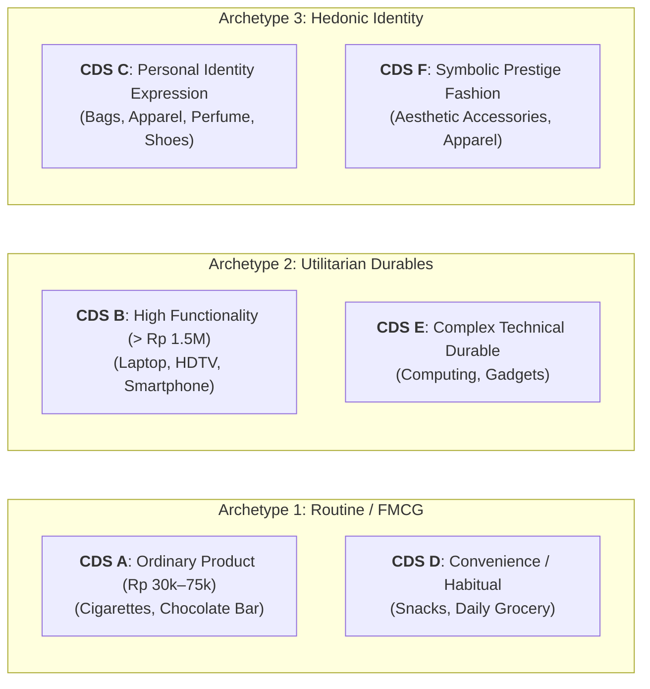

## 🚨 The Executive Dilemma

Marketing executives frequently design customer acquisition funnels assuming a uniform consumer decision journey: the consumer becomes aware of a need, rationally compares alternative brands on spec sheets, and transacts.

In reality, consumer choice deviates across product categories and price thresholds. A consumer buying a pack of cigarettes or chocolate bar operates on rapid sub-conscious habitual scripts; an engineer buying a flagship smartphone or high-end laptop conducts extensive technical forensics; an executive purchasing a luxury designer bag or fragrance is negotiating personal identity, social validation, and self-worth.

The **Customer Decision Stripe (CDS)** case series audits consumer decision mechanics across three distinct product pairings (A through F), challenging students to uncover the true behavioral drivers beneath stated consumer explanations.

---

## 🏢 Enterprise & Category Background: The 6 CDS Profiles

### Profile Descriptions

1. **CDS A & CDS D (Low-Involvement Convenience FMCG)**:
   - _Target Price Band_: Rp 30,000 – Rp 75,000.
   - _Behavioral Modality_: Inertia, routine replenishment, and impulse point-of-sale triggers.
   - _Decision Unit_: Solo individual; zero deliberation; immediate availability (_Place_) dominates.
2. **CDS B & CDS E (High-Functionality Utilitarian Durables)**:
   - _Target Price Band_: > Rp 1,500,000.
   - _Behavioral Modality_: Cognitive problem solving, active benchmark cross-checking, and performance anxiety.
   - _Decision Unit_: Multi-actor household buying center (e.g., child user, tech-savvy peer influencer, parent decider/buyer).
3. **CDS C & CDS F (Symbolic Identity-Expressive Goods)**:
   - _Target Price Band_: Moderate to High (discretionary spend).
   - _Behavioral Modality_: Hedonic gratification, self-concept enhancement, and social reference group alignment.
   - _Decision Unit_: Highly emotional personal choice, filtered through reference group approval and aesthetic resonance.

---

## 📈 Quantitative Exhibits & Behavioral Comparison

| Analytical Dimension           | CDS A / D (Convenience FMCG)      | CDS B / E (Utilitarian Durables)   | CDS C / F (Identity Fashion)        |
| :----------------------------- | :-------------------------------- | :--------------------------------- | :---------------------------------- |
| **Price Point**                | Rp 30,000 – Rp 75,000             | > Rp 1,500,000                     | Rp 250,000 – Rp 5,000,000+          |
| **Search Time Invested**       | < 60 seconds at retail rack       | 2 to 6 weeks online & in-store     | 1 to 4 weeks visual browsing        |
| **Number of Brands Evaluated** | 1 (habitual) or 2 (in-store swap) | 3 to 5 benchmarked on specs        | 4 to 8 evaluated on aesthetic fit   |
| **Role of Buying Center**      | 100% Solo Buyer                   | 65% Multi-person Household DMU     | 80% Solo Buyer with Peer Validation |
| **Dominant Pain Point**        | Out-of-stock friction             | Overpaying or buying obsolete tech | Buyer's remorse; looking outdated   |
| **Post-Purchase State**        | Immediate consumption             | Anxiety / Cognitive Dissonance     | Mood elevation / Social affirmation |

---

## ⚖️ Strategic Alternatives Matrix for Marketers

| Strategic Lever           | Low Involvement (CDS A/D)                                      | Utilitarian Durables (CDS B/E)                                     | Identity Goods (CDS C/F)                                     |
| :------------------------ | :------------------------------------------------------------- | :----------------------------------------------------------------- | :----------------------------------------------------------- |
| **Product Strategy**      | Standardized quality; sensory appeal (_wangi_, taste).         | Technical superiority; modular warranties; durable specs.          | Design aesthetics; limited editions; badge styling.          |
| **Pricing Strategy**      | Accessible cash-outlay price points (e.g., sachet/pack price). | Total cost of ownership; installment financing (PayLater).         | Prestige pricing; psychological price thresholds.            |
| **Distribution Strategy** | Intensive ubiquity (warung, checkout counters).                | Selective / Omnichannel (experience stores + official e-commerce). | Exclusive / Curated (lifestyle boutiques, social commerce).  |
| **Promotion Strategy**    | Repetitive top-of-mind ads; in-store trade displays.           | Comparative spec tables; tech influencer deep-dives.               | Lifestyle storytelling; influencer aesthetics; social proof. |

---

## 🎯 Executive Recommendation & Implementation Roadmap

1. **Avoid Category Cross-Contamination**: Never market a high-functionality durable (CDS B) with pure emotional fluff, and never market a fashion identity product (CDS C) with dry engineering spec sheets.
2. **Channel-Journey Alignment**: For low-involvement goods, invest 70% of commercial budget into distribution availability and eye-level shelf presence; for high-involvement durables, invest in transparent comparison engines and return policies to eliminate cognitive dissonance.

---

## 🎙️ Classroom Cold-Call & Boardroom Defense

### Cold-Call 1: _"If a smartphone costs over Rp 15 million, is it CDS B (Utilitarian) or CDS C (Identity-Expressive)?"_

> **Defense**: It is a hybrid, but often pivots to CDS C. While consumers justify flagship smartphones through utilitarian specs (camera megapixels, processor speed), the purchase is frequently driven by social badge value, status signaling, and peer belonging. A marketer who only promotes the chip architecture will lose to Apple, which markets creative self-actualization.

---

## 🔗 Knowledge Graph & Bridges

- Master Lecture Hub: [[courses/mk3-marketing-management/week-03/index|MK3 Week 03: Consumer Behavior & Customer Decision Stripe]]
- Assignment Analysis: [[courses/mk3-marketing-management/week-03/assignment-consumer-behavior-interview|Week 03 Interview Assignment Debrief]]
- Foundational Frameworks: [[concepts/customer-perceived-value|Customer Perceived Value]], [[concepts/elements-of-value|Elements of Value]]
