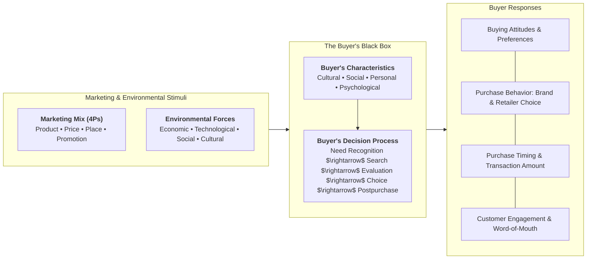
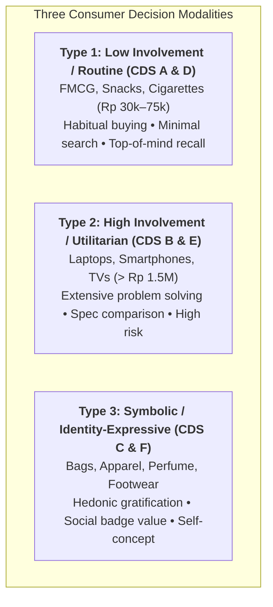

> [!NOTE] Curricular & Faculty Metadata
>
> - **Course:** MM5001 Marketing Management — Week 03
> - **Teaching Team:** [[entities/ilma-aulia-zaim|Ilma Aulia Zaim, Ph.D.]] & [[entities/ira-fachira|Ira Fachira, Ph.D.]] (School of Business and Management, Institut Teknologi Bandung)
> - **Primary Curricular Spine:** SBM ITB Master Slide Deck `[P3MD] Week 3-MK3.pdf` (36 slides)
> - **Textbook Foundation:** Kotler & Armstrong, _Principles of Marketing_ (Ch. 5: "Consumer Markets and Buyer Behavior")
> - **Direct Satellites & Problem Sets:**
>   - Case Study Dossier: [[courses/mk3-marketing-management/week-03/case-customer-decision-stripe-interview|Customer Decision Stripe (CDS): Archetypes A through F]]
>   - Dedicated Assignment Analysis: [[courses/mk3-marketing-management/week-03/assignment-consumer-behavior-interview|Week 03 Assignment Debrief: Consumer Behavior Depth Interview Exercise]]

---

## 1. Executive Overview & The Black Box of Consumer Behavior

Generating actionable marketing insight requires moving beyond superficial sales dashboards into the psychological and sociological drivers of consumer choice. Marketers must decode the **Model of Buyer Behavior**—often termed the **"Buyer's Black Box"**:

As taught by Dr. Ira Fachira, customer research frequently fails because managers assume buyers make purely rational, utility-maximizing calculations. In reality, purchasing decisions span a continuum from **automatic low-involvement habits** to **high-stakes technical evaluations** and **identity-expressive symbolic badge consumption**.

---

## 2. Psychological & Social Foundations of Consumer Choice

A consumer's purchase choices are shaped by four deeply embedded behavioral layers:

### 1. Cultural Factors (The Broadest Influence)

- **Culture**: The fundamental determinant of wants and behavior learned through family and societal institutions (e.g., the Indonesian cultural values of _Gotong Royong_, community harmony, and family interdependence).
- **Subculture**: Groups of people with shared value systems based on common life experiences (e.g., regional ethnicities—Javanese, Sundanese, Minang; religious affiliations; digital gamer communities).
- **Social Class**: Ordered social divisions whose members share similar values, interests, and behavior, measured by multi-variate factors (occupation, income, education, wealth).

### 2. Social Factors

- **Reference Groups**: Groups that have a direct or indirect influence on consumer attitudes or behavior:
  - _Membership Groups_: Direct membership (family, colleagues).
  - _Aspirational Groups_: Groups an individual wishes to belong to (celebrities, executive leaders).
  - _Dissociative Groups_: Groups whose values a consumer actively rejects.
- **Opinion Leaders & Word-of-Mouth**: Influencers who exert social influence due to special skills, knowledge, or personality.
- **Family**: The most influential consumer buying organization in society.

### 3. Personal Factors

- **Age and Life-Cycle Stage**: Changing tastes across youth, marriage, parenthood, empty nest, and retirement.
- **Economic Situation & Occupation**: Disposable income, savings, interest rates, and employment stability.
- **Lifestyle (AIO Framework)**: Activities, Interests, and Opinions profiling how an individual interacts with the world.
- **Personality & Self-Concept**: Unique psychological traits (e.g., self-confidence, dominance, adaptability) and how goods reflect identity.

### 4. Psychological Factors

- **Motivation**: A need that is sufficiently pressing to direct the person to seek satisfaction (Maslow’s Hierarchy; Freud's subconscious drives).
- **Perception**: The process by which people select, organize, and interpret information (_Selective Attention, Selective Distortion, Selective Retention_).
- **Learning**: Changes in an individual’s behavior arising from experience (Drives $\rightarrow$ Cues $\rightarrow$ Responses $\rightarrow$ Reinforcement).
- **Beliefs and Attitudes**: A person’s descriptive thoughts and enduring favorable/unfavorable evaluations toward an object.

---

## 3. The Customer Decision Stripe (CDS) Architecture

In field research, customer journeys are audited through the **Customer Decision Stripe (CDS)**. Decision pathways differ fundamentally across product categories:

| Decision Dimension      | Type 1: Convenience / Low-Involvement                                          | Type 2: Utilitarian / High-Functionality                                                     | Type 3: Identity-Expressive / Hedonic                                                |
| :---------------------- | :----------------------------------------------------------------------------- | :------------------------------------------------------------------------------------------- | :----------------------------------------------------------------------------------- |
| **Typical Basket Size** | Rp 30,000 – Rp 75,000                                                          | > Rp 1,500,000                                                                               | Variable (Rp 200,000 – Multi-Million)                                                |
| **Decision Cycle**      | Seconds to Minutes (Impulse / Habit)                                           | Weeks to Months (Extensive Research)                                                         | Days to Weeks (Emotional Deliberation)                                               |
| **Information Search**  | Passive; driven by shelf visibility                                            | Active; technical reviews, benchmarks                                                        | Social browsing; peer validation, aesthetic fit                                      |
| **Primary Value Tier**  | [[concepts/elements-of-value          \| Functional: Reduces Effort, Quality]] | [[concepts/customer-perceived-value             \| Functional & Economic: Durability, Spec]] | [[concepts/elements-of-value \| Emotional & Life-Changing: Badge Value, Aesthetics]] |
| **Post-Purchase Risk**  | Negligible; easy brand switching                                               | High Cognitive Dissonance; buyer regret                                                      | Social embarrassment; identity incongruence                                          |

---

## 4. Managerial Crucible: The Qualitative Depth Interview

To audit consumer behavior without falling into the [[concepts/marketing-research-methodologies|Causality vs Correlation Trap]], marketers execute **In-Depth Qualitative Interviews**:

1. **Laddering / "The 5 Whys" Technique**: Probing beyond functional attributes to reach psychological consequences and core personal values:
   $$\text{Attribute (e.g., 120Hz Screen)} \longrightarrow \text{Consequence (Smoother Navigation)} \longrightarrow \text{Value (Personal Competence \& Peace of Mind)}$$
2. **Neutral Probing Without Leading**: Asking open-ended behavioral questions (_"Take me back to the moment you realized you needed a new laptop..."_) rather than suggestive prompts (_"Did you buy this because it was fast?"_).
3. **Auditing the Buying Center**: Identifying who in the household served as Initiator, Influencer, Decider, Buyer, and User.

---

## 📚 Required Readings & In-Depth Satellites

| Document Title                                 | Author / Institution     | Core Focus / Methodological Contribution                                             | Study Note                                                                                                   |
| :--------------------------------------------- | :----------------------- | :----------------------------------------------------------------------------------- | :----------------------------------------------------------------------------------------------------------- |
| **Customer Decision Stripe (CDS) Cases A–F**   | SBM ITB Case Series      | 6 consumer decision archetypes across FMCG, electronics, and fashion categories      | [[courses/mk3-marketing-management/week-03/case-customer-decision-stripe-interview\|Open Case Dossier]]      |
| **Consumer Behavior Depth Interview Exercise** | F9 Syndicate 9 & SBM ITB | Field research methodology, interview transcripts, and comparative decision analysis | [[courses/mk3-marketing-management/week-03/assignment-consumer-behavior-interview\|Open Assignment Debrief]] |

---

## 📂 Primary Source Media & Digital Archives

| Material Title                     |      Media Type       | Archival Path                                                                       |
| :--------------------------------- | :-------------------: | :---------------------------------------------------------------------------------- |
| **[P3MD] Week 3-MK3 Presentation** | Presentation (`.pdf`) | `archive/courses/mk3/week-03/[P3MD] Week 3-MK3.pdf`                                 |
| **CDS Profiles A through F**       | Case Briefs (`.pdf`)  | `archive/courses/mk3/week-03/CDS A.pdf` ... `CDS F.pdf`                             |
| **CDS Interview Assignment Guide** |    Guide (`.pdf`)     | `archive/courses/mk3/week-03/CDS_PreClass_Assignment_ConsumerBehaviorInterview.pdf` |
| **Class F CDS Allocations**        | Spreadsheet (`.xlsx`) | `archive/courses/mk3/week-03/Pembagian CDS - Kelas F.xlsx`                          |

---

## 🔗 Knowledge Graph & Curriculum Bridges

- **Featured Frameworks in Knowledge Matrix**:
  - [[concepts/customer-perceived-value|Customer Perceived Value (CPV)]]
  - [[concepts/elements-of-value|Bain's Elements of Value]]
  - [[concepts/marketing-research-methodologies|Marketing Research Diagnostic Methodologies]]
  - [[concepts/b2b-buying-center|B2B Buying Center & DMU Roles]]
- **Next Curricular Module**: [[courses/mk3-marketing-management/week-04/index|Week 04: Managing Marketing Information & Customer Insights (Part 2) — B2B Marketing]]
- Return to **[[courses/mk3-marketing-management/index|MK3 Course Overview]]**
