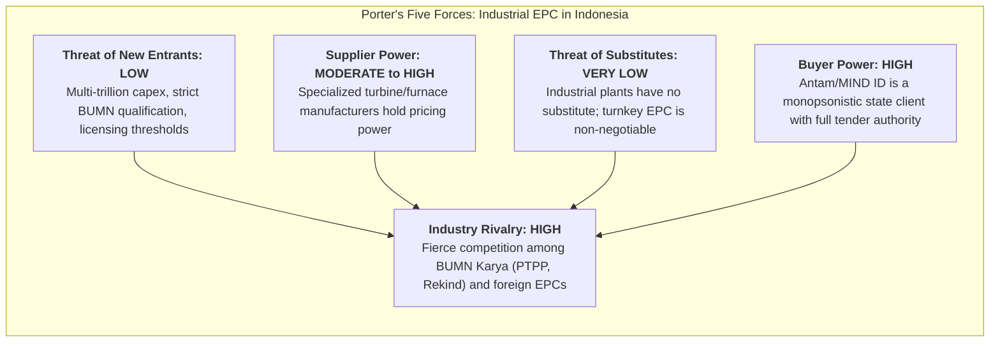

> [!NOTE] Assignment Context & Attribution
>
> - **Course:** MM5001 Marketing Management — Week 04
> - **Source Prompts:** `archive/courses/mk3/week-04/WIKA_Pre-Assignment Instruction.pdf` & `Group 9 – Post-Assignment.pdf`
> - **Reference Attribution:** Analytical synthesis contributed by **F9 (Class F / Syndicate 9)**
> - **Parent Lecture:** [[courses/mk3-marketing-management/week-04/index|Week 04 Master Lecture Hub: B2B Marketing & Organizational Buying]]
> - **Target Case:** [[courses/mk3-marketing-management/week-04/case-wika-epc-champion|WIKA and the Building EPC Champion Program (2026)]]
> - **Core Frameworks:** [[concepts/b2b-buying-center|B2B Buying Center & DMU Roles]], [[concepts/five-c-analysis|5C Environmental Analysis]], Porter's Five Forces

---

## 🎯 Executive Synopsis & Analytical Boundary Correction

In synthesizing the B2B marketing challenge facing [[entities/pt-wijaya-karya|PT Wijaya Karya (WIKA)]] in the industrial EPC sector, **Syndicate 9 established a critical methodological distinction**:

> [!IMPORTANT] Methodological Epistemic Boundary
> **PESTLE describes external macroenvironmental forces exclusively.** Internal firm conditions—such as WIKA’s debt restructuring, liquidity defaults, internal organizational silos, or historical client goodwill—are internal firm variables, not PESTLE forces. Conflating internal corporate distress with external macro environment produces flawed strategic diagnosis.

---

## 📊 1. Macroenvironmental (PESTLE) Analysis

| Macro Factor           | Case Evidence & Context                                                                                                                                                                                                                 | Effect on WIKA in Antam Relationship                                                                                                                 | Evidentiary Confidence |
| :--------------------- | :-------------------------------------------------------------------------------------------------------------------------------------------------------------------------------------------------------------------------------------- | :--------------------------------------------------------------------------------------------------------------------------------------------------- | :--------------------: |
| **Political**          | Government mandate for domestic mineral downstreaming (_hilirisasi_) under Ministry of Energy and Mineral Resources (ESDM). Strong pressure on state miners (MIND ID/Antam) to award contracts to state-owned contractors (BUMN Karya). | **Mixed**: Fosters demand for smelters, but politicizes project deadlines and heightens audit scrutiny from BPKP/LKPP.                               |       **Strong**       |
| **Economic**           | Fluctuations in global London Metal Exchange (LME) nickel prices; high domestic commercial bank interest rates; tightening credit access for state infrastructure contractors.                                                          | **Unfavorable**: Volatile commodity prices make Antam cautious with capex; high financing costs strain contractor working capital.                   |       **Strong**       |
| **Social**             | Increasing local community demands for employment and environmental compliance in mining regions (e.g., Southeast Sulawesi / Halmahera).                                                                                                | **Mixed**: Demands community relations capabilities that WIKA possesses, but increases site overhead.                                                |      **Moderate**      |
| **Technological**      | Industry transition toward High-Pressure Acid Leach (HPAL) technology for EV battery chemicals vs conventional Rotary Kiln Electric Furnace (RKEF) ferronickel smelters.                                                                | **Unfavorable**: HPAL requires proprietary international chemical engineering licenses, favoring global EPC partnerships.                            |       **Strong**       |
| **Legal / Regulatory** | Stringent state procurement regulations (Perpres Pengadaan Barang/Jasa Pemerintah) and anti-corruption auditing standards.                                                                                                              | **Unfavorable**: Client procurement officers face severe legal liability if an awarded contractor fails to deliver, prompting extreme risk aversion. |       **Strong**       |
| **Environmental**      | Stricter carbon emission standards, slag waste management protocols, and renewable energy integration requirements for industrial smelters.                                                                                             | **Mixed**: Demands cleaner engineering standards, raising total project complexity and capex.                                                        |      **Moderate**      |

---

## 🔬 2. Porter's Five Forces: Industrial EPC Segment

1. **Bargaining Power of Buyers (HIGH)**: State mining clients represent large, concentrated accounts. Antam commands absolute leverage over contract terms, milestone schedules, and penalty clauses.
2. **Competitive Rivalry (HIGH)**: Due to contraction in domestic civil infrastructure (toll roads), civil contractors (PTPP, Adhi Karya) are aggressively pivoting into industrial EPC to secure cash flow, triggering fierce price competition.
3. **Bargaining Power of Suppliers (MODERATE TO HIGH)**: Specialized smelter equipment suppliers (e.g., Outotec, Metso, specialized boiler manufacturers) hold global technical monopolies with long lead times.
4. **Threat of New Entrants (LOW)**: Massive capital bonding requirements, technical pre-qualification registries, and political-institutional relationships block speculative new entrants.
5. **Threat of Substitutes (VERY LOW)**: No substitute exists for physical turnkey engineering and commissioning of a metallurgical plant.

---

## 🏢 3. Competitor Deep-Dive: PTPP, Rekind, and Chiyoda

| Competitor                        | Strategic & Financial Position                                                                                          | Directness of Competition for Antam / MIND ID                                                                                 | Opening Created by WIKA's Distress                                                                                                     |                                        Verdict & Relative Threat Rank                                        |
| :-------------------------------- | :---------------------------------------------------------------------------------------------------------------------- | :---------------------------------------------------------------------------------------------------------------------------- | :------------------------------------------------------------------------------------------------------------------------------------- | :----------------------------------------------------------------------------------------------------------: |
| **PT PP (Persero) Tbk (PTPP)**    | Cleaner balance sheet; lower debt-to-equity ratio; backed by active state civil infrastructure portfolio.               | **Very Direct**: Primary domestic BUMN rival actively pursuing industrial diversification.                                    | **Massive Opening**: Positions itself as the financially secure state alternative, directly exploiting client insolvency fears.        |                   **Rank 1 (Highest Threat)**: Best positioned to take share immediately.                    |
| **PT Rekayasa Industri (Rekind)** | Specialized process engineering champion (oil, gas, fertilizer, petrochemicals); undergoing its own debt restructuring. | **Direct on Technical Merits**, but constrained by working capital and small balance sheet.                                   | **Limited Opening**: Client procurement committees view Rekind as financially fragile, similar to WIKA.                                |           **Rank 2 (Technical Threat)**: Strong in process engineering, but crippled by liquidity.           |
| **Chiyoda Corporation (Japan)**   | Global Tier-1 industrial EPC conglomerate; pristine balance sheet; world-class technology partners.                     | **Selective**: Only targets mega-scale contracts ($> \$500\text{M}$); uncompetitive in local labor and civil execution costs. | **Moderate Opening**: Appeals to conservative board members seeking zero-risk sovereign backing, but tender price is $20–30\%$ higher. | **Rank 3 (High-End Niche)**: High price limits win probability unless client demands Japanese yen financing. |

_(Note: PT Adhi Karya is treated as sector infrastructure context, per assignment instructions)._

---

## 🎯 4. Decision Alternatives & Syndicate 9 Recommendation

### The Four Strategic Alternatives

1. **Alternative A: Aggressive Price War**: Cut bid price by $6–8\%$ below historical baseline to defend account volume against PTPP. _(Rejected: Destroys margin and exacerbates cash crisis)._
2. **Alternative B: Cross-Company Balance-Sheet Guarantees**: Leverage corporate holding or bank consortium guarantees. _(Rejected: Violates restructuring covenants)._
3. **Alternative C: Joint Operation (JO) with Chiyoda / International EPC**: Form a 60/40 consortium combining WIKA site mastery with Chiyoda technical and balance-sheet standing. _(Viable Fallback)._
4. **Alternative D: Legally Ring-Fenced Milestone Contract (Recommended Option)**:
   - Structure a project-specific escrow account where progress payments cannot be diverted to WIKA holding-company debt.
   - Introduce third-party independent engineering milestone audits.
   - Sell **Total Cost of Startup Delay**: Prove to Antam that selecting PTPP carries an unproven process-metallurgy learning curve that risks a 6-month startup delay, costing Antam far more than WIKA's historical execution premium.

---

## 🔗 Knowledge Graph & Bridges

- Master Lecture Hub: [[courses/mk3-marketing-management/week-04/index|MK3 Week 04: B2B Marketing & Organizational Buying]]
- Case Study: [[courses/mk3-marketing-management/week-04/case-wika-epc-champion|WIKA and the Building EPC Champion Program]]
- Core Concept: [[concepts/b2b-buying-center|B2B Buying Center & DMU Roles]]
- Enterprise Profile: [[entities/pt-wijaya-karya|PT Wijaya Karya (Persero) Tbk]]
