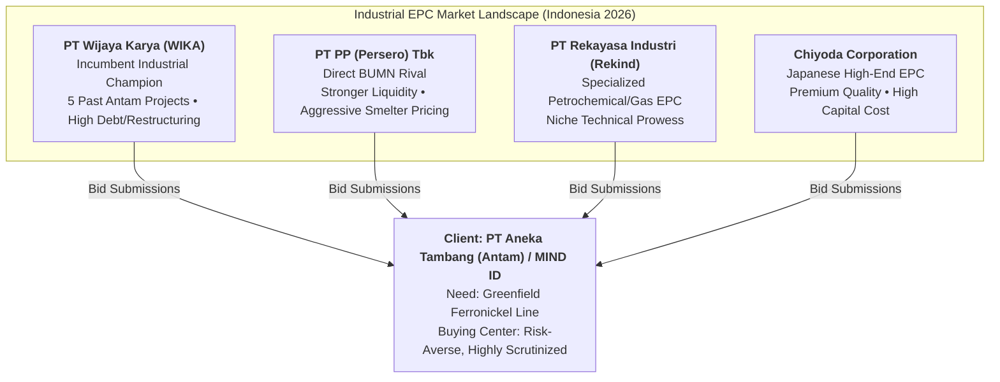
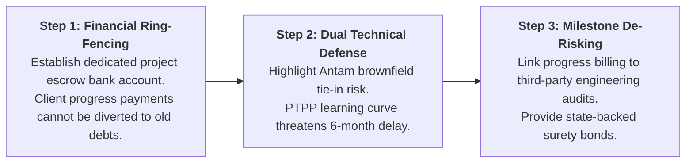

## 🚨 The Executive Dilemma

Jakarta, February 2026. **Rini Hartanto**, Head of Business Development for the Industrial and Mining Sector at [[entities/pt-wijaya-karya|PT Wijaya Karya (Persero) Tbk (WIKA)]], faces an acute commercial crisis ahead of an executive tender meeting with state-owned mining enterprise **PT Aneka Tambang (Antam)**.

Antam's nickel-processing division is preparing a tender for a sixth major industrial project with WIKA: a greenfield ferronickel smelter line. Historically, this account was WIKA’s crown jewel—WIKA had successfully engineered and commissioned five consecutive industrial facilities for Antam since 2019 with stellar technical performance.

However, WIKA is emerging from an unprecedented financial restructuring crisis triggered by heavy capital lockups in national turnkey toll roads and high-speed rail projects. Antam’s risk-averse **[[concepts/b2b-buying-center|Buying Center]]**—overseen by conservative board directors and Ministry of SOE auditors—is terrified of awarding a multi-trillion Rupiah contract to a contractor whose liquidity constraints could halt construction. Rivals **PTPP (PT PP Persero Tbk)**, **Rekind (PT Rekayasa Industri)**, and Japanese industrial specialist **Chiyoda** are circling to poach the relationship.

---

## 🏢 Enterprise Background & Industry Architecture

### The Stakeholder Triad in BUMN Contracting

1. **The Client (PT Aneka Tambang / MIND ID)**: Demands flawless metallurgical commissioning, zero delay penalties, and complete protection against contractor insolvency.
2. **The Contractor (WIKA)**: Possesses superior site familiarity and brownfield integration capabilities, but cannot absorb delayed client milestone payments or uncapped turnkey financial liabilities.
3. **The Regulatory / Audit State (BPKP, LKPP, Kementerian BUMN)**: Enforces rigid procurement transparency. Bidders with flagged financial distress create personal career and legal risk for client procurement officers (_"Nobody gets arrested for picking the safest balance sheet"_).

---

## 📈 Quantitative Exhibits & Financial Snapshot

| Metric / Dimension                      | PT Wijaya Karya (WIKA)        | PT PP (Persero) Tbk                    | PT Rekayasa Industri (Rekind)       | Chiyoda Corp (Japan)                 |
| :-------------------------------------- | :---------------------------- | :------------------------------------- | :---------------------------------- | :----------------------------------- |
| **Historical Antam Projects Delivered** | **5 Facilities (2019–2025)**  | 1 Civil Facility                       | 2 Gas Processing Units              | 1 FeNi Smelter Line (Historic)       |
| **Balance Sheet Liquidity Status**      | Restructuring in Progress     | Moderate; Debt-to-Equity $< 2.5\times$ | Undergoing Financial Rehabilitation | Prime Sovereign Investment Grade     |
| **Relative Tender Price Index**         | Baseline ($100$)              | Aggressive ($94 - 96$)                 | Niche High ($105$)                  | Premium ($120 - 130$)                |
| **Local Site & Engineering Mastery**    | High (Existing Crews on Site) | Medium (Civil Focus)                   | High (Process Engineering)          | Low (Relies on Local Subcontractors) |
| **Client Risk Perception**              | **High Insolvency Risk**      | Low Balance-Sheet Risk                 | Moderate Capacity Risk              | High Currency / Cost Overrun Risk    |

---

## ⚖️ Strategic Alternatives Matrix for WIKA

| Strategic Alternative                                                                 | Strategic Rationale                                                                                                     | Pros                                                                                              | Cons & Implementation Risks                                                            |
| :------------------------------------------------------------------------------------ | :---------------------------------------------------------------------------------------------------------------------- | :------------------------------------------------------------------------------------------------ | :------------------------------------------------------------------------------------- |
| **Alternative 1: Aggressive Price Discounting**                                       | Lower bid by 8% to undercut PTPP and secure contract volume.                                                            | Exploits WIKA's brownfield cost advantages.                                                       | Destroys gross margins; accelerates cash burn; fails to solve client insolvency fears. |
| **Alternative 2: Unilateral Performance Guarantee**                                   | Provide parent-company debt guarantees and escrow milestone retention.                                                  | Calms client credit committee.                                                                    | Severely strains WIKA's restructuring covenants with bank lenders.                     |
| **Alternative 3: Joint Operation / Consortium with International Technology Partner** | Form a Consortium with a tier-1 international engineering firm (e.g., Chiyoda or Outotec).                              | Diversifies financial liability; combines WIKA's site mastery with foreign balance-sheet comfort. | Margin sharing (20–30% profit split); governance coordination friction.                |
| **Alternative 4: Milestone-Restructured Direct Bid**                                  | Bid independently, but restructure payment milestones into ring-fenced escrow accounts with performance bond insurance. | Preserves 100% contract margin; directly solves client cash diversion anxiety.                    | Requires sophisticated legal drafting and bank syndicate consensus.                    |

---

## 🎯 Executive Recommendation & Implementation Roadmap

**Syndicate 9 Recommendation: Hybrid Milestone-Restructuring & Technical Ring-Fencing (Alternative 4 with Consortium Fallback)**

1. **Immediate (Days 1–14)**: Structure a project-specific escrow account with Bank Mandiri. Antam's milestone payments flow exclusively into project material purchasing and subcontractor payroll, legally ring-fenced from WIKA's holding-company debt service.
2. **Commercial Proposal (Day 30)**: Re-frame the bid around **Total Cost of Ownership & Startup Delay Penalties**. A 6-month commissioning delay by rival PTPP costs Antam over Rp 300 billion in lost nickel exports—dwarfing any 4% bid discount.
3. **Consortium Fallback**: If Antam's Board of Commissioners refuses a solo WIKA bid, execute a pre-negotiated 60/40 Joint Operation with a specialist process engineering partner.

---

## 🎙️ Classroom Cold-Call & Boardroom Defense

### Cold-Call 1: _"Why shouldn't Antam simply award the project to PTPP to eliminate financial distress risk?"_

> **Defense**: PTPP is a premier civil contractor (buildings, toll roads), not a proven metallurgical process contractor. Integrating a greenfield ferronickel line into an active brownfield mining complex requires deep familiarity with Antam’s existing power grid, slag handling, and automation architecture. WIKA's team already operates on-site. Choosing PTPP eliminates balance-sheet anxiety but introduces massive engineering execution and commissioning delay risk.

---

## 🔗 Knowledge Graph & Bridges

- Master Lecture Hub: [[courses/mk3-marketing-management/week-04/index|MK3 Week 04: B2B Marketing & Organizational Buying]]
- Assignment Analysis: [[courses/mk3-marketing-management/week-04/assignment-wika-b2b-analysis|Week 04 Assignment Debrief: WIKA Strategic Analysis]]
- Core Concepts: [[concepts/b2b-buying-center|B2B Buying Center & DMU Roles]], [[concepts/customer-perceived-value|Customer Perceived Value]], [[concepts/five-c-analysis|5C Environmental Analysis]]
- Corporate Entity: [[entities/pt-wijaya-karya|PT Wijaya Karya (Persero) Tbk]]
