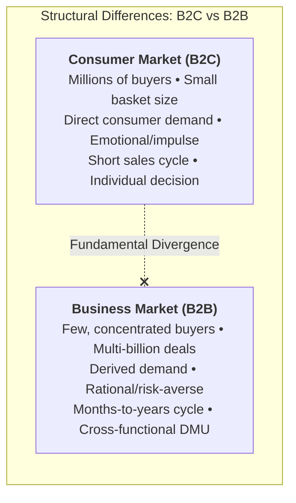
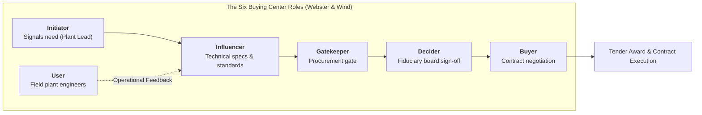

> [!NOTE] Curricular & Faculty Metadata
>
> - **Course:** MM5001 Marketing Management — Week 04
> - **Teaching Team:** [[entities/ilma-aulia-zaim|Ilma Aulia Zaim, Ph.D.]] & [[entities/ira-fachira|Ira Fachira, Ph.D.]] (School of Business and Management, Institut Teknologi Bandung)
> - **Primary Curricular Spine:** SBM ITB Master Slide Deck `[P3MD] Week 4-MK3.pdf` (34 slides)
> - **Textbook Foundation:** Kotler & Armstrong, _Principles of Marketing_ (Ch. 6: "Business Markets and Business Buyer Behavior")
> - **Direct Satellites & Problem Sets:**
>   - Case Study Dossier: [[courses/mk3-marketing-management/week-04/case-wika-epc-champion|PT Wijaya Karya (WIKA) and the Building EPC Champion Program (2026)]]
>   - Dedicated Assignment Analysis: [[courses/mk3-marketing-management/week-04/assignment-wika-b2b-analysis|Week 04 Assignment Debrief: PESTLE, Five Forces & B2B Strategy for WIKA]]

---

## 1. Executive Overview: Business Markets vs. Consumer Markets

While consumer marketing (B2C) focuses on mass psychological appeal, emotional branding, and high-velocity transactional retail, **Business-to-Business (B2B) Marketing** deals with organizational clients—corporations, government institutions, and state-owned enterprises—purchasing goods and services to facilitate manufacturing, infrastructure, or operational delivery.

The stakes in B2B transactions are orders of magnitude higher. A single contract in industrial Engineering, Procurement, and Construction (EPC) or heavy mining infrastructure ranges from hundreds of billions to trillions of Rupiah. Consequently, enterprise procurement is governed by multi-layered institutional protocols, formal audit oversight, and multi-disciplinary risk committees.



### Three Defining Characteristics of B2B Demand

1. **Derived Demand**: Demand for industrial inputs ultimately derives from consumer demand downstream. When end-consumer demand for stainless steel or electric vehicle batteries drops, industrial demand for ferronickel smelters collapses.
2. **Inelastic Demand**: In the short term, total demand for essential industrial inputs is not severely affected by price fluctuations (e.g., if the price of heavy construction equipment rises by 5%, an ongoing smelter project does not cease construction).
3. **Fluctuating Demand (The Acceleration Effect)**: A small percentage shift in consumer demand produces massive percentage swings in industrial plant and machinery orders.

---

## 2. Theoretical Architecture: The B2B Buying Center & Buy Classes

### 1. The Decision-Making Unit (DMU) Architecture

As formalized in the [[concepts/b2b-buying-center|B2B Organizational Buying Center Framework]] (Webster & Wind, 1972), organizational purchases are rarely approved by a single individual. Marketers must map six distinct functional roles:



### 2. Major Types of Buying Situations (Buy Classes)

- **Straight Rebuy**: The buyer reorders routine supplies without any modification (e.g., standard industrial lubricants, office supplies). Focus is on EDI integration and automated inventory replenishment.
- **Modified Rebuy**: The buyer modifies product specifications, prices, contract terms, or suppliers. Incumbent suppliers become defensive; outside suppliers spot an opening to win share.
- **New Task**: The organization purchases an unprecedented product, technological system, or facility (e.g., commissioning a greenfield high-pressure acid leach [HPAL] nickel smelter). The buying center expands, decision cycles lengthen, and risk management dominates.

$$\mathbf{\text{B2B Perceived Value} = \frac{\text{Operational Capabilities} + \text{Technical Execution Certainty} + \text{Long-Term Solvency}}{\text{Initial Tender Price} + \text{Delay Penalty Risk} + \text{Contractor Default Cost}}}$$

---

## 3. Managerial Crucible: The Indonesian BUMN EPC Sector

In [[courses/mk3-marketing-management/week-04/case-wika-epc-champion|The WIKA EPC Champion Program Case (2026)]], state-owned contractor [[entities/pt-wijaya-karya|PT Wijaya Karya (Persero) Tbk]] must defend its strategic relationship with state mining company **PT Aneka Tambang (Antam)**.

```mermaid
flowchart LR
    WIKA["<b>PT Wijaya Karya (Persero) Tbk</b><br/>Incumbent EPC Contractor<br/>(Track Record: 5 Projects Delivered)<br/><i>Vulnerability: High Debt & Restructuring</i>"]
    <-->|"B2B Negotiation Tension"|
    ANTAM["<b>PT Aneka Tambang (Antam)</b><br/>State Mining Enterprise (MIND ID)<br/><i>Need: Greenfield Smelter Line</i><br/><b>Core Pain: Execution Risk & Audit Scrutiny</b>"]

    PTPP["<b>Rival: PT PP (Persero) Tbk</b><br/>Cleaner Balance Sheet • Eager to Poach Account"] -.->|"Competitive Threat"| ANTAM
    REKIND["<b>Rival: PT Rekind</b><br/>Specialized Chemical EPC"] -.->|"Technical Threat"| ANTAM
```

### The Risk-Sensitive Buying Center

When client executives evaluate a multi-trillion Rupiah turnkey bid:

1. **The Technical Influencer** seeks proven metallurgy engineering track records.
2. **The CFO / Decider** fears contractor bankruptcy midway through construction, which halts capital activation and violates state bond covenants.
3. **The State Auditor (BPKP / LKPP Gatekeeper)** monitors whether procurement processes comply strictly with anti-corruption regulations.

In B2B industrial sales, **financial staying power is a core product feature**. A contractor offering the lowest price will be eliminated if its balance sheet threatens project completion.

---

## 4. Cross-Functional Implementation & Strategic Trade-offs

1. **Commercial Agility vs. Fiduciary Restraint**: Business development teams seek to offer generous performance bonds and fixed-price turnkey contracts to win mega-tenders. Finance and Risk teams must enforce strict milestone billing and inflation-escalation clauses to prevent margin collapse.
2. **Subcontractor Management**: Winning an EPC tender is only the first step. Operations must manage hundreds of specialized Tier 2 and Tier 3 subcontractors. Failure at any point in the supply chain halts critical path progress.

---

## 📚 Required Readings & In-Depth Satellites

| Document Title                                               | Author / Institution     | Core Focus / Methodological Contribution                                                   | Study Note                                                                                         |
| :----------------------------------------------------------- | :----------------------- | :----------------------------------------------------------------------------------------- | :------------------------------------------------------------------------------------------------- |
| **WIKA and the Building EPC Champion Program (2026)**        | SBM ITB Case Series      | Selling into a risk-sensitive state-owned buying center during balance-sheet restructuring | [[courses/mk3-marketing-management/week-04/case-wika-epc-champion\|Open Case Dossier]]             |
| **WIKA Strategic Analysis: PESTLE, Five Forces & Decisions** | F9 Syndicate 9 & SBM ITB | Macroenvironmental boundary audit, industry rivalry scoring, and account retention roadmap | [[courses/mk3-marketing-management/week-04/assignment-wika-b2b-analysis\|Open Assignment Debrief]] |

---

## 📂 Primary Source Media & Digital Archives

| Material Title                            |      Media Type       | Archival Path                                                                |
| :---------------------------------------- | :-------------------: | :--------------------------------------------------------------------------- |
| **[P3MD] Week 4-MK3 Presentation**        | Presentation (`.pdf`) | `archive/courses/mk3/week-04/[P3MD] Week 4-MK3.pdf`                          |
| **WIKA EPC Champion Program Case**        |  Case Study (`.pdf`)  | `archive/courses/mk3/week-04/WIKA_and_the_Building_EPC_Champion_Program.pdf` |
| **Pre-Assignment Instructions**           |    Guide (`.pdf`)     | `archive/courses/mk3/week-04/WIKA_Pre-Assignment Instruction.pdf`            |
| **Syndicate 9 Pre-Assignment Submission** |  Submission (`.pdf`)  | `archive/courses/mk3/week-04/Group 9 – Pre-Assignment.pdf`                   |
| **Syndicate 9 Post-Assignment Debrief**   |   Debrief (`.pdf`)    | `archive/courses/mk3/week-04/Group 9 – Post-Assignment.pdf`                  |

---

## 🔗 Knowledge Graph & Curriculum Bridges

- **Featured Frameworks in Knowledge Matrix**:
  - [[concepts/b2b-buying-center|B2B Organizational Buying Center & DMU Roles]]
  - [[concepts/five-c-analysis|5C Environmental Analysis Framework]]
  - [[concepts/customer-perceived-value|Customer Perceived Value (CPV)]]
  - [[concepts/elements-of-value|Bain's B2B Elements of Value]]
- **Enterprise Profiles**:
  - [[entities/pt-wijaya-karya|PT Wijaya Karya (Persero) Tbk]]
  - [[entities/danantara|Danantara Indonesia]]
- **Next Curricular Module**: [[courses/mk3-marketing-management/week-05/index|Week 05: Marketing Research & Diagnostic Methodologies]]
- Return to **[[courses/mk3-marketing-management/index|MK3 Course Overview]]**
