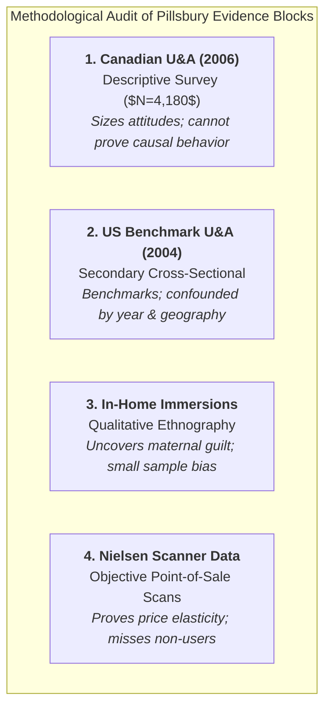

> [!NOTE] Assignment Context & Attribution
>
> - **Course:** MM5001 Marketing Management — Week 05
> - **Source Prompts:** `archive/courses/mk3/week-05/Pillsbury_pre-assignment instruction.pdf` & `Group 9 – Pre-Assignment.docx`
> - **Reference Attribution:** Analytical synthesis contributed by **F9 (Class F / Syndicate 9)**
> - **Parent Lecture:** [[courses/mk3-marketing-management/week-05/index|Week 05 Master Lecture Hub: Marketing Research & Diagnostic Methodologies]]
> - **Target Case:** [[courses/mk3-marketing-management/week-05/case-pillsbury-cookie-challenge|General Mills Canada — The Pillsbury Cookie Challenge]]
> - **Core Framework:** [[concepts/marketing-research-methodologies|Marketing Research Diagnostic Methodologies (Causality vs Correlation)]]

---

## 🎯 Executive Synopsis & Assignment Mandate

This assignment requires student syndicates to conduct a methodological audit of the four research blocks in the **Pillsbury Cookie Challenge Case (General Mills Canada)**.

Syndicates must evaluate:

1. The research design, sampling methods, and legitimate decisions each study can support.
2. The specific conclusions each study **cannot** support due to methodological limitations (distinguishing stated attitudes from revealed behaviors).
3. The strategic launch decision for refrigerated cookie dough (RCD) in Canada.

---

## 🔬 Part A: Evaluation of the Four Empirical Evidence Blocks

### 1. 2006 Canadian Usage & Attitude (U&A) Study

- **Question Addressed**: How do Canadian consumers perceive refrigerated cookie dough, and what category barriers inhibit trial?
- **Research Design**: Primary, quantitative, descriptive, cross-sectional survey research ($N = 4,180$ total respondents; $N = 3,054$ cookie bakers).
- **Legitimate Decision Supported**: Helps prioritize which consumer segments (e.g., lapsed bakers vs habitual scratch bakers) and functional attributes (taste vs convenience) warrant focus in advertising messaging.
- **Conclusion It Cannot Support**: **Cannot establish that valuing convenience causes purchase.** Stated positive attitudes in an online survey do not predict checkout conversion under real supermarket pricing and shelf-clutter friction.

### 2. 2004 United States U&A Study (Benchmark)

- **Question Addressed**: How do American consumers consume RCD, and what cross-border differences provide hypotheses for Canadian market expansion?
- **Research Design**: Quantitative, descriptive survey ($N = 3,361$ total; $N = 2,547$ bakers). Functioned as **secondary data** for the Canadian team.
- **Legitimate Decision Supported**: Provides baseline comparative hypotheses on consumption frequency and retail penetration.
- **Conclusion It Cannot Support**: Cannot support a direct causal conclusion that nationality explains differing adoption rates. The two studies were conducted in different years (2004 vs 2006) with differing sample weighting and recall periods.

### 3. In-Home Immersions & Discovery Workshops

- **Question Addressed**: What emotional rituals, routines, and guilt factors surround home baking?
- **Research Design**: Primary, exploratory qualitative research (in-home observations and consumer creative workshops).
- **Legitimate Decision Supported**: Uncovers the psychological tension between the desire for fresh-baked warmth and the guilt of using pre-made dough, informing creative advertising copy.
- **Conclusion It Cannot Support**: Cannot quantify market size, project revenue, or determine optimal retail price points due to small, self-selected sample size and lack of statistical power.

### 4. Retail Point-of-Sale (POS) Scanner Panel Data

- **Question Addressed**: How do shelf prices, promotional feature ads, and trade discounts affect real-world purchase velocity?
- **Research Design**: Observational, objective point-of-sale scanner tracking across Canadian supermarket chains.
- **Legitimate Decision Supported**: Quantifies price elasticity and establishes that temporary trade price reductions generate massive short-term promotional volume lift.
- **Conclusion It Cannot Support**: Cannot explain _why_ consumers do not buy when the product is at regular price; cannot profile the demographic identity of non-buyers who never scan the product.

---

## ⚖️ Part B: Syndicate 9 Strategic Launch Recommendation

**Verdict: Proceed with Canadian Market Commercialization via Format Innovation and Repositioning**

1. **Format Shift from Chub to "Place & Bake"**:
   - Terminate the traditional chub roll format in Canada. Chub rolls force consumers to cut dough with a knife, creating sticky utensils and uneven baking, negating the core convenience benefit.
   - Launch pre-cut, pre-formed **"Place & Bake" pucks**, reducing prep time to under 60 seconds with zero kitchen cleanup.
2. **Emotional Guilt Neutralization**:
   - Align advertising copy around the theme: _"The Warmth of Homemade, Without the Cleanup."_
   - Position Pillsbury not as a replacement for heirloom family recipes, but as the everyday enabler of spontaneous family baking after school.
3. **Retail Trade Execution & Secondary Placement**:
   - Co-merchandise refrigerated mobile bunker coolers adjacent to the bakery aisle and fluid milk cases, escaping the high-clutter dairy section.
   - Shift trade promotion budget from continuous $25\%$ price-slashing into co-op retail feature ads celebrating seasonal holiday baking.

---

## 🎙️ Classroom Cold-Call & Boardroom Defense

### Cold-Call 1: _"Why not conduct an additional 6-month lab study to confirm Canadian consumer taste preferences?"_

> **Defense**: General Mills already possesses sufficient descriptive and sensory data confirming product efficacy. Additional surveys merely produce redundant stated preference data. What the brand lacks is real-world market validation. The proper next step is a controlled **Causal In-Market Pilot (A/B Test)** in a representative test city (e.g., Calgary or London, Ontario), measuring actual scanner velocity for "Place & Bake" vs historical chub benchmarks.

---

## 🔗 Knowledge Graph & Bridges

- Master Lecture Hub: [[courses/mk3-marketing-management/week-05/index|MK3 Week 05: Marketing Research & Diagnostic Methodologies]]
- Case Study: [[courses/mk3-marketing-management/week-05/case-pillsbury-cookie-challenge|General Mills Canada — Pillsbury Cookie Challenge]]
- Core Concept: [[concepts/marketing-research-methodologies|Marketing Research Diagnostic Methodologies]]
- Corporate Entity: [[entities/general-mills|General Mills, Inc.]]
