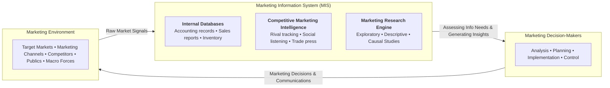
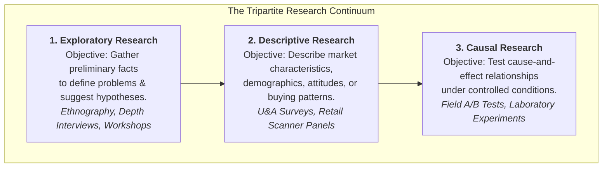
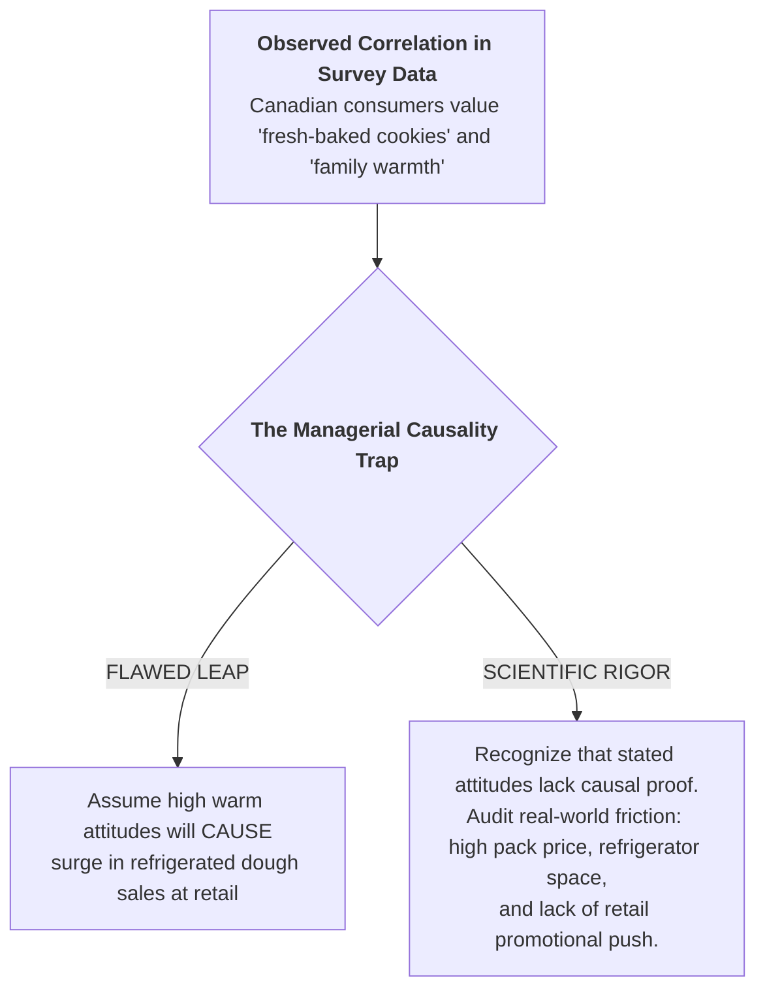

> [!NOTE] Curricular & Faculty Metadata
>
> - **Course:** MM5001 Marketing Management — Week 05
> - **Teaching Team:** [[entities/ilma-aulia-zaim|Ilma Aulia Zaim, Ph.D.]] & [[entities/ira-fachira|Ira Fachira, Ph.D.]] (School of Business and Management, Institut Teknologi Bandung)
> - **Primary Curricular Spine:** SBM ITB Master Slide Deck `[P3MD] Week 5-MK3.pdf` (37 slides)
> - **Textbook Foundation:** Kotler & Armstrong, _Principles of Marketing_ (Ch. 4: "Managing Marketing Information to Gain Customer Insights")
> - **Direct Satellites & Problem Sets:**
>   - Case Study Dossier: [[courses/mk3-marketing-management/week-05/case-pillsbury-cookie-challenge|General Mills Canada — The Pillsbury Cookie Challenge]]
>   - Dedicated Assignment Analysis: [[courses/mk3-marketing-management/week-05/assignment-pillsbury-research-evaluation|Week 05 Assignment Debrief: Research Methodology Evaluation & Launch Strategy]]

---

## 1. Executive Overview & The Marketing Information System (MIS)

Data without strategic discipline produces corporate paralysis. In modern marketing management, organizations generate massive volumes of transactional logs, point-of-sale scanner feeds, and social media commentary. However, raw data only becomes actionable intelligence through a structured **Marketing Information System (MIS)**:

A common executive trap is assuming that gathering more data automatically guarantees better decisions. The true test of research is **methodological validity**: understanding what an empirical study can legitimately prove, and what conclusions it cannot support.

---

## 2. Theoretical Architecture: The Research Design Continuum

As articulated in [[concepts/marketing-research-methodologies|Marketing Research Diagnostic Methodologies]], market investigations are structured across three distinct scientific designs:

### The Four Primary CPG Diagnostic Toolkits

1. **Usage & Attitude (U&A) Studies**: Large-scale cross-sectional surveys measuring brand awareness, penetration, usage frequency, and perceptual drivers. _Crucial limitation: Self-reported attitudes do not equal checkout behavior._
2. **In-Home Usage Testing (IHUT)**: Blind placement of test formulations into consumer households over 1–4 weeks to measure sensory performance, ergonomics, and daily utility.
3. **Concept & Use Testing (CPUT)**: Structured laboratory or digital tests exposing consumers to concept positioning statements alongside physical samples to estimate initial trial and repeat adoption.
4. **Retail Point-of-Sale (POS) Scanner Panel Data**: Automated barcode scan tracking across retail chains (Nielsen/Circana), capturing actual price paid, promotional elasticities, and brand switching.

---

## 3. Managerial Crucible: The Causality vs. Correlation Trap

In [[courses/mk3-marketing-management/week-05/case-pillsbury-cookie-challenge|The Pillsbury Cookie Challenge (General Mills Canada)]], brand leadership confronted conflicting research data. In descriptive Canadian U&A surveys, consumers expressed overwhelmingly positive attitudes toward baking freshness and warm family memories. Yet, actual retail sales of refrigerated cookie dough (RCD) remained stagnant at a fraction of US volume.

### The Three Scientific Conditions for Proving Causation

$$\mathbf{1.\ Concomitant\ Variation} \quad \vert \quad \mathbf{2.\ Temporal\ Precedence} \quad \vert \quad \mathbf{3.\ Non-Spuriousness\ (Omitted\ Variables\ Eliminated)}$$

Unless a marketing team isolates confounding variables through controlled A/B split-testing or randomized retail trials, claiming that a marketing campaign caused a sales surge is an unproven assertion.

---

## 4. Cross-Functional Implementation & Strategic Trade-offs

1. **Research Speed vs. Statistical Rigor**: Business units face pressure to launch fast to beat competitors. Thorough causal field tests take months and alert rivals. Management must balance the cost of research against the catastrophic capital risk of launching a flawed product.
2. **Primary vs. Secondary Data Costs**: Secondary data (industry reports, past studies) is inexpensive and rapid, but often stale or collected under incomparable sampling methodologies (e.g., comparing a 2004 US study with a 2006 Canadian study). Primary research offers customized relevance, but carries significant expense.

---

## 📚 Required Readings & In-Depth Satellites

| Document Title                                           | Author / Institution       | Core Focus / Methodological Contribution                               | Study Note                                                                                                     |
| :------------------------------------------------------- | :------------------------- | :--------------------------------------------------------------------- | :------------------------------------------------------------------------------------------------------------- |
| **General Mills Canada: The Pillsbury Cookie Challenge** | Harvard / Ivey Case Series | Reconciling conflicting survey attitudes vs scanner panel retail data  | [[courses/mk3-marketing-management/week-05/case-pillsbury-cookie-challenge\|Open Case Dossier]]                |
| **Pillsbury Research Evaluation & Launch Debrief**       | F9 Syndicate 9 & SBM ITB   | Rigorous critique of 4 empirical evidence blocks and go-to-market plan | [[courses/mk3-marketing-management/week-05/assignment-pillsbury-research-evaluation\|Open Assignment Debrief]] |

---

## 📂 Primary Source Media & Digital Archives

| Material Title                            |      Media Type       | Archival Path                                                          |
| :---------------------------------------- | :-------------------: | :--------------------------------------------------------------------- |
| **[P3MD] Week 5-MK3 Presentation**        | Presentation (`.pdf`) | `archive/courses/mk3/week-05/[P3MD] Week 5-MK3.pdf`                    |
| **Pillsbury Cookie Challenge Case**       |  Case Study (`.pdf`)  | `archive/courses/mk3/week-05/Pillsbury Cookie Challenge.pdf`           |
| **Pillsbury Assignment Instructions**     |    Guide (`.pdf`)     | `archive/courses/mk3/week-05/Pillsbury_pre-assignment instruction.pdf` |
| **Syndicate 9 Pre-Assignment Submission** | Submission (`.docx`)  | `archive/courses/mk3/week-05/Group 9 – Pre-Assignment.docx`            |

---

## 🔗 Knowledge Graph & Curriculum Bridges

- **Featured Frameworks in Knowledge Matrix**:
  - [[concepts/marketing-research-methodologies|Marketing Research Diagnostic Methodologies]]
  - [[concepts/customer-perceived-value|Customer Perceived Value (CPV)]]
  - [[concepts/five-c-analysis|5C Environmental Analysis Framework]]
- **Enterprise Profiles**:
  - [[entities/general-mills|General Mills, Inc.]]
- **Next Curricular Module**: [[courses/mk3-marketing-management/week-06/index|Week 06: Market Segmentation & Target Market Selection — HubSpot]]
- Return to **[[courses/mk3-marketing-management/index|MK3 Course Overview]]**
