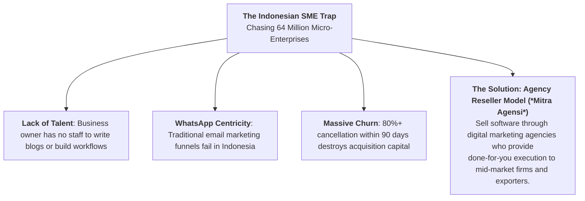

> [!NOTE] Assignment Context & Attribution
>
> - **Course:** MM5001 Marketing Management — Week 06
> - **Source Prompts:** `archive/courses/mk3/week-06/HubSpot_PreClass_Assignment.pdf` & `MK3_Week6_PreAssignment_Syndicate_9_REVISED.docx`
> - **Reference Attribution:** Analytical synthesis contributed by **F9 (Class F / Syndicate 9)**
> - **Parent Lecture:** [[courses/mk3-marketing-management/week-06/index|Week 06 Master Lecture Hub: Market Segmentation & Target Market Selection]]
> - **Target Case:** [[courses/mk3-marketing-management/week-06/case-hubspot-inbound-indonesia|HubSpot Inbound Marketing (US 2009) & Indonesia Expansion]]
> - **Core Frameworks:** [[concepts/elements-of-value|Bain's B2B Elements of Value]], [[concepts/customer-perceived-value|Customer Perceived Value & SaaS Unit Economics]], MASAD Criteria

---

## 🎯 Executive Synopsis & Assignment Objectives

This assignment synthesizes B2B market segmentation and customer selection across two temporal and geographic domains:

1. **HubSpot (US, 2009)**: Resolving the strategic conflict between **Owner Ollie** (micro-enterprise) and **Marketing Mary** (mid-market enterprise) using unit economics and Bain's B2B Elements of Value.
2. **Indonesia Expansion (2026–2029)**: Evaluating candidate customer segments using the **MASAD framework** and diagnosing the **"Indonesian SME / UMKM Trap"**.

---

## 📊 Task 1: Segmentation Variable Inventory (Pre-Sale vs. Post-Sale)

A critical operational requirement in B2B segmentation is separating observable **Pre-Sale Selection Variables** from internal **Post-Sale Performance Variables**:

```mermaid
flowchart LR
    subgraph PreSale ["Observable Pre-Sale Variables (Targeting Filters)"]
        direction TB
        V1["Firmographics: Industry, Headcount (1–25 vs 26–100)"]
        V2["Business Model: B2B vs B2C, Contract Values"]
        V3["Digital Readiness: Active Blog, Social Channels, CMS Type"]
        V4["Buyer Persona: Founder/Owner vs Marketing Director"]
    end

    subgraph PostSale ["Unobservable Post-Sale Variables (Operational Outcomes)"]
        direction TB
        P1["Product Adoption: Software Login Frequency"]
        P2["Feature Utilization: CMS Migration, Automation Setup"]
        P3["Customer Churn: 30-Day Cancellation, Account Churn"]
        P4["Customer Lifetime Value: Actual Revenue Tenure"]
    end

    PreSale -->|"Targeting Criteria"| SALES["Sales Pipeline"] -->|"Revealed Metrics"| PostSale
```

> [!IMPORTANT] Managerial Rule
> Marketers cannot target on churn or login frequency directly; they must target observable firmographic and behavioral proxies that correlate with low churn.

---

## 🔬 Task 2: Segment Economics Interpretation (Ollie vs. Mary)

| Unit Economics Dimension                     | Owner Ollie (Micro Business) | Marketer Mary (Mid-Market) | Strategic Interpretation                                                     |
| :------------------------------------------- | :--------------------------: | :------------------------: | :--------------------------------------------------------------------------- |
| **Monthly Subscription Price**               |    $\$250 / \text{month}$    |   $\$500 / \text{month}$   | Mary pays $2.0\times$ higher baseline software fees.                         |
| **Monthly Churn Rate**                       |     **$4.5\% - 5.0\%$**      |    **$1.5\% - 2.0\%$**     | **Ollie churns at $3\times$ the rate of Mary.**                              |
| **Customer Acquisition Cost ($\text{CAC}$)** |        $\sim \$1,000$        |       $\sim \$5,000$       | Ollie is cheap to acquire via self-service; Mary requires inside sales reps. |
| **Revenue-Based $\text{CLV}$**               |          $\$4,814$           |       **$\$10,625$**       | **Mary delivers $>2.2\times$ higher absolute lifetime cash.**                |
| **Lifetime Revenue / $\text{CAC}$ Ratio**    |       **$5.81\times$**       |        $3.13\times$        | Ollie appears more capital-efficient in short-term ratios.                   |
| **$\text{CAC}$ Payback Period**              |    **$4\text{ months}$**     |     $10\text{ months}$     | Ollie pays back cash faster.                                                 |

### The Executive Reconciliation

- **The Metric Trap**: Optimizing purely for $\text{CAC}$ payback or lifetime revenue/$\text{CAC}$ favors Ollie. However, Ollie's $4.5\%$ monthly churn means that nearly **half the customer base vanishes every 12 months**.
- **The Strategic Winner**: **Marketing Mary is the superior foundation.** Mid-market accounts create compounding net expansion through user seat additions and feature tier upgrades, whereas micro-firms fail and cancel software at catastrophic rates.

---

## 🏛️ Task 3: Bain's B2B Elements of Value Mapping

Applying the 40 B2B Elements of Value (Almquist et al., HBR 2018) to the two customer personas:

### 1. Owner Ollie (Micro-Business Founder)

1. **Improved Top Line (Functional Level)**: The primary motivation is generating immediate sales leads to survive month-to-month.
2. **Simplification (Ease of Doing Business Level)**: Ollie manages operations, accounting, and sales; software must be intuitive without complex coding.
3. **Time Savings (Ease of Doing Business Level)**: Ollie has zero dedicated marketing staff; marketing tools must automate repetitive tasks in minutes.

### 2. Marketing Mary (Mid-Market Marketing Director)

1. **Information & Analytics (Ease of Doing Business Level)**: Mary requires granular multi-touch attribution and conversion funnel analytics to justify program ROI to the CFO.
2. **Integration (Ease of Doing Business Level)**: Software must integrate seamlessly into enterprise CRM systems (e.g., Salesforce) and existing sales workflows.
3. **Reputational Assurance (Individual Value Level)**: Mary's career standing and executive bonuses depend on marketing performance; choosing a reliable, recognized platform protects professional standing.

---

## 🗺️ Task 4: Indonesian Market Screening (MASAD Framework, 2026–2029)

Evaluating three candidate expansion segments in Indonesia:

- **Segment A: Digitally Mature Mid-Market** (Tech, real estate, education, B2B services with 20–150 employees).
- **Segment B: Chat-Heavy Small Domestic Firms** (Millions of retail/wholesale shops operating on WhatsApp).
- **Segment C: B2B Export Manufacturers** (Furniture, textiles, agricultural processing exporting to foreign buyers).

| MASAD Criterion    |                                             Segment A: Mid-Market                                             |                                       Segment B: Chat Small Firms                                       |                                   Segment C: B2B Exporters                                   |
| :----------------- | :-----------------------------------------------------------------------------------------------------------: | :-----------------------------------------------------------------------------------------------------: | :------------------------------------------------------------------------------------------: |
| **Measurable**     |           **Supported**: LinkedIn profiles, job boards, business directories allow accurate sizing.           |                 **Constrained**: High informality; unrecorded revenue obscures budget.                  |   **Supported**: Ministry of Trade registries, customs export permits provide clean data.    |
| **Accessible**     | **Supported**: Reached via LinkedIn, industry webinars, and direct B2B inside sales reps in Jakarta/Surabaya. |        **Constrained**: High fragmentation; traditional outreach channels are cost-prohibitive.         |       **Supported**: Industry associations (KADIN, APINDO) and B2B export exhibitions.       |
| **Substantial**    |   **Supported**: High annual software budget ($\text{IDR } 50\text{M} - 200\text{M}$); high gross margins.    | **Constrained**: Very low willingness to pay ($< \text{IDR } 300\text{k}/\text{month}$); extreme churn. |   **Supported**: Multi-billion Rupiah revenue base; earns foreign currency ($\text{USD}$).   |
| **Actionable**     |        **Supported**: Standard HubSpot CRM and Marketing Hub align directly with organizational needs.        |  **Failed**: Requires native WhatsApp multi-agent inbox, which standard HubSpot lacks out-of-the-box.   | **Supported**: Multi-currency pipelines and foreign language templates match sales workflow. |
| **Differentiable** |       **Supported**: Distinct procurement committees, RFP processes, and enterprise integration needs.        |         **Supported**: Distinct from corporate accounts, but resembles consumer chat behavior.          |      **Supported**: Distinct global compliance and supply chain tracking requirements.       |

---

## ⚠️ Task 5: The Indonesian "SME / UMKM Trap" & Strategic Recommendation

### Syndicate 9 Recommendation

1. **Target Segments A & C Exclusively**: Focus enterprise sales teams on mid-market domestic champions and export manufacturers who possess dedicated sales teams and high willingness to pay.
2. **Build an Agency Ecosystem**: Replicate the HubSpot Partner Agency program across Indonesia. Do not sell direct software to small business owners; empower local agencies to manage the software on their behalf.
3. **Localize for WhatsApp & IDR**: Integrate native WhatsApp Business pipelines and support Rupiah virtual account billing to eliminate payment friction.

---

## 🔗 Knowledge Graph & Bridges

- Master Lecture Hub: [[courses/mk3-marketing-management/week-06/index|MK3 Week 06: Market Segmentation & Target Market Selection]]
- Case Study: [[courses/mk3-marketing-management/week-06/case-hubspot-inbound-indonesia|HubSpot Inbound Marketing & Indonesia Expansion]]
- Core Concepts: [[concepts/elements-of-value|Bain's B2B Elements of Value]], [[concepts/customer-perceived-value|Customer Perceived Value & SaaS Unit Economics]]
- Corporate Profile: [[entities/hubspot|HubSpot, Inc.]]
