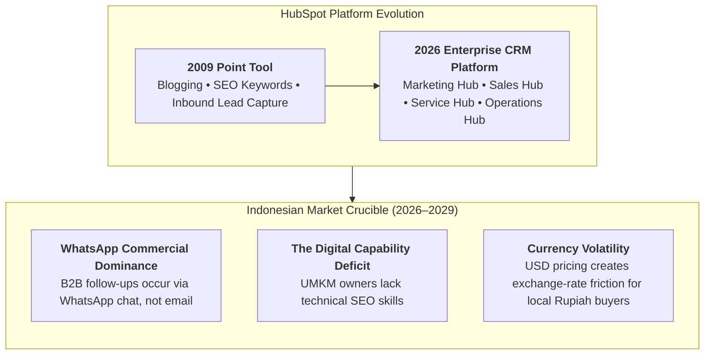
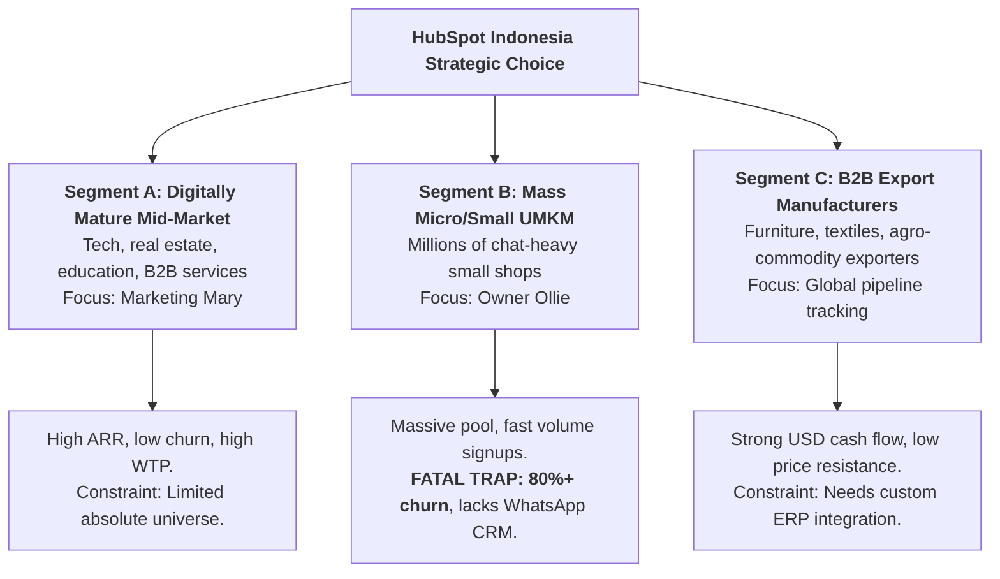

## 🚨 The Executive Dilemma

In Cambridge, Massachusetts (2009), [[entities/hubspot|HubSpot]] co-founders Brian Halligan and Dharmesh Shah achieved rapid growth by selling an all-in-one Inbound Marketing SaaS suite to small and mid-sized enterprises. However, despite surging sales volume, the company faced a strategic unit-economics crisis: **customer churn was burning a hole in their bucket**.

The marketing and sales engine was divided over two contrasting customer personas:

1. **Owner Ollie**: Very small businesses (1–25 employees) led by entrepreneur owners who handled sales, HR, and marketing personally. Ollie was cheap to acquire through automated inbound funnels, but canceled subscriptions within months because they lacked the staff and time to write blogs and optimize SEO.
2. **Marketing Mary**: Mid-market firms (26–100 employees) led by professional marketing directors. Mary had specialized staff and marketing budget, requiring CRM integration and deep analytics to prove ROI to executive leadership. Mary was more expensive to acquire via outbound inside sales, but stayed on the platform for years.

Seventeen years later (2026–2029), HubSpot faces an analogous expansion dilemma in **Indonesia**: Should the company pursue the massive ocean of 64 million micro, small, and medium enterprises (UMKM) through self-service digital freemium tiers, or concentrate sales capital on the digitally mature mid-market and export sector through localized agency partners?

---

## 🏢 Enterprise Background & Market Dynamics

---

## 📈 Quantitative Exhibits & Customer Economics

### Exhibit 5 & 7 Reconstruction: Unit Economics by Segment (US 2009 Case Basis)

| Metric                                       | Owner Ollie (Micro / Small Business) | Marketer Mary (Mid-Market Business) | B2B Category Average        | B2C Category Average        |
| :------------------------------------------- | :----------------------------------- | :---------------------------------- | :-------------------------- | :-------------------------- |
| **Typical Employee Count**                   | 1 to 25 employees                    | 26 to 100 employees                 | Mixed                       | Mixed                       |
| **Monthly Subscription Price (ARPU)**        | $\sim \$250 / \text{month}$          | $\sim \$500 / \text{month}$         | $\sim \$300 / \text{month}$ | $\sim \$250 / \text{month}$ |
| **Average Monthly Churn Rate**               | **$4.5\% - 5.0\%$**                  | **$1.5\% - 2.0\%$**                 | **$3.3\%$**                 | **$6.0\%$**                 |
| **Average Customer Lifespan**                | $\sim 20\text{ months}$              | $\sim 50 - 66\text{ months}$        | $\sim 30\text{ months}$     | $\sim 16.7\text{ months}$   |
| **Customer Acquisition Cost ($\text{CAC}$)** | $\sim \$1,000$                       | $\sim \$5,000$                      | $\sim \$2,500$              | $\sim \$1,500$              |
| **Lifetime Revenue ($\text{LTV}$)**          | $\$4,814$                            | **$\$10,625$**                      | $\$9,107$                   | $\$3,271$                   |
| **$\text{LTV} : \text{CAC}$ Ratio**          | **$4.8\times - 5.8\times$**          | **$2.1\times - 3.1\times$**         | $3.6\times$                 | $2.2\times$                 |
| **$\text{CAC}$ Payback Period**              | **$4\text{ months}$**                | **$10\text{ months}$**              | $8.3\text{ months}$         | $6.0\text{ months}$         |

_Note: Calculations reflect case-basis parameters. While Ollie demonstrates higher initial $\text{LTV}:\text{CAC}$ and faster payback, Ollie's high monthly churn means over 50% of the customer base vanishes every year, destroying long-term compound equity._

---

## ⚖️ Strategic Alternatives Matrix for Indonesia (2026–2029)

---

## 🎯 Executive Recommendation & Implementation Roadmap

**Syndicate 9 Recommendation: Dual-Track Focus on Mid-Market & Exporters (Segments A & C) via Local Agency Channel**

1. **Avoid the Direct "UMKM Mass Trap"**: Refuse to sell direct SaaS subscriptions to unassisted micro-businesses (Owner Ollies). Without dedicated marketing personnel, Indonesian UMKMs churn within 90 days.
2. **The Agency Partner Trojan Horse (_Mitra Agensi_)**: Replicate HubSpot's Value-Added Reseller (VAR) agency program in Jakarta, Surabaya, and Bandung. Sell software through digital marketing agencies who bundle HubSpot software with done-for-you content creation and WhatsApp management.
3. **Product Localization for Southeast Asia**:
   - Integrate native **WhatsApp Business API** pipelines directly into the HubSpot Smart CRM inbox.
   - Establish localized billing in Indonesian Rupiah ($\text{IDR}$) with QRIS and bank virtual account checkout.

---

## 🎙️ Classroom Cold-Call & Boardroom Defense

### Cold-Call 1: _"Why shouldn't HubSpot capture the 64 million Indonesian UMKM market with a cheap freemium tier?"_

> **Defense**: 64 million is a vanity metric. Over 98% of Indonesian UMKMs are survivalist micro-enterprises (_warung, pedagang kaki lima_) with zero software budget. The addressable B2B SaaS SME universe is less than 500,000 firms. Chasing unassisted micro-firms floods customer support with low-margin tickets, destroys net revenue retention, and burns capital. HubSpot must target the top 5% of firms with structured marketing funnels.

---

## 🔗 Knowledge Graph & Bridges

- Master Lecture Hub: [[courses/mk3-marketing-management/week-06/index|MK3 Week 06: Market Segmentation & Target Market Selection]]
- Assignment Analysis: [[courses/mk3-marketing-management/week-06/assignment-hubspot-segmentation-targeting|Week 06 Assignment Debrief: HubSpot Segmentation & The UMKM Trap]]
- Core Concepts: [[concepts/customer-perceived-value|Customer Perceived Value & SaaS Unit Economics]], [[concepts/elements-of-value|Bain's B2B Elements of Value]]
- Corporate Entity: [[entities/hubspot|HubSpot, Inc.]]
