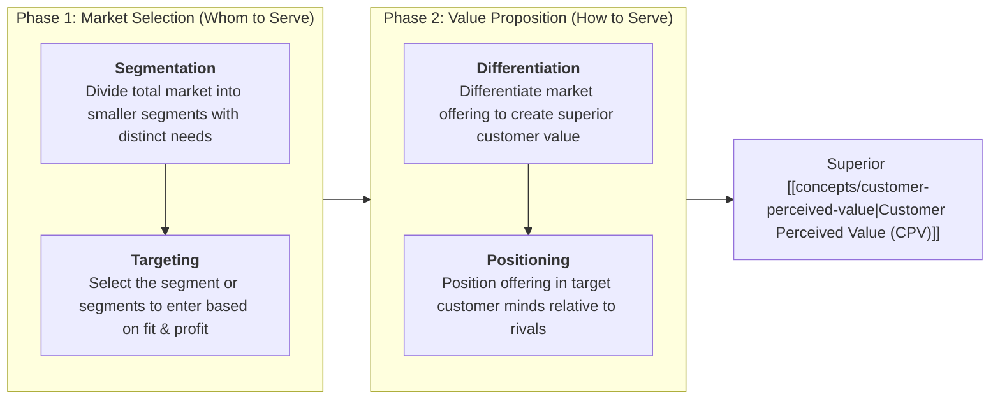
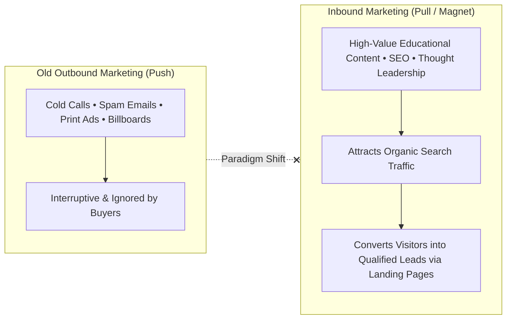
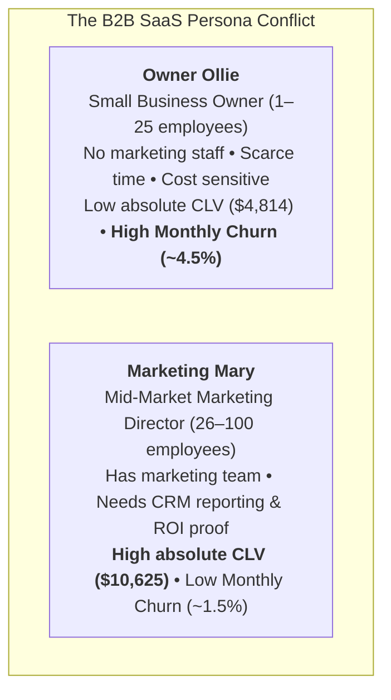

> [!NOTE] Curricular & Faculty Metadata
>
> - **Course:** MM5001 Marketing Management — Week 06
> - **Teaching Team:** [[entities/ilma-aulia-zaim|Ilma Aulia Zaim, Ph.D.]] & [[entities/ira-fachira|Ira Fachira, Ph.D.]] (School of Business and Management, Institut Teknologi Bandung)
> - **Primary Curricular Spine:** SBM ITB Master Slide Deck `[P3MD] Week 6-MK3-Student.pdf` (39 slides)
> - **Textbook Foundation:** Kotler & Armstrong, _Principles of Marketing_ (Ch. 7: "Customer-Driven Marketing Strategy: Creating Value for Target Customers")
> - **Direct Satellites & Problem Sets:**
>   - Case Study Dossier: [[courses/mk3-marketing-management/week-06/case-hubspot-inbound-indonesia|HubSpot Inbound Marketing (US 2009) & Indonesia Expansion (2026–2029)]]
>   - Dedicated Assignment Analysis: [[courses/mk3-marketing-management/week-06/assignment-hubspot-segmentation-targeting|Week 06 Assignment Debrief: HubSpot Segmentation & The Indonesian SME Trap]]

---

## 1. Executive Overview & The STP Strategic Imperative

A fundamental axiom of marketing management is that an enterprise cannot satisfy all customers in a market. Customers are too numerous, geographically dispersed, and widely varied in their buying requirements. Attempting broad, one-size-fits-all marketing squanders commercial capital.

Enterprise leadership must execute a **Customer-Driven Marketing Strategy** through the four-pillar STP architecture:

---

## 2. Theoretical Architecture: Segmentation Bases & MASAD Criteria

### 1. The Four Major Segmentation Variable Categories

1. **Geographic**: Nations, regions, provinces, cities, urban density (Metro vs Tier 2/3), climate.
2. **Demographic**: Age, gender, family size, life-cycle stage, household income, occupation, education, religion.
3. **Psychographic**: Social class, lifestyle (AIO: Activities, Interests, Opinions), personality characteristics.
4. **Behavioral**: Occasions, benefits sought (quality, convenience, speed), user status (non-users, ex-users, potential users, first-time users, regular users), usage rate (light, medium, heavy), loyalty status.

### 2. Requirements for Effective Market Segmentation (MASAD Criteria)

To be useful to executive decision-makers, market segments must satisfy five operational criteria:

| Criterion          | Formal Definition                                                                                          | Managerial Red Flag                                                                                       |
| :----------------- | :--------------------------------------------------------------------------------------------------------- | :-------------------------------------------------------------------------------------------------------- |
| **Measurable**     | The size, purchasing power, and profiles of the segments can be measured with reasonable accuracy.         | Operating in emerging markets where unrecorded cash transactions obscure segment spending.                |
| **Accessible**     | The market segments can be effectively reached and served through physical or digital channels.            | Identifying isolated rural populations lacking road access or cellular data coverage.                     |
| **Substantial**    | The market segments are large or profitable enough to serve; worth pursuing with a tailored marketing mix. | Hyper-segmenting into tiny niches that cannot amortize fixed product development capex.                   |
| **Actionable**     | Effective programs can be designed for attracting and serving the segments given firm capabilities.        | Identifying a lucrative corporate segment that requires capabilities the firm cannot build.               |
| **Differentiable** | The segments are conceptually distinguishable and respond differently to different marketing mix elements. | If married and single executives respond identically to software ads, they do not form separate segments. |

---

## 3. Managerial Crucible: Inbound Marketing & SaaS Economics (HubSpot)

In [[courses/mk3-marketing-management/week-06/case-hubspot-inbound-indonesia|HubSpot: Inbound Marketing and Web 2.0]], founders Brian Halligan and Dharmesh Shah challenged the outbound advertising paradigm:

### The Persona Dilemma: "Owner Ollie" vs. "Marketing Mary"

HubSpot segmented its commercial market into two distinct customer archetypes:

### SaaS Unit Economics Formulation

$$\mathbf{\text{Customer Lifetime Value (CLV)} = \frac{\text{Average Monthly Revenue per User (ARPU)}}{\text{Monthly Churn Rate}}}$$

$$\mathbf{\text{CAC Payback Period (Months)} = \frac{\text{Customer Acquisition Cost (CAC)}}{\text{Monthly ARPU} \times \text{Gross Margin \%}}}$$

- **Ollie's Trap**: While Ollie has a lower $\text{CAC}$ and faster payback (4 months vs 10 months), **Ollie's 4.5% monthly churn means nearly half the customer base turns over annually**. The marketing team is trapped on a "hamster wheel," constantly acquiring new micro-firms just to maintain flat recurring revenue.
- **Mary's Leverage**: Mary's 1.5% monthly churn enables compounding net revenue expansion, justifying higher sales touch and integration support.

---

## 4. The Indonesian B2B Expansion & The "UMKM Trap"

When expanding B2B SaaS into Indonesia (2026–2029), global software firms encounter the **Indonesian SME / UMKM Trap**:

1. **The WhatsApp Reality**: Indonesian commercial trade and lead follow-up occur overwhelmingly over **WhatsApp Business**, not email or desktop CRM dashboards.
2. **Currency & Payment Friction**: Pricing software in US Dollars ($\text{USD}$) introduces devastating exchange-rate shocks for local firms lacking corporate credit cards.
3. **The Agency Ecosystem**: Indonesian business owners lack the technical talent to configure complex marketing automation; they rely on third-party digital agencies (_Mitra Agensi_) to operate software on their behalf.

---

## 📚 Required Readings & In-Depth Satellites

| Document Title                                       | Author / Institution              | Core Focus / Methodological Contribution                                        | Study Note                                                                                                      |
| :--------------------------------------------------- | :-------------------------------- | :------------------------------------------------------------------------------ | :-------------------------------------------------------------------------------------------------------------- |
| **HubSpot: Inbound Marketing & Indonesia Expansion** | Harvard Business School & SBM ITB | Analyzing B2B segmentation, SaaS unit economics, and emerging market adaptation | [[courses/mk3-marketing-management/week-06/case-hubspot-inbound-indonesia\|Open Case Dossier]]                  |
| **HubSpot Segmentation & The UMKM Trap Debrief**     | F9 Syndicate 9 & SBM ITB          | Worked segment economics calculations, B2B value elements, and MASAD screening  | [[courses/mk3-marketing-management/week-06/assignment-hubspot-segmentation-targeting\|Open Assignment Debrief]] |

---

## 📂 Primary Source Media & Digital Archives

| Material Title                             |      Media Type       | Archival Path                                                                              |
| :----------------------------------------- | :-------------------: | :----------------------------------------------------------------------------------------- |
| **[P3MD] Week 6-MK3-Student Presentation** | Presentation (`.pdf`) | `archive/courses/mk3/week-06/[P3MD] Week 6-MK3-Student.pdf`                                |
| **HubSpot Inbound Marketing Case**         |  Case Study (`.pdf`)  | `archive/courses/mk3/week-06/HubSpot inbound marketing and web 2.0 .pdf`                   |
| **HubSpot Indonesia Expansion Supplement** |  Supplement (`.pdf`)  | `archive/courses/mk3/week-06/HubSpot in Indonesia — Case Supplement (Student Edition).pdf` |
| **The B2B Elements of Value**              | HBR Reading (`.pdf`)  | `archive/courses/mk3/week-06/The B2B Elements of Value.pdf`                                |
| **Syndicate 9 Pre-Assignment Submission**  | Submission (`.docx`)  | `archive/courses/mk3/week-06/MK3_Week6_PreAssignment_Syndicate_9_REVISED.docx`             |
| **B2B Strategy & SME Trap Podcast**        |    Audio (`.m4a`)     | `archive/courses/mk3/week-06/Strategi_B2B_HubSpot_dan_Jebakan_UMKM.m4a`                    |

---

## 🔗 Knowledge Graph & Curriculum Bridges

- **Featured Frameworks in Knowledge Matrix**:
  - [[concepts/customer-perceived-value|Customer Perceived Value & SaaS Unit Economics]]
  - [[concepts/elements-of-value|Bain's B2B Elements of Value]]
  - [[concepts/b2b-buying-center|B2B Buying Center & DMU Roles]]
  - [[concepts/five-c-analysis|5C Environmental Analysis Framework]]
- **Enterprise Profiles**:
  - [[entities/hubspot|HubSpot, Inc.]]
- **Next Curricular Module**: [[courses/mk3-marketing-management/week-07/index|Week 07: Strategic Positioning & Product Portfolio Strategy — L'Oréal]]
- Return to **[[courses/mk3-marketing-management/index|MK3 Course Overview]]**
