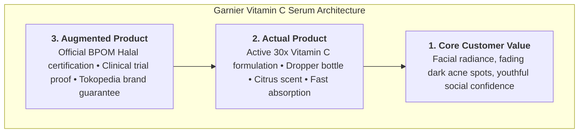
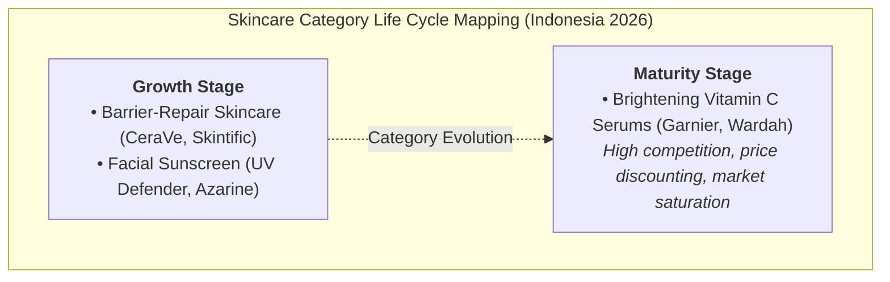
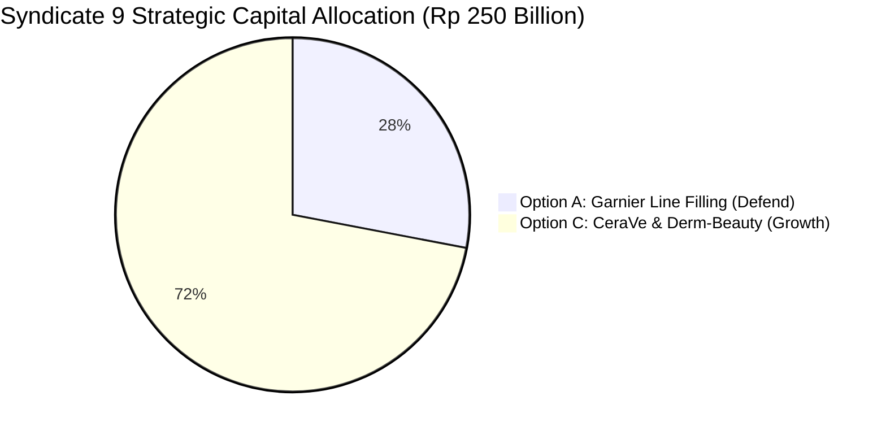

> [!NOTE] Assignment Context & Attribution
>
> - **Course:** MM5001 Marketing Management — Week 07
> - **Source Prompt:** `archive/courses/mk3/week-07/L_Oreal Indonesia_Pre class instruction.pdf`
> - **Reference Attribution:** Analytical synthesis contributed by **F9 (Class F / Syndicate 9)**
> - **Parent Lecture:** [[courses/mk3-marketing-management/week-07/index|Week 07 Master Lecture Hub: Product Strategy & Brand Portfolios]]
> - **Target Case:** [[courses/mk3-marketing-management/week-07/case-loreal-indonesia-portfolio|L'Oréal in Indonesia Case Dossier]]
> - **Core Framework:** [[concepts/product-life-cycle|Product Life Cycle (PLC) & Product Portfolio Architecture]]

---

## 🎯 Executive Synopsis & Problem Context

This assignment evaluates product architecture, product classification, portfolio math, and capital allocation for [[entities/loreal|L'Oréal Indonesia]] under the leadership of Dewi Kartika.

Syndicates must solve four rigorous analytical problems:

1. **Q1**: Three product levels for Garnier Vitamin C vs CeraVe, and competitive battlegrounds vs local indie rival Skintific.
2. **Q2**: Classification of consumer goods and price-per-ml calculations for a proposed 15 ml pack.
3. **Q3**: Product mix width, length, and depth from Exhibit 5; distinguishing line filling from downward line stretching.
4. **Q4**: Mapping skincare categories onto the [[concepts/product-life-cycle|Product Life Cycle (PLC)]] and allocating the Rp 250 billion capital budget.

---

## 🔬 Q1: The Three Product Levels & Competitive Differentiation

Analyzing the **Garnier Light / Bright Complete Vitamin C 30ml Serum** for an Indonesian consumer:

### Competitive Battleground vs. Skintific

- **Where Skintific Competes Most Directly**: At the **Actual Product Level**. Skintific markets specific active chemical ingredients (5X Ceramide, Niacinamide), modern minimalist packaging, and social media trend claims that directly match or exceed Garnier’s physical attributes.
- **Where L'Oréal Can Still Differentiate**: At the **Augmented Product Level**. L'Oréal differentiates through its 110-year global dermatological safety heritage, peer-reviewed clinical testing, local Indonesian manufacturing scale (Cikarang plant), and trusted Halal compliance assurance.

---

## 📊 Q2: Consumer Goods Classification & Shelf Price Calculations

### 1. Consumer Product Classifications

| Product SKU                       | Classification                | Buying Behavior Rationale                                                                                                           |
| :-------------------------------- | :---------------------------- | :---------------------------------------------------------------------------------------------------------------------------------- |
| **Garnier Micellar Water**        | **Convenience Good (Staple)** | Routine daily makeup removal; bought frequently with low search effort; widespread distribution in Indomaret/Alfamart.              |
| **Garnier Vitamin C Serum**       | **Shopping Good**             | Higher price per unit; consumers actively compare active percentages, customer reviews, and discounts across e-commerce.            |
| **La Roche-Posay Effaclar Serum** | **Specialty Good**            | High-ticket clinical derm-cosmetic; consumers exhibit strong brand insensitivity to substitutes and seek out authorized pharmacies. |

### 2. Pricing Calculations for the 15 ml Garnier Pack

_Baseline Market Case Data_:

- Standard 30 ml Garnier Vitamin C Serum List Price: $\text{Rp } 129,000$ ($\text{List Price per ml} = \text{Rp } 4,300/\text{ml}$).
- Promotional E-Commerce Sale Price: $\text{Rp } 89,000$ ($\text{Sale Price per ml} = \text{Rp } 2,967/\text{ml}$).

$$\mathbf{\text{Scenario A (List Price Basis)}}: 15\text{ ml} \times \text{Rp } 4,300/\text{ml} = \mathbf{\text{Rp } 64,500}$$

$$\mathbf{\text{Scenario B (Sale Price Basis)}}: 15\text{ ml} \times \text{Rp } 2,967/\text{ml} = \mathbf{\text{Rp } 44,505}$$

### Comparison with Option A's Proposed Rp 59,900

- Option A’s proposed shelf price of **Rp 59,900** ($\text{Rp } 3,993/\text{ml}$) sits strategically between the discounted 30 ml bottle and the full list price.
- **Managerial Risk**: At Rp 59,900, the 15 ml pack lowers the absolute cash barrier to entry for first-time buyers (Rp 59k vs Rp 129k), but risks **cannibalizing** the 30 ml bottle if consumers realize they are paying only a minor premium per ml while tying up half the out-of-pocket cash.

---

## 📐 Q3: Product Mix Dimensions & Line Expansion Decisions

From **Exhibit 5** of the case:

- **Product Mix Width**: **4 Divisions** (Consumer Products Division, L'Oréal Luxe, Dermatological Beauty, Professional Products).
- **Product Line Depth (Garnier Serum Line)**: **4 Packaging Sizes** ($7.5\text{ ml sachet}$, $15\text{ ml mini}$, $30\text{ ml standard}$, $50\text{ ml jumbo}$) across 2 primary formula variants (Vitamin C Brightening and Anti-Acne).

### Line Filling vs. Downward Line Stretching

- **Verdict**: Option A’s 15 ml pack at Rp 59,900 represents **Line Filling**.
- **Reasoning**: Downward line stretching involves entering an entirely new lower price-quality tier (e.g., launching an economy unbranded sachet below Rp 10,000 for traditional wet markets). A 15 ml pack priced at Rp 59,900 simply fills an existing gap between single-use sachets (Rp 20k) and full bottles (Rp 129k) within the existing mass-market brand tier.

---

## 📈 Q4: Product Life Cycle (PLC) Mapping & The Rp 250B Allocation

- **Brightening Serums**: **Maturity Stage** (Product Form). High category penetration, fierce price wars down to Rp 2,300/ml, and slowing incremental growth.
- **Barrier-Repair Skincare**: **Growth Stage** (Product Form). Rapidly accelerating consumer awareness of skin barrier integrity driven by social media education.
- **Sunscreen**: **Growth to Early Maturity** (Product Class). High adoption driven by daily UV index awareness, led online by local brands.

---

## 💰 Syndicate 9 Strategic Allocation of the Rp 250 Billion Pool

1. **Option A (Rp 70 Billion — Rebalanced)**: Allocate Rp 70B (scaled down from Rp 90B) to introduce the 15 ml Garnier pack exclusively in convenience modern trade (Indomaret/Alfamart) to defend retail distribution without over-investing in a mature category.
2. **Option B (Rp 0 Billion — Terminated)**: Allocate **zero capital** to building a greenfield Indonesian brand. Greenfield brand incubation takes 24+ months, dilutes focus, and contradicts L'Oréal’s core research advantages.
3. **Option C (Rp 180 Billion — Fully Funded)**: Direct the majority of capital to **scale CeraVe and La Roche-Posay**. Seize the structural **Growth stage** of barrier-repair derm-cosmetics, leveraging L'Oréal’s superior clinical authority to recapture share from Skintific with 65%+ gross margins.

---

## 🔗 Knowledge Graph & Bridges

- Master Lecture Hub: [[courses/mk3-marketing-management/week-07/index|MK3 Week 07: Strategic Positioning & Product Portfolio Strategy]]
- Case Study: [[courses/mk3-marketing-management/week-07/case-loreal-indonesia-portfolio|L'Oréal in Indonesia Case]]
- Core Concept: [[concepts/product-life-cycle|Product Life Cycle (PLC) & Product Portfolio Architecture]]
- Corporate Profile: [[entities/loreal|L'Oréal S.A. / L'Oréal Indonesia]]
