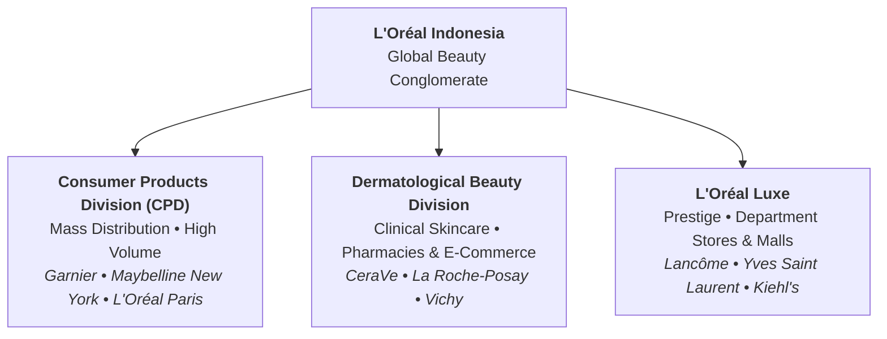
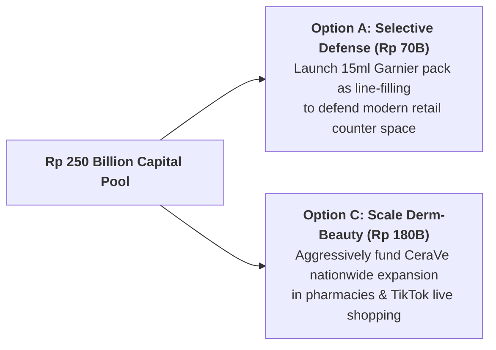

## 🚨 The Executive Dilemma

In October 2026, **Dewi Kartika**, Country Category Head for Skincare at [[entities/loreal|L'Oréal Indonesia]], faced a critical strategic turning point. For nearly five decades, L'Oréal grew successfully in Indonesia by leveraging global product formulations, manufacturing locally in Cikarang, and obtaining early Halal certifications.

However, the Indonesian beauty landscape in 2026 had transformed dramatically:

- **Local Indie Brands (Skintific, Somethinc, Wardah)**: Armed with agile third-party contract manufacturing (OEMs in Indonesia and China), local players launched trending skincare actives (ceramides, niacinamide, retinol) in 3 to 4 months, driving massive engagement on TikTok Shop and Shopee.
- **Price War in Brightening Serums**: Mature mass brightening serums (Garnier Light Complete / Bright Complete) were heavily discounted by rivals to as low as $\text{Rp } 2,300/\text{ml}$.
- **Regulatory Milestone**: Mandatory Halal certification for all cosmetics took effect on 18 October 2026 under BPJPH Law No. 33/2014.

Kartika had to present a strategic recommendation to the regional executive board by December 2026 to allocate a **Rp 250 billion** three-year investment pool (2027–2029) across three competing alternatives:

1. **Option A: Defend the Mature Line (Rp 90 billion)** — Reformulate Garnier serums with new actives, introduce 15 ml mini-packs at Rp 59,900, and accelerate marketplace-exclusive launches.
2. **Option B: Build an Indonesia-Specific Product (Rp 150 billion)** — Develop a brand-new local formulation tailored specifically for tropical Indonesian skin and humidity.
3. **Option C: Scale Dermatological Barrier Repair (Rp 180 billion)** — Pivot capital away from red-ocean brightening serums to aggressively scale **CeraVe** and **La Roche-Posay** in the booming barrier-repair and derm-cosmetics segment.

---

## 🏢 Enterprise Background & Multi-Division Architecture

---

## 📈 Quantitative Exhibits & Market Benchmarks

### Exhibit 5: Product Mix Width, Length & Depth (Verified Sample)

- **Width (4 Divisions)**: Consumer Products (CPD), Dermatological Beauty, L'Oréal Luxe, Professional Products.
- **Consumer Products Division Sample**:
  - _Cleansing Line (Garnier)_: Micellar Water (variants: Pink, Yellow/Oil, Salicylic Acid; sizes: 125 ml, 400 ml).
  - _Brightening Serum Line (Garnier)_: Light/Bright Complete Vitamin C (sizes: 7.5 ml sachet, 15 ml mini, 30 ml standard, 50 ml value).
  - _Anti-Aging Skincare Line (L'Oréal Paris)_: Glycolic Bright & Revitalift Hyaluronic Acid (sizes: 15 ml, 30 ml).
  - _Sunscreen Line (L'Oréal Paris)_: UV Defender (sizes: 15 ml travel, 50 ml tube; variants: Matte & Fresh, Bright & Clear, Moist & Fresh).

### Exhibit 8: Market Life Cycle & Competitive Concentration

| Product Category            | Life Cycle Stage                 | Competitive Intensity                | Top Competitors in Indonesia                            |
| :-------------------------- | :------------------------------- | :----------------------------------- | :------------------------------------------------------ |
| **Brightening Serums**      | **Maturity** (Plateauing Growth) | **Extremely High** (8+ major brands) | Garnier, Wardah, Somethinc, Hanasui, Implora, Skintific |
| **Barrier-Repair Skincare** | **Growth** (Rapid Surge)         | **High** (Leader: Skintific)         | Skintific 5X Ceramide, CeraVe, The Originote            |
| **Facial Sunscreen**        | **Growth to Early Maturity**     | **High** (Local Brands Lead Online)  | Azarine, Biore, L'Oréal Paris UV Defender, Somethinc    |

---

## ⚖️ Strategic Alternatives Matrix (The Rp 250B Capital Allocation)

| Dimension             | Option A: Defend Mature Line                                                      | Option B: Build Indonesia Product                                              | Option C: Scale Dermatological Beauty                                         |
| :-------------------- | :-------------------------------------------------------------------------------- | :----------------------------------------------------------------------------- | :---------------------------------------------------------------------------- |
| **Proposed Capex**    | **Rp 90 Billion**                                                                 | **Rp 150 Billion**                                                             | **Rp 180 Billion**                                                            |
| **Time to Market**    | 9 to 12 months                                                                    | 18 to 24 months                                                                | Immediate (Available SKUs)                                                    |
| **Target Offering**   | Garnier 15 ml pack @ Rp 59,900                                                    | Greenfield Indonesian brand                                                    | Scale CeraVe & La Roche-Posay                                                 |
| **Primary Advantage** | Protects cash-cow volume in traditional & modern trade.                           | Tailored to local tropical skin; counters nationalist buying.                  | High gross margins ($65\%+$); structural growth tailwind.                     |
| **Fatal Flaw / Risk** | **Cannibalization**: 15 ml mini-pack cannibalizes 30 ml bottle; low gross margin. | High failure rate of local brand incubation (mirrors China Mininurse failure). | CeraVe price points (Rp 150k–300k) exclude mass bottom-of-the-pyramid buyers. |

---

## 🎯 Executive Recommendation & Implementation Roadmap

**Syndicate 9 Recommendation: Hybrid Portfolio Allocation (Option A + Option C Rebalanced)**

1. **Reject Option B**: Greenfield local brand development in Indonesia takes 24 months and historically failed in China (Mininurse, Yue-Sai). L'Oréal’s core competence is scaling global clinical science, not imitating indie contract manufacturers.
2. **Defend Garnier via Line Filling (Rp 70B)**: Launch the 15 ml mini-pack at Rp 59,900 to capture trial from price-sensitive consumers, but restrict distribution to modern convenience channels (Indomaret/Alfamart) to prevent cannibalizing 30 ml pharmacy sales.
3. **Double Down on CeraVe & Barrier Repair (Rp 180B)**: Ride the high-margin **Growth phase** of the [[concepts/product-life-cycle|Product Life Cycle]]. Establish CeraVe as the #1 dermatologist-recommended barrier repair brand, unseating Skintific with superior clinical backing.

---

## 🎙️ Classroom Cold-Call & Boardroom Defense

### Cold-Call 1: _"Is the 15 ml Garnier pack downward line stretching or line filling?"_

> **Defense**: It is primarily **Line Filling**. Garnier is already an established mass-market consumer brand priced between Rp 20,000 (sachets) and Rp 130,000 (30 ml bottles). Introducing a 15 ml pack at Rp 59,900 simply plugs a price-point gap within an existing category range. It would only be downward stretching if L'Oréal launched an unbranded budget sub-label below its current brand quality floor.

---

## 🔗 Knowledge Graph & Bridges

- Master Lecture Hub: [[courses/mk3-marketing-management/week-07/index|MK3 Week 07: Strategic Positioning & Product Portfolio Strategy]]
- Assignment Analysis: [[courses/mk3-marketing-management/week-07/assignment-loreal-product-portfolio|Week 07 Assignment Debrief: L'Oréal Portfolio Decisions]]
- Core Concepts: [[concepts/product-life-cycle|Product Life Cycle & Product Portfolio Architecture]], [[concepts/customer-perceived-value|Customer Perceived Value]]
- Corporate Entity: [[entities/loreal|L'Oréal S.A. / L'Oréal Indonesia]]
