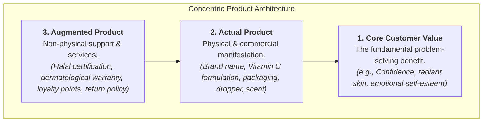
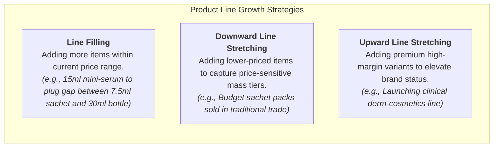
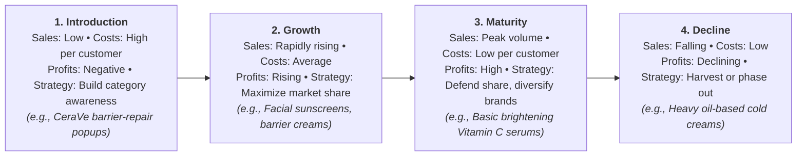

> [!NOTE] Curricular & Faculty Metadata
>
> - **Course:** MM5001 Marketing Management — Week 07
> - **Teaching Team:** [[entities/ilma-aulia-zaim|Ilma Aulia Zaim, Ph.D.]] & [[entities/ira-fachira|Ira Fachira, Ph.D.]] (School of Business and Management, Institut Teknologi Bandung)
> - **Primary Curricular Spine:** SBM ITB Master Slide Deck `[P3MD] Week 7-MK3_Student.pdf` (35 slides)
> - **Textbook Foundation:** Kotler & Armstrong, _Principles of Marketing_ (Ch. 8: "Products, Services, and Brands: Building Customer Value" & Ch. 9: "Developing New Products and Managing the Product Life Cycle")
> - **Direct Satellites & Problem Sets:**
>   - Case Study Dossier: [[courses/mk3-marketing-management/week-07/case-loreal-indonesia-portfolio|L'Oréal in Indonesia: Managing a Global Product Portfolio in a Local-Brand Market]]
>   - Dedicated Assignment Analysis: [[courses/mk3-marketing-management/week-07/assignment-loreal-product-portfolio|Week 07 Assignment Debrief: Product Levels, Mix Math & The Rp 250B Portfolio Allocation]]

---

## 1. Executive Overview & The Product Portfolio Dilemma

In corporate strategy, a product is more than physical matter assembled in a factory; it is a complex bundle of tangible and intangible value propositions designed to satisfy customer needs. However, managing products across an enterprise requires balancing a diverse portfolio of offerings across different stages of the **[[concepts/product-life-cycle|Product Life Cycle (PLC)]]**.

In emerging markets like Indonesia, multinational consumer conglomerates face a dual crucible:

1. **The Agility Disconnect**: Traditional global R&D cycles take 2 to 3 years to formulate and clinically test global formulations. Fast-moving local indie brands (e.g., Skintific, Somethinc, Wardah) leverage domestic and Chinese contract manufacturers (OEM/ODM) to take social-media skincare trends from concept to TikTok Shop bestseller in under 4 months.
2. **The Regulatory Shift**: Mandatory Halal certification compliance (in force October 2026 under BPJPH) and shifting traditional vs modern trade channel margins require dynamic portfolio restructuring.

```mermaid
flowchart LR
    subgraph GlobalCorp ["Multinational Conglomerate (L'Oréal)"]
        G1["Century-Old R&D Heritage"]
        G2["Rigorous Clinical Safety Testing"]
        G3["Global Brand Equity & Prestige"]
        G4["Slow 24-Month Launch Cycles"]
    end

    subgraph LocalDisruptors ["Local Indie Competitors (Skintific, Somethinc)"]
        L1["Agile Contract Manufacturing (OEM)"]
        L2["Social Commerce & TikTok First"]
        L3["Aggressive Sachet & Mini Pricing"]
        L4["Rapid 90-Day Trend Turnaround"]
    end

    GlobalCorp <-->|"The Beauty Battleground (Indonesia 2026)"| LocalDisruptors
```

---

## 2. Theoretical Architecture: Product Levels & Classifications

### 1. The Three Concentric Product Levels

As formalized by Philip Kotler, strategic marketing decomposes every offering into three conceptual layers:

- In [[courses/mk3-marketing-management/week-07/case-loreal-indonesia-portfolio|L'Oréal Indonesia]], local rival **Skintific** competes aggressively at the **Actual Product level** (5X Ceramide formulation, sleek packaging, viral claims).
- **L'Oréal differentiates at the Augmented Product level** through its global clinical research backing, certified dermatological safety standards, and verified Halal compliance across Indonesian factories.

### 2. Consumer Product Classifications

| Product Class         | Customer Buying Behavior                                                             | Price & Distribution Strategy                                              | Promotion & Market Examples                                                                          |
| :-------------------- | :----------------------------------------------------------------------------------- | :------------------------------------------------------------------------- | :--------------------------------------------------------------------------------------------------- |
| **Convenience Goods** | Frequent purchase; minimal thought or comparison effort.                             | Low unit price; widespread intensive distribution.                         | Mass advertising; Point-of-sale display. _(e.g., Garnier Micellar Water sachets in warungs)_.        |
| **Shopping Goods**    | Less frequent purchase; significant comparison on quality, price, and style.         | Higher price; selective distribution in malls and beauty specialty chains. | Advertising and personal selling by producers and resellers. _(e.g., Garnier Vitamin C 30ml serum)_. |
| **Specialty Goods**   | Strong brand preference and loyalty; special purchase effort; low price sensitivity. | High luxury price; exclusive distribution in prestige counters.            | Carefully targeted promotion by producers and resellers. _(e.g., La Roche-Posay / Lancôme)_.         |
| **Unsought Goods**    | Little product awareness or knowledge; or negative purchase interest until needed.   | Varies by category; aggressive direct selling.                             | Heavy advertising and direct marketing. _(e.g., Pre-need funeral plans, specialized insurance)_.     |

---

## 3. Product Mix & Line Expansion Mechanics

Enterprise marketing leaders manage product portfolios across four structural dimensions:

- **Width**: The number of different product lines the company carries (e.g., Consumer Products, Luxe, Dermatological Beauty, Professional Products).
- **Length**: The total number of items the company carries within its product lines.
- **Depth**: The number of versions offered for each product in the line (e.g., sizes: 15 ml, 30 ml, 50 ml; formulations: Normal, Sensitive, Matte).
- **Consistency**: How closely related the various product lines are in end use, production requirements, or distribution channels.

---

## 4. The Product Life Cycle (PLC) Strategic Matrix

Products pass through four classic stages, requiring fundamentally different marketing mixes:

---

## 📚 Required Readings & In-Depth Satellites

| Document Title                                        | Author / Institution     | Core Focus / Methodological Contribution                                                 | Study Note                                                                                                |
| :---------------------------------------------------- | :----------------------- | :--------------------------------------------------------------------------------------- | :-------------------------------------------------------------------------------------------------------- |
| **L'Oréal in Indonesia: Managing a Global Portfolio** | SBM ITB Case Series      | Multi-division brand portfolio management, local indie competition, and Halal compliance | [[courses/mk3-marketing-management/week-07/case-loreal-indonesia-portfolio\|Open Case Dossier]]           |
| **L'Oréal Product Portfolio & Mix Analysis**          | F9 Syndicate 9 & SBM ITB | Worked pricing math, mix width/depth calculations, and Rp 250B allocation                | [[courses/mk3-marketing-management/week-07/assignment-loreal-product-portfolio\|Open Assignment Debrief]] |

---

## 📂 Primary Source Media & Digital Archives

| Material Title                     |      Media Type       | Archival Path                                                                                                      |
| :--------------------------------- | :-------------------: | :----------------------------------------------------------------------------------------------------------------- |
| **[P3MD] Week 7-MK3 Presentation** | Presentation (`.pdf`) | `archive/courses/mk3/week-07/[P3MD] Week 7-MK3_Student.pdf`                                                        |
| **L'Oréal in Indonesia Case**      |  Case Study (`.pdf`)  | `archive/courses/mk3/week-07/L_Oréal in Indonesia Managing a Global Product Portfolio in a Local-Brand Market.pdf` |
| **Pre-Class Instructions**         |    Guide (`.pdf`)     | `archive/courses/mk3/week-07/L_Oreal Indonesia_Pre class instruction.pdf`                                          |

---

## 🔗 Knowledge Graph & Curriculum Bridges

- **Featured Frameworks in Knowledge Matrix**:
  - [[concepts/product-life-cycle|Product Life Cycle (PLC) & Product Portfolio Architecture]]
  - [[concepts/customer-perceived-value|Customer Perceived Value (CPV)]]
  - [[concepts/elements-of-value|Bain's Elements of Value]]
- **Enterprise Profiles**:
  - [[entities/loreal|L'Oréal S.A. / L'Oréal Indonesia]]
  - [[entities/unilever|Unilever Indonesia]]
- **Next Curricular Module**: [[courses/mk3-marketing-management/week-08/index|Week 08: Services Marketing & STP Strategy — PT KAI]]
- Return to **[[courses/mk3-marketing-management/index|MK3 Course Overview]]**
