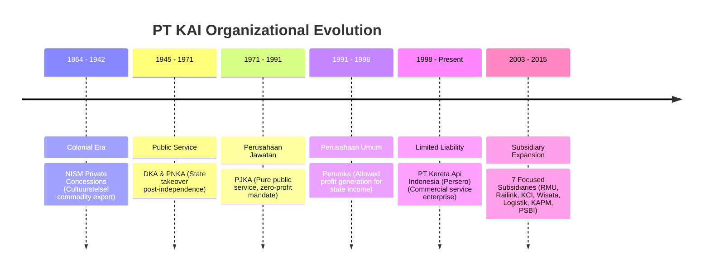
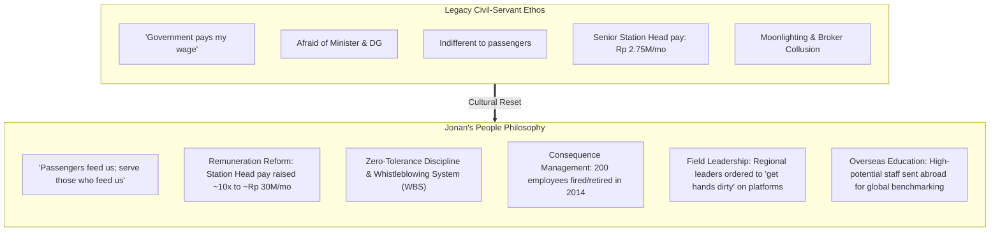

> [!NOTE] Case Publication & Authorship
>
> - **Case Title:** PT Kereta Api Indonesia - Service Transformation: Making Intangibles Tangible
> - **Authors:** Dr. Nila Armelia Windasari (SBM ITB), Dr. Ira Fachira (SBM ITB), & Tuyen Nguyen (Nikkei BizRuptors)
> - **Publisher:** Nikkei BizRuptors (Nikkei Business Lab Asia, Published November 2024)
> - **Subject Entity:** [[entities/pt-kereta-api-indonesia|PT Kereta Api Indonesia (Persero)]]
> - **Target Curricular Module:** [[courses/mk3-marketing-management/week-08/index|MK3 Week 08: Services Marketing & STP Strategy]]
> - **Companion Deliverable:** [[courses/mk3-marketing-management/week-08/assignment-pre-assignment-kai|Week 08 Group Pre-Assignment Analysis]]

---

## 1. Executive Summary & The Transformation Catalyst

Historically established under the Dutch colonial _cultuurstelsel_ system in 1864 to transport agricultural commodities, Indonesia’s national railway was transferred to the Republic in 1945. For over six decades, the state railway operated under an inward-looking **infrastructure and operational mindset** (_Perusahaan Djawatan / Perum_), treating transport as a bureaucratic engineering obligation rather than a customer-centric service business.

By 2008, the enterprise faced severe institutional crisis:

- Consecutive operational losses in 2007 and 2008 amounting to **Rp 83.5 billion (US$ 5.2 million)**.
- Rampant corruption, severe safety risks, unseated roof-riders (_koboi kereta_), squalid stations, foul-smelling toilets, and rampant ticket scalping (_calo_).
- Crumbling rolling-stock availability: over **50.5% of freight cars** and **77.0% of local trains** were grounded and inoperable due to chronic maintenance starvation.

In early 2009, State-Owned Enterprises Minister Sofyan Djalil appointed **Ignasius Jonan**—a former Managing Director of Citibank with an investment and accounting background—as President Director. Over his five-year tenure (2009–2014), Jonan executed one of the most celebrated corporate turnaround stories in modern SOE history, swinging KAI from chronic deficits to an annual net profit nearing **Rp 1 trillion (US$ 64 million)** by 2014, while tripling enterprise assets from Rp 5.7 trillion to **Rp 15.2 trillion (US$ 975 million)** by 2013.

```mermaid
flowchart LR
    subgraph Pre2009 ["Pre-2009 Crisis Era (Perjan / Perum)"]
        direction TB
        C1["Rp 83.5B Losses (2007–08)"]
        C2["50.5% Freight Cars Inoperable"]
        C3["Calo Networks & Overcapacity"]
        C4["Filthy Paid Toilets & Hawkers"]
    end

    subgraph Catalyst ["Turnaround Leadership (2009–2014)"]
        direction TB
        L1["Ignasius Jonan Appointed CEO"]
        L2["Customer-Centric Work Culture"]
        L3["10x Remuneration + Zero Tolerance"]
        L4["Making Intangibles Tangible"]
    end

    subgraph Outcome ["Transformed Enterprise (2014–Present)"]
        direction TB
        O1["~Rp 1 Trillion Net Profit (2014)"]
        O2["1-Seat-1-Passenger & Sterilized Stations"]
        O3["429.2M Passengers (2019)"]
        O4["Biometric FRBG & ISO 27001 (2023)"]
    end

    Pre2009 ==> Catalyst ==> Outcome
```

---

## 2. The Three Eras of Organizational Structure

The case highlights that service transformation was anchored in legal and structural reorganization:

1. **Perusahaan Djawatan / Jawatan (PJKA, 1971–1991):** Capital wholly owned by the state for public service with zero profit motive; entirely reliant on state subsidy.
2. **Perusahaan Umum (Perumka, 1991–1998):** State-owned enterprise permitted to generate operating profits to contribute to state revenue, shifting orientation toward service improvement.
3. **Perusahaan Terbuka / Persero (PT KAI, 1998–Present):** Converted to a Limited Liability Company characterized by legal personality, limited liability, centralized management, and shared corporate governance.
4. **Decentralized Subsidiary Governance (2003–2015):** KAI formed seven focused subsidiaries to eliminate bureaucratic bottlenecks:
   - **PT Reska Multi Usaha (RMU, 2003):** On-board catering, train cleaning, passenger amenities, and station parking/commercial facilities.
   - **PT Railink (2006):** Dedicated airport express rail links.
   - **PT Kereta Commuter Indonesia (KCI, 2008):** Greater Jakarta urban mass commuter transit.
   - **PT Kereta Api Wisata (2009):** Luxury tourism and bespoke charter rail services.
   - **PT Kereta Api Logistik (Kalog, 2009):** Freight, container, and industrial cargo transport.
   - **PT Kereta Api Properti Manajemen (KAPM, 2009):** Commercial real estate and station development.
   - **PT Pilar Sinergi BUMN Indonesia (PSBI, 2015):** High-speed rail consortium joint venture.

---

## 3. Redefining the Importance of People: Internal Marketing

Jonan identified that the primary impediment to service excellence was an entrenched internal belief: **employees assumed the government paid their salaries, making them fearful of ministerial superiors but indifferent to train passengers** (Case p. 8).

### Upgrading Frontline Customer Touchpoints

- **Prama & Prami:** Modeled after airline cabin crews, these uniformed train attendants handle passenger comforts, meal/beverage services, and special requests.
- **Polsuska (Railway Police):** Deployed across all coaches to guarantee passenger safety, enforce non-smoking regulations, and prevent illegal boarding.
- **Machinist on Duty:** Displaying the train driver's photograph, full name, and direct mobile phone number inside every carriage to enforce operational transparency and immediate emergency accountability.

---

## 4. Making Intangibles Tangible: Physical Evidence & Operational Levers

Because services are intangible, customers evaluate service quality through observable **tangible cues** (Servicescape and Physical Evidence):

| Service Lever           | Historical Intangible Failure                                        | Tangible Intervention Implemented                                                                                                                                                                                                                    |
| :---------------------- | :------------------------------------------------------------------- | :--------------------------------------------------------------------------------------------------------------------------------------------------------------------------------------------------------------------------------------------------- | ------------------------------------------------------------------------------------------------------------------------------------------ |
| **Toilets**             | Foul smell, unhygienic conditions, coins collected at turnstiles.    | Renovated, sanitized, odor-free, running water; **100% free of charge** across all stations and coaches.                                                                                                                                             |
| **Railroad Tracks**     | Open-chute toilets dropped raw human waste directly onto tracks.     | Installed bio-chemical liquid waste processing tanks, ensuring clean, feces-free tracks and stations.                                                                                                                                                |
| **Cabin Comfort**       | Sweltering, crowded carriages smelling of cigarette smoke.           | **Universal AC installed across 100% of fleet** (including Economy class); total smoking ban with passengers dropped off at nearest station if caught.                                                                                               |
| **Station Concourse**   | Chaotic concourses choked with unauthorized vendors and pickpockets. | Concourse sterilization via military security assistance; neat, standardized tenant retail zoning.                                                                                                                                                   |
| **Ticketing Process**   | Massive queues, fake scarcity, and corrupt ticket scalpers (_calo_). | **Rail Ticket System (RTS, Nov 2011)**: Centralized IT reservations, online booking via `www.tiket.kai.co.id`, convenience store checkout (Indomaret/Alfamart), and self-printing kiosks. Mapped against the [[concepts/service-system-design-matrix | Service-System Design Matrix]], this shifted high-variability counter encounters to standardized, automated on-site and remote technology. |
| **Capacity Management** | Dangerous overbooking, standing passengers, and roof-riding.         | **Strict 1-seat-1-passenger policy**: zero unseated tickets sold; station heads and conductors penalized if any rider lacked a seat, eliminating [[concepts/customer-introduced-variability                                                          | Customer-Introduced Variability]] in boarding density.                                                                                     |
| **Boarding Control**    | Stampeding crowds rushing platforms hours before departure.          | Gated boarding pass checks with mandatory ID match; entry restricted to 1-hour prior; fail-safe line-of-visibility separation established via [[concepts/service-blueprinting                                                                        | Service Blueprinting]].                                                                                                                    |

---

## 5. Ongoing Innovations & Post-2014 Institutional Compounding

Following Jonan's departure to become Minister of Transportation in late 2014, KAI continued its trajectory:

### 1. Customer Satisfaction Index (CSI, 2016–2022)

In 2016, KAI institutionalized semi-annual CSI surveys sampling approximately **5,000 passengers across Java and Sumatra** on a 5-point Likert scale:

|   Year   | Overall CSI | Physical Aspect (Stations, Fleets, Boarding, F&B) | Non-Physical Aspect (Punctuality, Friendliness, Accuracy, Tariffs) |
| :------: | :---------: | :-----------------------------------------------: | :----------------------------------------------------------------: |
| **2016** |    4.18     |                       4.16                        |                                4.19                                |
| **2017** |    4.34     |                       4.34                        |                                4.35                                |
| **2018** |    4.09     |                       4.08                        |                                4.10                                |
| **2019** |    4.12     |                       4.11                        |                                4.13                                |
| **2020** |    4.21     |                       4.15                        |                                4.24                                |
| **2021** |    4.30     |                       4.31                        |                                4.30                                |
| **2022** |    4.39     |                       4.34                        |                                4.44                                |

_Passenger traffic grew from 221.7 million riders in 2013 to 429.2 million by 2019, driven by reinvesting operating earnings into urban networks and airport rail links rather than dividend extraction._

### 2. Frontier Digitalization (2023–Present)

- **Face Recognition Boarding Gate (FRBG, 2023):** Automated 1-second biometric facial scanning cameras at station turnstiles matching passengers to their ticket and national ID database, valid for 1 year across all equipped stations.
- **ISO 27001 ISMS Certification:** Comprehensive information security management system protecting passenger biometric data and privacy.
- **KAISA (KAI Smart Assistant):** Robotic Process Automation (RPA) platform automating internal routine administrative tasks.
- **RAPID (Rail Procurement in Digital):** End-to-end digital procurement platform providing supply chain transparency.

---

## 6. Curricular Links & Analytical Satellites

- **Parent Lecture Hub:** [[courses/mk3-marketing-management/week-08/index|Week 08: Services Marketing & STP Strategy]]
- **Detailed Worked Assignment:** [[courses/mk3-marketing-management/week-08/assignment-pre-assignment-kai|Week 08 Group Pre-Assignment Analysis]]
- **Enterprise Profile:** [[entities/pt-kereta-api-indonesia|PT Kereta Api Indonesia (Persero)]]
- **Operational Case (MK4 Week 06):** [[courses/mk4-operations-supply-chain-management/week-06/case-kai-gambir-gate|One Second at the Gambir Gate (Process Design & Queuing)]]
- **Applied Operational Concepts:** [[concepts/service-blueprinting|Service Blueprinting]], [[concepts/service-system-design-matrix|Service-System Design Matrix]], [[concepts/customer-introduced-variability|Customer-Introduced Variability]]
