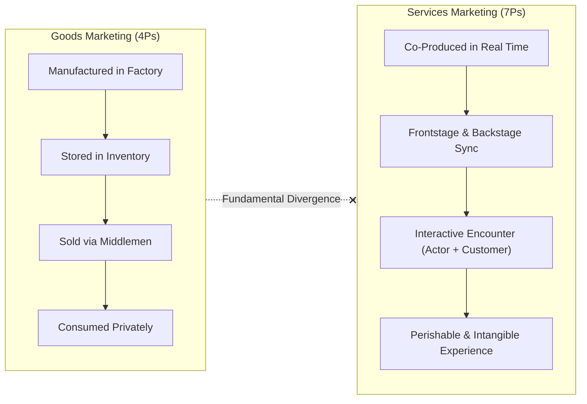
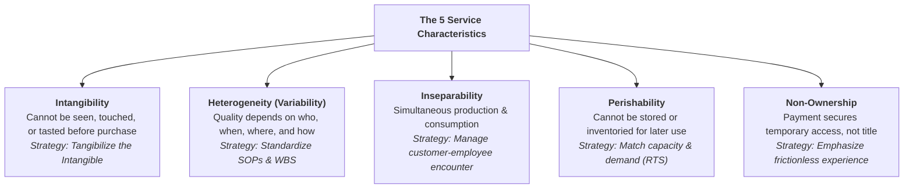
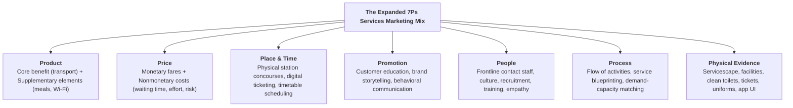
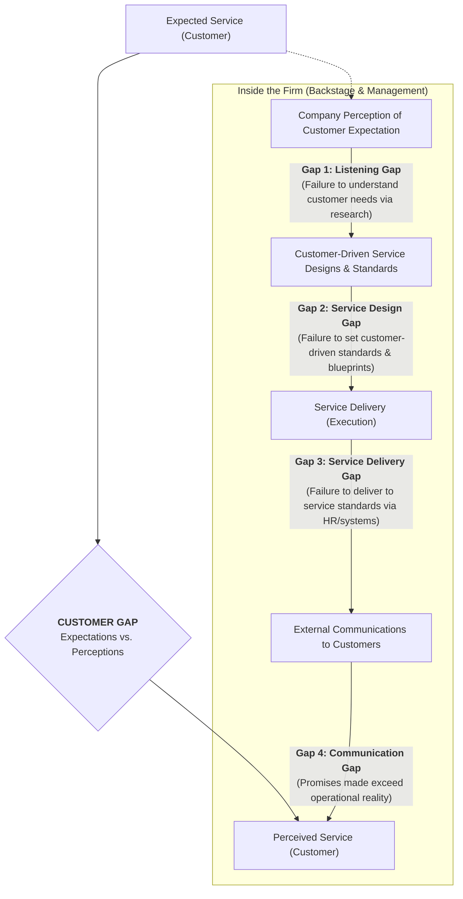
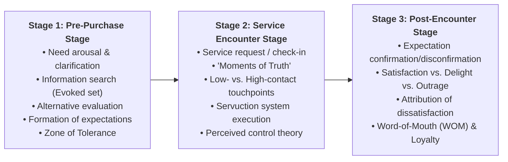
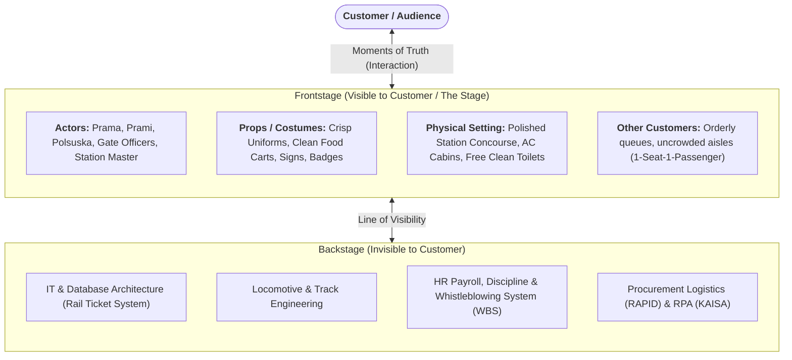
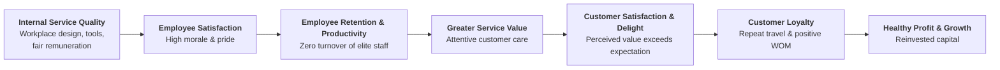
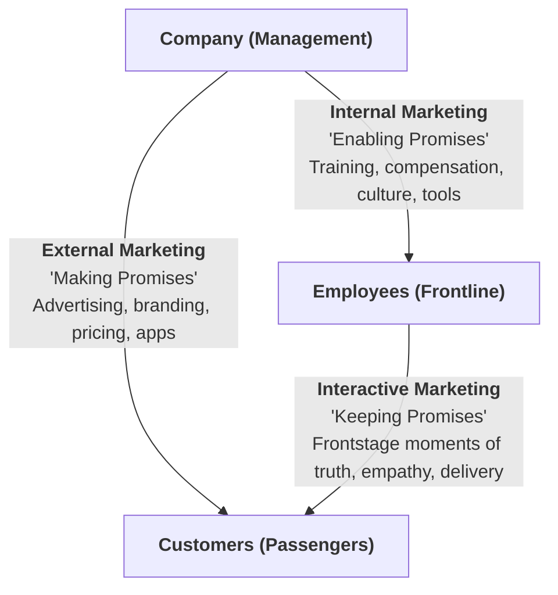

> [!NOTE] Curricular & Faculty Metadata
>
> - **Course:** MM5001 Marketing Management — Week 08
> - **Lead Faculty:** Ira Fachira, S.Si., M.T., Ph.D. (School of Business and Management, Institut Teknologi Bandung)
> - **Teaching Team:** Atik Aprianingsih, DBA; Ilma Aulia Zaim, Ph.D.; Nila Armelia, Ph.D.; Dr. Gallang Perdhana Dalimunthe
> - **Primary Curricular Spine:** SBM ITB Master Slide Deck `[P3MD] Week 8-MK3.pdf` (32 slides)
> - **Primary Media Asset:** `archive/courses/mk3/week-08/KAI_Dari_Rugi_Jadi_Laba_Triliunan.m4a` (Turnaround Audio Analysis: Dari Rugi Jadi Laba Triliunan)
> - **Foundational Literature:**
>   - Parasuraman, Zeithaml, & Berry (1985), _A Conceptual Model of Service Quality and Its Implications for Future Research_
>   - Zeithaml (1981), _How Consumer Evaluation Processes Differ Between Goods and Services_
>   - Heskett, Jones, Loveman, Sasser, & Schlesinger (1994), _Putting the Service-Profit Chain to Work_
> - **Direct Satellites & Problem Sets:**
>   - Case Study Dossier: [[courses/mk3-marketing-management/week-08/case-pt-kai-service-transformation|PT Kereta Api Indonesia — Service Transformation: Making Intangibles Tangible]]
>   - Dedicated Assignment Analysis: [[courses/mk3-marketing-management/week-08/assignment-pre-assignment-kai|Week 08 Group Pre-Assignment: KAI Turnaround Diagnostic]]

---

## 1. Executive Overview: The Paradigm Shift in Services Marketing

While traditional marketing grew out of fast-moving consumer packaged goods (FMCG) and manufactured commodities, modern economies are overwhelmingly service-driven. However, applying conventional manufacturing marketing frameworks to services produces strategic blind spots.

> [!NOTE] Definition of a Service (Slide 6)
> A **service** is any act or performance that one party can offer to another that is essentially intangible and does not result in the ownership of anything. Its production may or may not be tied to a physical product.

Unlike physical goods manufactured in a closed factory and shipped across distribution networks, **services are performances produced and consumed simultaneously in an interactive servicescape**, directly shaping [[concepts/customer-perceived-value|Customer Perceived Value (CPV)]] across multiple [[concepts/elements-of-value|Elements of Value]] (functional, emotional, and life-changing).



---

## 2. The Five Unique Characteristics of Services (IHIPN)

Services possess five distinctive structural characteristics that differentiate them from physical goods (Slides 7–9):



| Dimension          | Physical Goods                                                        | Services                                                                      | Resulting Managerial & Operational Implications (Table 1.1, Slide 9)                                                                              |
| :----------------- | :-------------------------------------------------------------------- | :---------------------------------------------------------------------------- | :------------------------------------------------------------------------------------------------------------------------------------------------ |
| **Intangibility**  | Tangible; physical dimensions and weight.                             | Intangible performance; cannot be inventoried or easily patented.             | Services cannot be displayed or sampled easily; pricing is complex; consumers rely heavily on **physical cues and brand reputation**.             |
| **Heterogeneity**  | Standardized, automated factory tolerances.                           | Highly variable; dependent on human mood, energy, and individual staff.       | Quality control cannot occur at the end of a conveyor belt; firms must implement strict SOPs, HR selection, and continuous training.              |
| **Inseparability** | Production separated from consumption by time and space.              | Simultaneous production and consumption; customer participates in delivery.   | Customers affect the transaction and affect each other (_customer compatibility_); decentralization is essential; mass production is constrained. |
| **Perishability**  | Nonperishable; buffers demand surges via warehouse inventory.         | Perishable; an empty seat or hotel room at departure is lost revenue forever. | Synchronizing supply and demand is critical; requires dynamic capacity management, reservations, and time-gating.                                 |
| **Non-Ownership**  | Customer obtains legal title, physical possession, and resale rights. | Customer acquires temporary access, usage rights, or facility rental.         | Customers evaluate psychological convenience, facility hygiene, and ease of access rather than asset durability.                                  |

---

## 3. The Expanded Marketing Mix for Services: The 7Ps Framework

Because customers actively enter the service delivery environment, the traditional 4Ps (_Product, Price, Place, Promotion_) must be expanded into the **7Ps Marketing Mix** (Slides 10–11):



1. **Product (Core vs. Supplementary Elements):**
   - _Core Element:_ Responds to the customer's primary need (e.g., getting from Jakarta to Surabaya safely).
   - _Supplementary Elements:_ Augment and enhance the core delivery (e.g., luggage handling, onboard _Prama/Prami_ meal service, charging ports, comfortable seating).
2. **Price & Nonmonetary Costs:**
   - Beyond nominal fare price, customer cost includes _time spent queuing_, _physical exertion_, _sensory discomfort (heat, foul smells)_, and _psychological risk of delays or theft_.
3. **Place and Time:**
   - Multi-channel delivery: physical station locations combined with digital interfaces (`tiket.kai.co.id`, mobile apps, and convenience store integrations).
4. **Promotion (Communication & Education):**
   - Educating passengers on boarding procedures, rules (smoking bans), and self-service technologies.
5. **People (The Internal Human Capital):**
   - Frontline service employees are the physical manifestation of the brand. Recruiting, training, compensation, and empowerment dictate the quality of interactive encounters.
6. **Process (Activity Flow & Blueprinting):**
   - Designing frictionless workflows, eliminating bottlenecks, and mapping touchpoints using [[concepts/service-blueprinting|Service Blueprinting]]. Balancing operational capacity with variable passenger surges requires configuring channels along the [[concepts/service-system-design-matrix|Service-System Design Matrix]] while managing [[concepts/customer-introduced-variability|Customer-Introduced Variability]].
7. **Physical Evidence (The Servicescape):**
   - The tangible environment where service is performed—facility aesthetics, interior cleanliness, signage, ambient temperature (AC), scent, and digital screens.

---

## 4. The Gaps Model of Service Quality (Parasuraman et al., Slide 13)

Service breakdowns occur when disconnects emerge across internal management and external customer perceptions:



- **Customer Gap:** The shortfall between what a customer expects and what they perceive they received. Closing this gap requires systematically closing Gaps 1 through 4 inside the company:
  - **Gap 1 (Listening Gap):** Management fails to accurately perceive what customers actually value (e.g., assuming passengers only care about cheap fares when they prioritize toilet cleanliness and punctuality).
  - **Gap 2 (Service Design & Standards Gap):** Management understands customer expectations but fails to establish measurable service specifications (e.g., lacking explicit cleanliness or boarding turnaround standards).
  - **Gap 3 (Service Delivery Gap):** Service standards exist on paper, but frontline staff fail to execute them due to inadequate training, low remuneration, poor tools, or stress.
  - **Gap 4 (Communication Gap):** Corporate advertising and public statements promise service levels that frontline operations cannot deliver.

---

## 5. Stages of Consumer Service Consumption & Evaluation

Consumer evaluation of services follows a three-stage temporal journey (Slides 14–19):



### The Search, Experience, and Credence Continuum (Zeithaml 1981, Slides 20–25)

Consumers evaluate offerings along three categories of attributes:

```
HIGH SEARCH QUALITIES                                   HIGH EXPERIENCE QUALITIES                                    HIGH CREDENCE QUALITIES
[Most Physical Goods]                                       [Mixed / Services]                                        [Complex Services]
|<------------------------------------------------------------------+------------------------------------------------------------------>|
Clothing   Jewelry   Furniture   Houses   Automobiles  |  Restaurant Meals   Vacations   Haircuts  |  Legal Services   Auto Repair   Medical Diagnosis
```

1. **Search Qualities:** Attributes determined _prior to purchase_ (color, price, style, specs). Easy to evaluate. Goods lean heavily toward search qualities.
2. **Experience Qualities:** Attributes determined only _during or after consumption_ (haircut quality, meal taste, train punctuality, flight comfort).
3. **Credence Qualities:** Characteristics that may be _impossible to evaluate even after consumption_ (medical accuracy, legal counsel quality, structural railway signaling safety, cybersecurity ISO compliance).
   > [!IMPORTANT] The Signaling Imperative
   > Because passengers cannot inspect credence qualities (e.g., track maintenance or diesel engine integrity), **they rely on experience qualities (toilet cleanliness, cabin odor, staff courtesy) as physical proxies for safety and competence**.

---

## 6. The Servuction System as Theater (Slide 18)

Service encounters can be analyzed using theatrical dramaturgy:



- **Roles & Scripts:** Service personnel follow defined procedural scripts (courteous greetings, ticket inspection, emergency announcements).
- **Customer Compatibility:** Because customers share the servicescape, the presence of noisy, unruly, or smoking passengers degrades everyone's experience. Enforcing onboard smoking bans and seat-only policies ensures customer compatibility.
- **Customer Co-Production:** The passenger is an active participant in service delivery (entering self-service booking data, presenting boarding passes, scanning faces at biometric turnstiles), introducing classic operational challenges of [[concepts/customer-introduced-variability|Customer-Introduced Variability]].

---

## 7. The Service Profit Chain & The Services Marketing Triangle

Service profitability is an organic outcome of internal capability alignment (Slides 30–31):

### 1. The Service Profit Chain (Heskett et al., Slide 30)



### 2. The Services Marketing Triangle (Slide 31)

Services marketing requires orchestrating three interrelated contracts:



- **External Marketing:** Making realistic promises through pricing, branding, and booking apps.
- **Internal Marketing:** Enabling employees to keep those promises through culture, 10x salary increases, training, and operational tools.
- **Interactive Marketing:** The real-time encounter where employees deliver the experience and confirm customer trust.

---

## 8. Integrated Case Synthesis: PT KAI Turnaround (2009–Present)

Applying these frameworks to the [[courses/mk3-marketing-management/week-08/case-pt-kai-service-transformation|PT KAI Case]] illustrates how Ignasius Jonan rescued the national railway:

1. **Re-anchoring the Services Marketing Triangle via Internal Marketing:**
   - Jonan realized that employees believed the government fed them rather than passengers. He reset company culture, increased Station Head pay tenfold (Rp 2.75M $\to$ Rp 30M), instituted strict punishment (200 dismissals in 2014), and sent personnel abroad.
2. **Making Intangibles Tangible via the Servicescape (7Ps Physical Evidence):**
   - Cleaned, odor-free, running-water toilets provided free of charge.
   - 100% universal AC across all classes, eliminating smoke and sweltering temperatures.
   - Cleared hawkers and squatter shacks to create polished, sterile station environments.
3. **Overcoming Perishability and Inseparability via Process & IT:**
   - Launched the **Rail Ticket System (RTS)** in 2011, establishing a strict **1-seat-1-passenger** policy and eliminating ticket touts (_calo_). By structuring touchpoints along the [[concepts/service-system-design-matrix|Service-System Design Matrix]] and tracing operational fail points via [[concepts/service-blueprinting|Service Blueprinting]], KAI stabilized frontstage delivery.
   - Time-gated boarding pass checks to eliminate platform overcrowding.
4. **Institutional Compounding Post-2014:**
   - Formalized the **Customer Satisfaction Index (CSI)** in 2016 (climbing from 4.18 to 4.39 by 2022).
   - Deployed **Facial Recognition Boarding Gates (FRBG)** and **ISO 27001 data security** in 2023.

5. **Turnaround Economics: From Trillion-Rupiah Losses to Record Profits:**
   - As documented in the accompanying audio debrief (`KAI_Dari_Rugi_Jadi_Laba_Triliunan.m4a`), KAI's financial transformation mirrored its service overhaul. In 2008, KAI recorded net losses exceeding **Rp 83.5 Billion**, burdened by ticket fraud, asset degradation, and low employee productivity.
   - By eliminating revenue leakage through computerized ticketing (1-Seat-1-Passenger rule), eradicating ticket touts (_calo_), monetizing commercial transit spaces, and expanding freight coal logistics, operating revenue surged from Rp 4.5 Trillion to over **Rp 25+ Trillion**, generating multi-trillion Rupiah annual net profits.

---

## 9. Required Deliverables & Case Resources

| Resource                          |        Type         |       Source / Location        | Analytical Contribution                                                                                  |
| :-------------------------------- | :-----------------: | :----------------------------: | :------------------------------------------------------------------------------------------------------- |
| **KAI Transformation Case**       |     Case Study      |    Nikkei BizRuptors (2024)    | [[courses/mk3-marketing-management/week-08/case-pt-kai-service-transformation\|Open Case Study Dossier]] |
| **Week 08 Group Pre-Assignment**  | Assignment Analysis |     Syndicate 9 (Class F)      | [[courses/mk3-marketing-management/week-08/assignment-pre-assignment-kai\|Open Worked Pre-Assignment]]   |
| **Turnaround Audio Debrief**      |   Audio (`.m4a`)    | `archive/courses/mk3/week-08/` | Audio analysis: _Dari Rugi Jadi Laba Triliunan_ (Operational & Financial Turnaround Mechanics)           |
| **Week 8 Lecture Slide Deck**     |   Slides (`.pdf`)   |    `[P3MD] Week 8-MK3.pdf`     | Curricular concepts: 7Ps, IHIPN, Gaps Model, Services Marketing Triangle                                 |
| **Pre-Assignment PDF Submission** |  Final Submission   | `Group 9 – Pre-Assignment.pdf` | 3-page submission deliverable ready for Google Classroom upload                                          |

---

## 🔗 Knowledge Graph & Curriculum Bridges

- Return to **[[courses/mk3-marketing-management/index|MK3 Course Overview]]**
- Linked Case Study: **[[courses/mk3-marketing-management/week-08/case-pt-kai-service-transformation|PT KAI Case Study Dossier]]**
- Linked Operations Module (MK4 Week 06): **[[courses/mk4-operations-supply-chain-management/week-06/index|Process Design & Queuing Analysis]]**
- Entity Profile: **[[entities/pt-kereta-api-indonesia|PT Kereta Api Indonesia (Persero)]]**
- Applied Concept: **[[concepts/service-blueprinting|Service Blueprinting]]**
- Applied Concept: **[[concepts/service-system-design-matrix|Service-System Design Matrix]]**
- Applied Concept: **[[concepts/customer-introduced-variability|Customer-Introduced Variability]]**
- Applied Concept: **[[concepts/customer-perceived-value|Customer Perceived Value (CPV)]]**
- Applied Concept: **[[concepts/elements-of-value|Elements of Value]]**
