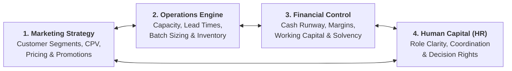
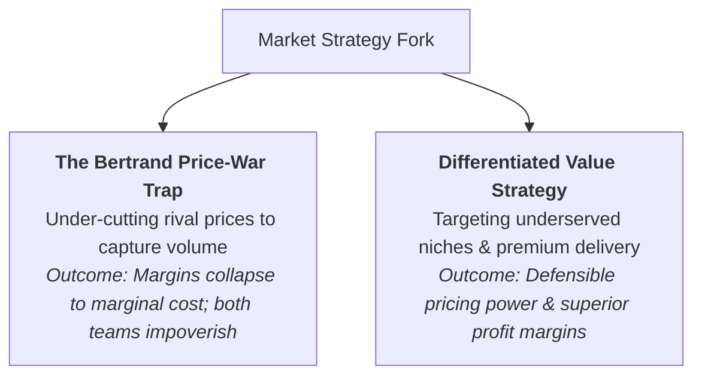
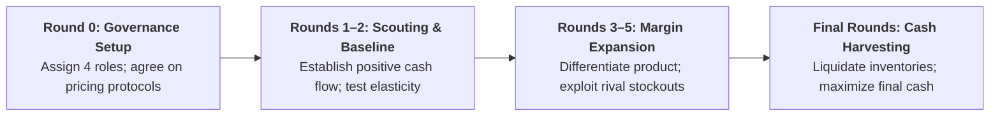

> [!NOTE] Curricular & Faculty Metadata
>
> - **Course:** MM5001 Marketing Management — Week 09
> - **Academic Host:** SBM ITB — _Direktorat Pendidikan Profesional Berkelanjutan_
> - **Lead Faculty:** Ira Fachira, S.Si., M.T., Ph.D.
> - **Primary Curricular Spine:** `archive/courses/mk3/week-09/announcement-selling-race.md`
> - **Modality:** Real-Time In-Class Interactive Business Simulation

---

> [!IMPORTANT] Official SBM ITB Course Directive: Week 09
> _"Please be informed that there will be no regular lecture materials in Week 9. Instead, our in-class learning session will be replaced by an interactive business simulation game called **SELLING RACE**._
>
> _In this game, you will work in teams and take on different management roles: **Finance, HR, Operations, and Marketing**. Your goal is to develop business strategies, manage resources, sell products, and compete against other teams to become the richest team!_
>
> _Please note that there will be no pre-test, post-test, pre-assignment, or post-assignment in Week 9. Your active participation, teamwork, communication, and decision-making will be important throughout the game. Let's play and win the market!"_

---

## 1. Executive Overview: The Pedagogy of Dynamic Market Simulations

In conventional business school curricula, functional disciplines are taught in isolated silos: Marketing designs value propositions, Operations plans capacity, Finance audits cash flows, and HR structures teams.

In real-world enterprise competition—and within the high-velocity arena of **The Selling Race**—these boundaries dissolve immediately. A brilliant marketing campaign produces immediate catastrophe if operations cannot manufacture enough units, resulting in stockouts and lost brand equity. Conversely, an operation that achieves peak production efficiency will bankrupt the enterprise if marketing prices the inventory incorrectly, trapping working capital in unsold inventory.

The objective of The Selling Race is not merely maximizing revenue; it is **maximizing retained economic profit** while navigating volatile competitor moves, supply constraints, and market demand shifts.

---

## 2. The 4-Pillar Cross-Functional Management Architecture

To win the simulation, syndicates must distribute functional responsibilities across four defined C-suite roles:

### 1. The Marketing Executive: Positioning, Value & Dynamic Pricing

The marketing lead serves as the voice of the market within the team:

- **Segment Selection & Targeting**: Diagnosing which customer tiers value premium quality versus those seeking discount commodity pricing.
- **Value Formulation**: Engineering [[concepts/customer-perceived-value|Customer Perceived Value (CPV)]] across functional and emotional [[concepts/elements-of-value|Elements of Value]].
- **Dynamic Pricing Strategy**: Adjusting price points in real time based on demand elasticity and competitor stockouts. If rival teams run out of inventory, marketing must seize pricing power rather than discounting.

### 2. The Operations Executive: Capacity & Inventory Equilibrium

The operations lead guarantees that customer demand translates into physical delivery:

- **Order Qualifiers vs. Order Winners**: Applying [[concepts/order-winners-and-qualifiers|Order Winners and Order Qualifiers]] to align manufacturing spend with customer purchase triggers.
- **The Lead-Time & Stockout Trade-off**: Managing raw material replenishment and production batches to avoid both stockout downtime penalties and excessive inventory holding costs, principles formalized in [[concepts/operations-lead-time-simulation|Operations Lead-Time Simulation]].
- **Throughput Balancing**: Preventing bottleneck queues in assembly and packaging to maximize asset turnover.

### 3. The Finance Executive: Solvency, Unit Economics & Cash Runway

The finance lead enforces capital discipline:

- **Unit Contribution Margin**: Tracking contribution per unit sold:
  $$
  \text{Unit Contribution} = \text{Selling Price} - \text{Variable Unit Cost}
  $$
- **The "Growing Broke" Liquidity Trap**: Monitoring cash runway to ensure that aggressive revenue expansion does not exhaust liquid working capital before customer payments clear, as analyzed in [[concepts/capital-budgeting-cash-flows|Capital Budgeting Cash Flows]].
- **Scoreboard Metric**: The ultimate victory condition is total accumulated retained cash at the end of the simulation.

### 4. The Human Resources Executive: Decision Rights & Speed

The HR lead designs the internal operating rhythm:

- **Clear Decision Rights**: Establishing clear [[concepts/organizational-dna-framework|Decision Rights]] so that frontline pricing and purchasing choices do not stall in committee paralysis.
- **Cross-Functional Communication**: Structuring rapid 30-second huddles between rounds to synchronize market shifts with factory production schedules.
- **Team Resilience**: Preventing cognitive burnout and blame-shifting under time-pressured competitive stress.

---

## 3. Game Theory & Competitive Dynamics in The Selling Race

### 1. The Bertrand Price-War Trap

When multiple syndicates manufacture identical commodity products, naive teams reflexively drop prices by $\text{Rp } 5{,}000$ or $\text{Rp } 10{,}000$ to undercut competitors. Competitors immediately retaliate. In game-theoretic Bertrand competition with homogeneous goods, prices rapidly spiral down to marginal cost ($P = MC$), eradicating all economic profit. **Do not compete on price alone**.

### 2. Exploiting Competitor Stockouts

When rival teams miscalculate production capacity and suffer stockouts, their unfulfilled customers flood the market. Syndicates that maintain disciplined safety stock can immediately hike prices to capture windfall profits from desperate buyers.

### 3. Information Asymmetry & Signaling

Watch competitor bidding behavior and order sizes closely. Rapid capacity additions by rivals signal an impending supply glut, warning your team to pivot toward alternative segments or preserve cash reserves.

---

## 4. The Syndicate Winning Playbook: Phase-by-Phase Roadmap

### Round 0: Pre-Game Governance & Setup

1. Assign explicit roles: 1 Chief Marketing Officer, 1 Chief Operating Officer, 1 Chief Financial Officer, 1 HR/Strategy Coordinator.
2. Establish a **Pricing Sign-Off Rule**: Marketing can adjust prices within pre-approved margin bands, but requires CFO concurrence if gross margin drops below $25\%$.
3. Agree on your syndicate's strategic posture: Premium Differentiation or High-Volume Focused Cost Leadership.

### Rounds 1–2: Market Scouting & Cash Foundation

1. Avoid speculative over-production. Produce conservative initial batches to test market clearing prices and customer segment preferences.
2. Ensure every transaction produces positive net cash inflow ($P > \text{Variable Cost} + \text{Holding Cost}$).
3. Maintain an emergency cash cushion to absorb unexpected cost shocks or regulatory tariffs.

### Rounds 3–5: Mid-Game Optimization & Differentiation

1. Invest in product features, branding, or faster delivery to transform your offering from an order qualifier into an **order winner**.
2. If competitors enter an irrational price war, do not follow them to the bottom. Pivot production toward premium, less price-sensitive buyer segments.
3. Keep production synchronized with actual sales velocity to minimize idle warehouse holding expenses.

### Final Rounds: Inventory Liquidation & Cash Harvesting

1. In the closing rounds, stop ordering long-lead-time raw materials.
2. Discount remaining finished goods slightly to achieve **100% inventory clearance**. Finished goods left unsold in the warehouse at game end yield zero points.
3. Maximize liquid cash to secure the "Richest Team" championship.

---

## 🔗 Related Knowledge Bridges

- Prior Marketing Lecture: [[courses/mk3-marketing-management/week-08/index|MK3 Week 08: Services Marketing & PT KAI Service Transformation]]
- Consumer Value Theory: [[concepts/customer-perceived-value|Customer Perceived Value (CPV)]]
- Strategic Value Architecture: [[concepts/elements-of-value|Elements of Value Framework]]
- Operations Interface: [[concepts/order-winners-and-qualifiers|Order Winners and Order Qualifiers]]
- Inventory & Lead Times: [[concepts/operations-lead-time-simulation|Operations Lead-Time Simulation]]
- Cash Flow & Liquidity: [[concepts/capital-budgeting-cash-flows|Capital Budgeting Cash Flows]]
- Strategic Coordination: [[concepts/organizational-dna-framework|Organizational DNA Framework]]
- Game Theory Foundations: [[concepts/value-creation-and-claiming|Value Creation vs. Value Claiming]]
- Return to [[courses/mk3-marketing-management/index|MK3 Course Overview Hub]]
