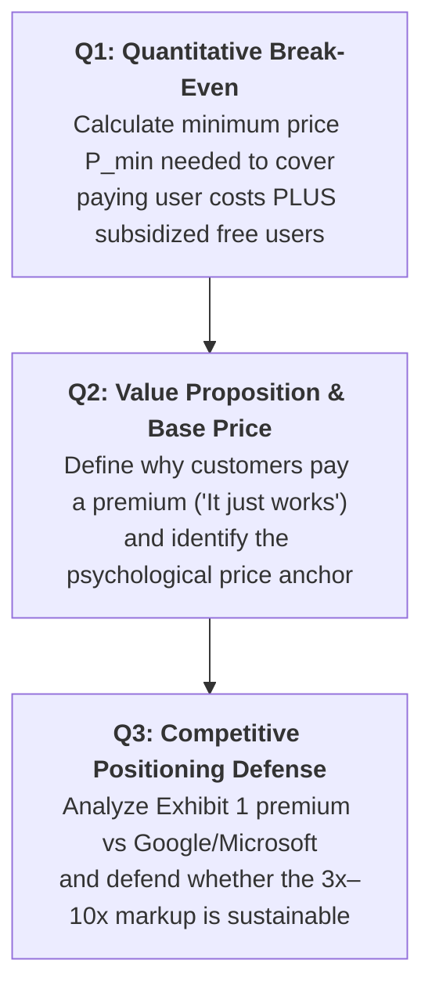

> [!IMPORTANT] Cohort Pre-Class Case Brief (_"Ini Peta, Bukan Jawaban"_)
> **Audience:** P3MD Batch I Soedirman Cohort  
> **Academic Mode:** Pre-Class Strategic Framing & Analytical Map  
> **Purpose:** This dossier compiles the competitive exhibits, freemium cost parameters, cross-subsidization mechanics, and analytical roadmaps for the **Freemium Pricing at Dropbox** case—**without prescribing specific group calculations or final recommendations**.

---

## 1. Executive Summary & Strategic Context

In 2013, **Dropbox** was the undisputed consumer champion of cloud storage, boasting **200 million registered users** saving over **1 billion files daily** and commanding a private valuation above **$\$4\text{ billion}$**.

Founded in 2007 by Drew Houston and Arash Ferdowsi around an elegant engineering thesis (_"It just works"_), Dropbox utilized a **freemium business model**:

- Giving away 2 GB of storage completely free.
- Providing 500 MB bonuses per side through a viral referral engine.
- Charging premium subscribers for higher storage tiers (50 GB for $\$9.99$/month or $\$100$/year; 100 GB for $\$19.99$/month).

However, Dropbox faced a looming strategic crisis:

1. **The Titan Offensive:** Tech giants with deep pockets and multi-line ecosystem subsidies launched aggressive competitor platforms: **Google Drive** (5 GB free, $\$30$/year for 25 GB), **Microsoft SkyDrive** (7 GB free, $\$10$/year for 27 GB), and **Apple iCloud** (5 GB free, $\$40$/year for 20 GB).
2. **The Freemium Subsidy Burden:** Only **$1.6\% \text{ to } 4.0\%$** of Dropbox's 200 million users ever upgraded to a paid account. Between $96\%$ and $98\%$ of users consumed storage and server bandwidth without paying a single cent.
3. **The Core Strategic Dilemma:** Could an independent startup with several hundred employees survive against subsidized platforms while charging a **$3\times \text{ to } 10\times$ pricing premium**? Should Dropbox eliminate freemium in favor of a limited-time free trial, or double down on enterprise B2B expansion?

---

## 2. Master Case Exhibits & Quantitative Data

### Exhibit 1: Competitive Landscape of Cloud Storage Services (2012)

| Cloud Storage Provider | Free Tier Allocation | First Paid Tier Storage | Annual Paid Price | Equivalent Price per GB / Year |
| :--------------------- | :------------------: | :---------------------: | :---------------: | :----------------------------: |
| **Dropbox**            |       **2 GB**       |        **50 GB**        | **\$100 / year**  |        **\$2.00 / GB**         |
| **Google Drive**       |         5 GB         |          25 GB          |    \$30 / year    |          \$1.20 / GB           |
| **Apple iCloud**       |         5 GB         |          20 GB          |    \$40 / year    |          \$2.00 / GB           |
| **Microsoft SkyDrive** |         7 GB         |          27 GB          |    \$10 / year    |          \$0.37 / GB           |

_Source: HBS Case Exhibit 1 / Gizmodo Benchmark._

### Exhibit 2: Cost Structure of Servicing Free & Paid Users

As documented in case text (p. 4, citing Michael Woloszynowicz, _The Economics of Dropbox_):

- **Average Storage Used by Free User:** Approximately **$433\text{ MB}$** ($0.433\text{ GB}$).
- **Annual Cost to Service Average Free User ($c_{\text{free}}$):** **$\$1.32\text{ per year}$** (direct hosting, Amazon S3 storage, and server bandwidth).
- **Annual Cost for Heavy Free User (16 GB cap):** Up to **$\$49.00\text{ per year}$**.
- **Customer Acquisition Cost (CAC) via Google AdWords:** **$\$194\text{ per paid user}$** (abandoned due to negative unit economics).
- **Referral Engine Virality:** $70\%$ participation rate; $12\%$ install conversion rate.

### Exhibit 3: Freemium Adopter Conversion Benchmarks Across Tech Sectors

| Company      | Sector             | Number of Paid Tiers | Free-to-Paid Conversion Rate | Secondary Revenue Sources                            |
| :----------- | :----------------- | :------------------: | :--------------------------: | :--------------------------------------------------- |
| **Dropbox**  | Cloud Storage      |          4           |     **$1.6\% - 4.0\%$**      | None ($100\%$ subscription)                          |
| **Spotify**  | Audio Streaming    |          3           |         **$20.0\%$**         | Display/Audio Ads on free tier ($17\%$)              |
| **Pandora**  | Online Radio       |          2           |         **$3.6\%$**          | Advertising ($79\%$ of revenue)                      |
| **LinkedIn** | Professional Graph |          3           |         **$0.8\%$**          | Enterprise B2B Recruiter subscriptions ($3:1$ ratio) |
| **Evernote** | Note Taking        |          1           |     **$1.0\% - 6.0\%$**      | None ($100\%$ subscription)                          |

---

## 3. Question-by-Question Analytical Roadmap

---

### 🧮 Question 1: Mathematical Break-Even Pricing Architecture

To determine the minimum price Dropbox must charge a paying customer to break even while cross-subsidizing free users:

#### 1. Define the Structural Subsidy Burden

Let:

- $N_{\text{total}} =$ Total user base (e.g., $100\text{ million}$ or $200\text{ million}$ users).
- $CR =$ Conversion rate to paying customers (explore range between $1.6\%$ and $4.0\%$).
- $N_{\text{paying}} = CR \times N_{\text{total}}$.
- $N_{\text{free}} = (1 - CR) \times N_{\text{total}}$.
- $\theta = \frac{N_{\text{free}}}{N_{\text{paying}}} = \frac{1 - CR}{CR}$ (the number of free users carried by each paying subscriber).

$$\text{At } CR = 1.6\%: \quad \theta = \frac{0.984}{0.016} = 61.5 \text{ free users per paying customer}$$

Notice the dramatic non-linear leverage of conversion improvement. If Dropbox sharpens product onboarding, refines enterprise security features, and executes targeted in-app prompts to elevate its conversion rate to 4.0%, the cross-subsidy burden drops by more than sixty percent:

$$\text{At } CR = 4.0\%: \quad \theta = \frac{0.960}{0.040} = 24.0 \text{ free users per paying customer}$$

#### 2. Establish Key Cost Assumptions for Your Syndicate

Your syndicate must clearly state and justify its operating assumptions:

- **Free User Hosting Cost ($c_{\text{free}}$):** Use the case figure of **$\$1.32/\text{year}$** for an average user, or model a blended average accounting for power users.
- **Paid User Hosting Cost ($c_{\text{paying}}$):** How much storage does a 50 GB paying customer actually consume? (e.g., if utilizing $20\text{ GB}$ to $50\text{ GB}$, storage and bandwidth costs typically scale to $\$15 - \$35/\text{year}$).
- **Fixed Platform Overhead ($C_{\text{fixed}}$):** Incorporate engineering R&D, corporate SG&A, and infrastructure maintenance (or compute on a per-user allocated contribution margin).

#### 3. Formulate the Break-Even Formula

The minimum annual break-even price per paying customer ($P_{\text{breakeven}}$) is:

$$P_{\text{breakeven}} = c_{\text{paying}} + (\theta \times c_{\text{free}}) + \frac{C_{\text{fixed}}}{N_{\text{paying}}}$$

> **Analytical Checklist for Q1:**
>
> - Did your syndicate test sensitivities at both $1.6\%$ and $4.0\%$ conversion rates?
> - Did you demonstrate how a reduction in cloud storage unit costs (Amazon S3 economies of scale) lowers the break-even threshold over time?

---

### 💎 Question 2: Value Proposition & Base Price Reflection

1. **Deconstruct Dropbox's True Value Proposition:**
   - Why do users love Dropbox? It is not about raw gigabytes. Storage is a commodity.
   - The value proposition is **Frictionless Ubiquity & Reliability**:
     - Seamless folder integration (zero learning curve; drag-and-drop into local Windows/Mac filesystem).
     - Delta-sync algorithms (syncing only modified binary chunks rather than whole files, saving battery and bandwidth).
     - True platform neutrality (working across Android, iOS, Windows, Mac, and Linux without ecosystem lock-in).
2. **Deriving the Base Price Anchor:**
   - Why did Houston select **$\$9.99/\text{month}$ ($\$100/\text{year}$)** for 50 GB?
   - In SaaS psychology, $\$9.99$ sits precisely beneath the $\$10$ psychological cognitive friction threshold.
   - It signals a professional-grade productivity utility (comparable to software licenses or digital subscriptions) rather than a cheap storage utility.

---

### ⚔️ Question 3: Competitive Positioning & Premium Justification

Analyze Exhibit 1 carefully. Dropbox charges:

- **$\$100/\text{year}$ for 50 GB** ($\$2.00/\text{GB}$).
- Google Drive charges **$\$30/\text{year}$ for 25 GB** ($\$1.20/\text{GB}$).
- Microsoft SkyDrive charges **$\$10/\text{year}$ for 27 GB** ($\$0.37/\text{GB}$).

Dropbox is **$67\%$ more expensive per GB than Google** and **over $5\times$ more expensive than Microsoft SkyDrive**!

#### Is the Premium Justified? Build a Structured Strategic Defense:

- **Arguments Supporting the Premium (Value-Added Pricing):**
  - _Network Effects & Shared Folders:_ Collaboration requires both parties to share folders. If the recipient already has Dropbox installed, switching costs are high.
  - _Ecosystem Neutrality:_ Corporate users use Windows laptops, iPhones, and Android tablets. Apple iCloud hobbles Windows; SkyDrive is tied to Microsoft accounts. Dropbox is the independent Switzerland of data.
  - _Reliability & Trust:_ High-value white-collar workers will not risk corrupting critical presentations to save $\$70$ a year on storage.
- **Counter-Arguments / Vulnerabilities:**
  - Google and Microsoft can operate their cloud drives at a permanent loss, cross-subsidizing storage via Google Workspace, Gmail ads, and Office 365 bundles.
  - As consumer files transition from documents to heavy video and 4K photo libraries, gigabyte price elasticity increases dramatically.

---

## 🔗 Related Portals

- Core Lecture Hub: [[courses/mk3-marketing-management/week-10/index|Week 10: Strategic Pricing & Value Capture]]
- Lattice Concept: [[concepts/freemium-pricing-model|Freemium Pricing Model & SaaS Economics]]
- Company Profile: [[entities/dropbox|Enterprise Dossier: Dropbox, Inc.]]
- Course Syllabus Hub: [[courses/mk3-marketing-management/index|MK3 Course Table of Contents]]
