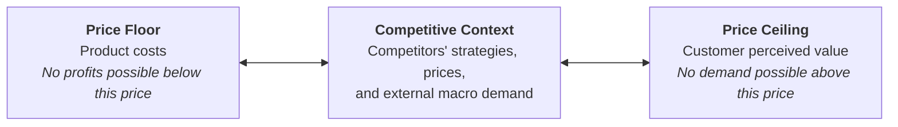
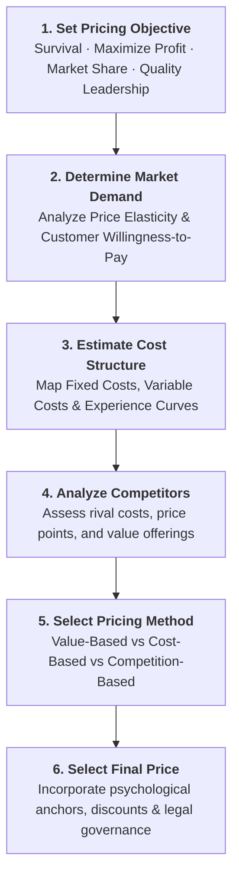
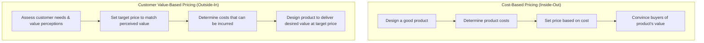
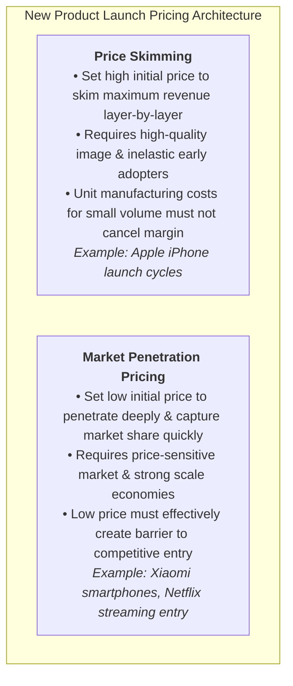
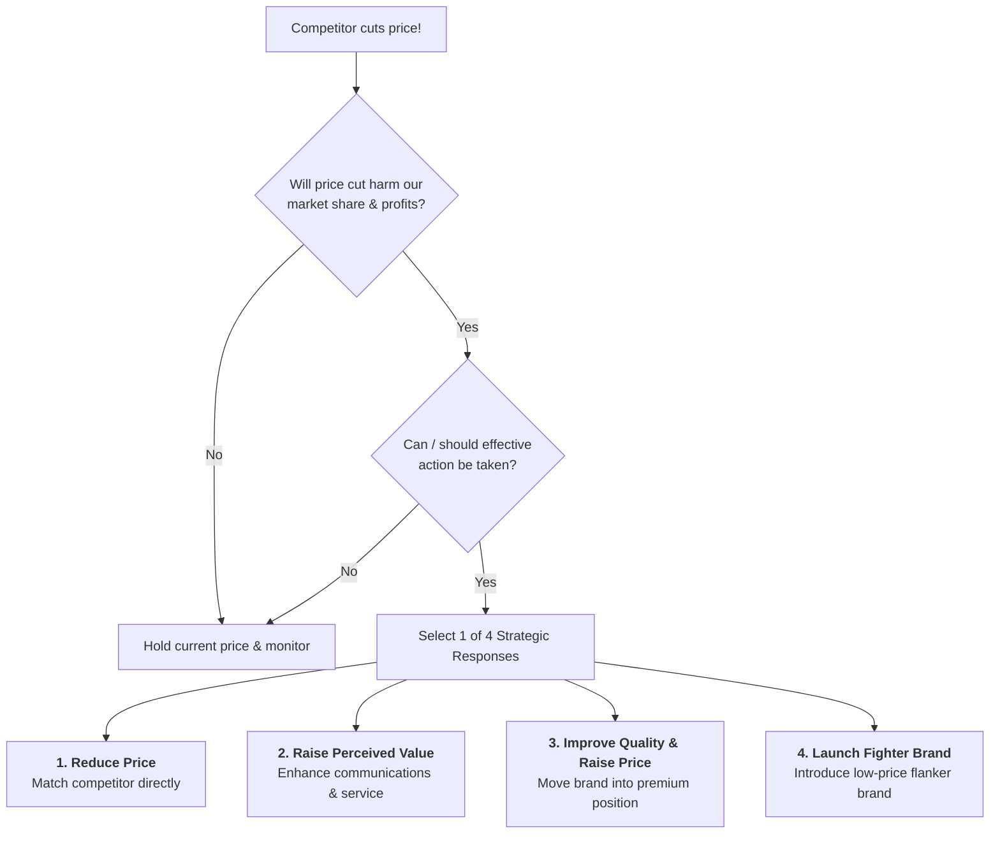

> [!NOTE] Curricular & Faculty Metadata
>
> - **Course:** MK3 Marketing Management (MM5001) — Week 10
> - **Teaching Team:** Dr. Asnan Furinto, ST., M.M., Dr. Nila Armelia Windasari, S.A., M.B.A.
> - **Primary Curricular Spine:** `archive/courses/mk3/week-10/[P3MD] Week 10-MK3.pdf`
> - **Harvard Teaching Case:** [[courses/mk3-marketing-management/week-10/case-dropbox-pricing|Freemium Pricing at Dropbox (HBS 9-514-053)]]
> - **Foundational Lattice Concept:** [[concepts/freemium-pricing-model|Freemium Pricing Model & SaaS Economics]]
> - **Primary Enterprise Entity:** [[entities/dropbox|Enterprise Profile: Dropbox, Inc.]]

---

## 1. The Opening Provocation: The Unique Power of Price

In the traditional marketing mix—Product, Price, Place, Promotion—three of the four elements represent **cost centers**:

- Product development consumes capital in engineering, design, and manufacturing.
- Place (distribution channels) incurs logistics, warehousing, and intermediary margin cuts.
- Promotion requires substantial outlays for digital media, brand campaigns, and sales forces.

> _"Price is the only element in the marketing mix that produces revenue; all other elements produce costs."_

Despite its singular financial impact, pricing is frequently the most poorly managed marketing lever. Companies reflexively default to simplistic **cost-plus markups** or engage in destructive, race-to-the-bottom **price wars**. Strategic marketing management requires treating price as an instrument of **value capture**—calibrated to extract fair economic return from the customer surplus created by product differentiation.

---

## 2. The 6-Step Systematic Pricing Architecture

Setting price requires a disciplined, sequential process bridging organizational objectives and market behavior:

---

## 3. The Three Major Pricing Paradigms

### 1. Customer Value-Based Pricing (The Gold Standard)

Prices are established based on the buyer's perception of value rather than the producer's historical costs:

- **Good-Value Pricing:** Offering precisely the right balance of quality and functional service at a fair, accessible price (e.g., Walmart's _Every Day Low Pricing_ [EDLP] or Mercedes-Benz introducing the entry-level CLA Class).
- **Value-Added Pricing:** Attaching premium, innovative features, and services to differentiate the offering and justify a substantial price premium (e.g., **Bose** premium audio systems commanding $\$350$ price points through psychoacoustic research).

### 2. Cost-Based Pricing & The Experience Curve

- **Cost-Plus (Markup) Pricing:** Adding a standard predetermined percentage markup to unit production costs:

  $$\text{Unit Cost} = \text{Variable Cost} + \frac{\text{Fixed Costs}}{\text{Unit Sales}}$$

  Once total unit cost is established, the target selling price incorporates the desired profit margin on sales:

  $$\text{Markup Price} = \frac{\text{Unit Cost}}{1 - \text{Desired Return on Sales}}$$

- **The Experience (Learning) Curve:** As cumulative production doubles, unit manufacturing costs decline predictably due to worker specialization, process refinement, and scale economies (illustrated by Lenovo's PC manufacturing).
- **Break-Even & Target Return Pricing:** Determining the volume threshold ($Q_{\text{BE}}$) required to cover fixed outlays at a designated price point:

  $$Q_{\text{BE}} = \frac{\text{Fixed Cost}}{P - \text{Variable Cost}}$$

### 3. Competition-Based Pricing & Economic Value to Customer (EVC)

Evaluating pricing relative to substitute market offerings. The classic industrial example is **Caterpillar (CAT)** heavy machinery:

- A competitor's standard bulldozer retails for $\$420,000$.
- CAT prices its bulldozer at **$\$500,000$**—a $\$80,000$ premium.
- CAT justifies the premium by quantifying the lifetime operating advantages: $+\$50,000$ superior durability, $+\$40,000$ reduced maintenance, $+\$40,000$ dealer parts availability, and $+\$20,000$ extended warranty ($+\$150,000$ total added value), then providing a $\$70,000$ buyer discount. The customer gladly pays $\$500,000$ because total cost of ownership is lower.

---

## 4. Product Mix & Portfolio Pricing Strategies

When products exist within an interdependent family, pricing must optimize total enterprise portfolio margins rather than individual SKU profitability:

| Strategy                     | Managerial Definition                                                                                                                       | Industry & Real-World Example                                                                                                     |
| :--------------------------- | :------------------------------------------------------------------------------------------------------------------------------------------ | :-------------------------------------------------------------------------------------------------------------------------------- |
| **Product Line Pricing**     | Setting stepped price increments across products based on feature separation and customer segmentation.                                     | Nike athletic footwear tiers: Running ($\$90$), Cross-Training ($\$130$), Pro Basketball ($\$190$).                               |
| **Optional-Product Pricing** | Pricing optional accessories or add-ons alongside a core base offering.                                                                     | Automotive options: Navigation packs, panoramic sunroofs, performance audio upgrades.                                             |
| **Captive-Product Pricing**  | Pricing the initial entry product low (often at razor-thin margins or cost) while taking high margins on mandatory proprietary consumables. | Video game consoles (Sony PlayStation sold at near cost; profits captured via $\$70$ software titles).                            |
| **By-Product Pricing**       | Monetizing production waste or industrial scrap to make the main product's price more competitive.                                          | Traditional Indonesian agriculture (selling _brutu_ chicken tail or composting animal manure into commercial organic fertilizer). |
| **Product Bundle Pricing**   | Combining complementary items and offering the package at a reduced bundled price.                                                          | Fast food _Paket Hemat_ (Burger $+$ Fries $+$ Drink for Rp 35.000 vs Rp 48.000 à la carte).                                       |

---

## 5. New-Product Pricing: Skimming vs. Penetration

---

## 6. Price Adjustment Strategies & Tactical Gating

Enterprises modify baseline pricing to adapt to segment characteristics, geography, and psychological perceptions:

1. **Segmented Pricing:** Selling a service at multiple prices where the difference is not driven by cost:
   - _Customer-Segment:_ Student, corporate, or senior citizen movie theater discounts.
   - _Product-Form:_ First-class vs. economy airline seats.
   - _Time-Based:_ Matinee theater pricing, peak-hour ride-hailing surges.
2. **Psychological Pricing & Reference Prices:**
   - Buyers carry internal **Reference Prices** based on past purchases or ambient context.
   - Charm pricing ($\$9.99$ instead of $\$10.00$) exploits cognitive anchoring.
3. **The Hazards of Promotional Pricing:**
   - Excessive discounting, flash sales, and rebates create "deal-prone" customers who refuse to purchase at full price, eroding brand equity and creating destructive addiction to promotional fixes.

---

## 7. Dynamic SaaS & Freemium Economics

Modern digital and cloud platforms replace traditional one-time software licenses with **Freemium Pricing**, explored in our [[courses/mk3-marketing-management/week-10/case-dropbox-pricing|Dropbox Case Study]]:

- **The Core Trade-off:** Providing a free functional tier generates massive organic adoption and viral referrals without paid advertising costs (Dropbox eliminated $\$194$ Google AdWords CAC).
- **The Mathematical Reality:** Because only $1.6\% \text{ to } 4.0\%$ of users upgrade to paid accounts, each paying subscriber must cross-subsidize 25 to 60 free users.
- **Enterprise Pivot:** Transitioning from consumer storage to high-margin **B2B Team Plans** ($40\%$ of revenue) with centralized security, admin controls, and unlimited capacity.

---

## 8. Strategic Responses to Competitor Price Cuts

When an aggressive competitor slashes prices, management must not panic. Kotler outlines four disciplined response vectors:

---

## 9. Marketing Budget Allocation Models

To support strategic pricing and market share goals, CMOs utilize four resource allocation models:

1. **5% Rule of Thumb:** Allocating $5\% - 10\%$ of total corporate revenue to ongoing marketing activities (surging to $7\% - 12\%$ during aggressive market penetration).
2. **Industry Benchmarking:** Aligning spend to sector realities (Deloitte/Gartner data reveals Consumer Packaged Goods spend $24\%$ of budget on marketing, while Energy spends only $4\%$).
3. **Competitive Parity Method:** Matching competitor expenditure to prevent share-of-voice erosion.
4. **Objective and Task Method (Best Practice):** Defining specific marketing objectives, identifying required tasks, and calculating the exact bottom-up cost required to execute them.

---

## 10. Indonesian BUMN Context: Regulated Tariffs vs Commercial Freedom

In Indonesia, pricing strategy within state enterprises requires navigating commercial profitability alongside public welfare obligations:

- **Telkomsel vs. By.U:** Telkomsel preserves premium brand equity for corporate/mature segments, while deploying **By.U** as a digital fighter brand with dynamic app-based pricing to capture price-sensitive Gen Z users.
- **PLN & Pertamina Dual-Track Pricing:** Subsidized lifeline tariffs for base consumers coexisting with non-subsidized, market-indexed pricing for commercial and high-income tiers (Pertamax vs Pertalite; non-subsidized commercial electricity tariffs).

---

## 🔗 Curricular Satellites & Further Study

- **Harvard Teaching Case:** [[courses/mk3-marketing-management/week-10/case-dropbox-pricing|Case Study: Freemium Pricing at Dropbox]]
- **Foundational Concept:** [[concepts/freemium-pricing-model|Freemium Pricing Model & SaaS Economics]]
- **Enterprise Profile:** [[entities/dropbox|Dropbox, Inc. Dossier]]
- **Course Syllabus Hub:** [[courses/mk3-marketing-management/index|MK3 Course Table of Contents]]
