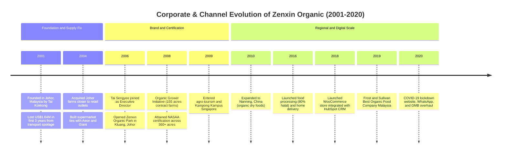
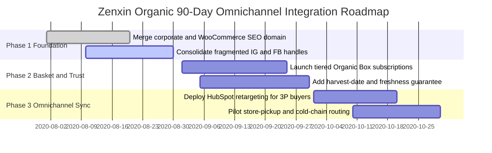

> [!NOTE] Case Dossier Metadata
>
> - **Case Reference:** _Zenxin Organic: From Brick and Mortar to Digital Retail_ (`SMU-20-0047` / `SMU935`, Version `2021-07-06`), by **Dr. Patricia Lui** and **Lipika Bhattacharya** (Singapore Management University)
> - **Course & Module:** [[courses/mk3-marketing-management/week-11/index|MK 3 Week 11: Marketing Mix — Place (Channel) & Digital Marketing]]
> - **Primary Enterprise:** [[entities/zenxin-organic|Zenxin Organic]]
> - **CRM Integration Partner:** [[entities/hubspot|HubSpot, Inc.]]
> - **Related Debrief:** [[courses/mk3-marketing-management/week-11/assignment-pre-assignment-zenxin|Week 11 Assignment Debrief (F9 Synthesis)]]

---

## 🚨 The Executive Dilemma

In **July 2020**, **Tai Sengyee**, Executive Director of **[[entities/zenxin-organic|Zenxin Organic]]**, faced an acute omnichannel crossroads. Although Zenxin had grown into Southeast Asia's leading organic fresh produce supplier—operating over $300\text{ hectares}$ of farmland, $14$ brick-and-mortar retail stores, and supplying $100+$ supermarkets—the bulk of its revenue still depended on physical supermarkets and owned stores.

When COVID-19 lockdowns disrupted physical distribution channels and forced retail closures, Sengyee confronted three interlocking channel and digital dilemmas:

1. **The Sensory "See and Feel" Barrier**: Market research showed that grocery shoppers preferred to inspect, touch, and smell fresh produce—and pick containers from the back of the shelf with the longest expiration dates. How could Zenxin replicate physical freshness trust in a digital storefront?
2. **Supermarket Margin Squeeze vs. Small-Basket Online Economics**: Big-box supermarkets (Aeon, Giant, Cold Storage, NTUC) provided broad reach but extracted steep trade margins. Conversely, selling perishable vegetables online suffered from small cart sizes, high cold-chain delivery costs, and low online revenue share.
3. **Siloed Digital Presence**: Despite launching a WooCommerce store integrated with [[entities/hubspot|HubSpot]] in 2018 and revamping its website, social media, and Google My Business profile in April 2020, Zenxin remained far behind giants like Amazon and RedMart. How should Sengyee integrate online and offline channels into a scalable [[concepts/marketing-channel-architecture#omnichannel-evolution|omnichannel strategy]]?

---

## 🏢 Enterprise & Industry Background

Founded in **2001** in Johor, Malaysia by **Tai Kokkong**, Zenxin began by fermenting agricultural waste into organic fertilizer using Japanese microbial techniques before pivoting into palm oil and fresh organic vegetables. Early road transport from Cameron Highlands and Gua Musang to Johor ($7\text{–}8$ hours) and Singapore ($9$ hours) caused severe spoilage and rejections, while local demand was confined largely to expatriates ($7.1\%$ of Singapore's population; $4.2\%$ of Malaysia's), resulting in an initial **$US\$1.64\text{ million}$** loss over three years.

### Brand Portfolio Architecture

| Brand Name         | Product Focus                                                                                        | Strategic Role in Channel Mix                                                                  |
| :----------------- | :--------------------------------------------------------------------------------------------------- | :--------------------------------------------------------------------------------------------- |
| **Zenxin Organic** | Perishable fresh vegetables, fruits, and herbs ($200+$ varieties)                                    | Flagship traffic driver across $14$ owned stores, $100+$ supermarkets, and local home delivery |
| **Simply Natural** | Dry organic groceries (handmade noodles, tea, grains, legumes, oils, sauces; $80\%$ halal-certified) | Higher shelf-life anchor enabling cross-border China digital expansion and gift hampers        |
| **Midori**         | Microbial organic fertilizers                                                                        | B2B/agricultural upstream heritage product                                                     |

---

## 📈 Quantitative Exhibits & Market Data

### 1. Customer Segmentation: Global Organic Personas & Regional Markets

| Segment / Persona       | Core Profile & Attitude                                                                         | Willingness to Pay (WTP)   | Ability to Pay (ATP) | Digital & Channel Behavior                                                                |
| :---------------------- | :---------------------------------------------------------------------------------------------- | :------------------------- | :------------------- | :---------------------------------------------------------------------------------------- |
| **Forwards**            | Younger, health-obsessed consumers living with family; actively seek _"better for me"_ options  | **High**                   | **Lower**            | High social media discovery; sensitive to delivery fees and minimum order thresholds      |
| **Followers**           | Middle-aged consumers with balanced wellness views; large addressable segment                   | **High**                   | **High**             | Core target for recurring weekly Organic Boxes and supermarket convenience                |
| **Neutrals**            | Elderly consumers prioritizing price and convenience over health                                | **Low**                    | **Moderate**         | Will try organic options only without price premiums; price-anchored                      |
| **Expatriates (SG/MY)** | Middle-to-high income, ages $26\text{–}50$ ($7.1\%$ SG / $4.2\%$ MY)                            | **High**                   | **High**             | Early adopters of NASAA-certified produce in modern supermarkets and RedMart              |
| **Chinese Millennials** | Digitally savvy, one-child-policy generation ($40\% \to 46\%$ pop., $69\%$ consumption by 2021) | **High (Foreign Premium)** | **High**             | Mobile-first; shop via WeChat, Taobao, and Chilli.com; value convenience over store trips |

Sengyee further distinguished two online grocery behaviors: **ad-hoc cross-shoppers** (buying on Amazon only when unable to visit supermarkets) versus **online regulars** (buying weekly groceries consistently on RedMart—Zenxin's highest-priority digital target).

### 2. Macro E-Commerce & Digital Funnel Benchmarks Cited in Case

- **E-Commerce Penetration Trajectory**: Forecast to rise from **$15\%$** (pre-January 2020) to **$25\%$** by 2025, with **$73\%$** of e-commerce sales occurring on mobile devices by end of 2021.
- **Funnel Drop-Off Reality**: Over **$98\%$** of website visitors leave without converting, often requiring up to **$30$ touchpoint steps** before purchase.
- **Retargeting Lift**: Exposing repeat visitors to retargeted ads for four weeks lifted search frequency by **$+1{,}046\%$** and site visits by **$+726\%$**.
- **Google My Business (GMB) Social Proof**: Active CEO/team responses to reviews earned Zenxin a **$4.1\text{–}4.2 / 5.0$** rating versus **$2.7 / 5.0$** for iHerb Singapore.

### 3. Exhibit 3: Website & Digital Transformation (Pre-COVID vs. April–October 2020)

| Digital Dimension          | Before COVID-19 Pandemic                                                                                | After COVID-19 Overhaul (April–October 2020)                                                                              |
| :------------------------- | :------------------------------------------------------------------------------------------------------ | :------------------------------------------------------------------------------------------------------------------------ |
| **SEO & Search Routing**   | Searching _"Zenxin"_ routed users to the corporate site, requiring extra clicks to find online delivery | Organic search surfaced _"Zenxin Singapore"_ with multiple direct e-commerce landing pages                                |
| **Landing Page & CTA**     | No clear Call-to-Action (CTA) on landing page                                                           | Centered **"Shop Now"** and **"Play Video"** CTAs plus a personal message from Executive Director Tai Sengyee             |
| **Product Categorization** | Cluttered display of many item-wise product categories                                                  | Consolidated into three clear pillars (**Organic Box**, **Recipe Box**, **Hot Deals**) under a clean dropdown (Exhibit 4) |
| **Conversion Flow**        | Two-step journey (enter category page, then click _"Shop Now"_)                                         | Streamlined one-step **"Shop Now"** path directly into dropdown product selection                                         |
| **Product Information**    | Small images with brief descriptions                                                                    | Larger high-resolution product visuals, short scannable blurbs, and expanded Detail tabs (Exhibit 5)                      |
| **Site Interaction**       | Static informational content                                                                            | Interactive clickable cards, customizable Organic Boxes, stay-home essentials, recipes, and testimonials                  |
| **Customer Communication** | Inactive live chat limited to Facebook Messenger                                                        | Added direct **WhatsApp** live chat for immediate one-to-one support                                                      |
| **Social Media Ecosystem** | Fragmented ($4$ Instagram handles, $7$ Facebook pages, $1$ YouTube); linked only FB/IG                  | Extended site links to **LinkedIn** and **YouTube** with regular video uploads (Exhibit 1)                                |

---

## ⚖️ Strategic Alternatives Matrix

| Strategic Option                                                           | Pros                                                                                             | Cons & Risks                                                                                    | Financial & Margin Impact                                                                                 | Organizational & Operational Friction                                                      |
| :------------------------------------------------------------------------- | :----------------------------------------------------------------------------------------------- | :---------------------------------------------------------------------------------------------- | :-------------------------------------------------------------------------------------------------------- | :----------------------------------------------------------------------------------------- |
| **Option A: Double Down on Owned E-Commerce (WooCommerce + HubSpot)**      | Full brand storytelling, NASAA education, first-party CRM data, and zero marketplace commissions | High traffic-acquisition cost; small basket sizes hurt last-mile delivery unit economics        | Highest gross margin per order, but requires sustained SEO/retargeting spend and minimum order thresholds | Requires unifying corporate and e-commerce domains plus cold-chain fulfillment discipline  |
| **Option B: Scale via Third-Party Marketplaces (RedMart, Lazada, Taobao)** | Instant access to high-intent weekly grocery shoppers and established logistics                  | Marketplace fees, direct price/brand comparison with rivals, and loss of customer CRM ownership | Lower net margin after platform commissions, but higher immediate order volume and lower CAC              | Risk of inconsistent freshness handling by external couriers damaging brand equity         |
| **Option C: Integrated Omnichannel Orchestration (Recommended)**           | Uses marketplaces for acquisition/reach and owned store + subscriptions for high-LTV retention   | Highest operational complexity across $14$ stores, $100+$ supermarkets, and digital platforms   | Optimizes blended CAC/LTV via Organic Box subscriptions, festive hampers, and dry-good cross-sells        | Demands unified inventory visibility, consistent social governance, and cross-channel KPIs |

---

## 🎯 Executive Recommendation & Implementation Roadmap

To resolve Sengyee's dilemma, Zenxin should execute **Option C (Integrated Omnichannel Orchestration)** along a phased 90-day roadmap:

1. **Replicate "See and Feel" Digitally**: Embed harvest-date transparency, NASAA traceability QR codes, high-resolution cross-section visuals, and a _"freshness replacement guarantee"_ to neutralize sensory hesitation.
2. **Fix Last-Mile Unit Economics**: Shift single-vegetable orders into recurring **Organic Box / Recipe Box subscriptions** and cross-sell high-margin dry goods (_Simply Natural_ noodles, oils, teas) to raise Average Order Value (AOV).
3. **Assign Distinct Channel Roles**: Leverage RedMart, HappyFresh, Lazada, and Taobao/WeChat for **customer acquisition** (TOFU), while inserting QR recipe/loyalty cards inside packages to migrate repeat buyers onto Zenxin's **owned [[entities/hubspot|HubSpot]]-powered storefront** (BOFU retention).

---

## 🎙️ Classroom Cold-Call & Boardroom Defense

- **If faculty asks: _"Why couldn't Zenxin just rely on supermarkets like Aeon and Giant?"_**
  Supermarkets solved physical reach (intensive distribution) but trapped Zenxin in a **margin squeeze** with zero first-party customer data and vulnerability to lockdown closures.
- **If faculty asks: _"Was Zenxin's digital shift purely a COVID-19 panic reaction?"_**
  No—Zenxin launched home delivery in **2016** and its WooCommerce + HubSpot store in **2018** to escape supermarket margin dependence and reach China via WeChat/Taobao. COVID-19 acted as an _accelerant_, not the origin.
- **Related Links**: [[courses/mk3-marketing-management/week-11/index|Week 11 Lecture Hub]] | [[courses/mk3-marketing-management/week-11/assignment-pre-assignment-zenxin|Week 11 Assignment Debrief]] | [[concepts/digital-marketing-funnel|Digital Marketing Funnel]]
