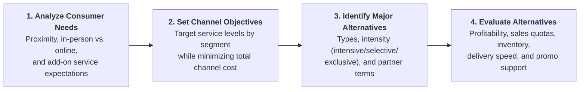
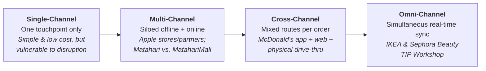
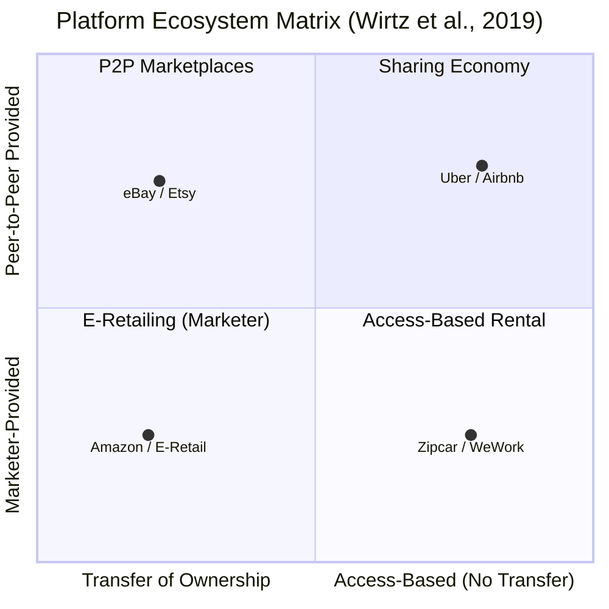
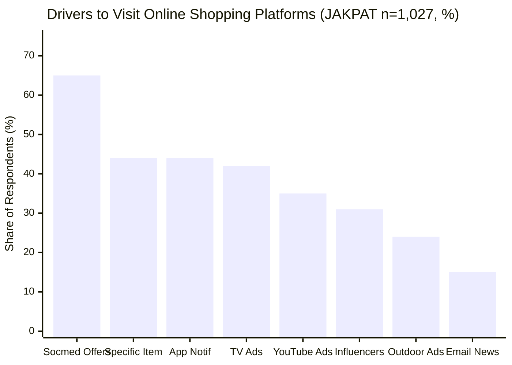
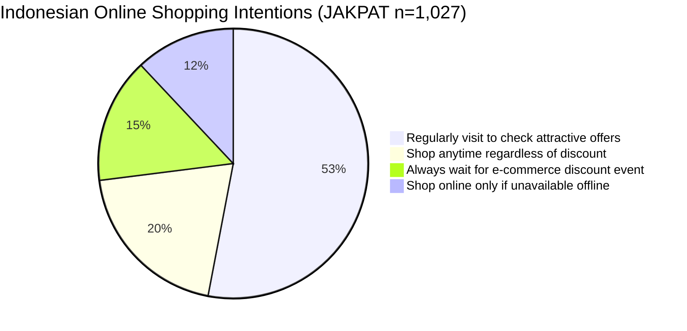

> [!NOTE] Curricular & Faculty Metadata
>
> - **Course:** MM5001 Marketing Management — Week 11
> - **Lead Faculty:** [[entities/ira-fachira|Ira Fachira, Ph.D.]] (School of Business and Management, Institut Teknologi Bandung)
> - **Primary Curricular Spine:** [`[P3MD] Week 11-MK3-student.pdf`](https://drive.google.com/file/d/1--7Vs42wIKLjDFMOGTna7I3TGODrJDit/view?usp=classroom_web&authuser=1) (57 slides)
> - **Direct Satellites & Problem Sets:**
>   - Case Study Dossier: [[courses/mk3-marketing-management/week-11/case-zenxin-organic-digital-retail|Zenxin Organic: From Brick and Mortar to Digital Retail (SMU-20-0047)]]
>   - Post-Class Assignment Debrief: [[courses/mk3-marketing-management/week-11/assignment-pre-assignment-zenxin|Week 11 Assignment Debrief: Zenxin Place & Omnichannel Strategy (F9 Synthesis)]]
> - **Foundational Lattice Concepts:** [[concepts/marketing-channel-architecture|Marketing Channel Architecture]] & [[concepts/digital-marketing-funnel|Digital Marketing Funnel & Platform Ecosystem]]

---

## 1. Executive Overview: Place as Value Delivery Architecture

In the 4Ps marketing mix, **Place** (distribution channels) determines how a firm's value proposition physically and digitally reaches the end customer. Even a superior product with optimal pricing fails if customers cannot find it where, when, and in the format they prefer. Modern marketing management extends physical channel design—intermediary selection, retailing, and wholesaling—into **omnichannel** and **digital marketing ecosystems** where physical stores, e-commerce platforms, and social media operate simultaneously.

---

## 2. Marketing Channel Levels & Contact Efficiency

### Consumer vs. Business Channel Levels (Slide 2)

Distribution channels differ by the number of intermediary layers (**Channel Levels**) separating producer from end buyer:

- **Direct Channel (Channel 1 — 0 Levels):** Producer sells directly to consumer or business buyer (e.g., GEICO, Amway, direct e-commerce).
- **Indirect Channel with 1 Intermediary (Channel 2):** Producer $\to$ Retailer $\to$ Consumer (consumer market), or Producer $\to$ Business Distributor $\to$ Business Customer (B2B).
- **Indirect Channel with 2 Intermediaries (Channel 3):** Producer $\to$ Wholesaler $\to$ Retailer $\to$ Consumer (consumer market), or Producer $\to$ Manufacturer's Rep/Sales Branch $\to$ Business Distributor $\to$ Business Customer (B2B).

### 💡 First-Principles Intuition: Why Distributors Exist (Slide 3)

If every factory shipped directly to every retail store, each producer would have to manage separate trucks, invoices, and credit checks for thousands of shops. Introducing a distributor acts like an airport hub: instead of every city flying direct point-to-point routes to every other city, flights route through a central hub, slashing total connections and transaction costs.

### 🔑 Prerequisite Concepts & Jargon Decoder

- **Channel Intermediary**: An independent distributor, wholesaler, or retailer that bridges assortment, geographic, and financing gaps between producer and buyer.
- **Vertical Marketing System (VMS)**: A unified channel in which producers, wholesalers, and retailers act as one coordinated system—eliminating the destructive conflict of **Conventional Distribution Channels** where each firm maximizes its own short-term margin (Slide 4).
- **Value Network**: A broader system of the company, suppliers, distributors, and customers partnering to improve end-to-end performance (Slide 24 — illustrated by **Grup Salim** entering poultry and **[[entities/pt-indofood-sukses-makmur|Indofood]]** acquiring five palm oil firms worth $\text{Rp } 285\text{ billion}$ to secure upstream supply).

$$\mathbf{T_{\text{direct}} = M \times C \qquad \text{vs.} \qquad T_{\text{distributor}} = M + C}$$

### ⚙️ Mechanics & Structural Anatomy

- **Direct Contacts ($M \times C$)**: Every manufacturer ($M$) must transact individually with every customer ($C$), causing transaction complexity to grow multiplicatively.
- **Distributor-Mediated Contacts ($M + C$)**: One central distributor converts the product into a sum, because producers ship only to the distributor and customers buy only from the distributor.
- **10-Second Micro-Example**: For $M = 3$ manufacturers and $C = 3$ customers, direct selling requires $3 \times 3 = \mathbf{9}$ contacts, whereas routing through one distributor requires only $3 + 3 = \mathbf{6}$ contacts (a $33\%$ reduction).

---

## 3. The 4-Step Channel Design Decision (Slides 5–13)

Designing an optimal route to market follows a disciplined four-stage sequence formalized in [[concepts/marketing-channel-architecture|Marketing Channel Architecture]]:



### Channel Intensity Typology (Slides 11–12)

| Intensity Strategy         | Core Definition                                                             | Slide Deck Examples                                                                   | Managerial Implication                                                                                      |
| :------------------------- | :-------------------------------------------------------------------------- | :------------------------------------------------------------------------------------ | :---------------------------------------------------------------------------------------------------------- |
| **Intensive Distribution** | Stocking products in as many outlets as possible for effortless convenience | **Sunsilk** shampoo, **Coca-Cola**, **Indomie**                                       | Maximizes impulse reach and volume, but weakens producer control over retail pricing and shelf presentation |
| **Selective Distribution** | Using more than one, but fewer than all, willing intermediaries             | **ACE Hardware**, home appliances/refrigerators, **iBox** (Apple Authorized Reseller) | Balances broad urban coverage with trained staff, store ambiance, and brand equity protection               |
| **Exclusive Distribution** | Granting a strictly limited number of dealers exclusive territorial rights  | **Hermès Paris**, **Ferrari**, **Christian Louboutin**                                | Preserves luxury scarcity, bespoke service, and premium price ceilings                                      |

---

## 4. Channel Integration: Single $\to$ Multi $\to$ Cross $\to$ Omni-Channel (Slides 14–23)

As digital touchpoints multiplied, channel management evolved through four distinct integration architectures:



- **Multi-Channel Silos (Slides 17–20):** Channels operate as separate departments with no shared data—if an online buyer visits a physical store, sales staff cannot see purchase history, creating internal channel rivalry.
- **Omni-Channel Simultaneity (Slides 22–23):** Customers use two channels _at the exact same time_ (checking mobile reviews or prices while standing in-store). One channel actively serves another to erase the gap between online and offline experiences.

---

## 5. Retailing & Wholesaling Strategy (Slides 25–43)

### Retailing & The 6-Spoke Retail Mix (Slides 26–38)

**Retailing** encompasses all activities involved in selling goods or services directly to final consumers for personal, nonbusiness use (exemplified in Indonesia by side-by-side convenience competitors **Indomaret** and **Alfamart**). Across seven major format types—_Specialty, Department, Supermarket, Convenience, Discount, Off-price,_ and _Superstore_—retailers compete by calibrating six **Retail Mix** levers, illustrated in class by Bandung's **Borma Toserba**:

| Retail Mix Variable           | Strategic Meaning                                | Borma Toserba Execution (Slides 33–38)                         |
| :---------------------------- | :----------------------------------------------- | :------------------------------------------------------------- |
| **1. Location**               | Store siting, parking, and catchment convenience | **Free-standing stores** in accessible neighborhood corridors  |
| **2. Merchandise Assortment** | Breadth of categories vs. depth of SKUs          | **Large number of categories**, **few items** in each category |
| **3. Pricing**                | Price level and promotional cadence              | **Low, Everyday Low Pricing (EDLP)**                           |
| **4. Communication Mix**      | Traffic-driving media and promotions             | **Catalogues, sales promotions, and social media**             |
| **5. Store Design & Display** | Layout, fixtures, and visual merchandising       | **Basic store layout** with **special promotional displays**   |
| **6. Customer Service**       | High-touch assistance vs. lean self-service      | **Limited customer service** to keep operating costs low       |

### Wholesaling & B2B Marketplaces (Slides 39–43)

**Wholesaling** covers all activities selling goods and services to buyers for resale or business use. Wholesalers perform nine critical functions: _selling/promoting, buying/assortment building, bulk breaking, warehousing, transportation, financing, risk bearing, market information,_ and _management advice_. They fall into three categories—**Merchant Wholesalers** (full-service and limited-service), **Brokers & Agents**, and **Manufacturers'/Retailers' Branches & Offices**—and increasingly operate digitally via Indonesian B2B platforms such as **Indotrading.com**.

---

## 6. Digital Marketing, Platform Ecosystems & Funnel Analytics (Slides 44–56)

### Platform Ecosystems & Digital Strategy (Slides 45–47)

In **Wirtz et al. (2019)**, digital platforms span 11 business-model archetypes (sharing economy, search, social media, matching, content/review, booking aggregators, retail platforms, payment, crowdfunding, development, and communication). Plotting them along ownership transfer versus resource provider clarifies competitive positioning:



Building on **Kannan & Li (2019)**, digital technologies reshape five environmental touchpoints—_Collaborators, Context, Competitors, Customers,_ and _Two-Sided Platforms_—connecting **Market Research** with the 4Ps to generate **Value for Customer**, **Customer Value** (acquisition, retention, profitability), and **Firm Value**.

### Indonesian E-Commerce Behavior: JAKPAT Survey ($n = 1{,}027$, Slides 50–51)

Empirical data from the _Indonesia E-Commerce Trend (2nd Semester 2019)_ JAKPAT survey reveals why Indonesian shoppers visit online platforms and how discount psychology shapes conversion:





### Digital Marketing Funnels, POE Media & Conversion Metrics (Slides 49, 52–56)

Marketers align digital levers across the **Sales Funnel** (_Awareness $\to$ Consideration $\to$ Findable [SEO/PPC] $\to$ Informative $\to$ Ease of Use [one-page checkout]_) and the **Hourglass Journey** (_Prospecting $\to$ Consideration $\to$ Conversion $\to$ Nurturing $\to$ Expansion_) across **Paid, Owned, and Earned (POE)** media—detailed in [[concepts/digital-marketing-funnel|Digital Marketing Funnel & Platform Ecosystem]]:

```mermaid
venn-beta
  A["Owned Media<br/>(Website, Apps, CRM, Storefronts)"]
  B["Paid Media<br/>(Search, Social, Display, Affiliates)"]
  C["Earned Media<br/>(WOM, Influencers, Reviews, Forums)"]
```

To diagnose funnel leakage quantitatively (Slide 56), track conversion rates from **Top of Funnel (TOFU)** through **Middle of Funnel (MOFU)** to **Bottom of Funnel (BOFU)**:

```mermaid
sankey-beta
  Reach (100,000),Click-Throughs (10% CTR),10000
  Reach (100,000),Unclicked Impressions,90000
  Click-Throughs (10% CTR),Bounces (50%),5000
  Click-Throughs (10% CTR),Content Readers,5000
  Content Readers,Opt-In Leads (20%),1000
  Opt-In Leads (20%),Email Prospects (50%),500
  Email Prospects (50%),Sales Conversions (20%),100
  Sales Conversions (20%),Loyal Repeats (40%),40
  Sales Conversions (20%),Customer Advocates (33%),33
```

---

## 7. Managerial Crucible: Indonesian Enterprise & BUMN Context

In Indonesia's archipelagic market, **Place** strategy confronts three structural realities:

1. **Dual-Track Retail Coexistence:** Traditional _warung_ and _pasar tradisional_ networks still anchor daily FMCG velocity alongside hyper-dense modern minimarkets (**Indomaret** & **Alfamart**), forcing producers to manage intensive wholesale tiers without triggering channel conflict.
2. **Last-Mile Perishability & Small-Basket Economics:** As demonstrated in [[courses/mk3-marketing-management/week-11/case-zenxin-organic-digital-retail|Zenxin Organic]], digital grocery orders suffer from high cold-chain delivery costs when cart sizes are small—requiring subscription bundling (_Organic Boxes_) and coordination with [[concepts/customer-order-decoupling-point|Customer Order Decoupling Points (CODP)]] and [[concepts/supply-chain-operations-reference|SCOR]] logistics.
3. **BUMN Omnichannel Governance:** State-owned enterprises (such as Pertamina Patra Niaga, Pos Indonesia, KAI, and Bank Mandiri/BRI) must integrate legacy physical branch/outlet networks with mobile super-apps (_MyPertamina_, _Access by KAI_, _Livin'_, _BRImo_) so online and offline channels share unified customer data rather than competing in silos.

---

## 📚 Required Cases, Assignments & Satellites

| Document Title                                              | Source / Author                        | Core Analytical Focus                                                                  | Study Note                                                                                             |
| :---------------------------------------------------------- | :------------------------------------- | :------------------------------------------------------------------------------------- | :----------------------------------------------------------------------------------------------------- |
| **Zenxin Organic: From Brick and Mortar to Digital Retail** | Lui & Bhattacharya (SMU-20-0047, 2021) | Omnichannel transformation, sensory barriers, and WooCommerce + HubSpot integration    | [[courses/mk3-marketing-management/week-11/case-zenxin-organic-digital-retail\|Open Case Dossier]]     |
| **Week 11 Pre-Class Assignment Debrief**                    | F9 (Class F / Syndicate 9)             | Growth via Place, Intensive vs. Selective tension, Owned vs. 3P marketplace trade-offs | [[courses/mk3-marketing-management/week-11/assignment-pre-assignment-zenxin\|Open Assignment Debrief]] |

---

## 📂 Primary Source Media & Digital Archives

| Material Title                                                |     Media Type      | Archive Location                                                                                                                                                     |
| :------------------------------------------------------------ | :-----------------: | :------------------------------------------------------------------------------------------------------------------------------------------------------------------- |
| **Week 11 Lecture Slides (`[P3MD] Week 11-MK3-student.pdf`)** |   Slides (`.pdf`)   | [`[P3MD] Week 11-MK3-student.pdf`](https://drive.google.com/file/d/1--7Vs42wIKLjDFMOGTna7I3TGODrJDit/view?usp=classroom_web&authuser=1)                              |
| **Zenxin Organic SMU Case (`SMU-20-0047`)**                   |    Case (`.pdf`)    | [`Zenxin Organic- From Brick and Mortar to Digital Retail.pdf`](https://drive.google.com/file/d/1p7bjEjh9e8mMZtv_r9sGuseaxWNF9Mm6/view?usp=classroom_web&authuser=1) |
| **Zenxin Pre-Class Assignment Prompt**                        |   Prompt (`.pdf`)   | [`Zenxin_Pre-Class Assignment.pdf`](https://drive.google.com/file/d/1qqQK8ya3LxYXEggIyid29ERAt78GgvUm/view?usp=classroom_web&authuser=1)                             |
| **F9 Syndicate 9 Pre-Assignment Draft**                       | Document (`.docx`)  | `archive/courses/mk3/week-11/Syndicate 9 - Pre-Assignment Week 11.docx`                                                                                              |
| **F9 Syndicate 9 Pre-Assignment Submission**                  | Submission (`.pdf`) | `archive/courses/mk3/week-11/Group 9 – Pre-Assignment.pdf`                                                                                                           |
| **F9 Syndicate 9 Post-Assignment Submission**                 | Submission (`.pdf`) | `archive/courses/mk3/week-11/Group 9 – Post-Assignment.pdf`                                                                                                          |

---

## 🔗 Knowledge Graph & Curriculum Bridges

- **Featured Frameworks in Knowledge Matrix:**
  - [[concepts/marketing-channel-architecture|Marketing Channel Architecture & Omnichannel Distribution]]
  - [[concepts/digital-marketing-funnel|Digital Marketing Funnel & Platform Ecosystem]]
  - [[concepts/customer-perceived-value|Customer Perceived Value (CPV)]]
- **Enterprise & Faculty Profiles:**
  - [[entities/zenxin-organic|Zenxin Organic]]
  - [[entities/hubspot|HubSpot, Inc.]]
  - [[entities/ira-fachira|Ira Fachira, Ph.D.]]
- **Previous & Next Curricular Modules:**
  - Previous: [[courses/mk3-marketing-management/week-10/index|Week 10: Strategic Pricing & Freemium Economics]]
  - Next: Week 12: Marketing Mix: Integrated Marketing Communications (IMC & Promotion) _(Scheduled)_
- Return to **[[courses/mk3-marketing-management/index|MK 3 Course Overview]]**
