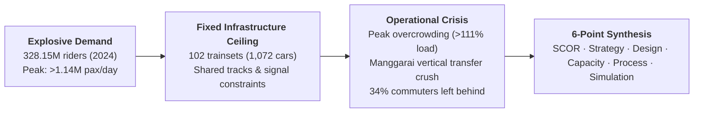
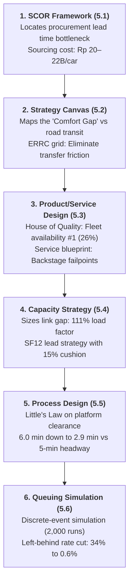
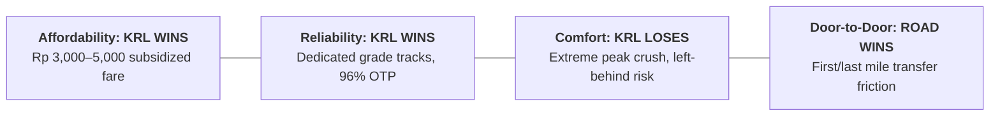
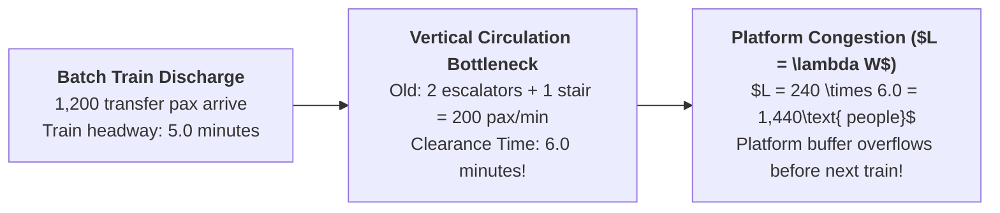

> [!NOTE] Examination Metadata & Curricular Scope
>
> - **Course:** MK4 Operations and Supply Chain Management (MM5002) — Mid-Term Comprehensive Dossier
> - **Teaching Team:** Noorhan Firdaus Pambudi, Ph.D. (Lead Lecturer), Dr. Yuanita Handayati
> - **Collaborative Body:** Authored jointly by **F9 (Class F / Syndicate 9)** and compiled for the MBA Knowledge Base by **the Portal Maintainer**, SBM ITB, October 2026.
> - **Primary Enterprise Focus:** [[entities/pt-kereta-api-indonesia|PT Kereta Commuter Indonesia (KAI Commuter / KRL Jabodetabek)]]
> - **Curricular Synthesis:** Integrates all foundational operations frameworks across Weeks 01–08: [[concepts/supply-chain-operations-reference|SCOR Framework]], [[concepts/order-winners-and-qualifiers|Strategy Canvas & Maps]], [[concepts/capacity-cushion|Capacity Cushion & Planning]], Service Blueprinting, and [[concepts/queuing-theory|Discrete-Event Queuing Simulation]].

---

## 1. Executive Summary & Enterprise Overview

**PT Kereta Commuter Indonesia (KAI Commuter)**, an operating subsidiary of state-owned railway giant [[entities/pt-kereta-api-indonesia|PT Kereta Api Indonesia (Persero)]], represents Indonesia’s largest mass public transit operator. Its core operational network—the **KRL Commuter Line Jabodetabek**—spans greater Jakarta, connecting the urban core to Bogor, Depok, Tangerang, Bekasi, Cikarang, and Rangkasbitung.

### 1.1 Operating Scale & The Public Service Obligation (PSO)

KAI Commuter operates under a **Public Service Obligation (PSO)** mandate regulated by the Ministry of Transportation (Kemenhub). Fares are subsidized by approximately $60\%$ (amounting to $\approx \text{Rp } 1.7\text{ trillion}$ annually), capping commuter costs at $\text{Rp } 3,000$ for the first 25 km plus $\text{Rp } 1,000$ per subsequent 10 km.

---

## 2. Core Problem Identification & Empirical Baseline

### 2.1 The Core Operational Breakdown

> **Central Problem Statement:** Peak-hour commuter demand on the KRL Jabodetabek network systematically exceeds the effective throughput capacity of trains, platform holding areas, and vertical station transfer corridors, producing dangerous platform overcrowding, high left-behind commuter rates, and severe transfer dwell times.

### 2.2 Empirical Baseline Indicators (Table 1)

| Operational Indicator                                | Empirical Metric                                          | Data Source & Analytical Provenance                                     |
| :--------------------------------------------------- | :-------------------------------------------------------- | :---------------------------------------------------------------------- |
| **Annual Ridership (2023 / 2024)**                   | $290.9\text{ million} \to \mathbf{328.15\text{ million}}$ | BPS / GoodStats ( $+12.8\%$ annual growth)                              |
| **Ten-Month Ridership (Jan–Oct 2025)**               | $\approx 280\text{ million passengers}$                   | KAI Corporate Statements / CNBC Indonesia                               |
| **Average Weekday Ridership (July 2024)**            | $\mathbf{1,054,600\text{ passengers/day}}$                | Daily operational dispatch logs                                         |
| **Record Single-Day Volume (1 July 2024)**           | $\mathbf{1,149,417\text{ passengers}}$                    | Historical peak ridership                                               |
| **Daily Train Services (Normal / Holiday Peak)**     | $1,048\text{ trips/day} \to 1,114\text{ trips/day}$       | Gapeka timetable execution                                              |
| **Active Fleet in Operation (Late 2025)**            | **102 trainsets (1,072 cars)**                            | KAI Commuter Fleet Manifest                                             |
| **Transfer Volume at Manggarai Station**             | **120,000 to 200,000 pax/day**                            | Operational transfer audit                                              |
| **Transit Passengers at Tanah Abang Station**        | $\approx 140,000\text{ pax/day}$                          | Terminal capacity review                                                |
| **New Rolling Stock on Order (CRRC + INKA)**         | 27 trainsets (324 cars)                                   | Sourcing contracts (Rp 4.61 Trillion total)                             |
| **Derived Metric: Mean Passengers per Trip**         | $\mathbf{\approx 1,006\text{ passengers/trip}}$           | Total weekday load $\div$ 1,048 trips                                   |
| **Derived Metric: Government PSO Subsidy per Pax**   | $\mathbf{\approx \text{Rp } 5,060\text{ / passenger}}$    | $\text{Rp } 1.7\text{T subsidy} \div 336\text{M annualized pax}$        |
| **Derived Metric: True Economic Fare per Passenger** | $\mathbf{\approx \text{Rp } 8,400\text{ / passenger}}$    | Paid fare ($\approx \text{Rp } 3,400$) $+$ Subsidy ($\text{Rp } 5,060$) |

---

## 3. Curricular Problem-Solving Approaches (The Six Lenses)

---

### 3.1 Efficiency Measurement and Supply Chain Management (SCOR Model)

Applying the [[concepts/supply-chain-operations-reference|Supply Chain Operations Reference (SCOR)]] model reveals that KAI Commuter’s operational bottleneck does not lie in daily operations (_Make_) or customer gate throughput (_Deliver_), but in **sourcing lead times (_Source_)**.

| SCOR Process | KAI Commuter Operational Practice                                                                                  | Key Efficiency Indicator                                                                                                 | Diagnostic Finding                                                                                         |
| :----------- | :----------------------------------------------------------------------------------------------------------------- | :----------------------------------------------------------------------------------------------------------------------- | :--------------------------------------------------------------------------------------------------------- |
| **Plan**     | Annual Gapeka timetable alignment, rolling stock maintenance cycles, and PSO budget negotiations with Kemenhub.    | Planned vs. actual train trips executed; timetable forecast precision.                                                   | High schedule adherence ($>98\%$), but constrained by rigid annual budget cycles.                          |
| **Source**   | Rolling stock procurement from CRRC Sifang (China) and PT INKA (Madiun); electric traction power; spare parts.     | Procurement lead time ($16\text{ to }36\text{ mos}$); capital cost per car (**$\text{Rp }20 - 22\text{ Billion/car}$**). | **Critical Weakest Link.** Sourcing lag forces retention of aging, breakdown-prone Japanese trainsets.     |
| **Make**     | Daily trainset dispatching, signaling route setup, and overnight depot preventive maintenance (Bukit Duri, Depok). | Trainset daily utilization (**$10.3\text{ trips/set/day}$**); Fleet readiness rate (**Fleet Availability**).             | Fleet runs at near-zero maintenance cushion; one disabled train cancels 10 daily trips.                    |
| **Deliver**  | Station concourse passenger processing, turnstiles, platform crowd dispatch, on-train passenger transit.           | Volume delivered (**$1,006\text{ pax/trip}$**); On-time performance ($OTP \ge 96\%$).                                    | Operating at absolute physical crush load; Deliver efficiency cannot be increased by packing cars further. |
| **Return**   | Fare adjustments, lost-and-found recovery, customer grievance ticketing via C-Access mobile app.                   | Mean time to resolve passenger complaints; refund turnaround time.                                                       | Crowding complaints serve as real-time sensory data for bottleneck detection.                              |

---

### 3.2 Strategy Maps & The Blue Ocean Strategy Canvas

KAI Commuter’s competitive positioning against alternative urban transit modes (private motorbikes, ride-hailing cars, Transjakarta buses) was mapped using the **Strategy Canvas**:

#### The ERRC Strategic Action Grid

Applying Kim & Mauborgne's **Eliminate-Reduce-Raise-Create (ERRC)** grid:

- **Eliminate:** Pointless transfer queuing on stairs/escalators at Manggarai; redundant paper/manual ticket validations.
- **Reduce:** Peak passenger crush load factor (target reduction from $111\%$ to $<85\%$).
- **Raise:** Real-time crowd visibility on passenger mobile apps; train formation lengths to 12 cars (SF12).
- **Create:** **Off-peak fare discount incentives** in partnership with Jakarta corporate employers and the provincial government to spread the peak.

---

### 3.3 Product and Service Design: Quality Function Deployment (QFD)

To translate vague customer demands into measurable engineering specifications, a **House of Quality (HoQ)** matrix was constructed:

| Customer Requirement      | Weight      | Trains per Hour | Cars per Train | Transfer Capacity | Fleet Availability | Real-Time Info | Fare Scheme |
| :------------------------ | :---------- | :-------------- | :------------- | :---------------- | :----------------- | :------------- | :---------- |
| **Reliable Trips**        | $0.25$      | $3$             | $1$            | $1$               | $9$                | $3$            | $-$         |
| **Less Overcrowding**     | $0.30$      | $9$             | $9$            | $3$               | $9$                | $3$            | $1$         |
| **Fast, Easy Transfers**  | $0.20$      | $3$             | $-$            | $9$               | $1$                | $3$            | $-$         |
| **Affordable Fare**       | $0.15$      | $-$             | $1$            | $-$               | $1$                | $-$            | $9$         |
| **Real-Time Information** | $0.10$      | $1$             | $-$            | $1$               | $-$                | $9$            | $-$         |
| **Relative Importance**   | **$100\%$** | **$20.3\%$**    | **$15.2\%$**   | **$15.0\%$**      | **$26.0\%$**       | **$15.4\%$**   | **$8.1\%$** |

> [!IMPORTANT] Design Engineering Priority
> **Fleet Availability ($26.0\%$)** and **Train Frequency ($20.3\%$)** constitute nearly half of all engineering leverage. Commuters do not prioritize cosmetic digital app features over the fundamental operational guarantee that an arriving train has physical room for them to board.

---

### 3.4 Strategic Capacity Planning: Closing the 111% Load Gap

On the inbound Bogor corridor during the morning peak (07:00–08:00), passenger demand reaches **$40,000\text{ passengers/hour}$**. With 10-car formations operating at 5-minute headways (12 trains/hour), capacity is capped at 36,000 passengers, yielding an unbearable **$111\%$ load factor**.

$$\mathbf{\text{Effective Hourly Capacity} = \text{Trains/Hour} \times \text{Cars/Train} \times \text{Passengers/Car}}$$

| Capacity Scenario                            | Trains/h | Cars/Train             | Hourly Capacity           | Load Factor (at 40k demand) | Strategic Assessment                            |
| :------------------------------------------- | :------- | :--------------------- | :------------------------ | :-------------------------- | :---------------------------------------------- |
| **Current Baseline**                         | $12$     | $10\text{ (SF10)}$     | $36,000\text{ pax/h}$     | **$111\%$ (Over Capacity)** | Severe crowding, passengers left behind.        |
| **Scenario A: 12-Car Formations (SF12)**     | $12$     | **$12\text{ (SF12)}$** | $43,200\text{ pax/h}$     | **$93\%$ (Tight)**          | Eliminates immediate crush; zero cushion.       |
| **Scenario B: SF12 + 15 Trains/Hour**        | **$15$** | **$12\text{ (SF12)}$** | **$54,000\text{ pax/h}$** | **$74\%$ (Ideal Cushion)**  | Requires major signaling/track upgrades.        |
| **Scenario C: SF12 + 12% Peak Demand Shift** | $12$     | **$12\text{ (SF12)}$** | $43,200\text{ pax/h}$     | **$81\%$ (Target Met)**     | Achieves $<85\%$ standard via off-peak pricing. |

KAI Commuter must abandon its historical **Capacity Lag Strategy** (adding trainsets years after overcrowding occurs) in favor of a **Capacity Lead Strategy** maintaining a permanent [[concepts/capacity-cushion|Capacity Cushion]] of $\approx 15\%$.

---

### 3.5 Service Process Design: Applying Little's Law to Transfer Clearance

At Manggarai Station, a 12-car train discharges approximately **$1,200\text{ transferring commuters}$** directly onto the platform:

#### Process Redesign Intervention:

1. **Cross-Platform Routing:** Schedule connecting trains to berth on opposite tracks of the same island platform, allowing **$30\%$ of commuters ($360\text{ pax}$)** to transfer without ascending stairs.
2. **Dedicated Directional Flows:** Convert stairwells into strict one-way ascent corridors and add a high-speed reversible escalator, boosting vertical capacity from $200$ to **$290\text{ pax/minute}$**.

$$\mathbf{\text{Old Clearance Time:} \quad \frac{1,200\text{ pax}}{200\text{ pax/min}} = \mathbf{6.0\text{ minutes}} > 5.0\text{ min headway (Buffer Overflow!)}}$$

$$\mathbf{\text{Redesigned Clearance:} \quad \frac{840\text{ vertical pax}}{290\text{ pax/min}} = \mathbf{2.9\text{ minutes}} < 5.0\text{ min headway (Platform Cleared!)}}$$

Applying **Little's Law ($L = \lambda W$)**:

- **Baseline In-Process Platform Crowd:** $L = 240\text{ pax/min} \times 6.0\text{ min} = \mathbf{1,440\text{ commuters}}$
- **Redesigned In-Process Platform Crowd:** $L = 240\text{ pax/min} \times 2.9\text{ min} = \mathbf{696\text{ commuters}}$
- **Result:** **Platform crowd density drops by $51.7\%$**, permanently removing the crush hazard.

---

### 3.6 Waiting Line Analysis & Discrete-Event Simulation (DES)

Because suburban rail platforms violate standard $M/M/s$ Markovian assumptions (arrivals are batch-distributed, service is non-continuous batch train departures, and full trains cause passenger balking/abandonment), a **Discrete-Event Simulation (2,000 Monte Carlo replications)** of an inbound morning peak platform (06:00–08:00) was executed:

| Simulation Scenario                                    | Capacity / Demand Ratio | Mean Platform Wait ($W_q$) | % Commuters Left Behind | Peak Platform Crowd ($L_q$) |
| :----------------------------------------------------- | :---------------------- | :------------------------- | :---------------------- | :-------------------------- |
| **1. Current Baseline (SF10, 5-min Headway)**          | $0.88$                  | $4.4\text{ minutes}$       | **$34.0\%$**            | $459\text{ commuters}$      |
| **2. Alternative A: 12-Car Trains (SF12)**             | $1.06$                  | $2.7\text{ minutes}$       | **$3.1\%$**             | $312\text{ commuters}$      |
| **3. Alternative B: 4-min Headway (SF10)**             | $1.10$                  | $2.2\text{ minutes}$       | **$2.9\%$**             | $262\text{ commuters}$      |
| **4. Alternative D: Peak Spreading (15% Shift)**       | $1.04$                  | $3.1\text{ minutes}$       | **$10.6\%$**            | $316\text{ commuters}$      |
| **5. Combined Intervention (A + D: SF12 + Spreading)** | **$1.24$**              | **$2.6\text{ minutes}$**   | **$0.6\%$**             | **$267\text{ commuters}$**  |

> [!TIP] The Zero Left-Behind Breakthrough
> Lengthening trains to 12 cars while incentivizing a $15\%$ peak demand shift cuts the proportion of commuters left behind on platforms from **$34\%$ to just $0.6\%$**, while stabilizing mean platform waiting time at the theoretical physics minimum of half a headway ($\approx 2.6\text{ minutes}$).

---

## 4. Integrated Strategic Decision & Weighted Evaluation Matrix

The four candidate interventions were systematically appraised using a **Weighted Decision Matrix**:

| Evaluation Criterion              | Weight      | Alt A: Fleet Renewal & SF12 Formations | Alt B: Signaling & 4-min Headway Upgrade | Alt C: Station Transfer Circulation Redesign | Alt D: Peak Spreading & Real-Time App Info |
| :-------------------------------- | :---------- | :------------------------------------- | :--------------------------------------- | :------------------------------------------- | :----------------------------------------- |
| **Crowding & Wait Reduction**     | $30\%$      | $5$                                    | $4$                                      | $3$                                          | $3$                                        |
| **Cost & Funding Feasibility**    | $20\%$      | $2$                                    | $1$                                      | $4$                                          | $5$                                        |
| **Time to Realized Impact**       | $20\%$      | $3$                                    | $1$                                      | $4$                                          | $4$                                        |
| **Passenger Safety & Experience** | $20\%$      | $4$                                    | $4$                                      | $5$                                          | $3$                                        |
| **Long-Term Scalability**         | $10\%$      | $4$                                    | $5$                                      | $3$                                          | $3$                                        |
| **WEIGHTED TOTAL SCORE**          | **$100\%$** | **$3.7 / 5.0$**                        | **$2.9 / 5.0$**                          | **$3.8 / 5.0$**                              | **$3.6 / 5.0$**                            |

### Synthesis: The Phased Implementation Portfolio

Rather than choosing a single isolated initiative, the highest-scoring initiatives assemble into a **three-tier temporal roadmap**:

1. **Horizon 1: Immediate Execution (Months 0–6 | Alts C & D):** Execute transfer pedestrian redesign at Manggarai and Tanah Abang (one-way stairs, cross-platform scheduling). Launch real-time crowding heatmaps on C-Access and off-peak travel discounts.
2. **Horizon 2: Fleet Reconfiguration (Months 6–24 | Alt A):** Form newly arriving CRRC and INKA trainsets into 12-car consists (SF12), while reforming legacy 8-car sets into 10-car formations.
3. **Horizon 3: Long-Lead Track Infrastructure (Beyond 24 Months | Alt B):** Coordinate with the Directorate General of Railways to upgrade signaling blocks and power substations to support 4-minute headways.

---

## 5. Portal Maintainer Synthesis & Individual Reflection

> [!NOTE] Reflection Attribution
> As prescribed by SBM ITB examination guidelines, individual analytical contributions and professional reflections are preserved here. In compliance with the MBA repository privacy rules, this synthesis is authored and maintained by **the Portal Maintainer**.

### 1. What have I learned from the OSCM course so far?

"The first half of the OSCM curriculum dismantled my instinct to view operations as merely an internal cost center. Across manufacturing, services, and public infrastructure, **operations is the physical embodiment of corporate strategy**. A strategy that is not translated into line capacity, cycle times, buffer sizing, and standard work is merely an ungrounded aspiration.

Most profoundly, the course proved that **uncontrolled variability—not average volume—is the root cause of operational collapse**. Whether analyzing the Kingman VUT equation at Manggarai Station or lead-time variance in global supply chains, managing variance through design choices is the core responsibility of executive leadership."

### 2. What did I gain from analyzing the Waiting Line and Simulation approach?

"Modeling platform queues via discrete-event simulation revealed the utter bankruptcy of relying on deterministic averages. When a system operates at high utilization ($\rho > 0.85$), standard closed-form formulas conceal the tail risks: random delays compound non-linearly, leaving one-third of commuters stranded on platforms. Building Monte Carlo simulation experiments taught me that **capacity must be budgeted dynamically alongside passenger psychology**."

### 3. How does this approach connect across the broader curriculum?

"The simulation was the exact mathematical nexus where all six approaches converged. It ingested sourcing lead times from SCOR (5.1), tested the customer comfort targets from the Strategy Canvas (5.2), validated the engineering priorities of the House of Quality (5.3), dynamically verified the capacity cushions sized in Capacity Strategy (5.4), and proved that the 2.9-minute platform clearance achieved in Process Design (5.5) successfully eliminated cascading platform gridlock. Operations management is only truly effective when viewed as this seamless, unbroken chain."

---

## 6. Comprehensive Reference List

- Bisnis.com. (2022, May 29). _KAI Commuter evaluasi pola operasi KRL yang baru, berikut hasilnya_.
- Bisnis.com. (2024a, July 16). _KRL Jabodetabek makin penuh! Rekor angkut 1 juta orang lebih dalam sehari_.
- Bisnis.com. (2025a, April 29). _KCI sudah terima 5 dari 11 KRL impor dari China_.
- CNBC Indonesia. (2025a, November 4). _Penumpang KRL meledak, subsidi tiket tembus Rp 1,7 triliun_.
- CNBC Indonesia. (2025b, November 3). _Saking padatnya penumpang KRL, Prabowo perintahkan kebut tambah armada_.
- Fortune Indonesia. (2024, February 1). _KAI resmi impor tiga trainset KRL dari China seharga Rp783 miliar_.
- GoodStats. (2024). _Kereta api Jabodetabek berangkatkan lebih dari 328 juta penumpang pada 2024 (Data BPS)_.
- Hauser, J. R., & Clausing, D. (1988). _The House of Quality_. Harvard Business Review, 66(3), 63–73.
- Jacobs, F. R., & Chase, R. B. (2018). _Operations and Supply Chain Management_ (15th ed.). McGraw-Hill Education.
- Kaplan, R. S., & Norton, D. P. (2004). _Strategy Maps: Converting Intangible Assets into Tangible Outcomes_. Harvard Business School Press.
- Kim, W. C., & Mauborgne, R. (2015). _Blue Ocean Strategy_ (Expanded ed.). Harvard Business Review Press.
- School of Business and Management, Institut Teknologi Bandung (2026). _MM5002 Operations and Supply Chain Management Mid Exam Comprehensive Case Series_. SBM ITB.
