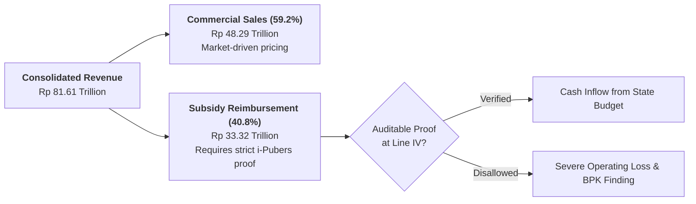
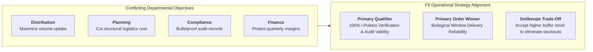
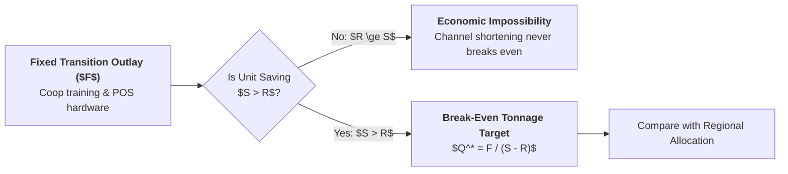
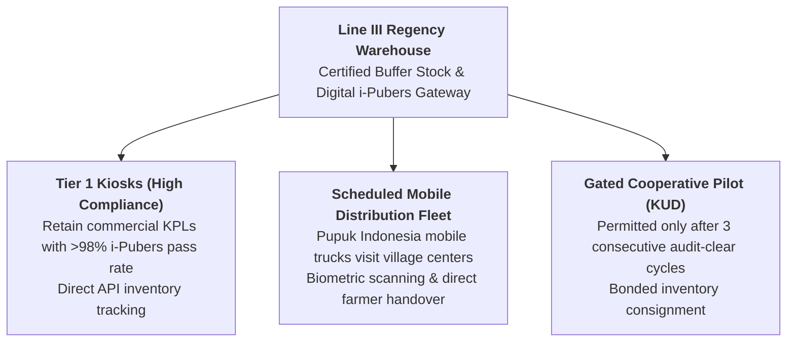

> [!NOTE] Curricular Metadata & Cohort Attribution
>
> - **Course:** MK4 Operations and Supply Chain Management — Week 01 Case Analysis
> - **Source Case:** `SBM-OSCM-26-001` (Pupuk Indonesia: Shorten the Chain, or Hold the Risk?)
> - **Synthesis Contribution:** Compiled for the cohort by **`F9 (Class F / Syndicate 9)`**.
> - **Analytical Lens:** Operations Strategy, Competitive Dimensions (Jacobs & Chase), Multi-Echelon Logistics, and Channel Economics.

---

## 1. Executive Summary & Problem Formulation

PT Pupuk Indonesia operates under a statutory dual mandate: achieving commercial profitability while executing the national subsidized fertilizer programme under state-mandated pricing, quotas, and farmer eligibility rules.

In 2024, subsidy reimbursements generated $\text{Rp } 33.32\text{ trillion}$ of the company’s $\text{Rp } 81.61\text{ trillion}$ consolidated revenue ($40.8\%$). Precise, auditable transaction documentation is not routine back-office bureaucracy—it is the **absolute operational prerequisite for revenue collection**.

The core operational dilemma evaluated by **`F9 (Class F / Syndicate 9)`** centers on whether removing Line IV retail kiosks and shifting distribution directly to village cooperatives (_Koperasi Unit Desa_ - KUD) achieves genuine logistics cost savings or merely transfers unmanageable operational and audit risks onto unprepared rural institutions.

---

## 2. Operational Priorities & Jacobs & Chase Trade-Off Matrix

Using the operations strategy framework developed by Jacobs & Chase (2018), operational goals must be translated into explicit trade-offs rather than pursuing uncoordinated departmental wishes:

### Strategic Competitive Dimensions Assessment

| Competitive Dimension    | Operational Definition in Subsidized Fertilizer                                             | Ranking in Subsidized Programme | Strategic Trade-off Decision                                                                      |
| :----------------------- | :------------------------------------------------------------------------------------------ | :-----------------------------: | :------------------------------------------------------------------------------------------------ |
| **Delivery Reliability** | Delivering within the strict 2-week biological fertilization window after planting.         |       **Order Winner #1**       | **Prioritized**: A late delivery destroys crop yield even if product is 100% free.                |
| **Process Quality**      | Exact chemical grade, verified farmer quota, tamper-free packaging, verified price ceiling. |     **Order Qualifier #1**      | **Non-Negotiable**: Unverified delivery risks total subsidy disallowance by state auditors.       |
| **Delivered Unit Cost**  | Total logistics expenditure per metric ton across Lines I–IV.                               |       **Order Winner #2**       | **Secondary**: Lower cost must not compromise delivery verification.                              |
| **Delivery Speed**       | Total transit elapsed time from Line I plant to Line V farmer.                              |        **Low Priority**         | Decoupled by regional buffer warehouses; predictable schedules matter more than transit velocity. |

---

## 3. Financial Ratio Decomposition: Why Asset Turnover Masks Field Inefficiency

Using the course efficiency metrics and Pupuk Indonesia's balance sheet data, Corporate Asset Turnover improved between 2023 and 2024:

$$\mathbf{\text{AT}_{2023} = \frac{79.20}{142.99} = 0.554\text{x}} \qquad\qquad \mathbf{\text{AT}_{2024} = \frac{81.61}{139.29} = 0.586\text{x}}$$

This represents an arithmetic improvement of $+5.78\%$ ($+0.032$). However, decomposing this shift demonstrates that aggregate financial ratios create dangerous managerial illusions:

$$\mathbf{\Delta \text{AT} = \underbrace{\frac{81.61 - 79.20}{142.99}}_{\text{Revenue Growth Contribution } (+0.017)} + \underbrace{81.61 \times \left(\frac{1}{139.29} - \frac{1}{142.99}\right)}_{\text{Asset Shrinkage Contribution } (+0.015)} = +0.032}$$

- **The Managerial Pitfall**: Asset turnover improved because top-line revenue rose while gross asset book values depreciated. **Zero percent of this improvement came from better warehouse management, on-time delivery, or kiosk reliability.**
- In fact, the total distribution freeze of NPK Cocoa in Garut ($0\%$ delivery) occurred during the exact same period that corporate asset turnover reached its multi-year high. **Supply chain performance must be measured with physical throughput and reliability metrics, not balance sheet abstractions.**

---

## 4. Quantitative Hurdle Model: Testing Channel Shortening

To evaluate whether removing Line IV kiosks yields genuine net savings, **`F9 (Class F / Syndicate 9)`** formulated a structural break-even model:

$$\mathbf{Q_{\text{break-even}} = \frac{F}{S - R}}$$

Where:

- $F$ = Fixed upfront capital investment (training village cooperatives, deploying ruggedized POS tablets, establishing secure storage).
- $S$ = Avoided operating cost per metric ton paid to commercial retail kiosks.
- $R$ = Recurring operational cost per metric ton of running the cooperative / direct channel (including supervisory field teams and mobile audits).

### Numerical Sensitivity Illustration

$$
\begin{aligned}
\text{Scenario A (Favorable):} &\quad F = \text{Rp } 300\text{M}, \; S = \text{Rp } 20,000/\text{t}, \; R = \text{Rp } 12,000/\text{t} \implies Q^* = \frac{300,000,000}{8,000} = \mathbf{37,500\text{ tonnes}} \\
\text{Scenario B (Supervised):} &\quad F = \text{Rp } 300\text{M}, \; S = \text{Rp } 20,000/\text{t}, \; R = \text{Rp } 18,000/\text{t} \implies Q^* = \frac{300,000,000}{2,000} = \mathbf{150,000\text{ tonnes}} \\
\text{Scenario C (Dysfunctional):} &\quad R \ge S \implies \mathbf{\text{Break-even is infinite; recurring losses accumulate.}}
\end{aligned}
$$

---

## 5. F9 Recommended Operating Design: Hybrid Mobile Pools with Performance Gating

Rather than gambling national food security on an overnight migration to unprepared cooperatives, **`F9 (Class F / Syndicate 9)`** recommends a **Gated Hybrid Operating Model**:

1. **Retain High-Performing Line IV Kiosks**: Commercial kiosks with proven internet connectivity and zero audit findings are retained; their margins are tied to electronic i-Pubers transaction velocity.
2. **Deploy Scheduled Mobile Distribution Hubs**: In remote pockets like southern Garut where kiosks are distant or NPK Cocoa uptake is blocked, Pupuk Indonesia dispatches company-managed mobile trucks equipped with satellite internet and biometric scanners on pre-announced planting dates.
3. **Rigorous Three-Stage Performance Gating for Cooperatives**:
   - _Gate 1 (Hardware & Identity)_: Cooperative must possess verified legal standing, secure dry storage, and trained operators.
   - _Gate 2 (Parallel Shadow Pilot)_: Cooperative handles non-subsidized commercial fertilizer for one planting season to prove inventory reconciliation discipline.
   - _Gate 3 (Full Subsidized Authorization)_: Handover authorized with bonded consignment limits.

---

## 6. Cold-Call Defense Script for the Executive Boardroom

> **Professor Cold-Call**: _"Candidate, the Minister of Agriculture insists that village cooperatives must take over all subsidized fertilizer by next month to eliminate middleman margins. As Director of Supply Chain, what is your opening sentence?"_
>
> **Boardroom Defense Script**:
> \*"Bapak Menteri, cutting a distribution tier on an organizational chart does not eliminate the physical work of warehousing, transporting, and biometrically verifying fertilizer at the farmer's gate. In Garut, warehouses are completely full, yet NPK Cocoa distribution is at zero percent strictly because audit compliance records could not be verified.
>
> If we transfer distribution to village cooperatives before their digital POS systems and audit controls are operational, we will not save Rp 450 per kilogram—we will cause catastrophic planting stockouts across Java and trigger tens of billions in state subsidy disallowances. Our strategy must be performance-gated: deploy company-managed mobile hubs to break the current verification bottleneck immediately, while qualifying cooperatives through empirical compliance milestones."\*

---

## 🔗 Cross-References & Study Navigation

- Lecture Notes: [[courses/mk4-operations-supply-chain-management/week-01/index|MK4 Week 01 Lecture Hub]]
- Case Dossier: [[courses/mk4-operations-supply-chain-management/week-01/case-pupuk-indonesia|Pupuk Indonesia Case Dossier]]
- Theoretical Framework: [[concepts/supply-chain-operations-reference|Supply Chain Operations Reference (SCOR)]]
- Enterprise Entity: [[entities/pt-pupuk-indonesia|PT Pupuk Indonesia (Persero)]]
