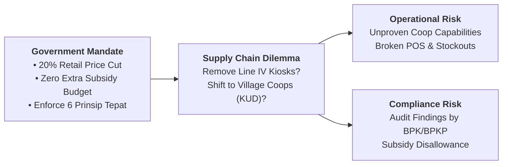
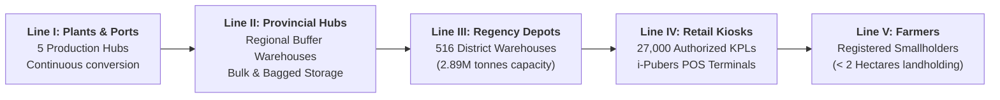
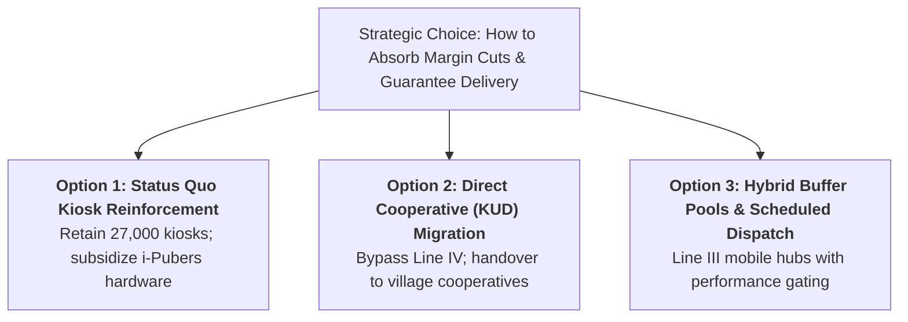

> [!NOTE] Case Overview & Pedagogical Metadata
>
> - **Case Code:** `SBM-OSCM-26-001` (Rev. 2 September 2026)
> - **Protagonist:** Robby Setiabudi Madjid, Director of Supply Chain, PT Pupuk Indonesia (Persero)
> - **Core Problem:** Absorbing a 20% government retail price-ceiling reduction with zero additional state subsidy budget by evaluating whether to shorten the 5-tier distribution channel or maintain authorized retail kiosks.
> - **Related Lecture Hub:** [[courses/mk4-operations-supply-chain-management/week-01/index|MK4 Week 01: Introduction to OSCM]]
> - **Cohort Working Solution:** [[courses/mk4-operations-supply-chain-management/week-01/assignment-pupuk-indonesia|Syndicate 9 (F9) Operations Strategy Analysis]]

---

## 1. Executive Summary & The Core Dilemma

In late August 2026, Robby Setiabudi Madjid, Director of Supply Chain at **PT Pupuk Indonesia (Persero)**, confronted a troubling distribution dashboard for Garut Regency: out of an annual subsidized fertilizer allocation of $116,941.70\text{ tonnes}$, only $64,551.75\text{ tonnes}$ ($55.21\%$) had reached farmers. Worse, in the column for specialized NPK Cocoa, deliveries stood at **zero tonnes**.

Depots held ample stock; the failure was not a manufacturing shortage. It was an information and audit compliance failure: Line III warehouses refused to release stock without ironclad verification that end-farmers were registered in the Ministry of Agriculture's definitive quota database (e-RDKK) and processed through the **i-Pubers** system.

Concurrently, the Ministry of Agriculture and parliamentary stakeholders proposed eliminating the commercial retail tier (Line IV kiosks) to hand distribution over directly to village cooperatives (_Koperasi Unit Desa_ - KUD). While removing a node appears to cut intermediation margins on paper, doing so shifts critical storage, transport, customer service, and biometric verification tasks to under-capitalized community entities.

---

## 2. Company Background & Operating Ecosystem

**PT Pupuk Indonesia (Persero)** is the state-owned holding corporation overseeing Indonesia’s fertilizer industry through five primary manufacturing subsidiaries:

1. **PT Pupuk Sriwidjaja Palembang (Pusri)**: Serving southern Sumatra and western Java.
2. **PT Petrokimia Gresik**: Largest compound NPK producer in Southeast Asia.
3. **PT Pupuk Kalimantan Timur (PKT)**: Dominant urea producer serving eastern Indonesia and export industrial markets.
4. **PT Pupuk Kujang**: Supplying western Java and food belt zones.
5. **PT Pupuk Iskandar Muda (PIM)**: Operating in Aceh and northern Sumatra.

### The Dual-Mandate Structural Tension

- **Commercial Mandate**: Maximize operating efficiency and deliver dividends to the state shareholder through commercial fertilizer sales and industrial chemical derivatives (ammonia, methanol).
- **Public Service Obligation (PSO)**: Sole authorized executor of national subsidized fertilizer distribution, where product formulas, regional tonnage allocations, target beneficiary lists, and maximum retail prices (_Harga Eceran Tertinggi_ - HET) are set by statutory decree. In 2024, subsidy reimbursements accounted for $\text{Rp } 33.32\text{ trillion}$ of Pupuk Indonesia’s $\text{Rp } 81.61\text{ trillion}$ revenue ($40.8\%$).

---

## 3. The 5-Tier Supply Chain Architecture & Multi-Echelon Friction

The national distribution pipeline is structured across five sequential operational lines:

### The "6 Prinsip Tepat" Statutory Mandate

Every kilogram of subsidized fertilizer distributed must satisfy six non-negotiable statutory conditions:

1. **Tepat Jumlah (Right Quantity)**: Exactly matching the approved e-RDKK allocation.
2. **Tepat Jenis (Right Type)**: Urea, NPK, or specialized organic blends as specified by soil type.
3. **Tepat Waktu (Right Time)**: Delivered strictly within the biological planting and fertilization window (a 2-week seasonal window).
4. **Tepat Tempat (Right Place)**: Handed over at the farmer's designated village retail kiosk.
5. **Tepat Mutu (Right Quality)**: Conforming strictly to SNI national chemical standards.
6. **Tepat Harga (Right Price)**: Sold strictly at or below the statutory HET price ceiling.

---

## 4. Quantitative Case Exhibits & Empirical Field Data

### Exhibit 1: Consolidated Financial Performance (PT Pupuk Indonesia)

| Metric (Rp Trillion)                  |     FY 2023     |     FY 2024     |  YoY Change (%)  |
| :------------------------------------ | :-------------: | :-------------: | :--------------: |
| **Total Consolidated Revenue**        |     $79.20$     |     $81.61$     |    $+3.04\%$     |
| **Government Subsidy Reimbursements** |     $27.45$     |     $33.32$     |    $+21.38\%$    |
| **Subsidy Revenue Share (%)**         |    $34.7\%$     |    $40.8\%$     | $+6.1\text{ pp}$ |
| **Total Balance Sheet Assets**        |    $142.99$     |    $139.29$     |    $-2.59\%$     |
| **Corporate Asset Turnover (AT)**     | $0.554\text{x}$ | $0.586\text{x}$ |    $+5.78\%$     |

### Exhibit 2: The October 2025 Price-Ceiling Reduction

On 22 October 2025, the government decreed an abrupt $20\%$ reduction in the farmer retail price cap (HET) without expanding the fiscal subsidy allocation:

$$
\begin{aligned}
\mathbf{\text{Urea HET:}} &\quad \text{Rp } 2,250/\text{kg} \longrightarrow \text{Rp } 1,800/\text{kg} \quad (-\text{Rp } 450/\text{kg} \implies -\text{Rp } 450,000/\text{tonne}) \\
\mathbf{\text{NPK HET:}} &\quad \text{Rp } 2,300/\text{kg} \longrightarrow \text{Rp } 1,840/\text{kg} \quad (-\text{Rp } 460/\text{kg} \implies -\text{Rp } 460,000/\text{tonne})
\end{aligned}
$$

### Exhibit 3: Garut Regency Distribution Status (As of August 2026)

| Fertilizer Product | Annual Allocated Quota (Tonnes) | Realized Distribution (Tonnes) | Uptake Realization (%) | Primary Operational Diagnosis                                                                       |
| :----------------- | :-----------------------------: | :----------------------------: | :--------------------: | :-------------------------------------------------------------------------------------------------- |
| **Urea**           |           $62,118.20$           |          $38,410.50$           |       $61.83\%$        | Normal seasonal uptake; minor POS connectivity glitches.                                            |
| **NPK Phonska**    |           $51,423.50$           |          $26,141.25$           |       $50.84\%$        | Farmer liquidity constraints; delayed planting rains.                                               |
| **NPK Cocoa**      |           $3,400.00$            |           **$0.00$**           |      **$0.00\%$**      | **Total Verification Bottleneck: Line III refuses release without verified farmer biometric data.** |
| **Total Garut**    |        **$116,941.70$**         |        **$64,551.75$**         |     **$55.21\%$**      | Significant risk of year-end distribution quota forfeiture.                                         |

---

## 5. Strategic Decision Alternatives Matrix

| Operational Dimension | Option 1: Retain Kiosk Network (Line IV)    | Option 2: Shift to Village Coops (KUD)         | Option 3: Hybrid Mobile Buffer Pools (Recommended) |
| :-------------------- | :------------------------------------------ | :--------------------------------------------- | :------------------------------------------------- |
| **Node Count**        | 5 Tiers (Full physical presence).           | 4 Tiers (Line IV eliminated).                  | 4.5 Tiers (Dynamic collection points).             |
| **Working Capital**   | High holding costs across 27,000 kiosks.    | Low holding costs; coops carry minimal stock.  | Optimized multi-echelon central buffers.           |
| **Audit Risk**        | Low (kiosks already trained on i-Pubers).   | **Severe** (coops lack POS and audit history). | Low (company-managed biometric dispatch).          |
| **Farmer Proximity**  | Walkable (within village retail perimeter). | Variable (many KUDs defunct or distant).       | High (scheduled collection at village hall).       |

---

## 6. Cold-Call Preparation & Boardroom Defense

### 1. "Why did NPK Cocoa distribution reach zero in Garut if warehouses were full?"

- **Defense Script**: "NPK Cocoa failed to move not because of physical supply shortage, but because of **administrative and audit compliance paralysis**. Under BPK audit regulations, any subsidized fertilizer released without matching biometric i-Pubers documentation cannot be invoiced to the Ministry of Finance. Line III warehouse managers rationally withheld inventory to avoid personal liability for unverified subsidy disallowance."

### 2. "Does cutting a node automatically save Rp 450,000 per tonne?"

- **Defense Script**: "No. The Rp 450/kg cut was a **regulatory price ceiling decree**, not an internal logistics efficiency gain. Eliminating retail kiosks does not eliminate the physical work of storage, security, identity verification, and bag handling. Shifting that burden to unprepared village cooperatives simply trades commercial stability for operational breakdown."

---

## 🔗 Cross-References & Study Navigation

- Lecture Context: [[courses/mk4-operations-supply-chain-management/week-01/index|MK4 Week 01: Introduction to OSCM]]
- Worked Solution: [[courses/mk4-operations-supply-chain-management/week-01/assignment-pupuk-indonesia|Syndicate 9 (F9) Operations Strategy Debrief]]
- Enterprise Profile: [[entities/pt-pupuk-indonesia|PT Pupuk Indonesia (Persero)]]
- Theoretical Model: [[concepts/supply-chain-operations-reference|Supply Chain Operations Reference (SCOR)]]
