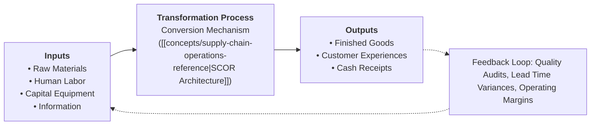
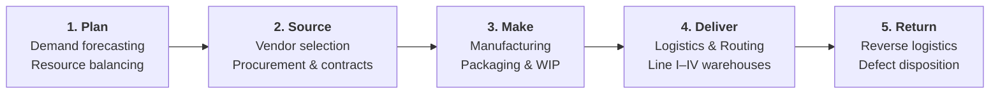
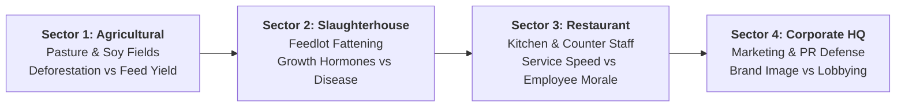
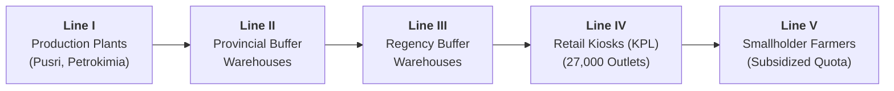

> [!NOTE] Curricular & Faculty Metadata
>
> - **Course:** MK4 Operations and Supply Chain Management — Week 01
> - **Teaching Team:** Dr. Yuanita Handayati (Associate Professor & Circular Economy Expert), Noorhan Firdaus Pambudi, Ph.D.
> - **Primary Curricular Spine:** `Introduction to OSCM.pptx.pdf` (37 Slides) & Jacobs & Chase (15th Ed.)
> - **Experiential Simulation:** McDonald's Supply Chain Video Game (Agricultural, Slaughter, Restaurant & Corporate Trade-offs)
> - **Direct Satellites & Problem Sets:**
>   - [[courses/mk4-operations-supply-chain-management/week-01/case-pupuk-indonesia|Pupuk Indonesia: Shorten the Chain, or Hold the Risk? (Case Dossier)]]
>   - [[courses/mk4-operations-supply-chain-management/week-01/assignment-pupuk-indonesia|Syndicate 9 (F9) Operations Strategy & Trade-Offs Debrief]]

---

## 1. Executive Overview: Operations Management as Value Architecture

Operations and Supply Chain Management (OSCM) is the systematic design, operation, and improvement of the systems that create and deliver an enterprise's primary products and services. In executive leadership, operations is not a back-office support function—it is the **engine of value capture and competitive survival**.

Every strategic objective conceived in corporate boardrooms must ultimately be converted into physical materials, information workflows, human routines, and transactional settlements:

### The Executive Duality: Efficiency vs. Effectiveness

Dr. Yuanita Handayati emphasizes the foundational distinction between operational cost control and strategic goal fulfillment:

$$
\begin{aligned}
\mathbf{\text{Efficiency}} &\implies \frac{\text{Output Produced}}{\text{Input Consumed}} \quad\text{(Doing things right: minimizing cost, waste, and cycle time)} \\
\mathbf{\text{Effectiveness}} &\implies \frac{\text{Achieved Outcome}}{\text{Targeted Goal}} \quad\text{(Doing the right things: creating customer value and fulfilling promises)}
\end{aligned}
$$

A company can be perfectly efficient while driving itself into bankruptcy if its efficient processes manufacture obsolete products that customers reject. Conversely, an organization that fulfills customer demands through emergency airfreight and frantic overtime may be highly effective, yet hemorrhage its operating margin. **Operational strategy is the deliberate management of this tension.**

---

## 2. Theoretical Architecture & Core Frameworks

### 2.1 The Five Foundational Supply Chain Macro-Processes

As formalized in the [[concepts/supply-chain-operations-reference|Supply Chain Operations Reference (SCOR) Framework]], enterprise supply chains coordinate five sequential stages:

1. **Plan**: Operating processes required to operate an existing supply chain strategically, balancing aggregate demand against manufacturing and distribution capacity.
2. **Source**: Selection of suppliers that will deliver the goods and services needed to create the firm’s product, establishing pricing, delivery, and payment terms.
3. **Make**: The major operational step where the product is fabricated or service provided, requiring scheduling of workers and equipment speed.
4. **Deliver**: Often termed logistics processes, coordinating carrier selection, warehouse networks, order receipt, and billing systems.
5. **Return**: Responsive processes for receiving worn-out, defective, and excess products sent back by customers.

### 2.2 Goods vs. Services Continuum & Capacity Perishability

The operational distinction between pure goods and pure services dictates how capacity and inventory are managed:

| Dimension              | Pure Manufactured Goods                                                    | Pure Service Experiences                                                                       |
| :--------------------- | :------------------------------------------------------------------------- | :--------------------------------------------------------------------------------------------- |
| **Tangibility**        | Physical product with measurable physical attributes.                      | Intangible experience, perishable instantaneously.                                             |
| **Inventory Buffer**   | Can be stored in warehouses to decouple production from demand mismatches. | Cannot be inventoried; customer demand must be met with real-time capacity.                    |
| **Customer Contact**   | Customer is outside the factory gates during manufacturing.                | Customer is actively co-present inside the operating system.                                   |
| **Quality Evaluation** | Defective parts inspected and reworked prior to shipment.                  | Quality is judged in real time during the "Moment of Truth."                                   |
| **Resale Potential**   | Finished goods can be returned, refurbished, and resold.                   | Service capacity expires immediately if unutilized (e.g., an empty seat on a departing train). |

### 2.3 Financial Market Evaluation: How Wall Street Judges OSCM

Financial markets evaluate operational health using standardized balance sheet and income statement ratios:

$$\mathbf{\text{Asset Turnover (AT)} = \frac{\text{Revenue}}{\text{Total Assets}}} \qquad\qquad \mathbf{\text{Receivables Turnover} = \frac{\text{Annual Credit Sales}}{\text{Average Accounts Receivable}}}$$

$$\mathbf{\text{Inventory Turnover} = \frac{\text{Cost of Goods Sold (COGS)}}{\text{Average Inventory Value}}} \qquad\qquad \mathbf{\text{Weeks of Supply} = \left(\frac{\text{Average Inventory Value}}{\text{COGS}}\right) \times 52}$$

---

## 3. Managerial Crucible: The McDonald's Supply Chain Game Simulation

In Week 1, executive candidates participate in the **McDonald's Video Game** simulation (Molleindustria), managing a vertically integrated global fast-food supply chain across four distinct sectors:

### Core Simulation Takeaways & Operational Trade-Offs

- **Cross-Sector Cascade Effect**: A decision in one sector instantaneously perturbs all upstream and downstream nodes. Expanding pasture in Sector 1 increases beef supply but triggers public relations backlash in Sector 4 if rainforest is cleared.
- **The Triple Bottom Line Friction**: Balancing **Profit, People, and Planet**. Accelerating slaughterhouse feedlot turnaround through chemical fattening lowers input costs but dramatically elevates corruption, health contamination, and customer boycotts.
- **Capacity Bottlenecks**: A single unmotivated cashier in Sector 3 limits restaurant throughput, idling the kitchen and causing beef patties to spoil on warming trays regardless of how efficiently the feedlot operates.

---

## 4. Managerial Crucible: Indonesian BUMN Context (Pupuk Indonesia)

In Indonesian state-owned enterprises, operational design is constrained by the **Dual-Mandate Friction**: generating commercial profitability while fulfilling statutory Public Service Obligations (PSO).

In the case of [[entities/pt-pupuk-indonesia|PT Pupuk Indonesia (Persero)]], the enterprise distributes subsidized fertilizer (_Pupuk Bersubsidi_) across an archipelagic 5-tier pipeline:

- When the government reduces the farmer retail price cap by 20% without expanding the state subsidy budget, the margin compression must be absorbed entirely through supply chain efficiency.
- Bypassing Line IV retail kiosks to distribute directly through village cooperatives (KUD) sounds appealing on paper, but risks catastrophic distribution failure if cooperatives lack digital point-of-sale infrastructure (**i-Pubers**) and audit compliance controls.

---

## 📚 Required Readings & In-Depth Satellites

| Document Title                                                                  | Type / Focus                              | Core Operational Contribution                                                          | Study Note                                                                                                    |
| :------------------------------------------------------------------------------ | :---------------------------------------- | :------------------------------------------------------------------------------------- | :------------------------------------------------------------------------------------------------------------ |
| **Pupuk Indonesia: Shorten the Chain, or Hold the Risk?**                       | SBM ITB Teaching Case (`SBM-OSCM-26-001`) | Reconstructing 5-tier distribution, 6 Prinsip Tepat, and retail price cap compression. | [[courses/mk4-operations-supply-chain-management/week-01/case-pupuk-indonesia\|Open Case Dossier]]            |
| **Syndicate 9 (F9) Case Analysis: Shorten the Chain Without Losing the Farmer** | Syndicate Post-Class Debrief              | Operations strategy, trade-off matrix, break-even formulation, and i-Pubers gating.    | [[courses/mk4-operations-supply-chain-management/week-01/assignment-pupuk-indonesia\|Open Syndicate Debrief]] |

---

## 📂 Primary Source Media & Digital Archives

| Material Title                                                                 |     Media Type      | Staging / Archive Location                                                 |
| :----------------------------------------------------------------------------- | :-----------------: | :------------------------------------------------------------------------- |
| **Introduction to OSCM Lecture Slide Deck**                                    |   Slides (`.pdf`)   | `archive/courses/mk4/week-01/Introduction to OSCM.pptx.pdf`                |
| **Pupuk Indonesia Case Study (SBM ITB)**                                       |    Case (`.pdf`)    | `archive/courses/mk4/week-01/Case_Pupuk_Indonesia_2026_SBM_ITB_EN (1).pdf` |
| **Catatan Kuliah Week 1 (Dr. Yuanita Handayati)**                              |   Notes (`.docx`)   | `archive/courses/mk4/week-01/.extracted/Catatan Week 1 OSCM.docx.txt`      |
| **Operations and Supply Chain Management Textbook (Jacobs & Chase, 15th Ed.)** | Reference (`.pdf`)  | `archive/courses/mk4/week-01/f.-robert-jacobs-richard-b.-chase-...pdf`     |
| **McDonald's Video Game Instruction Manual**                                   | Game Guide (`.pdf`) | `archive/courses/mk4/week-01/How to play McDonald_s Game.pdf`              |

---

## 🔗 Knowledge Graph & Curriculum Bridges

- **Featured Analytical Frameworks**:
  - [[concepts/supply-chain-operations-reference|Supply Chain Operations Reference (SCOR)]]
  - [[concepts/customer-order-decoupling-point|Customer Order Decoupling Point]]
- **Enterprise Dossiers**:
  - [[entities/pt-pupuk-indonesia|PT Pupuk Indonesia (Persero)]]
- **Next Curricular Module**: [[courses/mk4-operations-supply-chain-management/week-02/index|Week 02: Operations Strategy & Competitive Dimensions]]
- Return to **[[courses/mk4-operations-supply-chain-management/index|MK4 Course Overview]]**
