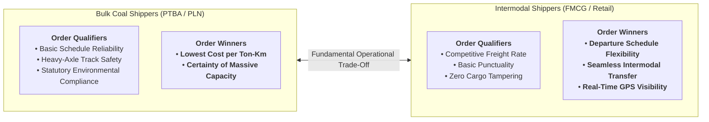
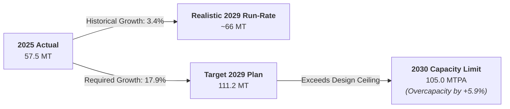
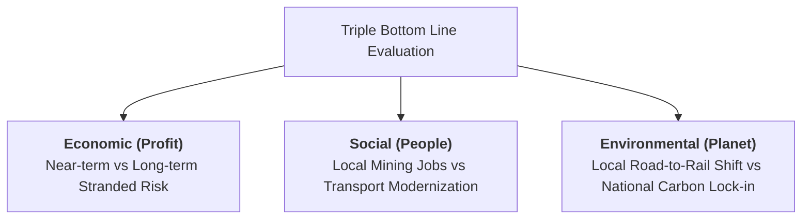
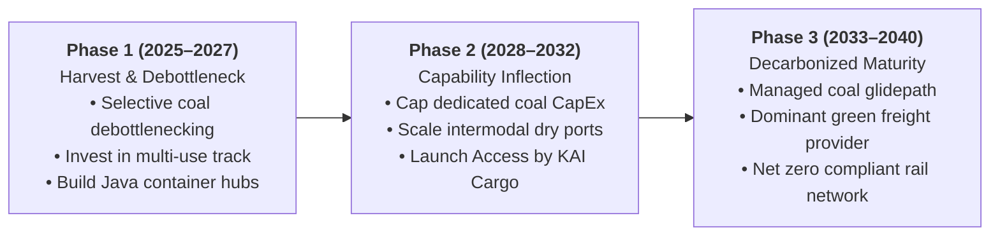

> [!NOTE] Curricular Metadata & Cohort Attribution
>
> - **Course:** MK4 Operations and Supply Chain Management — Week 02 Strategy Analysis
> - **Source Case:** `OSCM-02-2026` (Rails at a Crossroads: The Coal Dilemma at PT Kereta Api Indonesia)
> - **Synthesis Contribution:** Compiled for the cohort by **`F9 (Class F / Syndicate 9)`**.
> - **Analytical Framework:** Terry Hill Order Winners & Qualifiers, Jacobs & Chase Trade-Off Matrix, Capacity Infeasibility Audit, and Triple Bottom Line (TBL).

---

## 1. Executive Summary & Problem Formulation

PT Kereta Api Indonesia (Persero) has achieved an impressive post-pandemic financial turnaround, moving from a $\text{Rp } 1.7\text{ trillion}$ net loss in 2020 to a $\text{Rp } 2.22\text{ trillion}$ net profit in 2024, supported by a world-class passenger train departure punctuality of **$99.53\%$**.

However, KAI's financial stability rests heavily upon a single commodity: **coal represents $82.4\%$ of KAI’s total freight volume and $\text{Rp } 11.33\text{ trillion}$ of freight revenue**. Operating at an exhausting **$95\%$ corridor utilization** in South Sumatra, KAI must decide whether to pour multi-trillion rupiah capital expenditure into expanding coal line capacity toward 105 MTPA or reallocate capital to diversify into non-coal freight (intermodal containers, agricultural commodities, parcel express).

The core tension evaluated by **`F9 (Class F / Syndicate 9)`** is **Efficiency vs. Flexibility**: coal efficiency is driven by monolithic specialization, whereas non-coal diversification demands a flexible, responsive activity system.

---

## 2. Order Winners, Order Qualifiers & The Operating Trade-Offs

Applying Terry Hill’s framework, coal freight and container freight represent fundamentally irreconcilable customer needs that cannot be satisfied by the same operational activity system:

### The Inherent Trade-Offs of Straddling Coal and Containers

1. **Asset Utilization vs. Service Frequency**: Coal efficiency depends on running 61-wagon unit trains point-to-point on strict circular loops to maximize locomotive utilization. Container freight requires smaller, more frequent train slots to match factory delivery windows, directly cannibalizing long coal train slots on congested rail corridors.
2. **Dedicated vs. Multi-Use Assets**: Coal wagons (rotary-dump gondolas) cannot carry containers or palletized cargo. Capital invested in coal-specific rolling stock cannot be repurposed if coal demand declines.
3. **Commercial & IT Capabilities**: Selling bulk coal requires long-term government contracts with two principal clients (PTBA and PLN). Container freight requires an extensive multi-client commercial sales force, digital booking portals (_Access by KAI Cargo_), and dry port trucking logistics partners.

---

## 3. Quantitative Audit: Is the 2029 Target of 111.2 Million Tonnes Realistic?

The draft Corporate Long-Term Plan (RJPP) projects coal freight volume to almost double from **$57.52\text{ MT}$ in 2025 to $111.20\text{ MT}$ by 2029**. **`F9 (Class F / Syndicate 9)`** audited this target against empirical physical constraints:

$$
\begin{aligned}
\mathbf{\text{Volume Expansion Needed:}} &\quad 111.20 - 57.52 = +53.68\text{ Million Tonnes } (+93.3\%) \\
\mathbf{\text{Required Compound Growth:}} &\quad \text{CAGR} = \left(\frac{111.20}{57.52}\right)^{1/4} - 1 = \mathbf{17.92\%\text{ per year}} \\
\mathbf{\text{Historical Growth Realized (2025):}} &\quad \mathbf{+3.40\%\text{ YoY}} \\
\mathbf{\text{Current Corridor Utilization:}} &\quad \mathbf{\approx 95\%} \\
\mathbf{\text{Stated 2030 Line Capacity Ceiling:}} &\quad \mathbf{105.00\text{ MTPA}}
\end{aligned}
$$

> [!CAUTION] F9 Audit Conclusion on Target Feasibility
> The $111.2\text{ MT}$ target should be treated as an **aspirational stretch target**, not a prudent baseline for capital budgeting:
>
> 1. It requires coal volume growth to accelerate from $3.4\%$ to $17.9\%$ annually.
> 2. The $111.2\text{ MT}$ target exceeds the ultimate 2030 infrastructure capacity ceiling ($105\text{ MTPA}$) by $6.2\text{ MT}$.
> 3. Any construction delay in Tarahan II terminal or double-tracking will trigger catastrophic train gridlock on the $95\%$-utilized mainline.

---

## 4. Triple Bottom Line (TBL) Assessment: Option A vs. Option B

| TBL Dimension                    | Option A: Deepen Coal Expansion                                                          | Option B: Strategic Diversification                                                            |
| :------------------------------- | :--------------------------------------------------------------------------------------- | :--------------------------------------------------------------------------------------------- |
| **Profit (Near-Term)**           | **Superior**: Maximizes immediate cash flow from high-margin, long-term contracts.       | **Weaker**: High upfront CapEx with smaller, slower-growing initial non-coal revenue.          |
| **Profit (Long-Term)**           | **Extreme Risk**: Highly exposed to carbon taxes, coal phaseout, and stranded assets.    | **Resilient**: Builds versatile logistics infrastructure adaptable to diversified trade.       |
| **People (Social)**              | Protects existing South Sumatra mining logistics jobs and provincial royalties.          | Enables workforce reskilling in digital logistics, intermodal handling, and supply chains.     |
| **Planet (Local Rail Boundary)** | **Favorable**: Rail emits $80\%$ less $\text{CO}_2$ per ton-km than highway trucks.      | **Favorable**: Shifts general freight from diesel highway trucks onto electric/rail corridors. |
| **Planet (Energy Value-Chain)**  | **Unfavorable**: Locks in fossil-fuel extraction infrastructure for another 25–30 years. | **Superior**: Directly aligns with national Net Zero 2060 policy and coal phase-down.          |

---

## 5. F9 Recommended Strategic Roadmap: The Gated Transition Model

Rather than choosing between reckless coal over-investment or premature coal abandonment, **`F9 (Class F / Syndicate 9)`** proposes a **Three-Phase Gated Capital Allocation Model**:

1. **Harvest Coal Cash to Fund Multi-Use Infrastructure**: Continue operating the South Sumatra corridor efficiently to generate cash, but restrict new CapEx strictly to **multi-use assets** (double-tracking, centralized signaling, standard locomotives) that can carry general freight if coal volumes fall.
2. **Cap Irreversible Coal-Specific Investments**: Avoid building over-sized, irreversible assets like single-purpose rotary coal dumpers that depend entirely on $111.2\text{ MT}$ coal volume.
3. **Aggressively Target ODOL Highway Modal Shift**: Leverage government enforcement against Over-Dimension Over-Load (ODOL) trucks on Java’s North Coast (_Pantura_) to capture high-margin container freight.

---

## 6. Cold-Call Defense Script for the Executive Boardroom

> **Professor Cold-Call**: _"Candidate, KAI is making Rp 2.2 trillion in profit, almost entirely off coal. Why shouldn't Bobby Rasyidin just approve the 111 million tonne coal expansion and give the shareholders the dividend they want?"_
>
> **Boardroom Defense Script**:
> \*"Bapak Direktur Utama, taking the coal dividend today while ignoring the 25-year asset horizon is a classic value-destruction trap. Rail assets last 25 to 30 years. A locomotive bought in 2026 will still be depreciating on our balance sheet in 2056—four years before Indonesia's Net Zero 2060 deadline.
>
> Furthermore, our quantitative audit reveals that the 111.2 million-tonne target requires an unprecedented 17.9% annual growth on a corridor already running at 95% capacity, exceeding the 2030 infrastructure ceiling. If we commit all our capital to irreversible coal assets, KAI will face catastrophic stranded-asset write-downs when power utilities decarbonize.
>
> Our recommendation is disciplined: harvest the coal cash machine today, but mandate that all capital expenditure be directed into multi-use infrastructure that builds KAI's long-term intermodal container capability."\*

---

## 🔗 Cross-References & Study Navigation

- Lecture Notes: [[courses/mk4-operations-supply-chain-management/week-02/index|MK4 Week 02 Lecture Hub]]
- Case Dossier: [[courses/mk4-operations-supply-chain-management/week-02/case-kai-coal-dilemma|Rails at a Crossroads Case Dossier]]
- Reading Note: [[courses/mk4-operations-supply-chain-management/week-02/reading-enel-innovability|Enel's Innovability Reading Note]]
- Theoretical Framework: [[concepts/order-winners-and-qualifiers|Order Winners and Order Qualifiers]]
- Enterprise Profile: [[entities/pt-kereta-api-indonesia|PT Kereta Api Indonesia (Persero)]]
