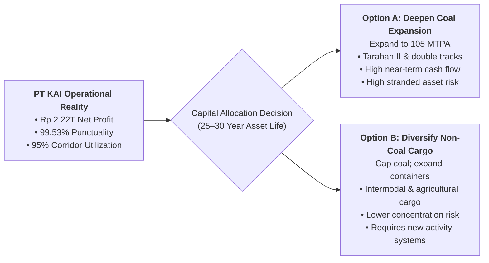
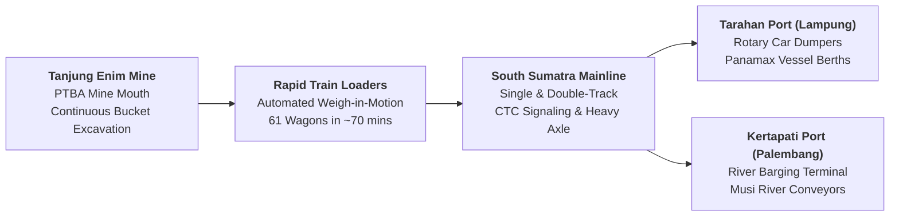
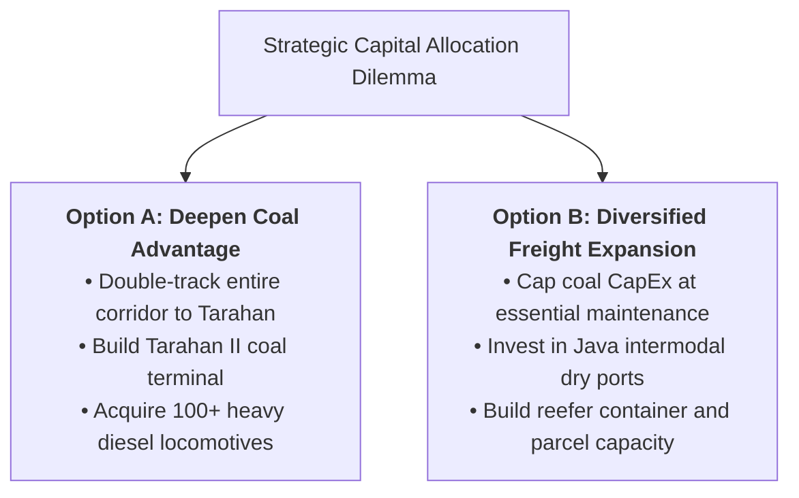

> [!NOTE] Case Overview & Pedagogical Metadata
>
> - **Case Code:** `SBM-ITB OSCM-02-2026` (Published 2 September 2026)
> - **Protagonist:** Bobby Rasyidin, President Director, PT Kereta Api Indonesia (Persero)
> - **Setting:** Tanjung Enim Baru Station, South Sumatra (February 2026)
> - **Core Problem:** Deciding whether to invest heavily in expanding South Sumatra coal line capacity to 105 MTPA or reallocate CapEx toward long-lived non-coal freight in the face of national Net Zero 2060 decarbonization.
> - **Related Lecture Hub:** [[courses/mk4-operations-supply-chain-management/week-02/index|MK4 Week 02: Operations Strategy]]
> - **Cohort Working Solution:** [[courses/mk4-operations-supply-chain-management/week-02/assignment-kai-coal-strategy|Syndicate 9 (F9) Operations Strategy Debrief]]

---

## 1. Executive Summary & The Crossroads Dilemma

At 04:40 AM at Tanjung Enim Baru Station in South Sumatra, President Director Bobby Rasyidin watched the **Babaranjang** coal train depart: 61 wagons, two heavy diesel-electric locomotives, stretching more than a kilometer long, hauling coal mined by [[entities/pt-bukit-asam|PT Bukit Asam (PTBA)]] toward the maritime export terminal at Tarahan, Lampung. The train cleared the yard with monotonous, clockwork precision.

Bobby inherited a company celebrated across Indonesia for its operational turnaround:

- Transformed from a net loss of $\text{Rp } 1.7\text{ trillion}$ in 2020 to a net profit of $\text{Rp } 2.22\text{ trillion}$ in 2024.
- Maintained an extraordinary **$99.53\%$ passenger train departure punctuality** through 2025.

Yet beneath this operational triumph lay an acute structural vulnerability: **coal accounted for $82.4\%$ of KAI’s total freight volume and $\text{Rp } 11.33\text{ trillion}$ of freight revenue**, while operating at an exhausting **$95\%$ corridor capacity utilization**. As Indonesia targets Net Zero emissions by 2060, Bobby must submit the 2025–2029 Corporate Long-Term Plan (RJPP): continue doubling down on coal infrastructure or pivot capital toward non-coal logistics.

---

## 2. Enterprise Context: The Turnaround of PT KAI

KAI's transformation over the past fifteen years represents one of the most prominent state-owned enterprise turnaround case studies in Southeast Asia:

1. **The Jonan Transformation (2009–2014)**: Eradicated ticket scalping, cleared informal station vendors, introduced mandatory electronic seat-only ticketing, installed air conditioning across all rolling stock classes, and enforced strict field management discipline.
2. **Post-Pandemic Financial Recovery (2020–2024)**: Overcame the COVID-19 passenger ridership collapse by expanding South Sumatra bulk coal transport and launching the _Access by KAI_ digital ecosystem.
3. **The Freight Engine**: Freight operations—specifically bulk commodity movement in Sumatra—generate the disproportionate bulk of corporate EBITDA, cross-subsidizing public passenger operations in Java.

---

## 3. The Babaranjang Coal Machine: South Sumatra Corridor Mechanics

The South Sumatra coal logistics pipeline represents a tightly coupled, highly specialized operations system:

### Operational Characteristics of Dedicated Coal Freight

- **Unit Train Standardization**: Monolithic train configurations (61 wagons per rake, identical bogies, unified braking curves).
- **High Asset Velocity**: Scheduled circular routing with minimal switching or shunting intermediate stops.
- **Extreme Corridor Utilization**: Running at approximately $95\%$ utilization in 2024; any track breakdown, landslide, or locomotive failure causes widespread cascading congestion across the single-track sections.

---

## 4. Quantitative Case Exhibits & Freight Metrics

### Exhibit 1: KAI Freight Volume & Commodity Breakdown (2025)

| Freight Commodity                  | Annual Volume (Million Tonnes) | Freight Share (%) | Primary Operating Corridor                             | Core Customer Base                              |
| :--------------------------------- | :----------------------------: | :---------------: | :----------------------------------------------------- | :---------------------------------------------- |
| **Coal Freight (Babaranjang)**     |          **$57.52$**           |   **$82.4\%$**    | South Sumatra (Tanjung Enim $\to$ Tarahan / Kertapati) | PT Bukit Asam, PLN Power Plants, Private Miners |
| **Container & Intermodal Freight** |             $5.12$             |      $7.3\%$      | Java North Coast (Jakarta $\to$ Surabaya / Dry Ports)  | Industrial Shippers, FMCG, Electronics          |
| **Cement & Building Materials**    |             $3.84$             |      $5.5\%$      | Java & Sumatra Corridors                               | Semen Indonesia Group, Indocement               |
| **Fuel & Liquid Cargo**            |             $2.15$             |      $3.1\%$      | Regional Fuel Depots (Java/Sumatra)                    | PT Pertamina Patra Niaga                        |
| **Parcel, Retail & Agriculture**   |             $1.17$             |      $1.7\%$      | Intercity Passenger Trains (Baggage Carriages)         | KAI Logistik, E-commerce, Farmers               |
| **Total Freight System**           |          **$69.80$**           |   **$100.0\%$**   | Consolidated Rail Network                              | Multi-industry portfolio                        |

### Exhibit 2: The 2029 Long-Term Target vs. Capacity Reality

The draft 2025–2029 Corporate Long-Term Plan (RJPP) proposes expanding coal freight volume to **$111.2\text{ million tonnes}$ by 2029**:

$$
\begin{aligned}
\mathbf{\text{Current Coal Volume (2025):}} &\quad 57.52\text{ MT} \\
\mathbf{\text{Target Coal Volume (2029):}} &\quad 111.20\text{ MT} \quad (+93.3\% \implies \mathbf{17.9\%\text{ annual CAGR}}) \\
\mathbf{\text{Historical Growth Rate (2025):}} &\quad +3.4\%\text{ YoY} \\
\mathbf{\text{Corridor Line Capacity Limit (2030):}} &\quad 105.00\text{ MTPA}
\end{aligned}
$$

> [!WARNING] The Capacity Infeasibility Arithmetic
> The 2029 target of $111.2\text{ MT}$ exceeds the stated 2030 design infrastructure capacity ($105\text{ MTPA}$) by $6.2\text{ MT}$ ($+5.9\%$). Achieving an $17.9\%$ annual volume growth on a corridor already operating at $95\%$ capacity utilization is impossible without immediate, flawless delivery of multi-trillion rupiah double-tracking and port terminal expansions.

---

## 5. Strategic Decision Alternatives: Deepen vs. Diversify

| Dimension               | Option A: Deepen Coal Operations                                          | Option B: Strategic Diversification                                   |
| :---------------------- | :------------------------------------------------------------------------ | :-------------------------------------------------------------------- |
| **Core Customer**       | Mining conglomerates (PTBA) and power utilities (PLN).                    | Multi-sector shippers (FMCG, retail, agricultural, chemicals).        |
| **Order Qualifier**     | Schedule reliability, safety, compliance.                                 | Competitive freight rates, basic punctuality, cargo safety.           |
| **Order Winner**        | **Lowest cost per ton-km; guaranteed capacity.**                          | **Schedule flexibility; intermodal integration; digital visibility.** |
| **Asset Specificity**   | High: dedicated rotary coal gondolas, coal dumpers.                       | Low: flat wagons, standardized intermodal containers.                 |
| **Stranded Asset Risk** | **Severe**: $25\text{–}30$ year assets exposed to Net Zero 2060 phaseout. | **Minimal**: assets can be re-routed across commodity sectors.        |
| **Near-Term Cash Flow** | Very strong: leverages existing high-margin contracts.                    | Moderate: requires upfront marketing and capability development.      |

---

## 6. Cold-Call Preparation & Classroom Defense

### 1. "Can KAI serve both coal and container customers with the same operational activity system?"

- **Defense Script**: "No. This is a classic Porter straddling dilemma. Coal operations are built on extreme specialization: monolithic 61-wagon unit trains running point-to-point without shunting, achieving maximum asset turnover and minimum unit cost. Container freight requires an entirely different activity system: multi-point scheduling, high frequency, variable rake sizes, dry port intermodal handling, and real-time GPS tracking. Forcing container freight onto coal infrastructure compromises the utilization of both."

### 2. "Why is a 25–30 year asset life critical in evaluating Option A?"

- **Defense Script**: "Railway capital investments—tracks, signaling systems, bridges, and locomotives—depreciate over 25 to 30 years. A locomotive commissioned in 2026 will still be on KAI's balance sheet in 2056, four years before Indonesia's Net Zero 2060 deadline. If domestic coal-fired power plants accelerate decommissioning under international Just Energy Transition Partnership (JETP) agreements, KAI risks holding trillions of rupiah in stranded, highly specialized coal assets."

---

## 🔗 Cross-References & Study Navigation

- Lecture Context: [[courses/mk4-operations-supply-chain-management/week-02/index|MK4 Week 02: Operations Strategy]]
- Cohort Solution: [[courses/mk4-operations-supply-chain-management/week-02/assignment-kai-coal-strategy|Syndicate 9 (F9) Strategy Debrief]]
- Enterprise Profile: [[entities/pt-kereta-api-indonesia|PT Kereta Api Indonesia (Persero)]]
- Theoretical Model: [[concepts/order-winners-and-qualifiers|Order Winners and Order Qualifiers (Terry Hill)]]
