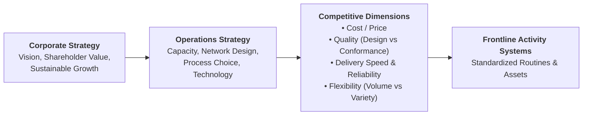
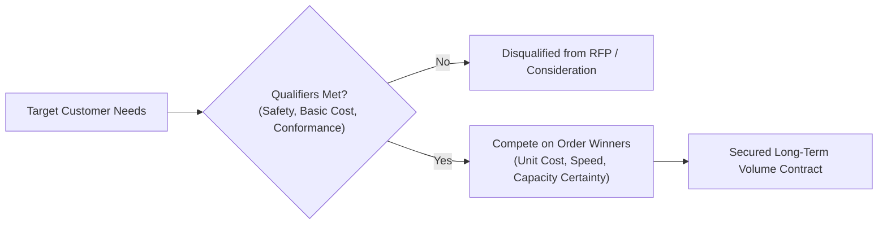
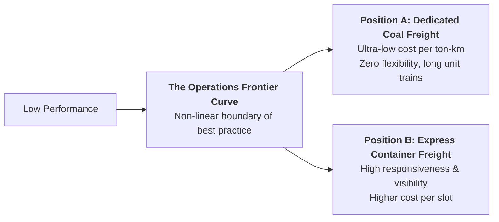
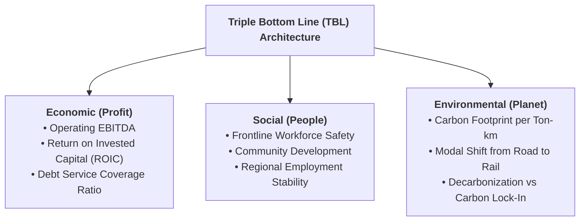

> [!NOTE] Curricular & Faculty Metadata
>
> - **Course:** MK4 Operations and Supply Chain Management — Week 02
> - **Teaching Team:** Noorhan Firdaus Pambudi, Ph.D. (Lead Lecturer), Dr. Yuanita Handayati
> - **Primary Curricular Spine:** `[FINAL] Strategy.pdf` (37 Slides) & Jacobs & Chase (Ch. 2)
> - **Direct Satellites & Problem Sets:**
>   - [[courses/mk4-operations-supply-chain-management/week-02/case-kai-coal-dilemma|Rails at a Crossroads: Operational Excellence and the Coal Dilemma at PT KAI (Case Dossier)]]
>   - [[courses/mk4-operations-supply-chain-management/week-02/reading-enel-innovability|Enel's Innovability: Global Open Innovation and Sustainability (Reading Note)]]
>   - [[courses/mk4-operations-supply-chain-management/week-02/assignment-kai-coal-strategy|Syndicate 9 (F9) Operations Strategy & Trade-Offs Debrief]]

---

## 1. Executive Overview: Operations Strategy as Competitive Fit

An enterprise cannot be all things to all people. Operations strategy is not about pursuing generic "world-class excellence" across every conceivable dimension; it is the **deliberate commitment of resources to a distinct set of operational capabilities that reinforces the corporate value proposition**.

Michael Porter's landmark formulation establishes that operational effectiveness (doing similar activities better than rivals) is necessary but insufficient for enduring advantage. Sustainable competitive advantage requires **strategic positioning**: performing different activities from rivals, or performing similar activities in radically different ways.

### The Straddling Trap

When a company attempts to match a competitor's winning advantage while maintaining its existing operational posture, it falls into the **straddling trap**. By grafting incompatible operational priorities onto a single operating system, the firm compromises both, diluting efficiency and confusing frontline execution.

---

## 2. Theoretical Architecture & Core Frameworks

### 2.1 The Competitive Dimensions of Operations

Enterprises compete across six fundamental operational dimensions:

| Competitive Dimension               | Operational Meaning                                                       | Core Trade-off / Cost of Pursuit                                                |
| :---------------------------------- | :------------------------------------------------------------------------ | :------------------------------------------------------------------------------ |
| **Price / Cost**                    | Delivering product or service at minimum possible unit expenditure.       | Sacrifices customization, excessive safety buffers, and premium materials.      |
| **Quality: Design**                 | High-performance features, luxury tolerances, and advanced capabilities.  | Higher development expenditure, costly components, and slower cycle time.       |
| **Quality: Conformance**            | Zero defects; delivering output that strictly conforms to specifications. | Investment in poka-yoke fail-safing, statistical process control, and training. |
| **Delivery Speed**                  | Minimizing elapsed time from customer order receipt to fulfillment.       | Requires local finished inventory buffers or expensive expedited transport.     |
| **Delivery Reliability**            | Fulfilling promises on the exact scheduled date and time (punctuality).   | Requires scheduling discipline, capacity cushions, and maintenance rigor.       |
| **Flexibility: Coping with Demand** | Rapidly scaling production up or down without severe cost penalties.      | Requires flexible labor, multi-purpose equipment, or demand buffers.            |
| **Flexibility: Product Variety**    | Offering broad customization and rapid new product introductions.         | Slower changeovers, higher inventory SKU complexity, and lower scale economies. |

### 2.2 Terry Hill's Framework: Order Winners vs. Order Qualifiers

As formalized in [[concepts/order-winners-and-qualifiers|Order Winners and Order Qualifiers]], an operations strategy must distinguish between baseline entry tickets and decisive purchasing drivers:

$$\mathbf{\text{Market Consideration}} \iff \text{Order Qualifiers Met} \qquad\qquad \mathbf{\text{Order Conversion}} \iff \text{Superiority on Order Winner}$$

### 2.3 The Operations Frontier & Strategic Trade-Offs

The **Operations Frontier** represents the trade-off curve between cost efficiency and responsiveness. World-class firms operate on the frontier; moving along the curve requires sacrificing one dimension to excel in another:

Attempting to force high-frequency, fragmented container dispatch through a dedicated, 61-wagon unit-train coal corridor moves the organization inside the frontier, degrading both asset utilization and schedule reliability.

---

## 3. The Triple Bottom Line (TBL) Framework

Modern operations strategy extends beyond traditional economic profit to evaluate the interconnected triad of **Profit, People, and Planet**:

- **Operational Boundary vs. Value-Chain Boundary**: Evaluating environmental sustainability depends critically on system boundaries. Rail freight generates up to $80\%$ fewer carbon emissions per ton-kilometer than highway trucking (an operational win). However, if that rail infrastructure locks in coal extraction for another 30 years, it perpetuates a fossil-fuel value chain that contradicts national Net Zero 2060 policies.

---

## 4. Managerial Crucible: The Coal Dilemma at PT Kereta Api Indonesia

In the case study [[courses/mk4-operations-supply-chain-management/week-02/case-kai-coal-dilemma|Rails at a Crossroads]], President Director Bobby Rasyidin faces a fundamental operations strategy dilemma at [[entities/pt-kereta-api-indonesia|PT Kereta Api Indonesia (Persero)]]:

- **The Cash Machine**: South Sumatra coal freight (Babaranjang) generates $82.4\%$ of total freight volume and $\text{Rp } 11.33\text{ trillion}$ in revenue, operating at an extraordinary $95\%$ corridor capacity utilization.
- **The Long-Term Transition Risk**: Indonesia has committed to national Net Zero emissions by 2060. Rail infrastructure (double-tracking, signaling, locomotives) carries an asset life of **25 to 30 years**.
- **The Strategic Crossroads**:
  - **Option A (Deepen Coal)**: Invest heavily to expand corridor capacity toward 105 MTPA. Offers guaranteed short-term cash flow, but maximizes stranded-asset exposure.
  - **Option B (Diversify Non-Coal)**: Cap coal investment and reallocate capital toward intermodal containers, express parcel, and agricultural commodities. Reduces terminal risk, but non-coal represents different order winners requiring new activity systems.

---

## 📚 Required Readings & In-Depth Satellites

| Document Title                                                                   | Type / Focus                           | Core Operational Contribution                                                                            | Study Note                                                                                                      |
| :------------------------------------------------------------------------------- | :------------------------------------- | :------------------------------------------------------------------------------------------------------- | :-------------------------------------------------------------------------------------------------------------- |
| **Rails at a Crossroads: Operational Excellence and the Coal Dilemma at PT KAI** | SBM ITB Teaching Case (`OSCM-02-2026`) | Reconstructs Babaranjang coal freight economics, 95% capacity utilization, and Net Zero 2060 trade-offs. | [[courses/mk4-operations-supply-chain-management/week-02/case-kai-coal-dilemma\|Open Case Dossier]]             |
| **Enel's Innovability: Global Open Innovation and Sustainability**               | INSEAD Academic Case (`IN1644`)        | Strategic alignment of open innovation with renewable energy sustainability.                             | [[courses/mk4-operations-supply-chain-management/week-02/reading-enel-innovability\|Open Reading Note]]         |
| **Syndicate 9 (F9) Strategy & Trade-Offs Debrief**                               | Cohort Case Debrief                    | Order winners/qualifiers comparison, 2029 stretch target audit, and TBL assessment.                      | [[courses/mk4-operations-supply-chain-management/week-02/assignment-kai-coal-strategy\|Open Syndicate Debrief]] |

---

## 📂 Primary Source Media & Digital Archives

| Material Title                                 |    Media Type    | Staging / Archive Location                                                                             |
| :--------------------------------------------- | :--------------: | :----------------------------------------------------------------------------------------------------- |
| **Strategy Lecture Slide Deck**                | Slides (`.pdf`)  | `archive/courses/mk4/week-02/[FINAL] Strategy.pdf`                                                     |
| **Rails at a Crossroads Case Study (SBM ITB)** |  Case (`.pdf`)   | `archive/courses/mk4/week-02/CASE_KAI_Operational_Excellence_SBM_ITB_EN.pdf`                           |
| **Enel Innovability Case Study (INSEAD)**      | Reading (`.pdf`) | `archive/courses/mk4/week-02/BC2 - Enel_s Innovability_ global open innivation and sustainability.pdf` |
| **Blue Ocean Strategy Reading**                | Reading (`.pdf`) | `archive/courses/mk4/week-02/BC - Operational Strategy - Blue Ocean Strategy.pdf`                      |
| **Pre-Assignment Prompt & Notes**              |  Task (`.docx`)  | `archive/courses/mk4/week-02/.extracted/MK 4 - Week 2 - Pre Assignment.docx.txt`                       |

---

## 🔗 Knowledge Graph & Curriculum Bridges

- **Featured Analytical Frameworks**:
  - [[concepts/order-winners-and-qualifiers|Order Winners and Order Qualifiers (Terry Hill)]]
  - [[concepts/capacity-cushion|Capacity Cushion & Strategic Capacity Planning]]
- **Enterprise Profiles**:
  - [[entities/pt-kereta-api-indonesia|PT Kereta Api Indonesia (Persero)]]
- **Previous Curricular Module**: [[courses/mk4-operations-supply-chain-management/week-01/index|Week 01: Introduction to OSCM]]
- **Next Curricular Module**: [[courses/mk4-operations-supply-chain-management/week-03/index|Week 03: Product and Service Design]]
- Return to **[[courses/mk4-operations-supply-chain-management/index|MK4 Course Overview]]**
