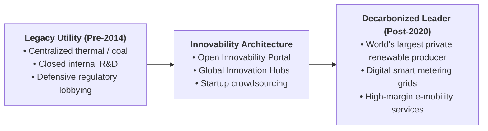
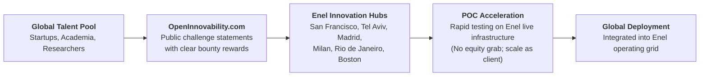

> [!NOTE] Reading Metadata & Curricular Context
>
> - **Case Reference:** INSEAD Case Study `IN1644` (Revised 2026)
> - **Authors:** Felipe Monteiro (Senior Affiliate Professor of Strategy, INSEAD) and Josemaria Siota (Executive Director, IESE Entrepreneurship and Innovation Center)
> - **Enterprise Subject:** Enel S.p.A. (Italian Multinational Energy Utility)
> - **Key Protagonist:** Francesco Starace (CEO) and Ernesto Ciorra (Chief Innovability Officer)
> - **Curricular Linkage:** Complements [[courses/mk4-operations-supply-chain-management/week-02/case-kai-coal-dilemma|Rails at a Crossroads (KAI Coal Dilemma)]] by examining how a legacy energy utility navigated the transition from fossil generation to renewable sustainability through structured open innovation.

---

## 1. Executive Summary & The "Innovability" Thesis

Under the leadership of CEO Francesco Starace and Chief Innovability Officer Ernesto Ciorra, multinational energy giant **Enel** executed one of the most radical corporate repositionings in the global utility sector.

Faced with the global climate crisis, distributed generation, and rapid technological disruption, Enel coined and institutionalized the concept of **"Innovability"**: the structural synthesis of **Innovation and Sustainability**:

$$\mathbf{\text{Innovability}} = \text{Innovation} \times \text{Sustainability} \implies \text{Innovation without sustainability is short-sighted; sustainability without innovation is unviable.}$$

Enel shifted its operations away from coal and conventional thermal generation toward renewable power (solar, wind, geothermal), smart digital grids, and advanced electrification infrastructure (Enel X).

---

## 2. Theoretical Architecture: The Open Innovation Funnel

Traditional utilities maintained secretive, closed corporate R&D laboratories with multi-year development cycles. Enel recognized that internal engineers, no matter how brilliant, represented a fraction of global scientific talent.

Ciorra established an **Open Innovation Architecture** that systematically crowdsources operational solutions from global startups, universities, independent inventors, and customers:

### The "No-Equity" Startup Engagement Philosophy

A pivotal operational policy was Enel's refusal to demand equity or intellectual property ownership from collaborating startups:

- **Client-First Model**: Enel positioned itself as the startup’s **first global industrial client**, providing access to Enel’s massive power grids, renewable plants, and customer base for rapid proof-of-concept testing.
- **Velocity Advantage**: Eliminating prolonged venture-capital equity negotiations accelerated pilot cycle times from years to weeks.

---

## 3. Operationalizing Decarbonization: Closing Coal Ahead of Schedule

Enel demonstrated that sustainability is an operational discipline requiring hard capital reallocation:

1. **Premature Decommissioning of Coal Assets**: Enel systematically retired 23 gigawatts of coal and thermal power plants, transforming brownfield sites into renewable hubs or battery energy storage systems (BESS).
2. **Capital Expenditure Reallocation**: Over $90\%$ of Enel's multi-billion euro annual CapEx was committed directly to United Nations Sustainable Development Goals (SDGs), primarily SDG 7 (Affordable and Clean Energy) and SDG 13 (Climate Action).
3. **Sustainability-Linked Bonds (SLB)**: Enel pioneered financial instruments where corporate debt coupon interest rates were tied directly to verifiable greenhouse gas emission reduction targets, aligning treasury costs with frontline operational decarbonization.

---

## 4. Managerial Synthesis: Strategic Lessons for Indonesian BUMNs

The Enel experience provides vital benchmarks for Indonesian state-owned enterprises navigating energy and infrastructure transitions—particularly [[entities/pt-kereta-api-indonesia|PT Kereta Api Indonesia (Persero)]] and PLN:

| Strategic Dilemma        | Enel Utility Transformation                                                                                                                   | KAI Coal Freight Crossroads                                                                                               |
| :----------------------- | :-------------------------------------------------------------------------------------------------------------------------------------------- | :------------------------------------------------------------------------------------------------------------------------ |
| **Legacy Asset Base**    | Coal and gas-fired power generation stations.                                                                                                 | South Sumatra Babaranjang coal rail logistics ($82.4\%$ freight).                                                         |
| **Transition Challenge** | Rapid decline in renewable solar/wind levelized cost of energy (LCOE).                                                                        | National Net Zero 2060 target and global coal phaseout commitments.                                                       |
| **Capital Allocation**   | Ruthlessly capped thermal CapEx; redirected funds to renewables and smart grids.                                                              | Dilemma: Expand coal lines to 105 MTPA vs invest in multi-use intermodal rail.                                            |
| **Innovation Approach**  | Open crowdsourcing with global startups via OpenInnovability.                                                                                 | Internal engineering focus; limited external logistics partnerships.                                                      |
| **Executive Lesson**     | **A company that waits for regulatory compulsion to abandon a dirty cash cow is destroyed; proactive transitions preserve enterprise value.** | **KAI must use near-term coal cash flows to fund long-lived non-coal intermodal capability before coal demand declines.** |

---

## 🔗 Cross-References & Study Navigation

- Lecture Context: [[courses/mk4-operations-supply-chain-management/week-02/index|MK4 Week 02: Operations Strategy]]
- Case Dossier: [[courses/mk4-operations-supply-chain-management/week-02/case-kai-coal-dilemma|Rails at a Crossroads: The Coal Dilemma at KAI]]
- Syndicate Solution: [[courses/mk4-operations-supply-chain-management/week-02/assignment-kai-coal-strategy|Syndicate 9 (F9) Operations Strategy Debrief]]
