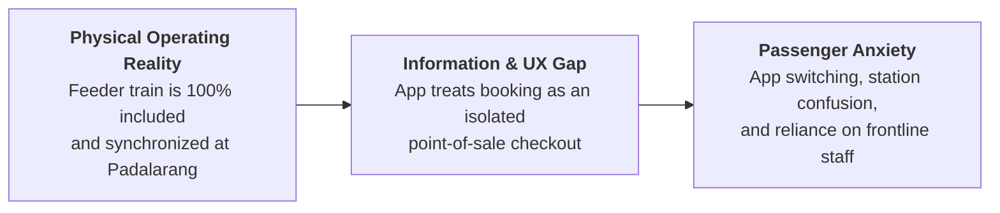
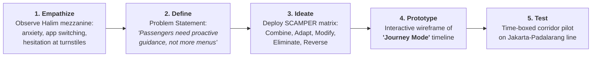
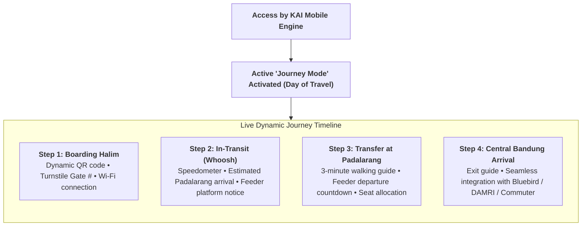
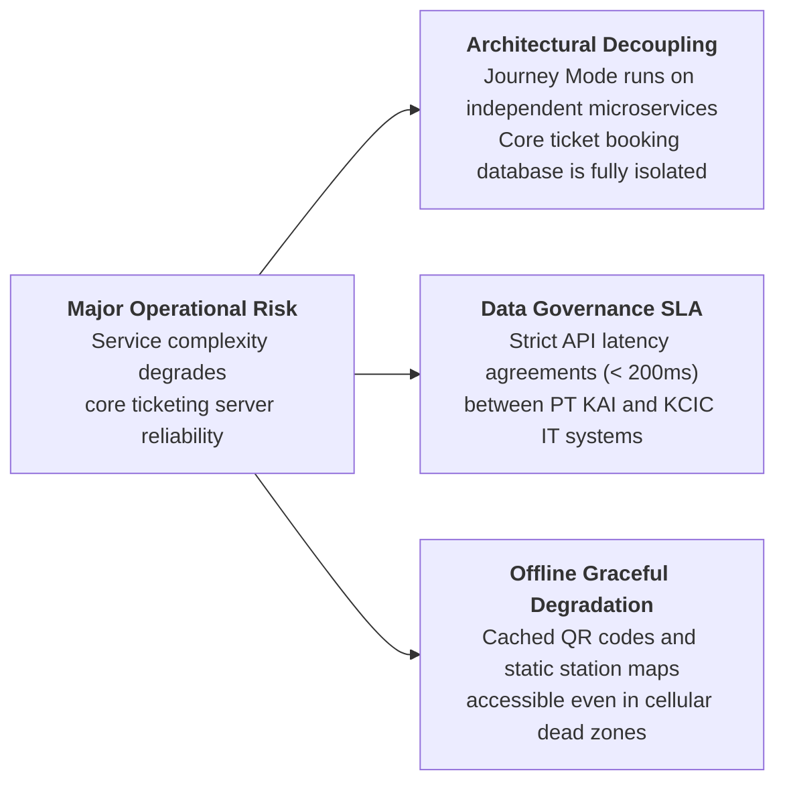

> [!NOTE] Curricular Metadata & Cohort Attribution
>
> - **Course:** MK4 Operations and Supply Chain Management — Week 03 Service Design Analysis
> - **Source Case:** `SBM-OSCM-2026-03` (Access by KAI: Redesigning an Integrated Journey Service Under the Weight of Whoosh)
> - **Synthesis Contribution:** Compiled for the cohort by **`F9 (Class F / Syndicate 9)`**.
> - **Analytical Framework:** Stanford d.school Design Thinking, SCAMPER (C-A-M-E-R) Toolkit, and Time-Boxed Corridor Pilot Governance.

---

## 1. Executive Summary & Problem Formulation

By mid-2026, **Access by KAI** commands **$29.87\text{ million}$ registered users**, $8.92\text{ million}$ monthly active users, and handles **$76.49\%$ of PT KAI's total ticket sales volume**. The platform is an undisputed commercial success as a digital transaction channel.

However, adding more users and isolated transactional features has encountered diminishing returns. The core customer problem is revealed through a common operational breakdown at Halim Station: a traveler holding a Whoosh ticket searches frantically on her smartphone to buy a ticket for the Padalarang feeder train—unaware that the feeder service is **already fully paid and included in her Whoosh fare**.

The core finding of **`F9 (Class F / Syndicate 9)`** is that **the operational defect is not a lack of physical transport service, but the failure to deliver the right information at the exact operational moment of need.**

---

## 2. Stanford d.school Design Thinking Methodology

**`F9 (Class F / Syndicate 9)`** applies the 5-stage Design Thinking architecture to re-engineer the passenger experience:

### Stage Breakdown & Operational Deliverables

1. **Empathize**: Direct field observation reveals that passengers experience peak cognitive load during modal transfer points (switching from high-speed rail to conventional feeder trains).
2. **Define**: The core problem is formulated: _"How might we transform Access by KAI from an application that ends when a ticket is purchased into an active service companion that guides passengers across transfer points?"_
3. **Ideate**: Brainstorming unconstrained solutions, filtered through the SCAMPER model.
4. **Prototype**: Authoring low-fidelity mobile journey screens displaying a dynamic single-screen timeline that adapts to the passenger's current physical location.
5. **Test**: Launching a controlled pilot exclusively on the Jakarta-Bandung high-speed corridor to measure staff intervention reduction and on-time transfer completion.

---

## 3. The SCAMPER Ideation Matrix: C–A–M–E–R Analysis

To translate user empathy into concrete system features, **`F9 (Class F / Syndicate 9)`** executed a targeted SCAMPER analysis across five selected elements:

| SCAMPER Dimension | Operational Application in Access by KAI                                                                                                                   | Expected Customer & Enterprise Value                                                                                   |
| :---------------- | :--------------------------------------------------------------------------------------------------------------------------------------------------------- | :--------------------------------------------------------------------------------------------------------------------- |
| **Combine (C)**   | Combine Whoosh electronic ticket, Padalarang feeder entitlement, platform directions, and real-time transfer schedules into a single unified journey card. | Eliminates app switching; passengers comprehend their complete multimodal route in one screen.                         |
| **Adapt (A)**     | Adapt Google Maps turn-by-turn navigation paradigms into live station wayfinding.                                                                          | Passengers receive contextual guidance ("Proceed down to Platform 1 for Feeder departure in 8 minutes").               |
| **Modify (M)**    | Modify the app home screen dynamically when travel date arrives, replacing generic promotional banners with a live **"Journey Mode"** card.                | The application assists the traveler through physical execution instead of abandoning them after payment.              |
| **Eliminate (E)** | Eliminate secondary search flows, redundant feeder purchase menus, and confusing fare breakdowns.                                                          | Reduces customer anxiety and directly lowers customer service desk inquiries at transfer hubs.                         |
| **Reverse (R)**   | **Reverse the information flow from "passenger searches and asks" to "KAI proactively informs."**                                                          | Pushes geo-fenced notifications before the train pulls into Padalarang Station, preventing confusion before it occurs. |

---

## 4. F9 Recommended Operating Design: The "Journey Mode" Corridor Pilot

### Controlled Pilot Execution (Whoosh-Padalarang Corridor)

Rather than risking systemic platform instability through an immediate, nationwide multi-operator rollout, **`F9 (Class F / Syndicate 9)`** recommends a **6-Month Controlled Corridor Pilot**:

- **Confined Boundary**: Applied exclusively to passengers traveling on the Whoosh + KA Feeder Bandung corridor.
- **Operational Metric Gates**:
  1. _Staff Intervention Rate_: Target a $75\%$ reduction in manual staff directions at Padalarang Station.
  2. _Transfer Punctuality_: Achieve $99\%$ passenger connection success on scheduled feeder departures.
  3. _App Crash Rate_: Maintain $< 0.05\%$ crash rate during peak Friday afternoon transaction surges.

---

## 5. Complexity Governance & System Risk Mitigation

Expanding digital service scope introduces acute operational vulnerabilities that must be actively managed:

---

## 6. Cold-Call Defense Script for the Executive Boardroom

> **Professor Cold-Call**: _"Candidate, why should KAI build 'Journey Mode' just for Whoosh passengers when intercity rail in Java generates over 70% of ticket volume?"_
>
> **Boardroom Defense Script**:
> \*"Bapak Direktur, we start with Whoosh because the Jakarta-Bandung corridor is our most urgent operational and commercial crucible. KAI owns 60% of the consortium operating Whoosh, and the single largest deterrent suppressing ridership is customer anxiety over the Padalarang transfer.
>
> By piloting 'Journey Mode' on this contained corridor, we solve a real customer bottleneck where KAI and KCIC control all the underlying physical assets. We test the microservices architecture, prove that station staff inquiries drop by 75%, and refine the proactive push engine before scaling Journey Mode to KAI Commuter and intercity lines across Java. Starting small is not a lack of ambition—it is disciplined operations management."\*

---

## 🔗 Cross-References & Study Navigation

- Lecture Notes: [[courses/mk4-operations-supply-chain-management/week-03/index|MK4 Week 03 Lecture Hub]]
- Case Dossier: [[courses/mk4-operations-supply-chain-management/week-03/case-kai-access|Access by KAI Case Dossier]]
- Reading Note: [[courses/mk4-operations-supply-chain-management/week-03/reading-apple-design-thinking|Apple Design Thinking Reading]]
- Theoretical Framework: [[concepts/service-system-design-matrix|Service-System Design Matrix]]
- Enterprise Profiles: [[entities/pt-kereta-api-indonesia|PT Kereta Api Indonesia]] · [[entities/pt-kereta-cepat-indonesia-china|PT KCIC]]
