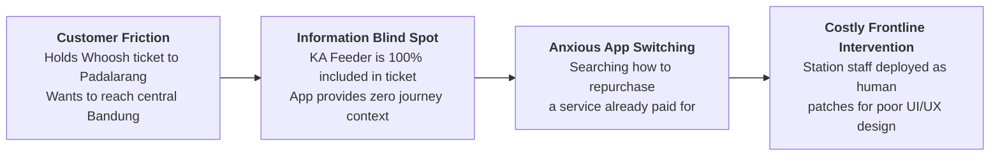
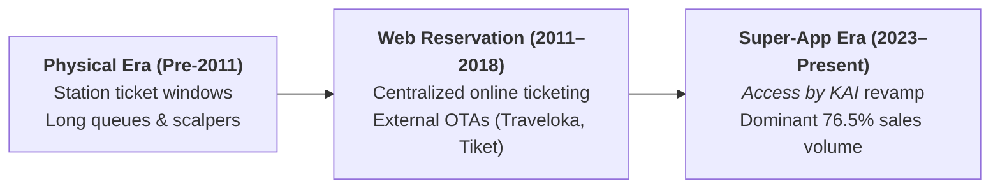
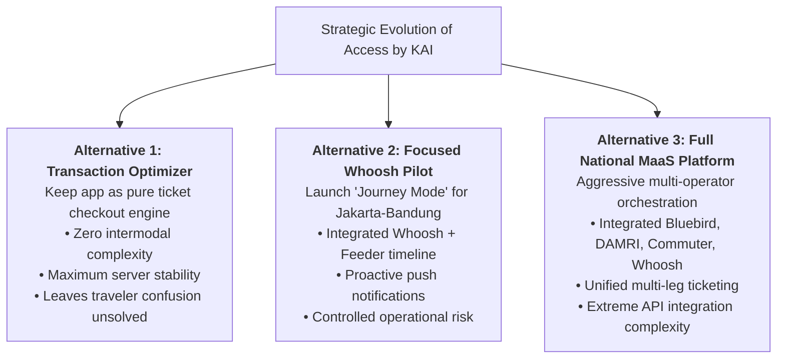

> [!NOTE] Case Overview & Pedagogical Metadata
>
> - **Case Code:** `SBM-OSCM-2026-03` (Revised August 2026)
> - **Protagonist:** Ratna Widiastuti, Director of Commerce & Digital Service Development, PT Kereta Api Indonesia (Persero)
> - **Setting:** Halim High-Speed Rail Station, Jakarta (July 2026)
> - **Core Problem:** Transforming a 29.8 million-user ticketing app into a proactive multimodal journey orchestrator while absorbing commercial pressure to support Whoosh ridership.
> - **Related Lecture Hub:** [[courses/mk4-operations-supply-chain-management/week-03/index|MK4 Week 03: Product and Service Design]]
> - **Cohort Working Solution:** [[courses/mk4-operations-supply-chain-management/week-03/assignment-access-kai|Syndicate 9 (F9) Service Design Debrief]]

---

## 1. Executive Summary & The Halim Station Dilemma

On a Friday afternoon at 16:40 at Halim Station in Jakarta, Ratna Widiastuti, Director of Commerce and Digital Service Development at PT KAI, stood on the departure mezzanine. She observed a young female passenger with a backpack standing motionless before the turnstiles, opening one mobile application, closing it, opening another, and looking anxiously around for customer service staff.

The traveler held an electronic ticket for the **Whoosh** high-speed train to Padalarang, intending to continue onward to central Bandung on the **KA Feeder**. That feeder train ride was **already included in the ticket price without any additional charge**. Unaware of this entitlement, the traveler was frantically searching how to buy something she already owned. A frontline employee eventually stepped in to guide her to Platform 1.

Reflecting on the incident, Ratna noted:

> _"We have built an application used by nearly thirty million people, and we are still solving service design problems by stationing a human being at the point of confusion."_

---

## 2. Enterprise Context: The Evolution of Access by KAI

The digital distribution footprint of [[entities/pt-kereta-api-indonesia|PT Kereta Api Indonesia (Persero)]] has progressed across three structural epochs:

### Scale of the Digital Asset (Mid-2026 Status)

- **Cumulative Registered Users**: **$29,870,864$** (growing $+3.68\%$ YoY).
- **Monthly Active Users (MAU)**: **$8,924,134$** ($4.81\text{M}$ premium loyalty tier members).
- **Share of Total Ticket Sales**: **$76.49\%$** of all KAI Group passenger tickets booked through the app.
- **Intercity Annual Volume**: Over $26.48\text{ million}$ intercity transactions processed via the application in 2025.

---

## 3. The Whoosh Commercial Pressure & Intermodal Disconnect

Concurrently, PT KAI faces intense commercial pressure through its majority shareholding in **PT Pilar Sinergi BUMN Indonesia (PSBI)**, the $60\%$ owner of [[entities/pt-kereta-cepat-indonesia-china|PT Kereta Cepat Indonesia China (KCIC)]]:

- **Below-Forecast Ridership**: While Whoosh achieves high technical punctuality ($99.9\%$), daily ridership remains below the aggressive investment feasibility assumptions ($30,000\text{ passengers/day}$ target vs. $18,000\text{–}22,000$ actual).
- **The Padalarang Bottleneck**: Because Whoosh terminates at Tegalluar (far south of Bandung) and Padalarang (west of Bandung), the passenger experience depends entirely on a seamless transfer to KAI’s dedicated diesel-multiple-unit Feeder train.
- **Commercial Temptation**: Corporate leadership wants _Access by KAI_ to actively push Whoosh tickets over KAI’s traditional intercity express trains (_Argo Parahyangan_), risking customer backlash if the digital channel loses its perceived impartiality.

---

## 4. Quantitative Exhibits & Digital Performance

### Exhibit 1: KAI Passenger Sales Channel Composition (2025–2026)

| Distribution Channel                       | Share of Volume (%) | Strategic Cost / Economic Characteristic                                                        |
| :----------------------------------------- | :-----------------: | :---------------------------------------------------------------------------------------------- |
| **Access by KAI (Mobile App)**             |    **$76.49\%$**    | Zero agency commission; direct first-party data ownership; proprietary payment rails.           |
| **Online Travel Agents (OTAs)**            |      $14.22\%$      | Third-party distribution fee ($2.5\%\text{–}3.5\%$ commission); limited customer re-engagement. |
| **Station Vending Machines**               |      $5.18\%$       | On-site self-service hardware; high maintenance and terminal servicing capex.                   |
| **Station Ticket Counters**                |      $2.85\%$       | Dedicated frontline human staff; reserved for elderly, discounts, and cancellations.            |
| **Retail Partners (Alfamart / Indomaret)** |      $1.26\%$       | Cash payment collections for unbanked demographic.                                              |
| **Total Ticketing Pipeline**               |   **$100.00\%$**    | Fully digitized multi-channel architecture.                                                     |

---

## 5. Strategic Decision Alternatives

Ratna Widiastuti’s digital product team formulated three alternative strategic paths for the upcoming board meeting:

| Operational Dimension       | Alternative 1: Transaction Optimizer       | Alternative 2: Focused Whoosh Pilot (Recommended)         | Alternative 3: National MaaS Orchestrator                        |
| :-------------------------- | :----------------------------------------- | :-------------------------------------------------------- | :--------------------------------------------------------------- |
| **Value Proposition**       | Fast, frictionless rail ticket checkout.   | Proactive, step-by-step corridor journey guide.           | Full Mobility-as-a-Service (MaaS) multi-operator transit.        |
| **System Complexity**       | Low: standalone KAI database queries.      | Moderate: time-boxed API link between KAI and KCIC.       | Extremely High: real-time cross-enterprise APIs and shared SLAs. |
| **Customer Journey Impact** | Zero impact on station transfer confusion. | **Completely resolves Padalarang transfer anxiety.**      | High, but prone to third-party app crashes and delays.           |
| **Whoosh Financial Aid**    | Minimal: passive ticket listing.           | **Strong: removes primary deterrent to Whoosh adoption.** | Diluted across hundreds of transit modes.                        |

---

## 6. Cold-Call Preparation & Classroom Defense

### 1. "Why should KAI spend capital turning a 76%-dominant ticketing app into a journey orchestrator?"

- **Defense Script**: "Because selling the ticket is only the first step in a service journey. When a passenger gets lost at Halim Station or tries to re-buy a Padalarang feeder ticket she already owns, KAI pays the cost in expensive frontline station staff interventions. More critically, the single biggest friction suppressing Whoosh high-speed rail ridership is the perceived anxiety of the Padalarang transfer. By transforming _Access by KAI_ into an active journey companion, KAI directly drives Whoosh load factors and reduces station labor costs."

### 2. "Why not roll out the Full Mobility-as-a-Service (Alternative 3) nationwide immediately?"

- **Defense Script**: "In operations design, complexity is the enemy of reliability. Orchestrating taxis, ride-hailing, buses, and trains across Java requires real-time data synchronization across dozens of third-party legacy databases. If a partner API fails, customers blame KAI. Alternative 2 provides a disciplined, time-boxed pilot on the high-visibility Jakarta-Bandung corridor where KAI and KCIC control all physical assets."

---

## 🔗 Cross-References & Study Navigation

- Lecture Context: [[courses/mk4-operations-supply-chain-management/week-03/index|MK4 Week 03: Product and Service Design]]
- Syndicate Solution: [[courses/mk4-operations-supply-chain-management/week-03/assignment-access-kai|Syndicate 9 (F9) Service Design Debrief]]
- Enterprise Profiles: [[entities/pt-kereta-api-indonesia|PT Kereta Api Indonesia (Persero)]] · [[entities/pt-kereta-cepat-indonesia-china|PT Kereta Cepat Indonesia China (KCIC)]]
