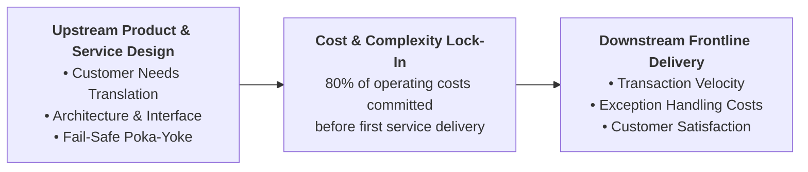
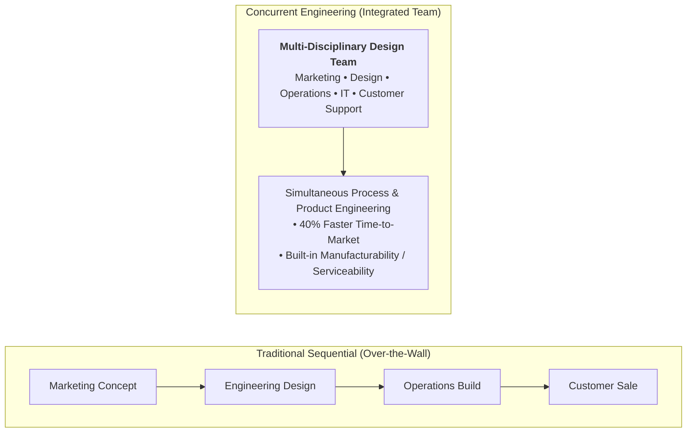
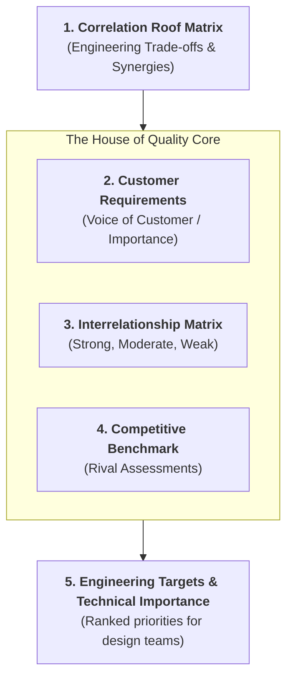
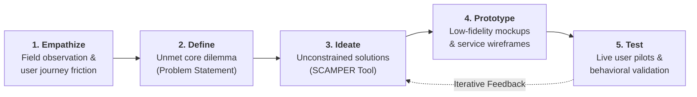

> [!NOTE] Curricular & Faculty Metadata
>
> - **Course:** MK4 Operations and Supply Chain Management — Week 03
> - **Teaching Team:** Dr. Liane Okdinawati (Associate Professor in Logistics & Supply Chain), Noorhan Firdaus Pambudi, Ph.D.
> - **Primary Curricular Spine:** `[FINAL] Design of Products and Services.pptx.pdf` (42 Slides) & Jacobs & Chase (Ch. 3)
> - **Direct Satellites & Problem Sets:**
>   - [[courses/mk4-operations-supply-chain-management/week-03/case-kai-access|Access by KAI: Redesigning an Integrated Journey Service Under the Weight of Whoosh (Case Dossier)]]
>   - [[courses/mk4-operations-supply-chain-management/week-03/reading-apple-design-thinking|Design Thinking in Apple: Transforming User Experience into Industrial Value (Reading Note)]]
>   - [[courses/mk4-operations-supply-chain-management/week-03/assignment-access-kai|Syndicate 9 (F9) Service Design & SCAMPER Debrief]]

---

## 1. Executive Overview: Designing the Customer Journey

Product and service design defines the physical form, functional architecture, customer touchpoints, and delivery mechanisms of an enterprise offering. In executive operations management, design is not merely aesthetic styling—it dictates up to **$80\%$ of downstream operating expenditures and lifecycle maintenance costs**.

A poorly designed service process forces frontline employees to act as permanent human shock absorbers, spending expensive labor hours answering repetitive questions and fixing avoidable customer errors.

---

## 2. Theoretical Architecture & Core Frameworks

### 2.1 The Product Development Process & Concurrent Engineering

Traditional engineering deployed the sequential "Over-the-Wall" model, where Marketing threw concepts to Design, Design tossed blueprints to Manufacturing, and Manufacturing delivered products to Sales. This sequential handoff created massive redesign rework and delayed time-to-market.

Modern operations relies on **Concurrent Engineering (Cross-Functional Design)**:

### 2.2 Quality Function Deployment (QFD) & The House of Quality

**Quality Function Deployment (QFD)** is the structured matrix methodology used to translate the subjective "Voice of the Customer" (Customer Requirements / Whats) into measurable technical parameters (Engineering Characteristics / Hows):

### 2.3 Stanford d.school Design Thinking Architecture

When designing service systems with high customer touch, organizations deploy the five-stage **Design Thinking** methodology:

### 2.4 Service Process Architecture: Blueprints & The Design Matrix

Translating conceptual design into operational reality requires two core tools:

1. **The [[concepts/service-system-design-matrix|Service-System Design Matrix]]**: Balances customer contact intensity against operational efficiency. High-touch face-to-face services provide customization at low operational volume, whereas reactive mobile digital touchpoints (_Access by KAI_) enable massive transaction scale at high standardization.
2. **[[concepts/service-blueprinting|Service Blueprinting]]**: Explicitly delineates the _Line of Visibility_ between front-stage customer touchpoints (app ticketing, boarding gate turnstiles) and backstage operational support (train dispatching, feeder schedule synchronization, payment reconciliation). Designing fail-safe mechanisms (_Poka-Yoke_) across this line prevents customer friction and service failure.

---

## 3. The SCAMPER Ideation Toolkit in Service Innovation

To move beyond generic brainstorming, operations teams use the **SCAMPER** prompt matrix:

| SCAMPER Prompt           | Operational Tool Definition                          | Service Design Application in Transportation                                                   |
| :----------------------- | :--------------------------------------------------- | :--------------------------------------------------------------------------------------------- |
| **S - Substitute**       | Swap components, materials, or interfaces.           | Replace paper feeder boarding passes with encrypted digital QR codes.                          |
| **C - Combine**          | Unite distinct services into one integrated flow.    | Combine high-speed rail ticket, transfer timetable, and feeder entitlement.                    |
| **A - Adapt**            | Borrow successful patterns from adjacent industries. | Adapt Google Maps turn-by-turn contextual GPS navigation into station wayfinding.              |
| **M - Modify**           | Magnify or minify features and touchpoints.          | Modify app ticketing into an active, live "Journey Mode" companion.                            |
| **P - Put to Other Use** | Deploy existing assets into new customer contexts.   | Use empty train baggage capacity for high-margin e-commerce parcel logistics.                  |
| **E - Eliminate**        | Strip non-value-adding steps, menus, or questions.   | Eliminate secondary checkout screens for services already included in the fare.                |
| **R - Reverse**          | Invert the operational sequence or information flow. | Reverse information flow from "customer searches and asks" to "app pushes proactive guidance." |

---

## 4. Managerial Crucible: The Access by KAI Redesign Dilemma

In the case [[courses/mk4-operations-supply-chain-management/week-03/case-kai-access|Access by KAI]], Director Ratna Widiastuti confronts the limits of transaction-focused application design:

- **Massive Digital Scale**: _Access by KAI_ commands **$29.87\text{ million}$ registered users**, $8.92\text{ million}$ monthly active users, and processes **$76.49\%$ of KAI’s ticket sales volume**.
- **The Service Breakdown Moment**: At Halim Station, a passenger holding a Whoosh ticket stands paralyzed in front of the gate, frantically searching across multiple apps to buy a Padalarang feeder train ticket—unaware that the feeder is already fully paid and included in her ticket price.
- **The Strategic Dilemma**:
  - Should _Access by KAI_ remain a **ticket vending cash register**, or transform into an active **multimodal journey orchestrator**?
  - How can KAI support the commercial turnaround of [[entities/pt-kereta-cepat-indonesia-china|Whoosh KCIC]] without cannibalizing user trust through forced, clumsy commercial bundling?

---

## 📚 Required Readings & In-Depth Satellites

| Document Title                                                                          | Type / Focus                               | Core Operational Contribution                                                                     | Study Note                                                                                                  |
| :-------------------------------------------------------------------------------------- | :----------------------------------------- | :------------------------------------------------------------------------------------------------ | :---------------------------------------------------------------------------------------------------------- |
| **Access by KAI: Redesigning an Integrated Journey Service Under the Weight of Whoosh** | SBM ITB Teaching Case (`SBM-OSCM-2026-03`) | Digital transformation from ticket vending to multimodal orchestrator; Whoosh feeder integration. | [[courses/mk4-operations-supply-chain-management/week-03/case-kai-access\|Open Case Dossier]]               |
| **Design Thinking in Apple: Transforming User Experience into Industrial Value**        | HBS Case (`9-609-066`)                     | Operationalizing user empathy, iterative prototyping, and integrated hardware-software design.    | [[courses/mk4-operations-supply-chain-management/week-03/reading-apple-design-thinking\|Open Reading Note]] |
| **Syndicate 9 (F9) Service Design & SCAMPER Debrief**                                   | Cohort Case Debrief                        | Stanford d.school Design Thinking walkthrough, CAMER matrix, and Journey Mode pilot design.       | [[courses/mk4-operations-supply-chain-management/week-03/assignment-access-kai\|Open Syndicate Debrief]]    |

---

## 📂 Primary Source Media & Digital Archives

| Material Title                                 |    Media Type    | Staging / Archive Location                                                      |
| :--------------------------------------------- | :--------------: | :------------------------------------------------------------------------------ |
| **Design of Products and Services Slide Deck** | Slides (`.pdf`)  | `archive/courses/mk4/week-03/[FINAL] Design of Products and Services.pptx.pdf`  |
| **Access by KAI Teaching Case (SBM ITB)**      |  Case (`.pdf`)   | `archive/courses/mk4/week-03/Case_Access_by_KAI_SBM_ITB_EN.docx.pdf`            |
| **Apple Design Thinking Case (HBS)**           | Reading (`.pdf`) | `archive/courses/mk4/week-03/[STS] BC - General - Design Thinking in Apple.pdf` |
| **Shell Opportunity Case (HBS)**               | Reading (`.pdf`) | `archive/courses/mk4/week-03/[STS] BC2 - Shell_ a company of opportunity.pdf`   |
| **Dr. Liane Okdinawati Lecture Slide Photos**  | Photos (`.jpeg`) | `archive/courses/mk4/week-03/PPT Bu Liane/`                                     |

---

## 🔗 Knowledge Graph & Curriculum Bridges

- **Featured Analytical Frameworks**:
  - [[concepts/service-system-design-matrix|Service-System Design Matrix]]
  - [[concepts/service-blueprinting|Service Blueprinting]]
- **Enterprise Profiles**:
  - [[entities/pt-kereta-api-indonesia|PT Kereta Api Indonesia (Persero)]]
  - [[entities/pt-kereta-cepat-indonesia-china|PT Kereta Cepat Indonesia China (KCIC)]]
- **Previous Curricular Module**: [[courses/mk4-operations-supply-chain-management/week-02/index|Week 02: Operations Strategy]]
- **Next Curricular Module**: [[courses/mk4-operations-supply-chain-management/week-04/index|Week 04: Project Management]]
- Return to **[[courses/mk4-operations-supply-chain-management/index|MK4 Course Overview]]**
