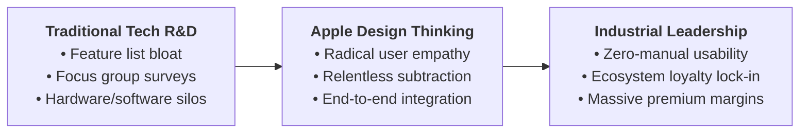
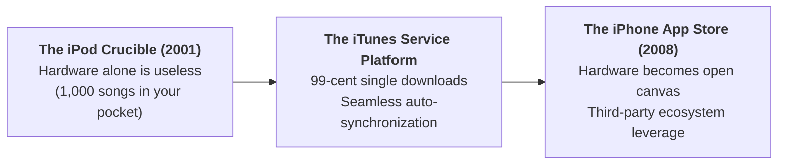

> [!NOTE] Reading Metadata & Curricular Context
>
> - **Case Reference:** Harvard Business School Case `9-609-066` (Rev. May 2012)
> - **Authors:** Stefan Thomke (William Barclay Harding Professor of Business Administration, HBS) and Barbara Feinberg
> - **Enterprise Subject:** Apple Inc.
> - **Curricular Linkage:** Paired with [[courses/mk4-operations-supply-chain-management/week-03/case-kai-access|Access by KAI]] to study how design thinking transcends cosmetic aesthetics to become the primary driver of operational value and user friction elimination.

---

## 1. Executive Summary & The Core Thesis

Under Steve Jobs and design chief Jony Ive, **Apple Inc.** institutionalized a product and service development philosophy that redefined the technology industry.

Rather than conducting traditional market research—asking focus groups what features they wanted on a spreadsheet—Apple practiced **Design Thinking**: deeply empathizing with unspoken user frustrations, rapidly prototyping physical models, ruthlessly simplifying interfaces, and integrating hardware, software, and retail services into a seamless ecosystem.

$$\mathbf{\text{Apple Design Axiom}} \implies \text{"Design is not just what it looks like and feels like. Design is how it works."} \quad\text{— Steve Jobs}$$

---

## 2. The Pillars of Apple's Design Architecture

### 1. Radical Empathy & Latent Needs Discovery

Apple bypassed traditional market surveys because consumers cannot articulate solutions to problems they have normalized:

- Before the iPod (2001), consumers tolerated clunky MP3 players with microscopic buttons and complicated directory management.
- Before the iPhone (2007), smart devices were covered in physical plastic QWERTY keyboards and required styluses.
- **Design Mechanism**: Observe the point of friction in the user's daily life, strip away mechanical clutter, and engineer the simplest possible mental model.

### 2. Prototyping as Thinking & The 10-to-3-to-1 Funnel

Apple treated prototypes not as final product verifications, but as the medium through which teams thought and debated:

- For every major hardware launch, industrial designers generated **ten distinct physical prototypes**, narrowed them to **three refined working concepts**, and debated for months before committing to **one final production candidate**.
- Engineering and operations sat in the design studio from Day One (**Concurrent Engineering**), preventing designs that could not be manufactured at global scale.

### 3. The Power of Subtraction (Simplicity)

Simplicity was not achieved by cutting corners; it was achieved by solving immense engineering challenges to remove visible parts:

- Removing the floppy drive from the iMac.
- Replacing hundreds of buttons with the iPod Click Wheel.
- Eliminating all physical keyboard buttons on the iPhone in favor of a full multi-touch glass display.

---

## 3. Deep-Dive Case Vignettes: Transforming Hardware into Service Systems

### The iPod & iTunes Ecosystem (2001)

The breakthrough of the iPod was not merely a miniature hard drive and a clean mechanical housing; it was the **ecosystem synchronization** between the device and iTunes desktop software:

- Competing digital players required users to manually configure USB device drivers and drag-and-drop music folders.
- Apple recognized that the customer's true journey was acquiring music and organizing playlists. By integrating the iTunes Music Store with automatic FireWire docking, Apple turned a hardware gadget into an frictionless digital music service.

---

## 4. Managerial Synthesis: Application to Access by KAI

The Apple design philosophy provides immediate operational clarity for [[courses/mk4-operations-supply-chain-management/week-03/case-kai-access|Access by KAI]]:

| Apple Design Principle     | Traditional Corporate Default                                               | Application to Access by KAI Redesign                                                                                |
| :------------------------- | :-------------------------------------------------------------------------- | :------------------------------------------------------------------------------------------------------------------- |
| **"How It Works"**         | Treating app design as button colors and splash screens.                    | Structuring the application around the passenger’s complete door-to-door transit workflow.                           |
| **Subtractive Simplicity** | Adding dozens of uncoordinated menus for ancillary services.                | Eliminating redundant checkout gates and search queries for the Whoosh Padalarang feeder train.                      |
| **Ecosystem Integration**  | Selling isolated train tickets and leaving station transfers to chance.     | Integrating the high-speed rail ticket, transfer countdown, and platform navigation into an active **Journey Mode**. |
| **Fail-Safe Service**      | Deploying customer service staff at station bottlenecks to give directions. | Designing digital information architectures so intuitive that station staff interventions become unnecessary.        |

---

## 🔗 Cross-References & Study Navigation

- Lecture Context: [[courses/mk4-operations-supply-chain-management/week-03/index|MK4 Week 03: Product and Service Design]]
- Case Dossier: [[courses/mk4-operations-supply-chain-management/week-03/case-kai-access|Access by KAI Case Dossier]]
- Syndicate Solution: [[courses/mk4-operations-supply-chain-management/week-03/assignment-access-kai|Syndicate 9 (F9) Service Design Debrief]]
