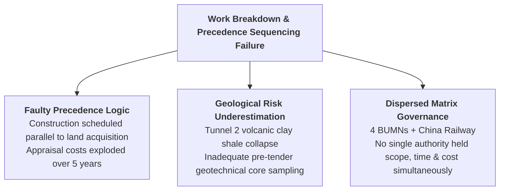
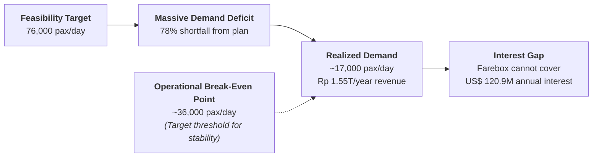
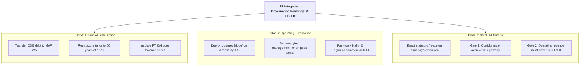

> [!NOTE] Curricular Metadata & Cohort Attribution
>
> - **Course:** MK4 Operations and Supply Chain Management — Week 04 Project Management Analysis
> - **Source Case:** SBM ITB Case Series (Whoosh: When Schedule, Cost and a State Mandate Collide)
> - **Synthesis Contribution:** Compiled for the cohort by **`F9 (Class F / Syndicate 9)`**.
> - **Analytical Framework:** Earned Value Management (EVM), Precedence Scheduling Failures, Sunk Cost Escalation, and Multi-Tier Kill Criteria.

---

## 1. Executive Summary & Problem Formulation

The **Whoosh Jakarta-Bandung High-Speed Rail (KCJB)** presents an acute project management paradox: **a project that is technically and operationally successful, but financially and managerially distressed**.

Across 142.3 kilometers, Whoosh reduced transit time between Halim and Tegalluar from 3 hours to 46 minutes, delivering an extraordinary **$99.9\%$ on-time performance with zero accidents across $40,000$ commercial runs**. However, this operational achievement came at an exorbitant price:

- **Schedule**: Groundbreaking in January 2016 targeting a 2019 launch; commercial operations finally commenced on 17 October 2023 (**4-year delay**).
- **Budget**: Capital investment rose from $\text{US\$ } 5.50\text{ billion}$ to $\text{US\$ } 7.27\text{ billion}$ (**$\text{US\$ } 1.77\text{ billion}$ / $+32.2\%$ cost overrun**).
- **Financing**: Total project debt reached $\approx \text{US\$ } 7.2\text{ billion}$, requiring **$\text{US\$ } 120.9\text{ million}$ in annual interest payments** alone.
- **Ridership**: Feasibility studies projected $76,000\text{ passengers/day}$ ($50,000$ pessimistic); actual ridership averages only **$\approx 17,000\text{ passengers/day}$** ($78\%$ demand deficit).

The analysis compiled by **`F9 (Class F / Syndicate 9)`** evaluates the structural governance failures of the matrix consortium and establishes an actionable, multi-tier restructuring framework.

---

## 2. Earned Value Management (EVM) & Scheduling Failure Analysis

### Earned Value Indices During Construction (2018–2022 Performance)

$$\mathbf{\text{CPI} = \frac{EV}{AC} \approx \frac{5.50}{7.27} = \mathbf{0.757}} \qquad\qquad \mathbf{\text{SPI} = \frac{EV}{PV} \approx \frac{3\text{ years planned work}}{7.75\text{ years actual time}} = \mathbf{0.387}}$$

- **Cost Performance Index ($\text{CPI} = 0.76$)**: For every $\text{Rp } 1.00$ of capital spent, the project realized only $\text{Rp } 0.76$ of physical infrastructure value.
- **Schedule Performance Index ($\text{SPI} = 0.39$)**: The project advanced at less than $40\%$ of its scheduled baseline speed between 2016 and 2021 due to land acquisition deadlocks.

---

## 3. The Demand Deficit & Operational Break-Even Threshold

### Break-Even Capacity Calculation

$$\mathbf{\text{Farebox Revenue/Day} = 17,000\text{ passengers} \times \text{Rp } 250,000\text{ average fare} = \text{Rp } 4.25\text{ Billion/day } (\approx \text{Rp } 1.55\text{ Trillion/year})}$$

$$\mathbf{\text{Annual Debt Interest Alone} = \text{US\$ } 120.9\text{ Million} \times \text{Rp } 15,800/\text{US\$} = \text{Rp } 1.91\text{ Trillion/year}}$$

$$\mathbf{\text{Structural Operating Deficit} = \text{Rp } 1.55\text{T (Gross Revenue)} - \text{Rp } 1.91\text{T (Debt Interest)} = -\text{Rp } 360\text{ Billion/year (Before Opex)}}$$

At $17,000\text{ passengers/day}$, gross ticket revenue does not even cover the interest on the China Development Bank loan, let alone rolling stock electricity, station personnel, track maintenance, or principal repayment. **Break-even requires at least $36,000\text{ passengers/day}$ at current fares.**

---

## 4. Evaluation of Strategic Alternatives

| Strategic Alternative                 | Operational Mechanism                                                                          | Primary Strategic Benefit                                                             | Critical Weakness & Fatal Flaw                                                                 |
| :------------------------------------ | :--------------------------------------------------------------------------------------------- | :------------------------------------------------------------------------------------ | :--------------------------------------------------------------------------------------------- |
| **A. Financial Restructuring**        | Shift debt to Ministry of Finance Special Mission Vehicle (SMV); extend tenor to 50–60 years.  | Removes imminent insolvency threat from KAI and consortium partners.                  | Solves a financing symptom; leaves the operational demand deficit completely unaddressed.      |
| **B. Revenue Maximization**           | Dynamic pricing, multimodal feeder bundling, station commercial TOD development.               | Directly improves asset utilization; targets 30,000+ passengers/day within two years. | Highly demanding: 2024–2025 passenger growth was only $+2.4\%$ YoY.                            |
| **C. Public Service Redefinition**    | Reclassify Whoosh as a statutory social utility (PSO) justified by highway decongestion.       | Politically legitimizes ongoing state operational and debt subsidies.                 | Retrospective goalpost moving; destroys capital discipline for future national infrastructure. |
| **D. Capital Freeze / Kill Criteria** | Legally halt all capital spending on the Surabaya extension until Jakarta-Bandung breaks even. | Restores capital discipline; terminates the sunk-cost escalation cycle.               | Politically interpreted as a national retreat; foregoes potential network economies.           |

---

## 5. F9 Recommended Strategy: The A + B + D Hybrid Governance Roadmap

**`F9 (Class F / Syndicate 9)`** rejects single-lever solutions and recommends an integrated **Three-Pillar Recovery Program**:

### Concrete Kill Criteria Thresholds for the Surabaya Extension

Before committing a single rupiah of state equity or loan guarantees to extending Whoosh to Surabaya:

1. **Ridership Gate**: Jakarta-Bandung must achieve a rolling 12-month average of at least **$30,000\text{ passengers/day}$**.
2. **Operational Self-Sufficiency Gate**: Corridor farebox and non-fare revenue must cover **$100\%$ of operating and maintenance expenditures** (excluding legacy debt service).
3. **Institutional Restructuring Gate**: The project vehicle for any future extension must have a single railway operator holding unified authority over scope, time, and budget.

---

## 6. Cold-Call Defense Script for the Executive Boardroom

> **Professor Cold-Call**: _"Candidate, the Minister of Finance wants your recommendation on Whoosh within three weeks. Do we restructure the loan, ask for a state PSO subsidy, or build to Surabaya to achieve economies of scale?"_
>
> **Boardroom Defense Script**:
> \*"Bapak Menteri, our recommendation is the disciplined A + B + D integrated roadmap.
>
> First, execute Alternative A: transfer the China Development Bank debt into a dedicated Ministry of Finance Special Mission Vehicle. KAI cannot carry a US$ 7.2 billion debt on its commercial balance sheet without destroying its credit rating and paralyzing its public rail operations across Java.
>
> Second, execute Alternative B: aggressively drive ridership from 17,000 toward the 36,000 break-even mark by eliminating the Padalarang transfer friction through Access by KAI's Journey Mode, introducing dynamic off-peak pricing, and monetizing Halim station real estate.
>
> Third—and most critically—enact Alternative D: institute a statutory freeze on the Surabaya extension. Doubling down on an asset operating at 22% of forecast volume to justify past sunk costs is textbook escalation of commitment. We must establish non-negotiable Kill Criteria: not one kilometer of track to Surabaya is funded until the Jakarta-Bandung line proves it can cover its operating costs."\*

---

## 🔗 Cross-References & Study Navigation

- Lecture Notes: [[courses/mk4-operations-supply-chain-management/week-04/index|MK4 Week 04 Lecture Hub]]
- Case Dossier: [[courses/mk4-operations-supply-chain-management/week-04/case-whoosh-kcic|Whoosh KCIC Case Dossier]]
- Theoretical Framework: [[concepts/critical-path-method|Critical Path Method (CPM) and PERT]]
- Enterprise Profiles: [[entities/pt-kereta-cepat-indonesia-china|PT KCIC]] · [[entities/pt-kereta-api-indonesia|PT Kereta Api Indonesia]]
