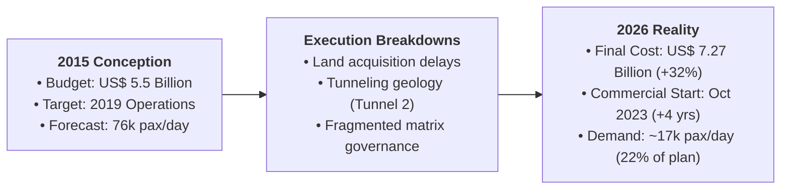
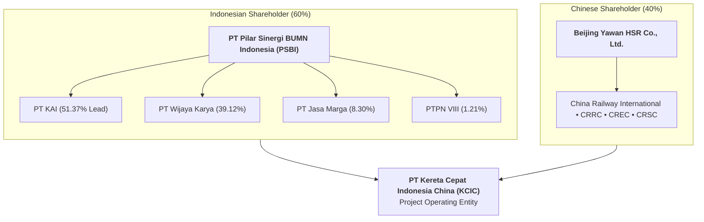
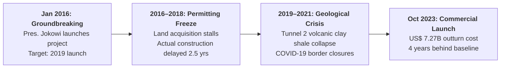
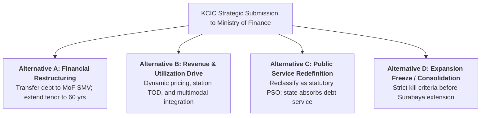

> [!NOTE] Case Overview & Pedagogical Metadata
>
> - **Case Series:** SBM ITB Case Series · Operations & Supply Chain Management (Meeting 4)
> - **Protagonist:** President Director of PT Kereta Cepat Indonesia China (KCIC)
> - **Setting:** Halim Head Office, Jakarta (28 August 2026)
> - **Core Problem:** Facing a three-week deadline before the Ministry of Finance executes a debt restructuring transfer, formulating an operating recommendation for an asset that is operationally flawless ($99.9\%$ punctuality) but financially distressed ($\text{US\$ } 1.77\text{B}$ overrun; demand at $22\%$ of forecast).
> - **Related Lecture Hub:** [[courses/mk4-operations-supply-chain-management/week-04/index|MK4 Week 04: Project Management]]
> - **Cohort Working Solution:** [[courses/mk4-operations-supply-chain-management/week-04/assignment-whoosh-project-management|Syndicate 9 (F9) Project Governance Debrief]]

---

## 1. Executive Summary: Forty-Six Minutes vs. Eleven Years

At 05:42 AM on 28 August 2026, the first CR400AF bullet train of the day departed Halim Station. Forty-six minutes later, it glided to a stop at Tegalluar, having covered 142.3 kilometers—a journey that once required three grueling hours on the congested Cipularang toll highway. By every physical operational metric, the asset works magnificently: **$99.9\%$ on-time punctuality and zero accidents across nearly $40,000$ commercial trips**.

Yet on the eighth floor of KCIC’s Halim headquarters, the President Director reviewed a catastrophic financial ledger:

- A net loss of **$\text{Rp } 5.13\text{ trillion}$ in H1 2026** attributable to KAI's high-speed rail line.
- Assets of holding consortium PT Pilar Sinergi BUMN Indonesia (PSBI) shrinking from $\text{Rp } 25.2\text{ trillion}$ to $\text{Rp } 21.5\text{ trillion}$, while liabilities surged to an identical $\text{Rp } 20.1\text{ trillion}$.
- An imminent mandate from the Ministry of Finance to absorb KCIC's debt under a state Special Mission Vehicle (SMV).

---

## 2. Enterprise Context: The Cross-National Matrix Consortium

The project organization was structured as a bilateral cross-national joint venture rather than an integrated operational utility:

Former KAI President Director Didiek Hartantyo observed that the project was troubled from its inception because **it was not designed by a railway operator**. A state-owned agricultural plantation company (PTPN VIII) and toll-road concessionaire (Jasa Marga) were made equity shareholders in an ultra-advanced high-speed railway, diffusing executive authority across competing corporate and ministerial interests.

---

## 3. The Triple Constraint Breakdown: Timeline of Delays & Escalations

### Root Causes of Project Management Failure

1. **Flawed Precedence Sequencing**: Groundbreaking was staged in January 2016 before land acquisition was finalized. In CPM terms, construction activities were scheduled in parallel with land acquisition rather than as a strict finish-to-start dependency ($FS$). Land speculation along the corridor exploded appraisal valuations.
2. **Alignment Sub-Optimization**: The rail alignment traversed expensive industrial estates and fertile plantations rather than cheaper marginal land, driving acquisition costs through the ceiling.
3. **Absence of Predefined Kill Criteria**: The project lacked contractually defined "stop thresholds." When cost projections breached $\text{US\$ } 6.0\text{B}$, then $\text{US\$ } 6.5\text{B}$, then $\text{US\$ } 7.0\text{B}$, no governance mechanism paused the project. The consortium was trapped in **Escalation of Commitment**, driven by national political prestige.

---

## 4. Quantitative Exhibits: Financial Overruns & Demand Deficits

### Exhibit 1: Project Budget Escalation & Debt Structure

| Component                                      |       Initial Feasibility Baseline (2015)        |              Final Outturn at Launch (2023)              |                  Variance / Escalation                   |
| :--------------------------------------------- | :----------------------------------------------: | :------------------------------------------------------: | :------------------------------------------------------: |
| **Total Project Capital Cost**                 |      **$\text{US\$ } 5.50\text{ Billion}$**      |          **$\text{US\$ } 7.27\text{ Billion}$**          |    **$+\text{US\$ } 1.77\text{ Billion } (+32.2\%)$**    |
| **China Development Bank (CDB) Loan**          | $\text{US\$ } 4.125\text{ Billion}$ (at $2.0\%$) | $\text{US\$ } 5.45\text{ Billion}$ (Overrun at $>3.0\%$) |           $+\text{US\$ } 1.325\text{ Billion}$           |
| **Equity Contribution (PSBI & Beijing Yawan)** |       $\text{US\$ } 1.375\text{ Billion}$        |            $\text{US\$ } 1.82\text{ Billion}$            | $+\text{US\$ } 445\text{ Million}$ (Funded by State PMN) |
| **Annual Debt Service (Interest Only)**        |    $\approx \text{US\$ } 82.5\text{ Million}$    |         **$\text{US\$ } 120.9\text{ Million}$**          |       **$+\text{US\$ } 38.4\text{ Million/year}$**       |

### Exhibit 2: Passenger Demand Deficit

$$\mathbf{\text{Feasibility Optimistic Demand:}} \quad 76,000\text{ passengers/day} \qquad\qquad \mathbf{\text{Feasibility Pessimistic Demand:}} \quad 50,000\text{ passengers/day}$$

$$\mathbf{\text{Polar UI Study (2024):}} \quad 30,000\text{ passengers/day} \qquad\qquad \mathbf{\text{Actual Realized Demand (2025–2026):}} \quad \mathbf{\approx 17,000\text{ passengers/day}}$$

$$\mathbf{\text{Operational Break-Even Threshold:}} \quad \mathbf{\approx 36,000\text{ passengers/day (at Rp 250k average fare)}}$$

> [!CAUTION] The Structural Cash Deficit
> At $17,000\text{ passengers/day}$, daily farebox revenue averages $\approx \text{Rp } 4.25\text{ billion}$ ($\approx \text{US\$ } 100\text{M/year}$). This is insufficient even to cover the $\text{US\$ } 120.9\text{ million}$ annual interest payment to China Development Bank, leaving zero cash flow to fund track maintenance, electric power, rolling stock overhauls, or principal amortization.

---

## 5. Strategic Decision Alternatives

| Decision Alternative                  | Core Mechanism                                                                                                    | Primary Strategic Strength                                                             | Severe Strategic Risk                                                                   |
| :------------------------------------ | :---------------------------------------------------------------------------------------------------------------- | :------------------------------------------------------------------------------------- | :-------------------------------------------------------------------------------------- |
| **A. Financial Restructuring**        | Transfer loan servicing from KAI to MoF Special Mission Vehicle; stretch tenor to 50–60 years.                    | Immediately removes the bankruptcy threat hanging over KAI's commercial balance sheet. | Solves a treasury liquidity symptom without repairing the underlying demand deficit.    |
| **B. Revenue Maximization**           | Dynamic yield management, airline codesharing, Halim/Tegalluar TOD commercial leasing.                            | Directly addresses asset utilization; lifts daily passenger volumes toward 30,000.     | Demand elasticity is limited; non-fare revenue takes 5–10 years to mature.              |
| **C. Public Service Redefinition**    | Explicitly recognize the project as a social public good that eliminates Rp 100T/year congestion.                 | Politically legitimizes ongoing state fiscal operating subsidies.                      | Sets a toxic precedent for future mega-projects; eliminates managerial accountability.  |
| **D. Capital Freeze / Kill Criteria** | Legally freeze all capital spending on the proposed Surabaya extension until Jakarta-Bandung reaches 36k pax/day. | Restores capital allocation discipline; terminates the sunk cost escalation cycle.     | Politically unpopular; may be perceived as abandoning national high-speed connectivity. |

---

## 6. Cold-Call Preparation & Classroom Defense

### 1. "Former President Jokowi argued that public transit should be measured by social benefit, not profit. Why shouldn't we accept that defense for Whoosh?"

- **Defense Script**: "Because social benefit without ex-ante measurement is the most dangerous justification in project management: it ensures there is never a number bad enough to halt any project. While Whoosh certainly alleviates Cipularang highway congestion, that social benefit was never modeled or budgeted as a public service obligation at inception; it was pitched as a business-to-business project with zero state budget exposure. Using social benefit retrospectively to excuse a US$ 1.77 billion cost overrun and an 78% demand shortfall destroys capital allocation discipline."

### 2. "Should Indonesia extend Whoosh to Surabaya to achieve network economies?"

- **Defense Script**: "Extending to Surabaya today violates the fundamental rule of project management: never double down on a troubled project to justify past mistakes. The Jakarta-Bandung corridor must first prove it can reach operational break-even (36,000 pax/day). Management must institute strict **Kill Criteria**: unless the existing line covers its operating costs and station transit-oriented development yields cash flow, not a single rupiah of state equity should be committed to a 700-kilometer extension."

---

## 🔗 Cross-References & Study Navigation

- Lecture Context: [[courses/mk4-operations-supply-chain-management/week-04/index|MK4 Week 04: Project Management]]
- Syndicate Solution: [[courses/mk4-operations-supply-chain-management/week-04/assignment-whoosh-project-management|Syndicate 9 (F9) Project Governance Debrief]]
- Enterprise Profiles: [[entities/pt-kereta-cepat-indonesia-china|PT KCIC]] · [[entities/pt-kereta-api-indonesia|PT Kereta Api Indonesia]]
- Theoretical Framework: [[concepts/critical-path-method|Critical Path Method (CPM) and PERT]]
