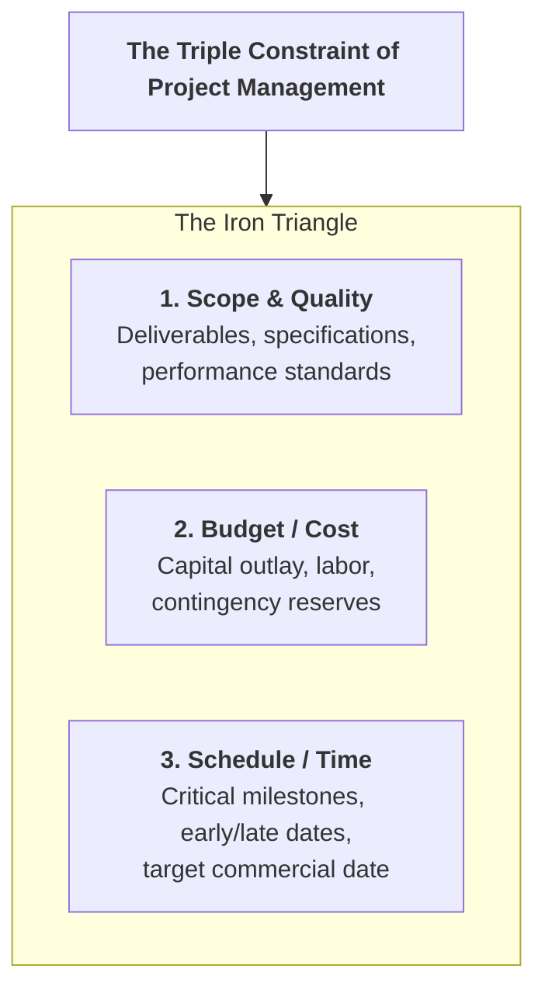
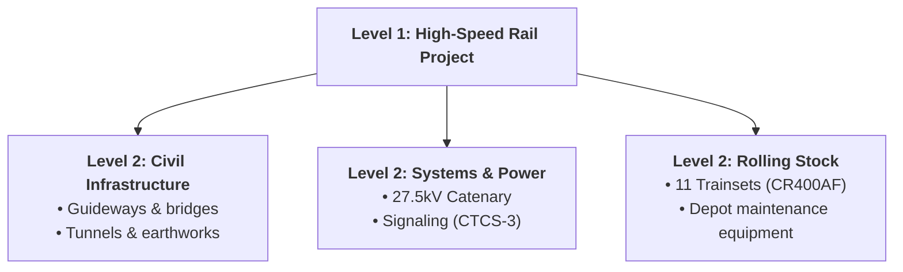
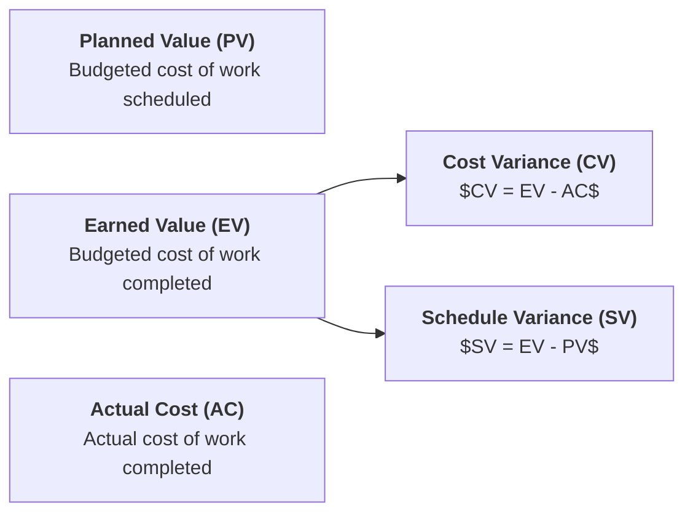

> [!NOTE] Curricular & Faculty Metadata
>
> - **Course:** MK4 Operations and Supply Chain Management — Week 04
> - **Teaching Team:** Noorhan Firdaus Pambudi, Ph.D. (Lead Lecturer), Dr. Yuanita Handayati
> - **Primary Curricular Spine:** `[FINAL] Project Management.pptx (1).pdf` (48 Slides) & Jacobs & Chase (Ch. 4)
> - **Direct Satellites & Problem Sets:**
>   - [[courses/mk4-operations-supply-chain-management/week-04/case-whoosh-kcic|Whoosh: When Schedule, Cost and a State Mandate Collide (Case Dossier)]]
>   - [[courses/mk4-operations-supply-chain-management/week-04/assignment-whoosh-project-management|Syndicate 9 (F9) Project Management & Kill Criteria Debrief]]

---

## 1. Executive Overview: Projects as Temporary Value Engines

A project is a temporary endeavor undertaken to create a unique product, service, or result. Unlike routine operational processes—which rely on continuous, repetitive, and standardized workflows—projects are non-routine, carry significant uncertainty, and operate under the **Triple Constraint of Project Management**:

In capital-intensive infrastructure—such as the [[entities/pt-kereta-cepat-indonesia-china|Whoosh KCIC]] high-speed railway—a failure in project management is not a minor delay; it transforms an engineering marvel into a multi-trillion rupiah balance-sheet liability.

---

## 2. Theoretical Architecture & Quantitative Scheduling Models

### 2.1 Work Breakdown Structure (WBS) & Sequencing

Project planning begins by decomposing complex deliverables into manageable, hierarchically structured work packages via the **Work Breakdown Structure (WBS)**:

### 2.2 Critical Path Method (CPM) Network Analysis

As formalized in [[concepts/critical-path-method|Critical Path Method (CPM) and PERT]], activities are mapped into an Activity-on-Node (AON) precedence network:

$$
\begin{aligned}
\mathbf{\text{Forward Pass (Early Dates):}} &\quad ES_j = \max_{i \in \text{Pred}(j)} \{ EF_i \}, \quad EF_j = ES_j + t_j \\
\mathbf{\text{Backward Pass (Late Dates):}} &\quad LF_i = \min_{k \in \text{Succ}(i)} \{ LS_k \}, \quad LS_i = LF_i - t_i \\
\mathbf{\text{Slack (Total Float):}} &\quad \text{Slack}_i = LS_i - ES_i = LF_i - EF_i
\end{aligned}
$$

The **Critical Path** is the longest unbroken path of activities through the network. **Any activity with $\text{Slack} = 0$ is critical; delaying it delays the entire project.**

### 2.3 PERT Probabilistic Duration Estimation

When activity durations are stochastic (e.g., complex tunneling through volcanic clay shale), PERT uses a **Beta Distribution**:

$$\mathbf{\mu = \frac{a + 4m + b}{6}} \qquad\qquad \mathbf{\sigma^2 = \left(\frac{b - a}{6}\right)^2}$$

Where $a$ is optimistic, $m$ is most likely, and $b$ is pessimistic. For total critical path duration:

$$\mathbf{Z = \frac{D - \mu_{\text{critical}}}{\sigma_{\text{critical}}}} \implies P(T \le D) = \Phi(Z)$$

### 2.4 Time-Cost Trade-Offs: Project Crashing

When contractual penalties or geopolitical commitments force project completion ahead of the normal critical path:

$$\mathbf{\text{Cost Slope} = \frac{\text{Crash Cost} - \text{Normal Cost}}{\text{Normal Time} - \text{Crash Time}} = \frac{\Delta C}{\Delta T}}$$

Crashing must be executed iteratively: crash the critical activity with the **lowest cost slope**, recalculate the network, and watch for emerging parallel critical paths.

---

## 3. Earned Value Management (EVM) Architecture

Earned Value Management provides objective measurement of cost and schedule progress:

$$\mathbf{\text{Cost Performance Index (CPI)} = \frac{EV}{AC}} \qquad\qquad \mathbf{\text{Schedule Performance Index (SPI)} = \frac{EV}{PV}}$$

- If $\text{CPI} < 1.0$, the project is experiencing cost overruns.
- If $\text{SPI} < 1.0$, the project is behind schedule.

---

## 4. Managerial Crucible: Mega-Project Governance & Whoosh KCIC

In [[courses/mk4-operations-supply-chain-management/week-04/case-whoosh-kcic|Whoosh: When Schedule, Cost and a State Mandate Collide]], executive candidates examine Southeast Asia’s flagship mega-project:

- **The Technical Miracle**: 142.3 km between Jakarta and Bandung covered in 46 minutes at $350\text{ km/h}$, delivering $99.9\%$ punctuality and zero accidents across $40,000$ commercial runs.
- **The Triple Constraint Collapse**:
  - **Schedule**: Groundbreaking in 2016 with a 2019 target; actual operations began in October 2023 (**4-year delay**).
  - **Cost**: Approved at $\text{US\$ } 5.5\text{ billion}$; surged to $\text{US\$ } 7.27\text{ billion}$ (**$\text{US\$ } 1.77\text{ billion}$ / $+32.2\%$ cost overrun**).
  - **Demand**: Feasibility studies projected $76,000\text{ passengers/day}$; actual ridership averages $\approx 17,000\text{/day}$ ($78\%$ demand deficit), far below the $\approx 36,000\text{/day}$ operational break-even threshold.
- **The Structural Governance Failure: Escalation of Commitment**:
  The project lacked **predefined kill criteria**—no objective cost, schedule, or demand threshold was ever established to force a pause, renegotiation, or halt. As a result, the consortium fell victim to the **Sunk Cost Fallacy**: continuously pouring capital into an escalating commitment because billions had already been spent.

---

## 📚 Required Readings & In-Depth Satellites

| Document Title                                                  | Type / Focus          | Core Operational Contribution                                                                | Study Note                                                                                                              |
| :-------------------------------------------------------------- | :-------------------- | :------------------------------------------------------------------------------------------- | :---------------------------------------------------------------------------------------------------------------------- |
| **Whoosh: When Schedule, Cost and a State Mandate Collide**     | SBM ITB Teaching Case | Project management post-mortem: matrix consortia, cost overruns, and MoF debt restructuring. | [[courses/mk4-operations-supply-chain-management/week-04/case-whoosh-kcic\|Open Case Dossier]]                          |
| **Syndicate 9 (F9) Project Management & Kill Criteria Debrief** | Cohort Case Debrief   | Root-cause sequence analysis, EVM audit, demand-gap models, and kill criteria governance.    | [[courses/mk4-operations-supply-chain-management/week-04/assignment-whoosh-project-management\|Open Syndicate Debrief]] |

---

## 📂 Primary Source Media & Digital Archives

| Material Title                                        |    Media Type     | Staging / Archive Location                                               |
| :---------------------------------------------------- | :---------------: | :----------------------------------------------------------------------- |
| **Project Management Slide Deck**                     |  Slides (`.pdf`)  | `archive/courses/mk4/week-04/[FINAL] Project Management.pptx (1).pdf`    |
| **Whoosh KCIC Case Study (SBM ITB)**                  |   Case (`.pdf`)   | `archive/courses/mk4/week-04/[STS] Case_Whoosh_KCIC_SBM_ITB_EN.pdf`      |
| **Whoosh Project Mindmap Visual Posters**             | Diagrams (`.png`) | `archive/courses/mk4/week-04/Mindmap Case Whoosh.png`                    |
| **Syndicate 9 Pre-Assignment (English & Indonesian)** | Reports (`.pdf`)  | `archive/courses/mk4/week-04/Syndicate 9_Pre-Assignment Week 4_MK 4.pdf` |

---

## 🔗 Knowledge Graph & Curriculum Bridges

- **Featured Analytical Frameworks**:
  - [[concepts/critical-path-method|Critical Path Method (CPM) and PERT]]
  - [[concepts/order-winners-and-qualifiers|Order Winners and Order Qualifiers]]
- **Enterprise Profiles**:
  - [[entities/pt-kereta-cepat-indonesia-china|PT Kereta Cepat Indonesia China (KCIC)]]
  - [[entities/pt-kereta-api-indonesia|PT Kereta Api Indonesia (Persero)]]
- **Previous Curricular Module**: [[courses/mk4-operations-supply-chain-management/week-03/index|Week 03: Product and Service Design]]
- **Next Curricular Module**: [[courses/mk4-operations-supply-chain-management/week-05/index|Week 05: Strategic Capacity Planning]]
- Return to **[[courses/mk4-operations-supply-chain-management/index|MK4 Course Overview]]**
