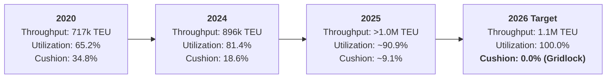
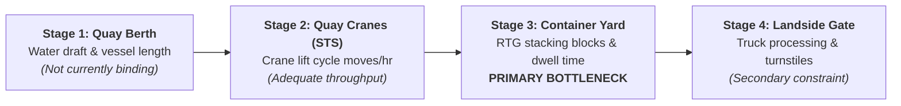
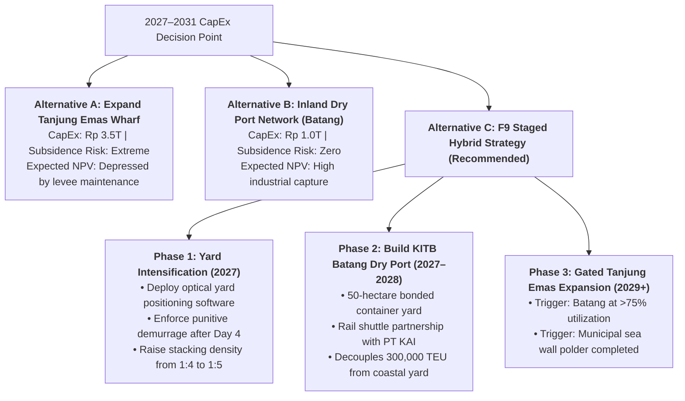

> [!NOTE] Curricular Metadata & Cohort Attribution
>
> - **Course:** MK4 Operations and Supply Chain Management — Week 05 Capacity Planning
> - **Source Case:** SBM ITB Case Series `OSCM-05-2026-01` (Pelindo and Semarang Container Terminal)
> - **Synthesis Contribution:** Compiled for the cohort by **`F9 (Class F / Syndicate 9)`**.
> - **Analytical Framework:** Capacity Cushion Sizing, 4-Stage Terminal Bottleneck Deconstruction, Subsidence-Adjusted Effective Capacity, and Decision Tree Optimization.

---

## 1. Executive Summary & Problem Formulation

PT Pelindo’s Semarang Container Terminal (TPKS) at the Port of Tanjung Emas operates in an unusually severe physical and strategic environment. In 2025, container throughput exceeded **$1.0\text{ million TEU}$** against an installed design capacity of **$1.1\text{ million TEU}$ ($90.9\%$ annual utilization)**. The 2026 target of $1.1\text{ million TEU}$ will drive the terminal’s theoretical capacity cushion to zero ($0\%$).

However, the core managerial dilemma evaluated by **`F9 (Class F / Syndicate 9)`** is not merely whether to expand terminal capacity, but **where the binding constraint in the system actually lies**. The terminal faces:

1. Acute container yard congestion during peak fourth-quarter shipping seasons.
2. Coastal land subsidence exceeding $10\text{–}15\text{ cm/year}$, evidenced by a 25-meter sea wall collapse in May 2025 that inundated $75\%$ of the terminal.
3. A westward migration of Central Java's manufacturing base toward the Kendal–Batang Industrial Corridor (KITB).
4. Persistent $70\%$ cargo leakage to Tanjung Priok (Jakarta) and Tanjung Perak (Surabaya).

---

## 2. Capacity Utilization Rates & The Non-Linear Congestion Trap

Applying the course formulations:

$$\mathbf{\text{Capacity Utilization Rate} = \frac{\text{Throughput}}{\text{Installed Capacity}}} \qquad\qquad \mathbf{\text{Capacity Cushion} = 100\% - \text{Utilization Rate}}$$

### The Fallacy of the Annual Average

A critical finding of **`F9 (Class F / Syndicate 9)`** is that **annual utilization figures mask peak-period operational collapse**:

- An annual utilization rate of $90.9\%$ in 2025 coexisted with severe vessel queue delays during peak weeks.
- As utilization moves above $85\%$, queues do not grow linearly; under Kingman’s approximation, queue waiting time ($W_q$) approaches infinity as utilization ($\rho$) approaches $1.0$:
  $$\mathbf{W_q \approx \left(\frac{\rho}{1 - \rho}\right) \times \left(\frac{C_a^2 + C_s^2}{2}\right) \times \left(\frac{1}{\mu}\right)}$$
- Therefore, operating with zero capacity cushion guarantees continuous vessel congestion and truck gate queues.

---

## 3. Deconstructing the 4-Stage Terminal Pipeline: Identifying the Bottleneck

Terminal capacity is not a single number; it comprises four distinct, sequential stages:

| Pipeline Sub-Stage            | Operational Symptom When Saturated                                                         | Field Diagnosis at TPKS                                                                           |     Bottleneck Classification      |
| :---------------------------- | :----------------------------------------------------------------------------------------- | :------------------------------------------------------------------------------------------------ | :--------------------------------: |
| **Quay Berth**                | Vessels wait at anchorage; vessel schedules slip.                                          | Moderate; occasional wait during peak Q4 weeks.                                                   |            Non-binding             |
| **Ship-to-Shore Cranes**      | Slower vessel discharge; low moves per hour.                                               | High; STS cranes achieve benchmark 25–28 moves/hr.                                                |            Non-binding             |
| **Container Stacking Yard**   | **High yard occupancy ($>85\%$); long dwell times; excessive unproductive box shuffling.** | **Severe: Vessels waited at sea because there was literally no open yard slot to deposit boxes.** | **PRIMARY OPERATIONAL BOTTLENECK** |
| **Terminal Gate**             | Extended truck queues blocking municipal highway.                                          | Significant during shift changeovers; manageable with optical automation.                         |          Secondary buffer          |
| **Hinterland & Connectivity** | Shippers bypass port via road/rail to Priok/Perak.                                         | 70% of Central Java cargo bypasses Semarang due to sailing schedules and draught.                 | **LONG-TERM STRATEGIC BOTTLENECK** |

> [!IMPORTANT] F9 Bottleneck Ruling
> **The short-term operational bottleneck is the Container Yard, not the berth or cranes.**
> Investing $\text{Rp } 500\text{ billion}$ in additional Ship-to-Shore cranes would merely unload containers faster into an already paralyzed yard. Capital must be deployed to relieve yard stacking density.

---

## 4. Incorporating Land Subsidence into Quantitative Capacity Measurement

Land subsidence does not carry a TEU label, but it fundamentally degrades terminal operating capacity by reducing operating-time availability and destroying asset lifespans:

$$\mathbf{\text{Operating Availability Ratio (OAR)} = \frac{\text{Scheduled Operating Hours} - \text{Flooding Hours Lost}}{\text{Scheduled Operating Hours}}}$$

$$\mathbf{\text{True Effective Annual Capacity} = \text{Nominal Installed Design Capacity} \times \text{Operating Availability Ratio}}$$

### Illustrative Numerical Impact

$$
\begin{aligned}
\text{Scheduled Annual Hours:} &\quad 365\text{ days} \times 24\text{ hours} = 8,760\text{ hours} \\
\text{Tidal Flooding \& Power Outages Lost:} &\quad 438\text{ hours } (5.0\%\text{ downtime}) \\
\text{Operating Availability Ratio:} &\quad \text{OAR} = \frac{8,760 - 438}{8,760} = \mathbf{95.0\%} \\
\mathbf{\text{True Effective Capacity:}} &\quad 1,100,000\text{ TEU} \times 0.95 = \mathbf{1,045,000\text{ TEU}}
\end{aligned}
$$

- **The Strategic Implication**: In 2025, TPKS handled $>1,000,000\text{ TEU}$. When adjusted for coastal flood disruptions, the terminal was operating at **over $96\%$ of true effective capacity**. The capacity cushion had already vanished.

---

## 5. Decision Tree Framework & The Staged Hybrid Strategy

### Strategic Rationale of Alternative C

1. **Near-Term Capital Efficiency**: Modernizing yard management software and raising demurrage storage fees discourages shippers from using TPKS as a cheap warehouse, freeing up $15\%\text{–}20\%$ of yard capacity immediately.
2. **Geographic Synergy with PT KAI**: The Batang dry port leverages the Memorandum of Understanding signed between Pelindo and PT KAI, shifting container transit from congested highways onto rail shuttles.
3. **Decoupling from Climate Hazard**: Placing long-term container dwell storage on stable, elevated ground in Batang insulates Pelindo's balance sheet from catastrophic sea wall collapses at Tanjung Emas.

---

## 6. Cold-Call Defense Script for the Executive Boardroom

> **Professor Cold-Call**: _"Candidate, Pelindo’s Board wants to request Rp 3.5 trillion from the Ministry of BUMN to build a new container wharf at Tanjung Emas. As VP of Planning, do you sign off?"_
>
> **Boardroom Defense Script**:
> \*"Bapak Direktur, I cannot recommend pouring Rp 3.5 trillion into extending the wharf at Tanjung Emas.
>
> First, our operations analysis proves that the quay is not the system bottleneck. Ships are waiting at anchorage because our container stacking yard is full. Adding another wharf merely dumps containers faster into an already gridlocked yard.
>
> Second, Tanjung Emas is sinking by over 10 centimeters a year. In May 2025, a levee breach flooded 75% of our terminal. Investing trillions in fixed concrete assets on sinking alluvial mud when the economic life exceeds the physical land stability is reckless capital stewardship.
>
> Third, Central Java’s manufacturing growth is moving 80 kilometers west to the Batang Integrated Industrial Estate. We must execute the Staged Hybrid Strategy: invest Rp 1.0 trillion to build an inland dry port at Batang with a dedicated rail connection to PT KAI. This intercepts cargo at the factory gate, moves container dwell storage off the sinking coast, and restores a 20% capacity cushion without gambling with the rising sea."\*

---

## 🔗 Cross-References & Study Navigation

- Lecture Notes: [[courses/mk4-operations-supply-chain-management/week-05/index|MK4 Week 05 Lecture Hub]]
- Case Dossier: [[courses/mk4-operations-supply-chain-management/week-05/case-pelindo-tpks-capacity|Pelindo TPKS Case Dossier]]
- Theoretical Framework: [[concepts/capacity-cushion|Capacity Cushion & Strategic Capacity Planning]]
- Enterprise Profile: [[entities/pt-pelabuhan-indonesia|PT Pelabuhan Indonesia (Pelindo)]]
