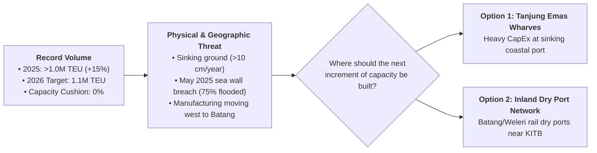
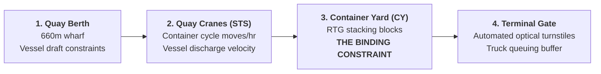
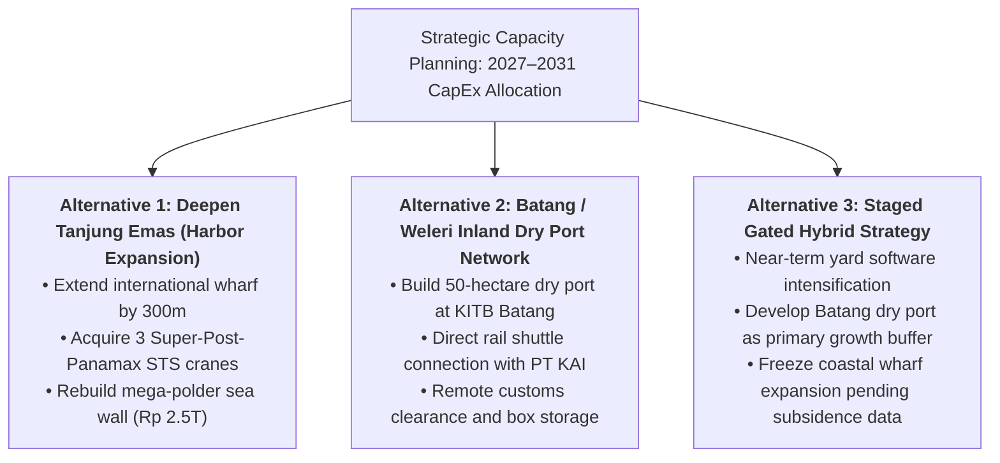

> [!NOTE] Case Overview & Pedagogical Metadata
>
> - **Case Series:** SBM ITB Case Series · No. `OSCM-05-2026-01` (September 2026)
> - **Protagonist:** Andira Prawitasari, Vice President of Strategic Planning, PT Pelindo Terminal Petikemas (SPTP)
> - **Setting:** Terminal Peti Kemas Semarang (TPKS), Port of Tanjung Emas, Central Java (September 2026)
> - **Core Problem:** Formulating a 5-year CapEx plan (2027–2031) for a container terminal approaching 100% capacity utilization while the ground beneath it subsides by over 10 cm/year and industrial demand migrates west toward Kendal-Batang.
> - **Related Lecture Hub:** [[courses/mk4-operations-supply-chain-management/week-05/index|MK4 Week 05: Strategic Capacity Planning]]
> - **Cohort Working Solution:** [[courses/mk4-operations-supply-chain-management/week-05/assignment-pelindo-capacity-planning|Syndicate 9 (F9) Capacity Planning Debrief]]

---

## 1. Executive Summary & The Sinking Terminal Dilemma

On a rainy morning in early September 2026, Andira Prawitasari, VP of Strategic Planning at PT Pelindo Terminal Petikemas (the container subholding of [[entities/pt-pelabuhan-indonesia|PT Pelindo]]), looked out the second-floor window of the Semarang Container Terminal (TPKS) offices.

She observed an operational paradox:

- A container stacking yard packed solid to the brim.
- A line of diesel trucks stretching past the automated terminal gate out onto the municipal access road.
- In the distance, the reconstructed sea wall at Post 1, where twenty-five meters of coastal levee had collapsed during the disastrous May 2025 tidal surge.

In 2025, TPKS surpassed **$1.0\text{ million TEU}$** for the first time in its history ($+15\%$ YoY growth). Management celebrated the milestone with public press releases. But internal operations told a perilous story: **the 2026 target of $1.1\text{ million TEU}$ equals the terminal’s maximum installed design capacity, reducing the capacity cushion to zero ($0\%$)**.

---

## 2. Enterprise Context: Pelindo Terminal Petikemas (SPTP)

Following the historic national port consolidation in October 2021, Pelindo reorganized into four specialized subholdings:

1. **Pelindo Terminal Petikemas (SPTP)**: Managing national container terminals (Tanjung Priok, Tanjung Perak, Belawan, Makassar, TPKS).
2. **Pelindo Multi Terminal (SPMT)**: Non-container, bulk commodity, and liquid freight.
3. **Pelindo Jasa Maritim (SPJM)**: Marine pilotage, tugging, and dredging.
4. **Pelindo Solusi Logistik (SPSL)**: Integrated hinterland supply chains and dry ports.

**TPK Semarang (TPKS)** serves as the sole dedicated container gateway for Central Java, operating an international container wharf of 660 meters, an inter-island wharf of 250 meters, and an installed equipment fleet of Ship-to-Shore (STS) gantry cranes and hybrid Rubber-Tyred Gantry (RTG) yard cranes.

---

## 3. The 4-Stage Terminal Bottleneck Architecture

Capacity in maritime container logistics is not a single monolithic parameter. It is an interconnected four-stage pipeline:

### Diagnosing the True System Bottleneck

During peak periods in Q4 2025, container ships waited at sea not because of quay crane breakdowns, but because **there was nowhere left in the container yard to set down incoming boxes**:

- High yard density ($>85\%$ occupancy) degrades yard crane productivity exponentially because cranes must execute 3–5 "unproductive box shuffles" to retrieve a buried import container.
- **The System Rule**: Adding more STS quay cranes on the wharf would merely dump containers onto a paralyzed yard even faster, shifting the queue without processing an ounce of additional throughput.

---

## 4. Quantitative Exhibits: Throughput, Subsidence & Leakage

### Exhibit 1: TPKS Throughput & Capacity Cushion Trend

|      Year       | Throughput Volume (TEU) | Installed Capacity (TEU) | Capacity Utilization (%) | Capacity Cushion (%) | Operational Status                  |
| :-------------: | :---------------------: | :----------------------: | :----------------------: | :------------------: | :---------------------------------- |
|    **2020**     |        $717,062$        |       $1,100,000$        |         $65.2\%$         |       $34.8\%$       | Comfortable buffer.                 |
|    **2024**     |        $895,904$        |       $1,100,000$        |         $81.4\%$         |       $18.6\%$       | Approaching threshold.              |
|    **2025**     |  $\approx 1,000,000+$   |       $1,100,000$        |     $\approx 90.9\%$     |   $\approx 9.1\%$    | Severe peak yard congestion.        |
| **2026 Target** |     **$1,100,000$**     |     **$1,100,000$**      |      **$100.0\%$**       |     **$0.0\%$**      | **Zero Cushion: System Fragility.** |

### Exhibit 2: Land Subsidence & The Tidal Flood Impact

- **Subsidence Velocity**: Coastal engineering studies confirm Tanjung Emas is subsiding at **$10\text{ to }15\text{ cm per year}$** due to deep groundwater extraction and alluvial soil consolidation.
- **The May 2025 Sea Wall Disaster**: A 25-meter breach at Post 1 during high tide (_rob_) submerged $75\%$ of the port, flooding electrical panels, halting STS cranes, and cutting terminal operating availability by $12\%$ for that month.
- **Subsidence-Adjusted Effective Capacity Formula**:
  $$\mathbf{\text{Effective Capacity} = \text{Physical Capacity} \times \left(\frac{\text{Scheduled Hours} - \text{Flooding Hours Lost}}{\text{Scheduled Hours}}\right)}$$
  If coastal flooding halts operations for $5\%$ of scheduled annual hours, true effective capacity drops from $1.1\text{M TEU}$ to **$1.045\text{M TEU}$**, meaning TPKS is **already operating beyond effective capacity**.

### Exhibit 3: The 70% Cargo Leakage Paradox

$$\mathbf{70\%\text{ of Central Java export containers ship through Tanjung Priok (Jakarta) or Tanjung Perak (Surabaya).}}$$

- **Shipper Rationale**: Jakarta and Surabaya offer deep-water berths ($-14\text{m}$ to $-16\text{m}$ draft) handling direct-call mainline container vessels to Europe and the US. Semarang's shallow draft ($-10\text{m}$ to $-12\text{m}$) restricts traffic to feeder vessels shuttling to Singapore. Adding yard space in Semarang does not automatically alter international shipping line route schedules.

---

## 5. Strategic Decision Alternatives Matrix

| Dimension                  | Alternative 1: Deepen Coastal Port                            | Alternative 2: Batang Dry Port                                         | Alternative 3: Staged Hybrid (Recommended)              |
| :------------------------- | :------------------------------------------------------------ | :--------------------------------------------------------------------- | :------------------------------------------------------ |
| **Capital Expenditure**    | Extremely High ($\text{Rp } 3.5\text{–}4.0\text{ Trillion}$). | Moderate ($\text{Rp } 800\text{ Billion}\text{–}1.2\text{ Trillion}$). | Phased ($\text{Rp } 1.2\text{ Trillion}$ over 3 years). |
| **Subsidence Exposure**    | **Catastrophic**: Invests trillions on sinking seabed.        | **Zero**: Batang sits on stable elevated rock.                         | Protected: Keeps expensive assets inland.               |
| **Yard Congestion Relief** | Moderate (adds physical yard acres at coast).                 | **High**: Moves dwell storage $80\text{ km}$ inland.                   | **High**: Decouples dwell time from quay.               |
| **Shipper Proximity**      | Distant from growing Batang/Kendal factories.                 | **Directly inside KITB industrial zone.**                              | **Directly serves tenant factories.**                   |

---

## 6. Cold-Call Preparation & Classroom Defense

### 1. "Why not just add another Ship-to-Shore crane to solve the queue?"

- **Defense Script**: "In operations management, adding capacity to a non-bottleneck activity creates expensive waste. TPKS's bottleneck is the container yard, where stacking occupancy exceeds 85%. An STS crane unloads containers from ships at 25 moves per hour; if the yard has no open slots, that crane must hold the container suspended in mid-air. Adding a crane accelerates the pile-up of work-in-process without increasing terminal throughput by a single TEU."

### 2. "Why is a dry port in Batang superior to expanding Tanjung Emas?"

- **Defense Script**: "A dry port in Batang solves three crises simultaneously. First, it bypasses the sinking coastal geology of Tanjung Emas, placing long-lived assets on stable bedrock. Second, it intercepts container volume directly at the source—the Batang Integrated Industrial Estate (KITB)—eliminating 80 km of highway trucking congestion. Third, it functions as an external container yard buffer, allowing containers to clear customs inland and arrive at TPKS just-in-time for ship loading, cutting coastal yard dwell times from 5 days to 24 hours."

---

## 🔗 Cross-References & Study Navigation

- Lecture Context: [[courses/mk4-operations-supply-chain-management/week-05/index|MK4 Week 05: Strategic Capacity Planning]]
- Syndicate Solution: [[courses/mk4-operations-supply-chain-management/week-05/assignment-pelindo-capacity-planning|Syndicate 9 (F9) Capacity Planning Debrief]]
- Enterprise Profile: [[entities/pt-pelabuhan-indonesia|PT Pelabuhan Indonesia (Pelindo)]]
- Theoretical Framework: [[concepts/capacity-cushion|Capacity Cushion & Strategic Capacity Planning]]
