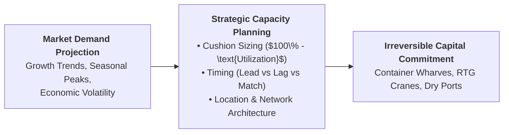
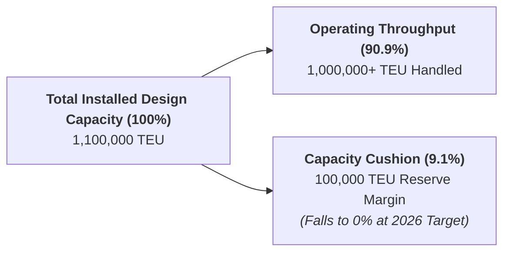
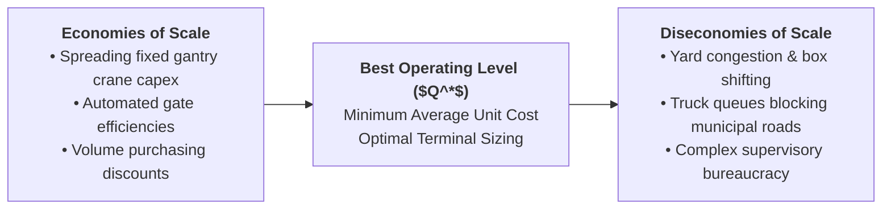
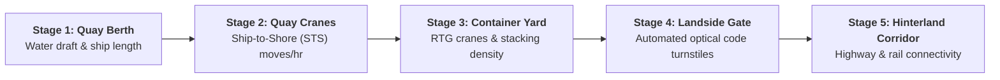

> [!NOTE] Curricular & Faculty Metadata
>
> - **Course:** MK4 Operations and Supply Chain Management — Week 05
> - **Teaching Team:** Noorhan Firdaus Pambudi, Ph.D. (Lead Lecturer), Dr. Yuanita Handayati
> - **Primary Curricular Spine:** `[STS] Strategic Capacity Planning.pptx.pdf` (39 Slides) & Jacobs & Chase (Ch. 5)
> - **Direct Satellites & Problem Sets:**
>   - [[courses/mk4-operations-supply-chain-management/week-05/case-pelindo-tpks-capacity|Pelindo and Semarang Container Terminal: Adding Capacity on Sinking Ground (Case Dossier)]]
>   - [[courses/mk4-operations-supply-chain-management/week-05/assignment-pelindo-capacity-planning|Syndicate 9 (F9) Strategic Capacity Planning & Decision Tree Debrief]]

---

## 1. Executive Overview: Capacity as Strategic Commitment

Strategic capacity planning determines the overall capacity level of capital-intensive resources—facilities, heavy equipment, and labor force size—that best supports the company's long-term competitive strategy.

In operations leadership, capacity decisions are **irreversible strategic bets**:

- Building too much capacity creates crushing fixed depreciation and interest overheads that depress Return on Invested Capital ($ROIC$).
- Building too little capacity triggers catastrophic bottleneck congestion, customer defection to competitors, and operational breakdown.

---

## 2. Theoretical Architecture & Core Frameworks

### 2.1 Capacity Utilization & The Capacity Cushion

As formalized in [[concepts/capacity-cushion|Capacity Cushion and Strategic Capacity Planning]], capacity must be evaluated as a rate of output over a defined time horizon:

$$\mathbf{\text{Capacity Utilization Rate} = \frac{\text{Actual / Expected Throughput}}{\text{Maximum Installed Design Capacity}} \times 100\%}$$

$$\mathbf{\text{Capacity Cushion } (C) = 100\% - \text{Capacity Utilization Rate} = \frac{\text{Design Capacity} - \text{Average Demand}}{\text{Design Capacity}} \times 100\%}$$

### 2.2 Economies and Diseconomies of Scale

As throughput volume expands, average unit cost follows a U-shaped long-run curve:

$$\mathbf{\text{LRAC}(Q) = \frac{\text{Fixed Capital Depreciation} + \text{Operating Costs}}{Q}}$$

### 2.3 Capacity Timing Strategies: Lead vs. Lag vs. Match

| Expansion Strategy               | Timing Rationale                                                            | Operational Advantage                                                                | Primary Vulnerability                                                                         |
| :------------------------------- | :-------------------------------------------------------------------------- | :----------------------------------------------------------------------------------- | :-------------------------------------------------------------------------------------------- |
| **Capacity Lead (Expansionist)** | Capacity is added in anticipation of demand growth.                         | Never experiences stockouts; maintains high service levels; deters competitor entry. | Severe underutilization penalties if demand growth falters.                                   |
| **Capacity Lag (Conservative)**  | Capacity is added only after demand has materialized and exceeded capacity. | Maximizes asset utilization; minimizes capital risk; low fixed depreciation.         | Lost sales, severe customer defection, overtime expenses, and queue blowups.                  |
| **Capacity Match (Tracking)**    | Capacity is added in small, incremental steps matching demand trajectory.   | Balances utilization with service responsiveness.                                    | Frequent construction disruptions; higher unit procurement cost than single large expansions. |

---

## 3. Multi-Stage Pipeline Bottleneck Dynamics

In complex infrastructure—such as maritime container terminals—capacity is never a single monolithic number. It is an **interdependent multi-stage pipeline**:

> [!CAUTION] The Bottleneck Subjugation Rule
> **A multi-stage system can never process more volume than its slowest sub-stage.**
> In terminal operations, if the **Container Yard** is $100\%$ full, adding more Ship-to-Shore (STS) cranes on the berth solves nothing; it merely lifts containers off the ship faster only to dump them into a gridlocked yard, forcing vessels to wait at anchor.

---

## 4. Managerial Crucible: Pelindo TPKS on Sinking Ground

In [[courses/mk4-operations-supply-chain-management/week-05/case-pelindo-tpks-capacity|Pelindo and Semarang Container Terminal]], VP Andira Prawitasari faces a unique operational crisis:

- **Zero Cushion Crisis**: In 2025, TPKS handled over $1.0\text{ million TEU}$ against $1.1\text{ million TEU}$ capacity ($90.9\%$ utilization). The 2026 target of $1.1\text{ million TEU}$ drops the capacity cushion to **$0\%$**.
- **The Sinking Ground Reality**: Tanjung Emas port area is sinking by **$10\text{–}15\text{ cm/year}$**. In May 2025, a sea-wall breach inundated $75\%$ of the port, submerging electrical transformers and halting crane operations.
- **Hinterland Migration**: Manufacturing is moving west toward the **Kendal-Batang Industrial Corridor** (KITB).
- **The 70% Leakage Factor**: Over $70\%$ of Central Java cargo bypasses Semarang entirely, shipping via Jakarta (Tanjung Priok) or Surabaya (Tanjung Perak) due to superior vessel direct-call frequencies.
- **The Strategic Decision**: Should Pelindo pour trillions into elevating sea walls and building new wharves at sinking Tanjung Emas, or develop an inland **Dry Port Network at Batang/Weleri**?

---

## 📚 Required Readings & In-Depth Satellites

| Document Title                                                                 | Type / Focus                              | Core Operational Contribution                                                                                    | Study Note                                                                                                              |
| :----------------------------------------------------------------------------- | :---------------------------------------- | :--------------------------------------------------------------------------------------------------------------- | :---------------------------------------------------------------------------------------------------------------------- |
| **Pelindo and Semarang Container Terminal: Adding Capacity on Sinking Ground** | SBM ITB Teaching Case (`OSCM-05-2026-01`) | Strategic capacity planning under severe land subsidence and coastal tidal flooding.                             | [[courses/mk4-operations-supply-chain-management/week-05/case-pelindo-tpks-capacity\|Open Case Dossier]]                |
| **Syndicate 9 (F9) Capacity Planning & Decision Tree Debrief**                 | Cohort Case Debrief                       | Utilization audit, 4-stage bottleneck identification, subsidence-adjusted capacity formulas, and staged roadmap. | [[courses/mk4-operations-supply-chain-management/week-05/assignment-pelindo-capacity-planning\|Open Syndicate Debrief]] |

---

## 📂 Primary Source Media & Digital Archives

| Material Title                                  |    Media Type    | Staging / Archive Location                                                         |
| :---------------------------------------------- | :--------------: | :--------------------------------------------------------------------------------- |
| **Strategic Capacity Planning Slide Deck**      | Slides (`.pdf`)  | `archive/courses/mk4/week-05/[STS] Strategic Capacity Planning.pptx.pdf`           |
| **Pelindo TPKS Teaching Case (SBM ITB)**        |  Case (`.pdf`)   | `archive/courses/mk4/week-05/Case_Pelindo_TPKS_Capacity_Planning_EN.docx.pdf`      |
| **Port Capacity Case Study Infographic Poster** | Diagram (`.png`) | `archive/courses/mk4/week-05/Pelindo Port Capacity Case Study Infographic.png`     |
| **Pre-Assignment Template & Notes**             |  Task (`.docx`)  | `archive/courses/mk4/week-05/.extracted/Salinan Salinan Template Syn 9...docx.txt` |

---

## 🔗 Knowledge Graph & Curriculum Bridges

- **Featured Analytical Frameworks**:
  - [[concepts/capacity-cushion|Capacity Cushion & Strategic Capacity Planning]]
  - [[concepts/littles-law|Little's Law: $L = \lambda W$]]
- **Enterprise Profiles**:
  - [[entities/pt-pelabuhan-indonesia|PT Pelabuhan Indonesia (Pelindo)]]
- **Previous Curricular Module**: [[courses/mk4-operations-supply-chain-management/week-04/index|Week 04: Project Management]]
- **Next Curricular Module**: [[courses/mk4-operations-supply-chain-management/week-06/index|Week 06: Process Design, Analysis & Little's Law]]
- Return to **[[courses/mk4-operations-supply-chain-management/index|MK4 Course Overview]]**
